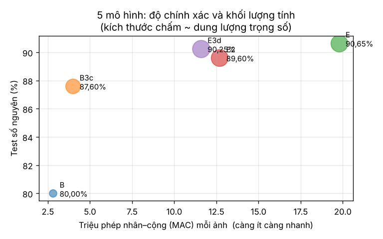

# So sánh 5 mô hình chính – LSI Design Contest 2027

> File này **tự sinh** bởi `python model/kiem_chung.py` – không sửa tay (sửa sẽ bị ghi đè).
> Cập nhật lần cuối: 2026-11-26 08:33. Số liệu từng mô hình lấy từ máy ghi ở dòng **Trạng thái**.

Mọi accuracy đo trên **4.000 ảnh test CIFAR-4**. "Test số nguyên" = kết quả của `golden_int.py`, tức đúng kết
quả mạch FPGA sẽ cho ra. Quy trình kiểm chứng: [`docs/KIEM_CHUNG.md`](KIEM_CHUNG.md).

## Bảng so sánh

| | **B** Cơ bản (~80%) | **B3c** Nhanh | **E** Chính xác cao (+ mạng thầy cho E2, E3d) | **E2** Cân bằng | **E3d** Thử nghiệm mới (5 conv) |
|---|---|---|---|---|---|
| Tên lượt chạy (thư mục `model/export*`) | `B_16_32_64` | `B3c_c4x4_128+cinic_ft` | `E_opt_cnn+cinic_ft` | `E2_lite+cinic60_kdft` | `E3d_deep5+cinic60_kdft` |
| **Test số nguyên** (đúng kết quả FPGA) | **80,00%** | **87,60%** | **90,65%** | **89,60%** | **90,25%** |
| Test float (PyTorch) | 80,23% | 87,67% | 90,45% | 90,00% | 90,20% |
| Val float (dùng để chọn) | 81,55% | 87,30% | 90,45% | 90,20% | 90,70% |
| Số đã ghi trước đây (float / số nguyên) | 80,23% / 80,00% | 87,08% / 87,20% | 90,65% / 90,60% | 90,33% / 90,30% | – |
| Accuracy từng lớp (số nguyên) cat / dog / deer / horse | 68,5 / 78,6 / 87,3 / 85,6 | 79,7 / 85,2 / 93,1 / 92,4 | 85,8 / 86,5 / 94,8 / 95,5 | 80,3 / 87,5 / 95,1 / 95,5 | 83,4 / 86,6 / 95,0 / 96,0 |
| Số tầng conv | 3 | 4 | 4 | 4 | 5 |
| Tham số | 27.684 | 105.636 | 138.372 | 138.372 | 147.524 |
| Trọng số thật (W int8 – conv1 int16 nếu có; bias int32) | 27,4 KB | 104,3 KB | 136,8 KB | 136,8 KB | 145,6 KB |
| BRAM ước lượng (trọng số + bộ đệm ảnh) | ~17% | ~55% | ~79% | ~73% | ~76% |
| Phép nhân–cộng (MAC) / ảnh | 2,8 triệu | 4,0 triệu | 19,8 triệu | 12,7 triệu | 11,6 triệu |
| Thời gian/ảnh – 16 DSP @ 20 MHz* | 8,8 ms | 12,5 ms | 61,8 ms | 39,7 ms | 36,2 ms |
| Thời gian/ảnh – 16 DSP @ 100 MHz* | 1,8 ms | 2,5 ms | 12,4 ms | 7,9 ms | 7,2 ms |
| Thời gian/ảnh – 64 DSP @ 100 MHz* | 0,4 ms | 0,6 ms | 3,1 ms | 2,0 ms | 1,8 ms |
| Conv1 | int8 | int16 | int16 | int16 | int16 |
| Dữ liệu cần | CIFAR | CIFAR + CINIC-10 | CIFAR + CINIC-10 | CIFAR + CINIC-10 | CIFAR + CINIC-10 |
| Thời gian huấn luyện (theo results.md) | 3 phút | 29 phút | 70 phút | 95 phút | 96 phút |
| Cần mạng thầy E | không | không | không | có | có |
| **Trạng thái** | ✅ Đã kiểm chứng trên máy `LAPTOP-2RM30BH4` (2026-11-25 20:34) | ✅ Đã kiểm chứng trên máy `LAPTOP-2RM30BH4` (2026-11-25 21:06) | ✅ Đã kiểm chứng trên máy `LAPTOP-2RM30BH4` (2026-11-25 22:20) | ✅ Đã kiểm chứng trên máy `LAPTOP-2RM30BH4` (2026-11-25 23:59) | ✅ Đã kiểm chứng trên máy `LAPTOP-2RM30BH4` (2026-11-26 01:38) |

\*Ước lượng lý thuyết = MAC ÷ (số DSP × tần số), giả sử DSP bận 100%; mạch thật chậm hơn khoảng 20–40%.
Clock gốc của board là 20 MHz; muốn 100 MHz phải dùng MMCM. Camera ~30 khung/giây = 33 ms/khung.
BRAM: chip có 1.620 Kb ≈ 202 KB; ước lượng = trọng số + bản đồ vào/ra lớn nhất (uint8), chưa tính phần
BRAM bị lẻ khối 18 Kb và các bộ đệm dòng – thực tế cao hơn. Trên ~80% là chật.

## Nhận xét từ kết quả hiện tại (tự động)

- **Chính xác nhất:** E – 90,65% (19,8 triệu MAC/ảnh).
- **Gần bằng mức cao nhất (kém ≤ 0,5 điểm) mà ít phép tính nhất:** E3d – 90,25% với 11,6 triệu MAC/ảnh (ít hơn E 41%).
- **Nhanh nhất trong nhóm ≥ 85%:** B3c – 87,60% với 4,0 triệu MAC/ảnh.
- **Chênh với số đã ghi trước khi kiểm chứng (điểm %):** B +0,00, B3c +0,40, E +0,05, E2 -0,70. Chênh vài phần mười là dao động bình thường giữa hai máy.
- Mỗi mô hình mới chạy **1 lần** (1 seed); chênh nhau dưới ~0,5 điểm chưa đủ để kết luận mô hình nào chắc chắn tốt hơn.

## Ý nghĩa trạng thái

| Ký hiệu | Nghĩa |
|---|---|
| ✅ Đã kiểm chứng | Huấn luyện lại từ đầu trên máy của nhóm bằng `kiem_chung.py`; mọi số trong cột là của máy đó |
| ⚠️ Chưa kiểm chứng | Số liệu do AI (Claude) chạy trên máy cloud ở nhánh `exp/opt-acc-90`; chưa chạy lại trên máy nhóm |
| ⛔ Chưa chạy | Kiến trúc mới chỉ được đề xuất, chưa huấn luyện lần nào – chưa có số liệu |

## Kiểm tra nhanh (golden model trên tham số có sẵn)

| Mô hình | Ngày | Máy | Test số nguyên | So với số đã ghi |
|---|---|---|---|---|
| B | 2026-11-25 20:13 | `LAPTOP-2RM30BH4` | 80,00% | khớp số đã ghi ✅ |
| B3c | 2026-11-25 20:13 | `LAPTOP-2RM30BH4` | 87,20% | khớp số đã ghi ✅ |
| E | 2026-11-25 20:14 | `LAPTOP-2RM30BH4` | 90,60% | khớp số đã ghi ✅ |
| E2 | 2026-11-25 20:14 | `LAPTOP-2RM30BH4` | 90,30% | khớp số đã ghi ✅ |

## Ghi chú từng mô hình

- **B – Cơ bản:** mô hình nhóm đã học (3 conv). Dễ hiểu, nhỏ, nhanh; độ chính xác ~80%.
- **B3c – Nhanh:** thân B + 1 conv 64→128 ở 4×4. Ít phép tính nhất trong nhóm >85%. Cần CINIC.
- **E – Chính xác cao:** VGG rút gọn, cặp conv kép ở 16×16. Chậm nhất; **cũng là mạng thầy** (distillation) cho
  E2 và E3d, nên phải chạy E trước.
- **E2 – Cân bằng:** như E nhưng cặp conv kép ở 8×8 → cùng tham số, ít hơn 36% phép tính.
  Trước khi kiểm chứng, 5 lần AI huấn luyện cho 89,45–90,30% (dao động giữa các lần chạy khá lớn).
- **E3d – Thử nghiệm mới:** 5 conv hẹp hơn (24/48/64/64/112), ít phép tính nhất trong nhóm ~90%; đổi lại RTL
  thêm 1 tầng. Lần đầu được huấn luyện chính là lần kiểm chứng trên máy nhóm (không có số AI để so).
- Các bản `+cinic` học thêm 84.000 ảnh ImageNet 32×32 (CINIC-10), đã loại ảnh gốc CIFAR và ảnh trùng tập test;
  sau đó tinh chỉnh 15 epoch chỉ trên CIFAR. Conv1 dùng trọng số int16 (int16 × uint8 vẫn vừa 1 DSP48E1).
- Lệnh huấn luyện các bản `+cinic` được dựng lại từ ghi chú commit của nhánh exp (`--cifar-repeat 2`,
  tinh chỉnh `--lr 0.005 --warmup 0`, distillation alpha 0,7 / T 4). Kết quả trên máy nhóm có thể lệch
  vài phần mười % so với số AI.

## Các mô hình khác

Mọi mô hình **ngoài 5 mô hình trên** trong `model/results.md` và `docs/so_sanh_mo_hinh.md` là **số do AI chạy trên
máy cloud**, chưa huấn luyện lại trên máy nhóm – chỉ để tham khảo (trừ A, C, D: nhóm đã chạy tay ngày 24/11/2026).

### Hai kiến trúc mới không chọn (chưa từng chạy – chỉ là đánh giá trên giấy)

| Kiến trúc | Trọng số / MAC | Đánh giá |
|---|---|---|
| `E3a_w112` (E2 rộng hơn) | ~150 KB / 13,7 triệu | Tiềm năng thấp–vừa: mở rộng thêm cho lợi ích giảm dần (E chỉ hơn E2 0,3 điểm), BRAM càng chật |
| `T_wide_teacher` | 522 KB / 49 triệu | Không vừa chip (202 KB BRAM) – chỉ làm mạng thầy; distillation trước đây cho kết quả không ổn định; tốn thời gian nhất |
