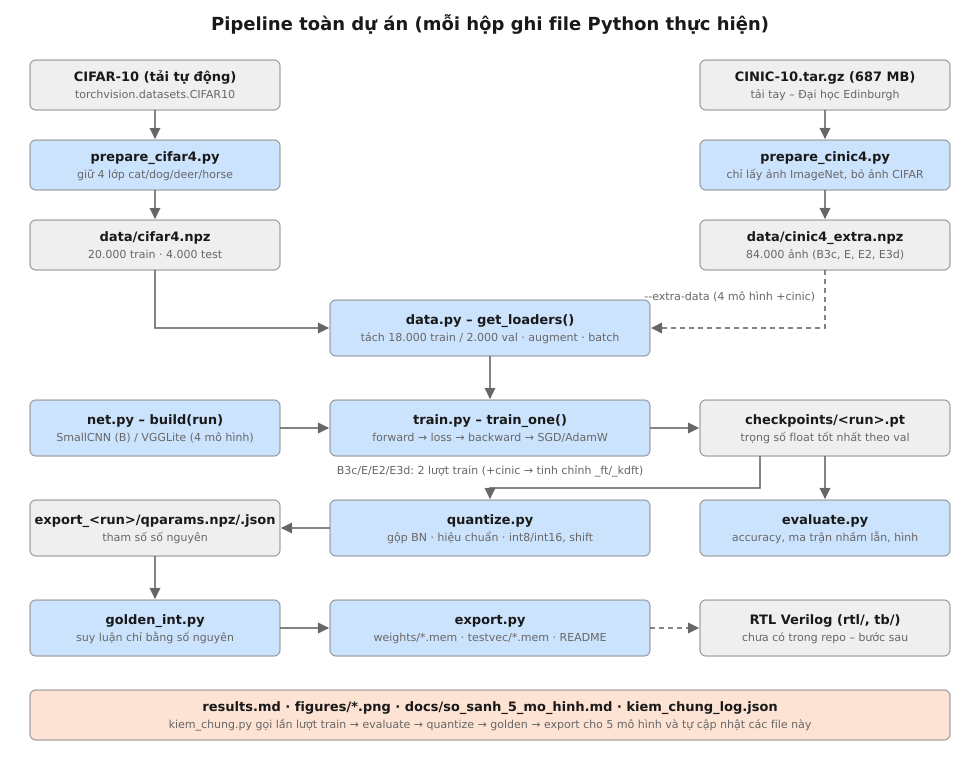
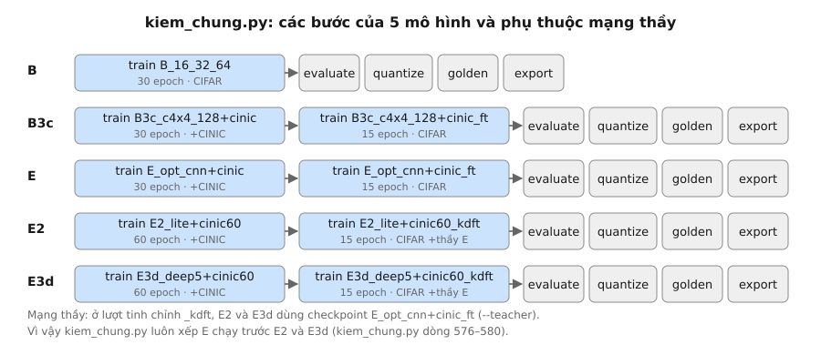

# 01 – Cấu trúc source code

← [README.md](README.md) · [Mục lục](README.md) · [02_DATA_PREPROCESSING.md](02_DATA_PREPROCESSING.md) →

Phân tích dựa trên nhánh `main` của repo `hpnt1912/lsi-design-contest-2027` (commit `e64cd23`, 26/11/2026). Tài liệu này coi nhánh
`main` là "file ZIP" của dự án.

---

## 1. Cây thư mục

```text
lsi-design-contest-2027/
├── CLAUDE.md                  quy ước dự án (ràng buộc chip, quy ước code, lệnh hay dùng)
├── README.md                  giới thiệu chung
├── requirements.txt           thư viện Python cần cài (torch cài riêng bản CPU)
├── data/                      [KHÔNG commit] cifar4.npz, cinic4_extra.npz, CIFAR-10 gốc
├── model/                     ★ toàn bộ phần Python của 5 kiến trúc
│   ├── config.py              hằng số: đường dẫn, lớp, seed, siêu tham số
│   ├── prepare_cifar4.py      tải CIFAR-10, giữ 4 lớp -> data/cifar4.npz
│   ├── prepare_cinic4.py      lọc ảnh ImageNet của CINIC-10 -> data/cinic4_extra.npz
│   ├── data.py                tách train/val, chuẩn hoá /256, tăng cường, DataLoader
│   ├── net.py                 định nghĩa kiến trúc (SmallCNN, VGGLite), đếm tham số/MAC
│   ├── train.py               vòng lặp huấn luyện, lưu checkpoint, vẽ đường học
│   ├── evaluate.py            accuracy test, ma trận nhầm lẫn, ảnh đoán sai
│   ├── quantize.py            gộp BN, hiệu chuẩn, lượng tử hoá int8/int16, kiểm tra khớp bit
│   ├── golden_int.py          suy luận chỉ bằng số nguyên (chuẩn cho RTL)
│   ├── export.py              xuất .mem (hex) + vector kiểm thử cho Verilog
│   ├── predict_image.py       dự đoán ảnh thật (jpg/png)
│   ├── report.py              tiện ích ghi/thay một mục trong results.md
│   ├── kiem_chung.py          ★ điều phối: chạy lại 5 mô hình, cập nhật bảng, commit/push
│   ├── anh_that.py            đo cả 5 mô hình trên ảnh thật model/real_images/<lớp>/ (thêm 26/11)
│   ├── nhieu_seed.py          chạy thêm seed cho một mô hình, tính trung bình ± độ lệch (thêm 26/11)
│   ├── kiem_chung_log.json    trạng thái kiểm chứng từng mô hình (máy, ngày)
│   ├── results.md             nhật ký kết quả mọi thí nghiệm (tự sinh)
│   ├── README.md              mô tả các file trong model/
│   ├── checkpoints/           [KHÔNG commit] <run>.pt, <run>_history.json, kiem_chung_<mã>.txt
│   ├── figures/               hình: train_*.png, confusion_*.png, errors_*.png, samples.png, so_sanh_5_mo_hinh.png
│   ├── export/                tham số số nguyên + .mem của B (kiến trúc gốc A–D ghi vào đây)
│   └── export_<run>/          tham số số nguyên của các lượt chạy khác (17 thư mục; 4 thuộc 4 mô hình chính B3c/E/E2/E3d)
├── docs/                      tài liệu dự án (đặc tả, phần cứng, kế hoạch, bảng so sánh tự sinh…)
├── rtl/  tb/  pi/             mới có README.md – chưa có mã Verilog / testbench / chương trình Pi
├── vivado/                    constraints/ và scripts/ cho tổng hợp
├── reports/                   (trống, .gitkeep)
└── documentation/             ★ bộ tài liệu này (không thay đổi code gốc)
```

`data/`, `model/checkpoints/` và các file `*.pt` nằm trong `.gitignore`. Vì vậy repo **không** chứa trọng số float. Thứ được commit là
**tham số số nguyên** (`qparams.npz`, `.mem`) trong các thư mục `export*`.

## 2. Vai trò từng file Python (`model/`)

| File | Dòng | Chịu trách nhiệm | Hàm / lớp chính | Đọc | Ghi |
|---|---|---|---|---|---|
| `config.py` | 50 | Hằng số chung | `export_dir_for(arch)` (dòng 49–50) | – | – |
| `prepare_cifar4.py` | 51 | **Xử lý dữ liệu** (tải, lọc 4 lớp) | `extract`, `main` | Internet (torchvision) | `data/cifar4.npz` |
| `prepare_cinic4.py` | 67 | **Xử lý dữ liệu** (CINIC, chống lộ test) | `main` | `CINIC-10.tar.gz`, `cifar4.npz` | `data/cinic4_extra.npz` |
| `data.py` | 144 | **Xử lý dữ liệu** khi huấn luyện | `load_arrays`, `split_train_val`, `to_tensor`, `Cifar4`, `strong_augment`, `get_loaders`, `seed_worker` | `data/*.npz` | (`figures/samples.png` khi chạy trực tiếp) |
| `net.py` | 162 | **Xây dựng mô hình** | `ARCHS`, `OPT_ARCHS`, `SmallCNN`, `VGGLite`, `build`, `count_params`, `count_macs` | – | – |
| `train.py` | 266 | **Huấn luyện** | `train_one`, `opt_recipe`, `distill_loss`, `evaluate`, `save_curves`, `append_result` | data, checkpoint thầy, `--init` | `checkpoints/<run>.pt`, `_history.json`, `figures/train_<run>.png`, `results.md` |
| `evaluate.py` | 105 | **Đánh giá** (float) | `load_model`, `predict_all`, `main` | checkpoint | `figures/confusion_*.png`, `errors_*.png`, `results.md` |
| `quantize.py` | 229 | **Chuyển sang số nguyên + kiểm tra** | `fold_bn`, `float_forward`, `calib_amax`, `frac_bits_for`, `quantize`, `save_qparams`, `torch_int_forward` | checkpoint, data | `export*/qparams.npz/.json`, `results.md` |
| `golden_int.py` | 110 | **Đánh giá số nguyên** (= kết quả FPGA) | `load_qparams`, `requant_relu`, `conv3x3_int`, `maxpool2`, `infer`, `accuracy` | `qparams.npz`, data | (in màn hình) |
| `export.py` | 122 | **Lưu kết quả cho RTL** | `to_hex`, `write_mem`, `main` | `qparams`, data | `export*/weights/*.mem`, `testvec/*.mem`, `labels.csv`, `README.md` |
| `predict_image.py` | 75 | Thử ảnh thật | `load_32x32`, `main` | ảnh, checkpoint, qparams | (in màn hình) |
| `report.py` | 18 | **Lưu kết quả** (ghi một mục vào results.md) | `update_section` | `results.md` | `results.md` |
| `kiem_chung.py` | 591 | **Điều phối 5 mô hình** | `MODELS`, `verify_model`, `run_step`, `build_table`, `hw_numbers`, `golden_check`, `commit_push` | mọi thứ trên | `kiem_chung_log.json`, `docs/so_sanh_5_mo_hinh.md`, `figures/so_sanh_5_mo_hinh.png`, mục đầu `results.md`, git |
| `anh_that.py` | 114 | **Đánh giá trên ảnh thật** (5 mô hình) | `load_images`, `int_predict`, `float_predict`, `main` | `model/real_images/<lớp>/`, qparams (+ checkpoint nếu có) | mục "Ảnh thật" trong `results.md` |
| `nhieu_seed.py` | 140 | **Huấn luyện lại nhiều seed** | `seeded`, `stages_for`, `write_section`, `main` (dùng `run_step`, `golden_check` của `kiem_chung.py`) | data, checkpoint thầy | checkpoint/qparams `*_s<seed>`, mục "Nhiều seed" trong `results.md`, `kiem_chung_log.json` |

## 3. Bảng liên kết: công đoạn → file Python

Khi chạy một công đoạn, đây là file thực sự làm việc đó:

| Công đoạn | File Python tương ứng | Chức năng | Đầu ra |
|---|---|---|---|
| Tải và lọc dữ liệu chính | `model/prepare_cifar4.py` | CIFAR-10 → 4 lớp, nhãn 0..3 | `data/cifar4.npz` |
| Tạo dữ liệu bổ sung | `model/prepare_cinic4.py` (gọi từ `kiem_chung.ensure_cinic`) | Lấy 84.000 ảnh ImageNet của CINIC-10, bỏ ảnh CIFAR và ảnh trùng test | `data/cinic4_extra.npz` |
| Tách train/val, chuẩn hoá, tăng cường, chia batch | `model/data.py` (`get_loaders`) | 18.000/2.000, `/256`, crop/flip(/jitter/Cutout), DataLoader | 3 DataLoader (trong bộ nhớ) |
| Xây dựng kiến trúc | `model/net.py` (`build`) | `SmallCNN` cho B, `VGGLite` cho B3c/E/E2/E3d | đối tượng `nn.Module` |
| Huấn luyện | `model/train.py` (`train_one`) | forward → loss → backward → optimizer, mỗi epoch đo val | `checkpoints/<run>.pt` (tốt nhất theo val), đường học, 1 dòng `results.md` |
| Validation | `model/train.py` (`evaluate`, dòng 35–46) | loss + accuracy trên 2.000 ảnh val sau mỗi epoch | chọn checkpoint |
| Testing (float) | `model/train.py` dòng 156–157; `model/evaluate.py` | accuracy trên 4.000 ảnh test | test acc (float) |
| Đánh giá chi tiết | `model/evaluate.py` | ma trận nhầm lẫn, accuracy từng lớp, 16 ảnh sai | `figures/confusion_<run>.png`, `errors_<run>.png`, mục "Đánh giá chi tiết" |
| Gộp BN + lượng tử hoá | `model/quantize.py` | float → int8/int16, shift; so khớp bit với cách tính thứ hai | `export*/qparams.npz`, `qparams.json`, mục "Lượng tử hoá" |
| Đánh giá số nguyên (kết quả FPGA) | `model/golden_int.py` (gọi trong `quantize.py` và chạy riêng) | suy luận chỉ bằng số nguyên | accuracy số nguyên |
| Xuất cho phần cứng | `model/export.py` | `.mem` hex bù 2 + 20 vector kiểm thử | `export*/weights/`, `testvec/`, `README.md` |
| Lưu và tổng hợp kết quả | `model/report.py`, `model/kiem_chung.py` | ghi mục results.md; vẽ bảng + hình so sánh 5 mô hình | `results.md`, `docs/so_sanh_5_mo_hinh.md`, `figures/so_sanh_5_mo_hinh.png`, `kiem_chung_log.json` |
| So sánh 5 kiến trúc | `model/kiem_chung.py bang` | tính lại MAC, bộ nhớ, BRAM, golden acc từng lớp | bảng so sánh |
| Thử ảnh thật | `model/predict_image.py` | cắt giữa + thu 32×32 → float và số nguyên | (in màn hình) |



## 4. Các file gọi nhau như thế nào

**Quan hệ `import`** (đọc trực tiếp từ đầu mỗi file):

```text
config.py  ◄── data.py ◄── train.py ──► net.py
   ▲  ▲          ▲   ▲        │ (import evaluate khi có --teacher, dòng 93)
   │  │          │   │        ▼
   │  └─ report.py ◄── evaluate.py ──► net.py, data.py
   │        ▲             ▲
   │        │             │
   └── quantize.py ───────┘──► golden_int.py ◄── export.py ──► data.py
                                    ▲
                     predict_image.py (──► evaluate.py)
prepare_cinic4.py ──► config.py          prepare_cifar4.py: chỉ torchvision, numpy
kiem_chung.py ──► config.py (+ net, data, golden_int khi vẽ bảng); gọi các script khác bằng subprocess
```

**Quan hệ "chạy bằng lệnh"** (`kiem_chung.run_step`, dòng 120–140): với mỗi mô hình, `kiem_chung.py` chạy **các tiến trình con**
`python model/train.py ...` → `evaluate.py` → `quantize.py` → `golden_int.py` → `export.py`, theo danh sách `MODELS[k]["stages"]`
(dòng 57–96). Mỗi bước xong được ghi vào `kiem_chung_log.json`, nên nếu bị dừng thì chạy lại sẽ làm tiếp từ bước chưa xong.



## 5. Quy ước đặt tên lượt chạy (`<kiến trúc>+<nhãn>`)

`net.build(name)` bỏ mọi thứ sau dấu `+` (`model/net.py` dòng 100), nên `E_opt_cnn+cinic_ft` vẫn là kiến trúc `E_opt_cnn`. Nhãn chỉ để mỗi lượt
huấn luyện có **checkpoint, đường học, dòng kết quả và thư mục export riêng**, không ghi đè lên nhau.

| Phần nhãn | Nghĩa | Ví dụ |
|---|---|---|
| `+cinic` | huấn luyện có thêm 84.000 ảnh CINIC (`--extra-data --cifar-repeat 2`) | `B3c_c4x4_128+cinic` |
| `60` | 60 epoch thay vì 30 | `E2_lite+cinic60` |
| `_ft` | tinh chỉnh 15 epoch chỉ trên CIFAR, lr 0,005 (`--init`) | `E_opt_cnn+cinic_ft` |
| `_kdft` | tinh chỉnh + distillation từ mạng thầy E (`--teacher`) | `E3d_deep5+cinic60_kdft` |

5 lượt chạy cuối của 5 mô hình chính (`kiem_chung.py` dòng 57–96):

| Mã | Kiến trúc (`net.py`) | Lượt chạy cuối | Thư mục tham số số nguyên |
|---|---|---|---|
| B | `B_16_32_64` (`ARCHS`, dòng 21) | `B_16_32_64` | `model/export/` |
| B3c | `B3c_c4x4_128` (`OPT_ARCHS`, dòng 64) | `B3c_c4x4_128+cinic_ft` | `model/export_B3c_c4x4_128+cinic_ft/` |
| E | `E_opt_cnn` (dòng 56) | `E_opt_cnn+cinic_ft` | `model/export_E_opt_cnn+cinic_ft/` |
| E2 | `E2_lite` (dòng 66) | `E2_lite+cinic60_kdft` | `model/export_E2_lite+cinic60_kdft/` |
| E3d | `E3d_deep5` (dòng 69) | `E3d_deep5+cinic60_kdft` | `model/export_E3d_deep5+cinic60_kdft/` |

13 thư mục `export_*` còn lại là thí nghiệm do AI chạy trên máy cloud (nhánh `exp/opt-acc-90`), chỉ để tham khảo (`docs/so_sanh_5_mo_hinh.md`,
mục "Các mô hình khác"). Kể cả `export_E_opt_cnn+cinic/`: lượt trung gian này được huấn luyện lại trên laptop nhưng tham số số nguyên
của nó vẫn là bản của máy cloud (`kiem_chung.laptop_runs(final_only=True)`, dòng 306–313).

## 6. `config.py` – mọi hằng số dùng chung

| Hằng số | Giá trị | Dòng | Dùng ở |
|---|---|---|---|
| `REPO_ROOT`, `DATA_FILE`, `CKPT_DIR`, `EXPORT_DIR`, `FIG_DIR`, `RESULTS_FILE` | đường dẫn tương đối gốc repo | 9–14 | mọi script |
| `CLASSES` | `["cat", "dog", "deer", "horse"]` | 17 | nhãn 0..3 |
| `IMG_SIZE` | 32 | 18 | (thông tin) |
| `SEED` | 2027 | 21 | `set_seed`, tách val, DataLoader, chọn ảnh hiệu chuẩn |
| `VAL_FRACTION` | 0,1 | 22 | 2.000 ảnh val |
| `BATCH_SIZE`, `EPOCHS`, `LR`, `WEIGHT_DECAY` | 64, 30, 1e-3, 5e-4 | 23–26 | công thức gốc (B) |
| `CHOSEN_ARCH` | `"B_16_32_64"` | 30 | mặc định của mọi script khi không có `--arch` |
| `OPT_EPOCHS`, `OPT_BATCH_SIZE`, `OPT_LR`, `OPT_MOMENTUM`, `OPT_WEIGHT_DECAY` | 100, 128, 0,05, 0,9, 5e-4 | 34–38 | công thức opt |
| `OPT_WARMUP_EPOCHS`, `OPT_LABEL_SMOOTHING`, `OPT_CUTOUT`, `OPT_JITTER` | 5, 0,1, 12, 0,2 | 39–42 | công thức opt |
| `BASELINE_ARCHS` | A, B, C, D | 46 | quyết định thư mục export (`export/` hay `export_<run>/`) |

## 7. Các file kết quả nằm ở đâu

| File / thư mục | Sinh bởi | Commit? | Nội dung |
|---|---|---|---|
| `model/checkpoints/<run>.pt` | `train.py` dòng 150 | **không** | trọng số float tốt nhất theo val (`{"arch", "state_dict"}`) |
| `model/checkpoints/<run>_history.json` | `train.py` dòng 162 | không | loss/acc train/val từng epoch |
| `model/checkpoints/kiem_chung_<mã>.txt` | `kiem_chung.run_step` | không | nhật ký đầy đủ lần kiểm chứng |
| `model/figures/train_<run>.png` | `train.save_curves` | có | đường học |
| `model/figures/confusion_<run>.png`, `errors_<run>.png` | `evaluate.py` | có | ma trận nhầm lẫn, 16 ảnh sai |
| `model/results.md` | `train.append_result`, `report.update_section`, `kiem_chung.write_results_summary` | có | nhật ký kết quả |
| `model/export*/qparams.npz`, `qparams.json` | `quantize.save_qparams` | có | tham số số nguyên |
| `model/export*/weights/*.mem`, `testvec/*.mem`, `labels.csv`, `README.md` | `export.py` | có | dữ liệu cho RTL |
| `model/kiem_chung_log.json` | `kiem_chung.save_log` | có | ai chạy, máy nào, khi nào |
| `docs/so_sanh_5_mo_hinh.md`, `model/figures/so_sanh_5_mo_hinh.png` | `kiem_chung.write_doc`, `draw_figure` | có | bảng + hình so sánh 5 mô hình (tự sinh) |

Chi tiết cách đọc từng file kết quả: [`11_EVALUATION_AND_RESULTS.md`](11_EVALUATION_AND_RESULTS.md).

---

← [README.md](README.md) · [Mục lục](README.md) · [02_DATA_PREPROCESSING.md](02_DATA_PREPROCESSING.md) →
