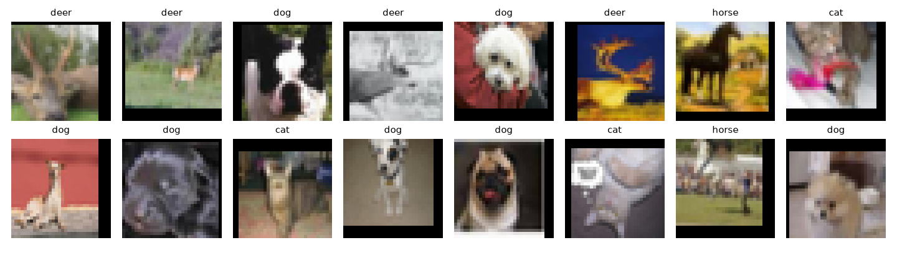

# 02 – Dữ liệu và tiền xử lý

← [01_PROJECT_STRUCTURE.md](01_PROJECT_STRUCTURE.md) · [Mục lục](README.md) · [03_CNN_FOUNDATIONS.md](03_CNN_FOUNDATIONS.md) →

File này đi theo đường đi của một ảnh: từ file tải về trên Internet tới tensor đưa vào mạng (khi huấn luyện), và tới 3.072 byte gửi
xuống FPGA (khi chạy thật). Mọi số đếm trong file đều chạy trên chính dữ liệu do `prepare_cifar4.py` và `prepare_cinic4.py` tạo ra.



*Hình: 16 ảnh của một batch huấn luyện, có nhãn (sinh bởi `python model/data.py`, lưu ở `model/figures/samples.png`). Một số ảnh bị
lệch và có viền đen do bước cắt ngẫu nhiên.*

---

## 1. Bài toán và quy ước nhãn

- **Bài toán:** phân loại ảnh RGB 32×32 vào 4 lớp. Thứ tự chỉ số được cố định trong toàn dự án: **0 cat · 1 dog · 2 deer · 3 horse**
  (`config.CLASSES`, `model/config.py` dòng 17).
- **Đầu vào mạng:** tensor `(3, 32, 32)`, giá trị `pixel/256`.
- **Đầu ra mạng:** 4 logit. Lớp dự đoán là argmax.
- **Đầu vào phần cứng:** 3.072 byte uint8, thứ tự `X[c][h][w]` với kênh R, G, B (`export.py` dòng 13, README sinh tự động).

## 2. Dữ liệu chính: CIFAR-10 → CIFAR-4 (`model/prepare_cifar4.py`)

CIFAR-10 gồm ảnh màu 32×32 thuộc 10 lớp: 50.000 ảnh train, 10.000 ảnh test, mỗi lớp 5.000 / 1.000 ảnh. Dự án giữ lại 4 lớp động vật.

**Các bước trong code:**

| Dòng | Việc | Giải thích |
|---|---|---|
| 24 | `CIFAR10(root=data/, train=..., download=True)` | `torchvision` tự tải `cifar-10-python.tar.gz` (~170 MB) về `data/` |
| 25–26 | Tra chỉ số gốc của 4 lớp theo **tên** | Trong CIFAR-10: cat = 3, deer = 4, dog = 5, horse = 7. Tra theo tên nên không phụ thuộc thứ tự |
| 29 | `mask = np.isin(targets, cifar_ids)` | Giữ đúng các ảnh thuộc 4 lớp, giữ nguyên thứ tự gốc |
| 30–31 | `remap = {3: 0, 5: 1, 4: 2, 7: 3}` | Đánh lại nhãn theo thứ tự cat, dog, deer, horse |
| 41–42 | `np.savez_compressed(data/cifar4.npz, ...)` | Lưu `x_train, y_train, x_test, y_test, classes` |

**Kết quả (đếm trên file `data/cifar4.npz`):**

| Mảng | Hình | Kiểu | Mỗi lớp |
|---|---|---|---|
| `x_train` | (20.000, 32, 32, 3) | uint8 | 5.000 |
| `y_train` | (20.000,) | uint8 | – |
| `x_test` | (4.000, 32, 32, 3) | uint8 | 1.000 |
| `y_test` | (4.000,) | uint8 | – |

Ảnh lưu ở dạng NHWC `(N, H, W, C)` như file ảnh thông thường. PyTorch cần dạng NCHW, nên mỗi ảnh được đổi trục ở bước 5.

`data/` nằm trong `.gitignore`, nên mỗi máy phải tự chạy `python model/prepare_cifar4.py` một lần.

## 3. Dữ liệu bổ sung: CINIC-10 → `cinic4_extra.npz` (`model/prepare_cinic4.py`)

Dữ liệu này dùng cho 4 mô hình B3c, E, E2, E3d. B không dùng.

**Nguồn.** CINIC-10 (Darlow và cộng sự, 2018, Đại học Edinburgh) gồm ảnh CIFAR-10 **cộng** ảnh ImageNet đã thu về 32×32, cùng 10 lớp.
File `CINIC-10.tar.gz` nặng 687 MB, phải tải tay (docstring dòng 1–16).

**Vì sao phải lọc.** CINIC-10 chứa cả ảnh gốc CIFAR-10, **kể cả ảnh thuộc tập TEST của CIFAR** (tên file bắt đầu bằng `cifar10-`). Nếu đưa
các ảnh đó vào train, mô hình sẽ "thấy trước" ảnh test, và con số test không còn khách quan. Script xử lý bằng hai lớp bảo vệ:

| Dòng | Việc |
|---|---|
| 37–41 | Đọc thẳng từng file PNG trong tar.gz (không giải nén ra đĩa). Chỉ xét 4 lớp cần dùng |
| 44–46 | **Lớp bảo vệ 1:** bỏ mọi file không bắt đầu bằng `n` (mã synset ImageNet), tức bỏ hết ảnh `cifar10-...` |
| 47–50 | Mở PNG, đổi sang RGB, kiểm tra kích thước đúng 32×32, rồi thêm vào danh sách |
| 53–57 | **Lớp bảo vệ 2:** băm (hash) từng ảnh rồi so với 4.000 ảnh test CIFAR-4. Ảnh nào **trùng từng pixel** thì bỏ |
| 59 | Lưu `data/cinic4_extra.npz` gồm `x` (N, 32, 32, 3) uint8 và `y` (N,) uint8 |

**Kết quả.** Mỗi lớp có 21.000 ảnh ImageNet (7.000 ảnh trong mỗi thư mục train/valid/test của CINIC), tổng **84.000 ảnh**. Lần tạo dữ liệu trên
máy cloud in ra: "bỏ 24.000 ảnh gốc CIFAR, bỏ 0 ảnh trùng pixel với tập test". Kết quả này tất định: cùng file tar thì ra cùng kết quả.

**Giới hạn của lớp bảo vệ 2.** Nó chỉ bắt ảnh **giống hệt từng pixel**. Ảnh gần giống (cùng con vật nhưng bị nén hay thu nhỏ khác đi) thì
**chưa kiểm tra được**. Rủi ro này nhỏ, vì CIFAR lấy ảnh từ bộ "80 Million Tiny Images" còn phần ImageNet của CINIC lấy từ ImageNet, nhưng
chưa được loại trừ hoàn toàn.

Trên laptop, `kiem_chung.py` tự tìm file tar trong `~/Downloads`, `data/` hoặc `/mnt/c/Users/*/Downloads/`, rồi gọi `prepare_cinic4.py`
(hàm `ensure_cinic`, dòng 144–159).

## 4. Tách train / validation (`data.split_train_val`, `model/data.py` dòng 27–33)

```python
rng = np.random.default_rng(seed)          # seed = config.SEED = 2027
idx = rng.permutation(len(x))              # hoán vị ngẫu nhiên 0..19.999 nhưng cố định theo seed
n_val = int(len(x) * fraction)             # fraction = config.VAL_FRACTION = 0.1  -> 2.000
val_idx, train_idx = idx[:n_val], idx[n_val:]
```

- Kết quả: **18.000 train / 2.000 val**. Tách theo hoán vị ngẫu nhiên, không chia đều theo lớp, nên số ảnh mỗi lớp lệch nhẹ (đếm thật):

  | | cat | dog | deer | horse | Tổng |
  |---|---|---|---|---|---|
  | train | 4.508 | 4.506 | 4.488 | 4.498 | 18.000 |
  | val | 492 | 494 | 512 | 502 | 2.000 |

- Vì seed cố định, mọi lần chạy, mọi mô hình đều dùng **cùng** 2.000 ảnh val. So sánh giữa các kiến trúc nhờ vậy mới công bằng.
- Val chỉ có 2.000 ảnh, nên một ảnh = 0,05 điểm %, và sai số chuẩn ở mức 90% là √(0,9·0,1/2.000) ≈ 0,67 điểm %. Chênh val vài phần mười
  giữa hai mô hình **không** đủ để kết luận.

## 5. Từ uint8 sang tensor (`data.to_tensor`, dòng 36–38)

```python
return torch.from_numpy(img_uint8).permute(2, 0, 1).float() / 256.0
```

1. `permute(2, 0, 1)`: (32, 32, 3) → (3, 32, 32), tức HWC → CHW.
2. `.float()`: uint8 → float32.
3. `/ 256.0`: đưa giá trị về [0; 0,99609].

**Vì sao chia 256 mà không chuẩn hoá bằng mean/std?**
- Trên FPGA, chia cho 2⁸ là dịch phải 8 bit; trong golden model, ảnh được coi là số nguyên `pixel` với thang `f = 8`, nên **không tốn phép
  tính nào**.
- Trung bình pixel của tập train (đếm thật) là 116,07 trên 255; theo kênh R/G/B là 125,52 / 118,97 / 103,73. Mạng không cần biết trước các số
  này: BatchNorm ngay sau conv1 tự học phần dịch và co giãn (docstring `data.py` dòng 6–9).

## 6. Tăng cường dữ liệu (`Cifar4.__getitem__` dòng 57–68, `strong_augment` dòng 71–88)

Tăng cường chỉ áp cho **tập train** (`augment=True`, dòng 104). Val và test luôn là ảnh gốc (dòng 106–107). Mỗi lần DataLoader lấy một ảnh,
một biến thể ngẫu nhiên mới được tạo ra, nên qua mỗi epoch mạng thấy các phiên bản khác nhau của cùng một ảnh.

### 6.1. Tăng cường cơ bản – mọi mô hình

```python
padded = np.pad(img, ((4, 4), (4, 4), (0, 0)))     # đệm 4 pixel 0 mỗi phía: 32x32 -> 40x40
r, c = np.random.randint(0, 9, size=2)             # góc trên trái ngẫu nhiên: 0..8
img = padded[r:r + 32, c:c + 32]                   # cắt lại 32x32
if np.random.rand() < 0.5:
    img = img[:, ::-1]                             # lật ngang (đảo cột)
```

- **Random crop:** có 9 × 9 = 81 vị trí cắt, tức ảnh dịch tối đa ±4 pixel theo mỗi chiều. Phần lộ ra ngoài ảnh gốc là viền đen (0).
- **Horizontal flip:** lật ngang với xác suất 50%. Con mèo quay trái hay quay phải vẫn là mèo. Không lật dọc, vì con vật lộn ngược hiếm gặp
  ngoài thực tế.

### 6.2. Tăng cường mạnh – chỉ công thức `--recipe opt` (B3c, E, E2, E3d)

Bước này chạy **sau** crop + flip (dòng 66–67):

```python
f = img.astype(np.float32)
bright, contrast = uniform(0.8, 1.2), uniform(0.8, 1.2)    # OPT_JITTER = 0.2
f = (f - mean) * contrast + mean * bright                  # mean = trung bình mọi pixel, mọi kênh của ảnh
img = clip(round(f), 0, 255).astype(uint8)                 # vẫn là ảnh uint8 hợp lệ
# Cutout: tâm (cy, cx) ngẫu nhiên trong 0..31, ô [cy-6, cy+6) x [cx-6, cx+6), cắt theo biên ảnh, tô 0
```

- **Độ sáng / độ tương phản.** Ví dụ *minh hoạ* với một pixel 200, mean = 100, contrast = 1,1, bright = 0,9:
  `(200 − 100)·1,1 + 100·0,9 = 110 + 90 = 200`. Pixel bằng đúng mean thì thành `mean·bright = 90`. Mục đích là giả lập ánh sáng ngày thi khác
  ảnh CIFAR.
- **Cutout 12×12.** Ô bị tô đen tối đa 12·12 = 144 pixel (14% ảnh). Ở gần biên, ô bị cắt bớt nên nhỏ hơn. Mục đích là buộc mạng nhận dạng
  bằng nhiều bộ phận khác nhau (không chỉ dựa vào mặt hay tai).
- Kết quả vẫn là ảnh uint8 0..255, đúng loại dữ liệu mà phần cứng sẽ nhận.

## 7. Ghép dữ liệu CINIC vào train (`get_loaders`, dòng 91–108)

```python
if extra:
    d = np.load("data/cinic4_extra.npz")
    x_tr = np.concatenate([x_tr] * cifar_repeat + [d["x"]])   # cifar_repeat = 2
```

| Thành phần | Số ảnh | Tỉ lệ |
|---|---|---|
| CIFAR train (18.000) lặp lại 2 lần | 36.000 | 30% |
| CINIC (ảnh ImageNet) | 84.000 | 70% |
| **Tổng một epoch** | **120.000** | 100% |

Lặp CIFAR 2 lần để mạng vẫn thấy đủ ảnh "đúng kiểu CIFAR" khi bị 84.000 ảnh ImageNet lấn át (docstring dòng 94–96). Hai bản lặp của cùng một
ảnh vẫn có tăng cường ngẫu nhiên khác nhau. **Val và test không đổi**, vẫn chỉ là ảnh CIFAR.

## 8. DataLoader – cách chia batch

| DataLoader | Dữ liệu | Batch | Xáo trộn | Tăng cường | Số batch / epoch |
|---|---|---|---|---|---|
| train (B, công thức gốc) | 18.000 CIFAR | 64 | có (generator seed 2027) | cơ bản | 282 |
| train (lượt +cinic) | 120.000 | 128 | có | cơ bản + mạnh | 938 |
| train (lượt tinh chỉnh `_ft`/`_kdft`) | 18.000 CIFAR | 128 | có | cơ bản + mạnh | 141 |
| val | 2.000 CIFAR | 256 | không | không | 8 |
| test | 4.000 CIFAR | 256 | không | không | 16 |

- Xáo trộn dùng `torch.Generator().manual_seed(config.SEED)` (dòng 103), nên thứ tự batch lặp lại được giữa các lần chạy.
- `num_workers` để mặc định 0 (dữ liệu nạp trong tiến trình chính), nên các lệnh `np.random` trong `__getitem__` tuân theo seed của
  `set_seed`. Nếu sau này tăng `num_workers`, phải cấp seed riêng cho từng worker, nếu không tăng cường ngẫu nhiên có thể bị lặp giữa các
  worker (xem `15_CODE_REVIEW_NOTES.md`).

## 9. Dữ liệu ngày thi và ảnh thật (`predict_image.py`, `docs/model_spec.md`)

Ngày thi BTC phát ảnh mới (camera hoặc thẻ SD) với kích thước bất kỳ. Trên Raspberry Pi phải xử lý **đúng như** `load_32x32`
(`predict_image.py` dòng 27–32):

```python
img = Image.open(path).convert("RGB")
s = min(w, h)
img = img.crop(((w - s) // 2, (h - s) // 2, (w - s) // 2 + s, (h - s) // 2 + s))   # cắt hình vuông ở giữa
img.resize((32, 32), Image.BILINEAR)                                                # thu về 32x32
```

Ví dụ *minh hoạ*: ảnh 640×480 → cắt vùng giữa 480×480 (bỏ 80 pixel mỗi bên trái/phải) → thu về 32×32. Sau đó ảnh đi vào **cả** mô hình float
và golden model số nguyên, và script in ra hai dự đoán.

Khác biệt "miền dữ liệu" giữa ảnh CIFAR và ảnh camera chưa được đo trong repo (chưa có thư mục `model/real_images/`), nên độ chính xác trên ảnh
ngày thi **chưa xác định được**.

---

← [01_PROJECT_STRUCTURE.md](01_PROJECT_STRUCTURE.md) · [Mục lục](README.md) · [03_CNN_FOUNDATIONS.md](03_CNN_FOUNDATIONS.md) →
