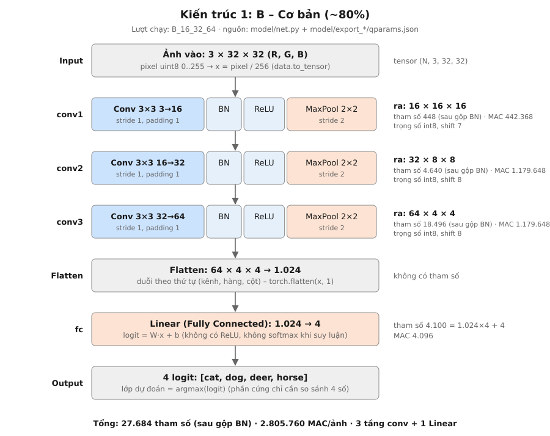
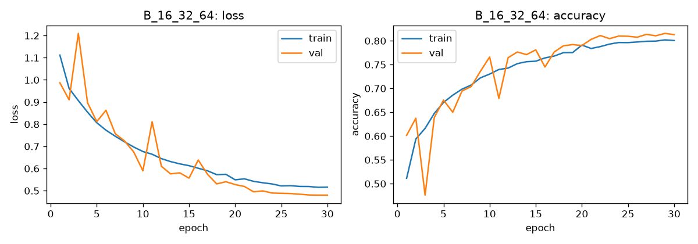
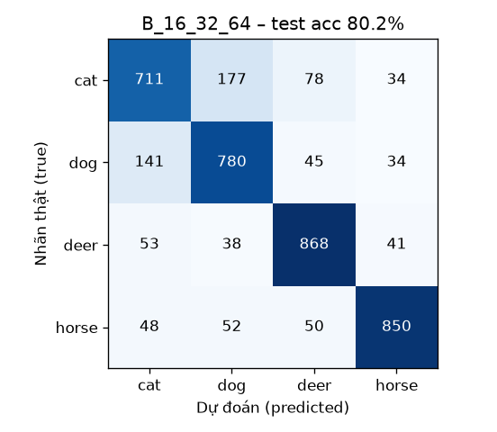
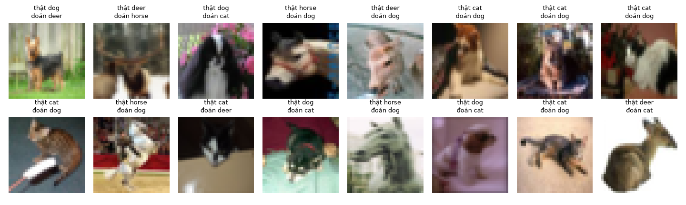

# Kiến trúc 1: B – Mạng cơ bản 3 khối (`B_16_32_64`)

[Mục lục](README.md) · [05_ARCHITECTURE_2_B3c.md](05_ARCHITECTURE_2_B3c.md) →

| Thông tin | Giá trị |
|---|---|
| Mã trong dự án | **B** – Cơ bản (~80%) |
| Tên lượt chạy cuối (checkpoint, thư mục export) | `B_16_32_64` |
| File định nghĩa | `model/net.py` – lớp `SmallCNN` (dòng 27–47), cấu hình ở dòng 21 |
| Lệnh tạo ra mô hình | `model/kiem_chung.py` – `MODELS["B"]` (dòng 58–62) |
| Số tầng conv / Linear | 3 / 1 |
| Tham số (sau gộp BN) | 27.684 |
| MAC / ảnh | 2.805.760 |
| Trọng số thật trên FPGA | 27,4 KB (BRAM ước lượng ~17%) |
| **Test số nguyên (= FPGA)** | **80,00%** |
| Test float | 80,23% |
| Thời gian huấn luyện (laptop) | 3,4 phút |

Mọi số trong file này được tính từ chính code trên nhánh `main` hoặc đọc từ file kết quả đã commit (`model/results.md`,
`model/export/qparams.json`). Các kết quả là số chạy thật trên laptop
`LAPTOP-2RM30BH4` của nhóm (`model/kiem_chung_log.json`).

---

## 1. Ý tưởng thiết kế

**Ý tưởng gốc.** B là mạng CNN "giáo khoa" mà đề thi yêu cầu tham khảo (tài liệu CNN lần 23, `docs/cnn23_reference.md`):
chỉ dùng **Conv 3×3 → kích hoạt → Pooling → Fully Connected**. Nhóm lặp lại đúng một khối
`Conv 3×3 → BatchNorm → ReLU → MaxPool 2×2` ba lần rồi nối một tầng Linear (docstring `model/net.py` dòng 1–13).

**Vì sao số kênh là 16 → 32 → 64?** Mỗi lần MaxPool, chiều cao và chiều rộng giảm một nửa (số điểm ảnh giảm 4 lần).
Nhân đôi số kênh để bù lại lượng "thông tin" bị mất. Hệ quả tính toán rất gọn (xem mục 3.3):
khối 2 và khối 3 có **đúng cùng số phép nhân–cộng** (1.179.648 MAC), vì số điểm ảnh giảm 4 lần còn
`C_in × C_out` tăng 4 lần. Đây là quy tắc thiết kế kinh điển của VGG/ResNet.

**Mục tiêu.** Là mô hình nhóm tự học và tự chạy đầu tiên, nhỏ (27,7 nghìn tham số ≈ 27 KB), nhanh (2,8 triệu MAC/ảnh),
dễ làm RTL. Đây là **mốc so sánh (baseline)**: mọi kiến trúc sau được đánh giá là "hơn B bao nhiêu, tốn thêm bao nhiêu".

**Đặc điểm nổi bật.**
- Kiến trúc lặp đều đặn → RTL chỉ cần một khối conv dùng lại 3 lần.
- Huấn luyện bằng **công thức gốc** (`--recipe base`): AdamW, 30 epoch, chỉ dữ liệu CIFAR, tăng cường nhẹ (cắt + lật).
- Là mô hình **duy nhất** trong 5 mô hình có conv1 dùng trọng số **int8** (4 mô hình còn lại dùng int16 cho conv1).

---

## 2. Phân tích cấu trúc mạng



### 2.1. Luồng dữ liệu từ Input đến Output

```text
Input 3×32×32 (pixel/256)
→ conv1: Conv 3×3, 3→16, stride 1, padding 1   → 16×32×32
→ BatchNorm2d(16)   → ReLU
→ MaxPool 2×2, stride 2   → 16×16×16
→ conv2: Conv 3×3, 16→32, stride 1, padding 1   → 32×16×16
→ BatchNorm2d(32)   → ReLU
→ MaxPool 2×2, stride 2   → 32×8×8
→ conv3: Conv 3×3, 32→64, stride 1, padding 1   → 64×8×8
→ BatchNorm2d(64)   → ReLU
→ MaxPool 2×2, stride 2   → 64×4×4
→ Flatten   → 1024
→ Linear 1024→4   → 4 logit (cat, dog, deer, horse)
→ argmax   → lớp dự đoán (0..3)
```

Trong `SmallCNN`, mọi khối đều có MaxPool (dòng 38) nên sau 3 khối ảnh luôn là 4×4 và tầng Linear có
`C3 × 4 × 4` đầu vào (dòng 41). Lớp này còn dùng cho A, C, D (cùng khuôn, khác số kênh/có BN hay không).

### 2.2. Bảng từng module (đúng thứ tự trong `nn.Sequential`)

Kích thước đo bằng cách cho một tensor `(1, 3, 32, 32)` chạy qua từng module của `net.build("B_16_32_64")`. Activation function của
mọi tầng conv là **ReLU** (module riêng ngay sau BN); tầng Linear cuối **không** có activation.

| # | Module PyTorch | Chức năng | Vào (C×H×W) | Ra (C×H×W) | Số filter | Kernel | Stride | Padding | Neuron | Tham số học được |
|---|---|---|---|---|---|---|---|---|---|---|
| 0 | `Conv2d(3, 16, 3, padding=1, bias=False)` | tích chập conv1 | 3 × 32 × 32 | 16 × 32 × 32 | 16 | 3×3 | 1 | 1 | – | 432 = 3·3·3·16 |
| 1 | `BatchNorm2d(16)` | chuẩn hoá từng kênh | 16 × 32 × 32 | 16 × 32 × 32 | – | – | – | – | – | 32 = 2·16 (γ, β); + 16+16 thống kê μ, σ² không học |
| 2 | `ReLU()` | kích hoạt max(0, x) | 16 × 32 × 32 | 16 × 32 × 32 | – | – | – | – | – | 0 |
| 3 | `MaxPool2d(2)` | lấy max mỗi ô 2×2 | 16 × 32 × 32 | 16 × 16 × 16 | – | 2×2 | 2 | 0 | – | 0 |
| 4 | `Conv2d(16, 32, 3, padding=1, bias=False)` | tích chập conv2 | 16 × 16 × 16 | 32 × 16 × 16 | 32 | 3×3 | 1 | 1 | – | 4.608 = 3·3·16·32 |
| 5 | `BatchNorm2d(32)` | chuẩn hoá từng kênh | 32 × 16 × 16 | 32 × 16 × 16 | – | – | – | – | – | 64 = 2·32 (γ, β); + 32+32 thống kê μ, σ² không học |
| 6 | `ReLU()` | kích hoạt max(0, x) | 32 × 16 × 16 | 32 × 16 × 16 | – | – | – | – | – | 0 |
| 7 | `MaxPool2d(2)` | lấy max mỗi ô 2×2 | 32 × 16 × 16 | 32 × 8 × 8 | – | 2×2 | 2 | 0 | – | 0 |
| 8 | `Conv2d(32, 64, 3, padding=1, bias=False)` | tích chập conv3 | 32 × 8 × 8 | 64 × 8 × 8 | 64 | 3×3 | 1 | 1 | – | 18.432 = 3·3·32·64 |
| 9 | `BatchNorm2d(64)` | chuẩn hoá từng kênh | 64 × 8 × 8 | 64 × 8 × 8 | – | – | – | – | – | 128 = 2·64 (γ, β); + 64+64 thống kê μ, σ² không học |
| 10 | `ReLU()` | kích hoạt max(0, x) | 64 × 8 × 8 | 64 × 8 × 8 | – | – | – | – | – | 0 |
| 11 | `MaxPool2d(2)` | lấy max mỗi ô 2×2 | 64 × 8 × 8 | 64 × 4 × 4 | – | 2×2 | 2 | 0 | – | 0 |
| 12 | `torch.flatten(x, 1)` | duỗi phẳng | 64 × 4 × 4 | 1024 | – | – | – | – | – | 0 |
| 13 | `Linear(1024, 4)` | phân loại → 4 logit | 1024 | 4 | – | – | – | – | 4 | 4.100 = 1.024·4 + 4 |

Ghi chú các cột: "Số filter" = số kênh ra = số bộ lọc 3×3×C_in; "Neuron" chỉ có ý nghĩa với Linear (4 neuron = 4 lớp).
Mọi conv: stride 1, padding 1, `bias=False`; mọi MaxPool: kernel 2, stride 2, padding 0 (mặc định PyTorch).

---

## 3. Giải thích toàn bộ phép tính

### 3.1. Kích thước feature map sau mỗi tầng

Công thức kích thước đầu ra của **Convolution** (dùng cho cả chiều cao H và chiều rộng W):

```text
H_out = floor((H_in + 2·P − K) / S) + 1
```

- `H_in`: kích thước vào · `K = 3`: kích thước kernel · `P = 1`: padding (số viền 0 thêm mỗi phía) · `S = 1`: stride (bước trượt). Mọi conv trong dự án đều `kernel_size=3, padding=1` (stride mặc định 1).

Công thức của **MaxPool2d(2)** (PyTorch mặc định `stride = kernel_size = 2`, `padding = 0`):

```text
H_out = floor((H_in + 2·0 − 2) / 2) + 1 = H_in / 2   (khi H_in chẵn)
```

| Tầng | Conv: thay số | Kết quả conv | Pool: thay số | Kết quả sau tầng |
|---|---|---|---|---|
| conv1 | floor((32 + 2·1 − 3)/1) + 1 = 32 | 16×32×32 | floor((32 − 2)/2) + 1 = 16 | **16×16×16** |
| conv2 | floor((16 + 2·1 − 3)/1) + 1 = 16 | 32×16×16 | floor((16 − 2)/2) + 1 = 8 | **32×8×8** |
| conv3 | floor((8 + 2·1 − 3)/1) + 1 = 8 | 64×8×8 | floor((8 − 2)/2) + 1 = 4 | **64×4×4** |

Nhận xét: với `K = 3, P = 1, S = 1` thì `H_out = H_in` – conv **không đổi** kích thước, chỉ đổi số kênh. Mọi việc thu nhỏ ảnh đều do MaxPool.

Sau tầng conv cuối là Flatten: `64 × 4 × 4 = 1.024` số → Linear `1.024 → 4`.

### 3.2. Số tham số

Công thức (trọng số conv có `bias=False` vì ngay sau là BatchNorm – `model/net.py` dòng 33–34 và 83):

```text
Conv (PyTorch)      = K_h·K_w·C_in·C_out                (không bias)
BatchNorm (PyTorch) = 2·C_out                           (γ và β; μ, σ² là thống kê, không học)
Conv sau gộp BN     = K_h·K_w·C_in·C_out + C_out          (mỗi kênh ra 1 bias, xem fold_bn)
Linear              = N_in·N_out + N_out
```

| Tầng | Trọng số conv | BN (γ, β) | **PyTorch học** | **Sau gộp BN (phần cứng)** | % tổng phần cứng |
|---|---|---|---|---|---|
| conv1 | 3·3·3·16 = 432 | 2·16 = 32 | 464 | 432 + 16 = 448 | 1,6% |
| conv2 | 3·3·16·32 = 4.608 | 2·32 = 64 | 4.672 | 4.608 + 32 = 4.640 | 16,8% |
| conv3 | 3·3·32·64 = 18.432 | 2·64 = 128 | 18.560 | 18.432 + 64 = 18.496 | 66,8% |
| fc | 1.024·4 = 4.096 | – | 4.100 | 4.096 + 4 = 4.100 | 14,8% |
| **Tổng** | | | **27.796** | **27.684** | 100% |

- **27.796** = số PyTorch thực sự học (`sum(p.numel() for p in model.parameters())` – đã chạy để kiểm chứng).
- **27.684** = số mà dự án ghi trong mọi bảng (`net.count_params`, `model/net.py` dòng 112–148) – là số lưu trên phần cứng sau khi gộp BN.
- Chênh 112 = 16 + 32 + 64: mỗi kênh có 2 tham số BN (γ, β) nhưng sau khi gộp chỉ còn 1 bias.
- Ngoài ra BN còn 224 số thống kê (running mean, running var) – lưu trong checkpoint nhưng không học bằng gradient.

### 3.3. Số phép nhân–cộng (MAC) và thời gian ước lượng

MAC (multiply–accumulate, một phép nhân rồi cộng dồn) của một conv: mỗi điểm ra cần `C_in·K·K` phép nhân.

```text
MAC_conv = H_out·W_out·C_out · (C_in·K·K)          MAC_linear = N_in·N_out
```

| Tầng | Thay số | MAC | % tổng |
|---|---|---|---|
| conv1 | 32·32·16·(3·3·3) | 442.368 | 15,8% |
| conv2 | 16·16·32·(16·3·3) | 1.179.648 | 42,0% |
| conv3 | 8·8·64·(32·3·3) | 1.179.648 | 42,0% |
| fc | 1.024·4 | 4.096 | 0,15% |
| **Tổng** | | **2.805.760** ≈ 2,81 triệu | 100% |

BatchNorm (sau khi gộp), ReLU (so sánh với 0) và MaxPool (so sánh) không có phép nhân nên không tính vào MAC.

**Ước lượng thời gian một ảnh** (công thức của `kiem_chung.py` dòng 352–353: `MAC ÷ (số DSP × tần số)`, giả sử mỗi DSP làm 1 MAC/chu kỳ và bận 100% – mạch thật chậm hơn 20–40%):

| Cấu hình | Thay số | Thời gian |
|---|---|---|
| 16 DSP @ 20 MHz | 2.805.760 / (16·20·10⁶) | 8,8 ms |
| 16 DSP @ 100 MHz | 2.805.760 / (16·100·10⁶) | 1,8 ms |
| 64 DSP @ 100 MHz | 2.805.760 / (64·100·10⁶) | 0,4 ms |

### 3.4. Bộ nhớ trên FPGA

Bộ nhớ trọng số thật trên FPGA (công thức `hw_numbers`, `model/kiem_chung.py` dòng 202–218): trọng số int8 (conv1: int8) + bias int32 (4 byte).

| Tầng | Trọng số | Bias | Byte |
|---|---|---|---|
| conv1 | 432 × 1 byte | 16 × 4 byte | 496 |
| conv2 | 4.608 × 1 byte | 32 × 4 byte | 4.736 |
| conv3 | 18.432 × 1 byte | 64 × 4 byte | 18.688 |
| fc | 4.096 × 1 byte | 4 × 4 byte | 4.112 |
| **Tổng** | | | **28.032 byte = 27,38 KB** |

Bộ đệm ảnh trung gian (uint8, `kiem_chung.py` giả sử chỉ giữ bản đồ vào + bản đồ ra của tầng đang tính, pool làm ngay khi ghi): conv1: 3·32² + 16·16² = 7.168 byte · conv2: 16·16² + 32·8² = 6.144 byte · conv3: 32·8² + 64·4² = 3.072 byte. Lớn nhất: **conv1 = 7,0 KB**.

BRAM ước lượng = (trọng số + bộ đệm lớn nhất) / BRAM của chip = (28.032 + 7.168) / (1.620·1.024/8 = 207.360 byte) ≈ **17,0%**. Con số này **chưa tính** phần BRAM bị lẻ khối 18 Kb và bộ đệm dòng của RTL – thực tế cao hơn.

### 3.5. Trường tiếp nhận (receptive field)

Trường tiếp nhận (receptive field, RF) = số pixel ảnh gốc (theo một chiều) ảnh hưởng tới một điểm của feature map. Đây là phép tính **lý thuyết** từ cấu hình trong code (dự án không tự tính):

```text
RF_mới = RF_cũ + (K − 1)·j        j_mới = j·S        (bắt đầu RF = 1, j = 1)
```

| Sau | K | S | RF | j (khoảng cách 2 điểm kề nhau, tính bằng pixel gốc) |
|---|---|---|---|---|
| conv1 | 3 | 1 | 3 | 1 |
| pool1 | 2 | 2 | 4 | 2 |
| conv2 | 3 | 1 | 8 | 2 |
| pool2 | 2 | 2 | 10 | 4 |
| conv3 | 3 | 1 | 18 | 4 |
| pool3 | 2 | 2 | 22 | 8 |

→ Mỗi điểm của feature map cuối "nhìn" một vùng **22×22 pixel** của ảnh 32×32.

### 3.6. Lượng tử hoá (số nguyên cho phần cứng)

Thông số lượng tử hoá **đã commit** trong `model/export/qparams.json` (sinh bởi `quantize.py` trên laptop của nhóm):

| Tầng | Bit W | f_in | fw | f_acc = f_in+fw | f_out | shift = f_acc − f_out | a_max (phân vị 99,99%) | MaxPool |
|---|---|---|---|---|---|---|---|---|
| conv1 | int8 | 8 | 4 | 12 | 5 | 7 | 6,889 | có |
| conv2 | int8 | 5 | 8 | 13 | 5 | 8 | 4,890 | có |
| conv3 | int8 | 5 | 8 | 13 | 5 | 8 | 4,156 | có |
| fc | int8 | 5 | 9 | 14 | – | – | – | – |

**Ví dụ thay số cho conv1** (công thức trong `quantize.py` dòng 99–130):

- Trọng số conv1 sau lượng tử nằm trong `[-90, 78]` với `fw = 4` → giá trị thực lớn nhất ≈ 90 / 2^4 = 5,625. `frac_bits_for` chọn `fw = floor(log2(127 / max|W|))`: đây là `fw` lớn nhất mà max|W|·2^fw vẫn ≤ 127.
- Ảnh vào là pixel/256 → `f_in = 8`. Tổng tích luỹ có thang `f_acc = 8 + 4 = 12`.
- Activation lớn nhất (phân vị 99,99% trên 2.000 ảnh) `a_max = 6,889` → `f_out = floor(log2(255 / 6,889)) = floor(5,210) = 5`.
- `shift = 12 − 5 = 7` → phần cứng tính `y = (acc + 2^6) >> 7` rồi kẹp về 0..255.

**Bộ cộng dồn có đủ 32 bit không?** Trường hợp xấu nhất mỗi tầng = max theo kênh ra của `Σ|Wq|·255 + |bq|` (tính từ `qparams.npz` đã commit):

| Tầng | Giá trị xấu nhất | Số bit cần (kể cả bit dấu) |
|---|---|---|
| conv1 | 231.838 | 19 |
| conv2 | 1.037.572 | 21 |
| conv3 | 1.165.550 | 22 |
| fc | 5.883.187 | 24 |

→ Lớn nhất 24 bit < 32 bit: int32 **đủ**, không tràn.

### 3.7. Loss, softmax và argmax – thay số thật

Ví dụ thật: **ảnh test số 0** (nhãn cat). Logit số nguyên do golden model tính, lưu trong `testvec/img00_fc.mem`; logit của tầng fc có thang `f_acc = 14` nên giá trị thực = số nguyên / 2^14:

| | cat | dog | deer | horse |
|---|---|---|---|---|
| Logit số nguyên | 42.710 | 10.907 | -58.256 | -55.115 |
| Logit thực (/2^14) | 2,607 | 0,666 | -3,556 | -3,364 |
| Softmax p = e^z / Σe^z | 0,8709 | 0,1250 | 0,0018 | 0,0022 |

- **Dự đoán** = argmax = cat (đúng). Phần cứng chỉ cần so sánh 4 số nguyên, không cần softmax.
- **Cross-entropy** (khi huấn luyện, nhãn cứng): `L = −ln p_cat = −ln 0,8709 = 0,1382`.
- B huấn luyện bằng công thức gốc **không** có label smoothing (`train.py` dòng 104), nên chỉ dùng CE nhãn cứng.
- Để so sánh với 4 mô hình còn lại: nếu có label smoothing 0,1 thì cùng ảnh này cho `L = 0,4901`, và loss thấp nhất có thể là 0,349.

---

## 4. Phân tích source code tương ứng

**Cấu hình kiến trúc** – `model/net.py` dòng 21:

```python
    "B_16_32_64": ((16, 32, 64), True),
```

**Lớp xây dựng mô hình** – `net.build("B_16_32_64")` (dòng 97–104) bỏ phần sau dấu `+` (`"B_16_32_64".split("+")[0]` =
`"B_16_32_64"`), rồi tra `ARCHS` và gọi `SmallCNN(channels, use_bn)`.
Phần `+...` chỉ là nhãn để mỗi lượt huấn luyện có checkpoint và thư mục export riêng.

```python
# model/net.py dòng 27–47
class SmallCNN(nn.Module):
    def __init__(self, channels=(16, 32, 64), use_bn=True, n_classes=4):
        super().__init__()
        layers = []
        c_in = 3                                   # ảnh RGB có 3 kênh
        for c_out in channels:                     # B: lặp 3 lần với c_out = 16, 32, 64
            # bias=False khi có BN, vì BN đã có tham số dịch (beta) làm thay việc của bias
            layers.append(nn.Conv2d(c_in, c_out, kernel_size=3, padding=1, bias=not use_bn))   # dòng 34
            if use_bn:
                layers.append(nn.BatchNorm2d(c_out))                                          # dòng 36
            layers.append(nn.ReLU())                                                          # dòng 37
            layers.append(nn.MaxPool2d(2))                                                    # dòng 38
            c_in = c_out
        self.features = nn.Sequential(*layers)                                                # dòng 40
        self.classifier = nn.Linear(c_in * 4 * 4, n_classes)                                  # dòng 41
        self.channels, self.use_bn = tuple(channels), use_bn

    def forward(self, x):
        x = self.features(x)          # 12 module: [Conv, BN, ReLU, Pool] × 3
        x = torch.flatten(x, 1)       # (N, 64, 4, 4) -> (N, 1024)
        return self.classifier(x)     # (N, 1024) -> (N, 4)
```

**Đoạn code nào tạo ra tầng nào:**

| Thành phần trong sơ đồ | Index trong `model.features` / thuộc tính | Dòng code tạo ra |
|---|---|---|
| conv1 → BN → ReLU → MaxPool | `features[0]`, `[1]`, `[2]`, `[3]` | `net.py` dòng 34, 36, 37, 38 (lần lặp thứ 1) |
| conv2 → BN → ReLU → MaxPool | `features[4]`, `[5]`, `[6]`, `[7]` | `net.py` dòng 34, 36, 37, 38 (lần lặp thứ 2) |
| conv3 → BN → ReLU → MaxPool | `features[8]`, `[9]`, `[10]`, `[11]` | `net.py` dòng 34, 36, 37, 38 (lần lặp thứ 3) |
| Flatten | trong `forward` | `net.py` dòng 46 |
| Linear 1024→4 | `model.classifier` | `net.py` dòng 41 |

**Vì sao tác giả viết như vậy:**
- `bias=False` trong conv: BN ngay sau đã có β làm việc của bias; giữ bias sẽ thừa tham số (bị BN triệt tiêu khi trừ trung bình).
- Không chuẩn hoá đầu vào bằng mean/std mà chỉ chia 256 (`data.py` dòng 36–38): chia 256 = dịch phải 8 bit, phần cứng làm "miễn phí";
  BN đầu tiên tự học phần chuẩn hoá (docstring `data.py` dòng 6–9).
- Linear không có ReLU và mô hình không có softmax: phần cứng chỉ cần argmax của 4 logit (`docs/model_spec.md`).
- `count_params`/`count_macs` (dòng 112–148) không đếm trên PyTorch mà tính bằng công thức theo cấu hình, để ra **số phần cứng sau gộp BN**.

**Các bước sau huấn luyện cho mô hình này** (`kiem_chung.py` dòng 47–49, `stages_after_train`):
`evaluate.py --arch "B_16_32_64"` → `quantize.py --arch "B_16_32_64"` →
`golden_int.py --arch "B_16_32_64"` → `export.py --arch "B_16_32_64"`.

---

## 5. Quy trình huấn luyện

| Lượt | Lệnh (do `kiem_chung.py` gọi) | Dữ liệu train | Epoch | Batch | Batch/epoch | Số lần cập nhật | Optimizer · LR | Loss | Tăng cường | Mạng thầy |
|---|---|---|---|---|---|---|---|---|---|---|
| `B_16_32_64` | `python model/train.py --arch B_16_32_64` | CIFAR 18.000 | 30 | 64 | 282 | 8.460 | AdamW, lr 1e-3, wd 5e-4 (mọi tham số), cosine T_max=30 | CrossEntropy | crop ±4 px + lật ngang | – |

Lịch learning rate (tính theo `train.py` dòng 105–108 cho công thức gốc, `opt_recipe` dòng 181–188 cho công thức opt; `sched.step()`
được gọi **sau** mỗi epoch nên epoch 1 dùng giá trị ở `ep = 0`):

| Lượt | Epoch | LR | Cách tính |
|---|---|---|---|
| `B_16_32_64` | 1 | 1,000000·10⁻³ | 0,5·10⁻³·(1 + cos(π·0/30)) |
| `B_16_32_64` | 16 | 0,500000·10⁻³ | 0,5·10⁻³·(1 + cos(π·15/30)) |
| `B_16_32_64` | 30 | 0,002739·10⁻³ | 0,5·10⁻³·(1 + cos(π·29/30)) |

Từng bước trong một lần cập nhật (chi tiết và công thức: `09_TRAINING_PROCESS.md`):

| Bước | Bản chất | Code |
|---|---|---|
| Khởi tạo mô hình | `net.build` tạo mạng với trọng số ngẫu nhiên (khởi tạo mặc định của PyTorch) | `train.py` dòng 80–84 |
| Loss | `nn.CrossEntropyLoss()` | `train.py` dòng 104 |
| Optimizer | AdamW(lr 1e-3, weight_decay 5e-4) | `train.py` dòng 106 |
| Chia batch | `DataLoader(..., shuffle=True)` | `data.py` dòng 103–105 |
| Forward / loss / backward / step | `logits = model(x)` → `loss_fn` → `zero_grad` → `backward` → `step` | `train.py` dòng 123–133 |
| Validation mỗi epoch | `evaluate(model, val_loader)` – CE không label smoothing | `train.py` dòng 141–142, 35–46 |
| Lưu model | `torch.save` khi val acc tốt hơn mọi epoch trước | `train.py` dòng 148–151 |
| Test | nạp checkpoint tốt nhất, đo test **một lần** | `train.py` dòng 156–157 |

---

## 6. Đánh giá kết quả

| Lượt | Epoch | Val acc tốt nhất | Test acc (float) | Thời gian (laptop) |
|---|---|---|---|---|
| `B_16_32_64` | 30 | 81,55% | 80,23% | 3,4 phút |

Lượng tử hoá (mục "Lượng tử hoá (int8)" của `model/results.md`):

| Chỉ số | Giá trị |
|---|---|
| Sai khác logit lớn nhất sau gộp BN | 6.2e-06 (chỉ là sai số làm tròn số thực) |
| Accuracy float sau gộp BN | 80,23% |
| **Accuracy số nguyên (golden = FPGA)** | **80,00%** |
| Chênh số nguyên − float | -0,22 điểm % |
| Trùng dự đoán float ↔ số nguyên | 98,0% |
| golden_int.py ↔ PyTorch trùng từng bit | Có |

Tôi đã chạy lại `golden_int` trên `qparams.npz` đã commit: ra **80,00%** – khớp bảng trên.

**Ma trận nhầm lẫn float** (`evaluate.py`, hàng = nhãn thật, cột = dự đoán; mỗi lớp 1.000 ảnh):

| | cat | dog | deer | horse |
|---|---|---|---|---|
| **cat** | **711** | 177 | 78 | 34 |
| **dog** | 141 | **780** | 45 | 34 |
| **deer** | 53 | 38 | **868** | 41 |
| **horse** | 48 | 52 | 50 | **850** |

**Precision / Recall / F1** – dự án **không** tự tính các chỉ số này; tôi tính thêm từ ma trận trên để minh hoạ (công thức ở `11_EVALUATION_AND_RESULTS.md`):

| Lớp | Precision | Recall (= accuracy từng lớp) | F1 | Accuracy số nguyên từng lớp (golden) |
|---|---|---|---|---|
| cat | 74,6% | 71,1% | 72,8% | 68,5% |
| dog | 74,5% | 78,0% | 76,2% | 78,6% |
| deer | 83,4% | 86,8% | 85,1% | 87,3% |
| horse | 88,6% | 85,0% | 86,8% | 85,6% |
| **Trung bình (macro)** | 80,3% | 80,2% | 80,2% | 80,0% |

Cặp nhầm nhiều nhất: **cat → dog** (177 ảnh), tiếp theo **dog → cat** (141 ảnh). Riêng cặp cat↔dog chiếm 318 / 791 ảnh sai (40%).

**Đọc đường học** (`train_B_16_32_64.png`): train loss giảm đều; val loss/accuracy dao động mạnh ở các epoch đầu (LR AdamW
còn lớn, ví dụ epoch 3 val acc tụt xuống ~0,48) rồi ổn định khi cosine giảm LR. Cuối quá trình val acc (~0,81) **cao hơn** train acc
(~0,80): ảnh train bị cắt/lật ngẫu nhiên nên khó hơn ảnh val, và train acc được đo trong chế độ `model.train()` (BN dùng thống kê
của batch). Không thấy dấu hiệu overfitting (val không đi xuống khi train tiếp tục tăng).







---

## 7. Ưu điểm, nhược điểm, khi nào dùng

**Ưu điểm**
- Nhỏ nhất (27,4 KB trọng số thật, ~17% BRAM), ít phép tính nhất (2,8 triệu MAC) → nhanh nhất, dễ làm RTL nhất.
- Không cần dữ liệu ngoài, không cần mạng thầy; huấn luyện 3,4 phút trên laptop.
- Trọng số conv1 int8 → toàn mạng chỉ một độ rộng trọng số.

**Nhược điểm**
- Độ chính xác thấp nhất: 80,00% (số nguyên). Lớp cat chỉ 68,5%.
- Sức chứa nhỏ: trên máy cloud, cùng kiến trúc huấn luyện kỹ hơn (B2, B3_kd) chỉ lên ~84% (`model/results.md`).
- Trường tiếp nhận cuối chỉ 22 pixel (< 32) – mỗi điểm 4×4 cuối chưa 'nhìn' hết ảnh.

**Nên dùng khi:** Khi ưu tiên tuyệt đối diện tích/tốc độ/độ đơn giản RTL, hoặc làm bản RTL đầu tiên để kiểm chứng luồng phần cứng.

So sánh với 4 kiến trúc còn lại: [`12_ARCHITECTURE_COMPARISON.md`](12_ARCHITECTURE_COMPARISON.md).

---

[Mục lục](README.md) · [05_ARCHITECTURE_2_B3c.md](05_ARCHITECTURE_2_B3c.md) →
