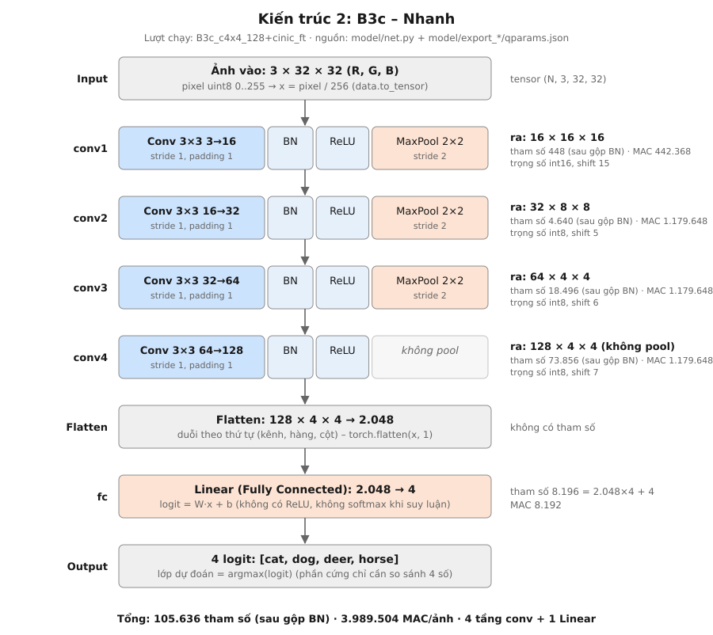
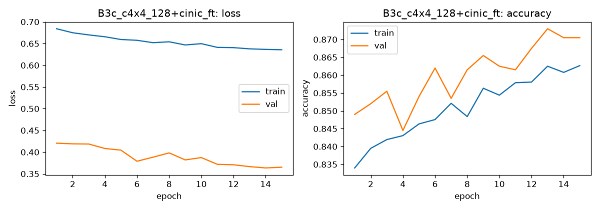
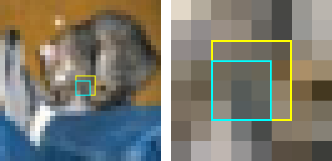
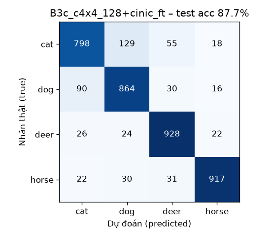

# B3c từ A đến Z – kiến trúc chọn đi thi (`B3c_c4x4_128+cinic_ft`)

← [05_ARCHITECTURE_2_B3c.md (bản cũ, ngắn hơn)](05_ARCHITECTURE_2_B3c.md) · [Mục lục](README.md) · [06_ARCHITECTURE_3_E.md](06_ARCHITECTURE_3_E.md) →

File này giải thích **toàn bộ** mô hình B3c: vì sao có kiến trúc này, ảnh đi qua mạng thế nào, mạng học ra sao, đổi sang số
nguyên cho FPGA thế nào, và kết quả. **Mỗi con số đều có: công thức → thay số → kết quả → nguồn.** Đọc theo thứ tự từ trên xuống.

**Phiên bản:** nhánh `main`, commit `0e3a0d9` (28/11/2026). Tham số số nguyên lấy từ
`model/export_B3c_c4x4_128+cinic_ft/qparams.json` / `qparams.npz` – sinh trên laptop `LAPTOP-2RM30BH4` của nhóm.

**Ký hiệu nguồn số liệu** (dùng trong cả file):

| Ký hiệu | Nghĩa |
|---|---|
| ✅ | Chạy thật trên laptop của nhóm (`model/kiem_chung_log.json`, `model/results.md`) |
| ⚠️ | Số do AI chạy trên máy cloud (nhánh `exp/opt-acc-90`), **chưa** chạy lại trên laptop – chỉ để tham khảo |
| 📐 | Tính từ công thức / từ file tham số đã commit – ai cũng tính lại được, không cần huấn luyện |
| 🧮 | Số **minh hoạ** tự chọn để giải thích công thức, không phải số của mô hình |

---

## Mục lục

0. [B3c trong một trang](#0-b3c-trong-một-trang)
1. [Bài toán và ràng buộc](#1-bài-toán-và-ràng-buộc)
2. [Kiến trúc hình thành như thế nào](#2-kiến-trúc-hình-thành-như-thế-nào)
3. [Kiến thức nền: 8 khối, mỗi khối một công thức và một ví dụ](#3-kiến-thức-nền-8-khối-mỗi-khối-một-công-thức-và-một-ví-dụ)
4. [Kiến trúc chi tiết: kích thước, tham số, MAC](#4-kiến-trúc-chi-tiết-kích-thước-tham-số-mac)
5. [Dữ liệu và tiền xử lý ảnh](#5-dữ-liệu-và-tiền-xử-lý-ảnh)
6. [Huấn luyện](#6-huấn-luyện)
7. [Từ số thực sang số nguyên (lượng tử hoá)](#7-từ-số-thực-sang-số-nguyên-lượng-tử-hoá)
8. [Hành trình một ảnh thật từ A đến Z](#8-hành-trình-một-ảnh-thật-từ-a-đến-z)
9. [Phần cứng: bộ nhớ, DSP, thời gian, file cho RTL](#9-phần-cứng-bộ-nhớ-dsp-thời-gian-file-cho-rtl)
10. [Kết quả và đánh giá](#10-kết-quả-và-đánh-giá)
11. [Hạn chế và các câu thầy hay hỏi](#11-hạn-chế-và-các-câu-thầy-hay-hỏi)
12. [Phụ lục: ký hiệu, bảng công thức, nguồn, lệnh](#12-phụ-lục-ký-hiệu-bảng-công-thức-nguồn-lệnh)

---

## 0. B3c trong một trang

```text
Ảnh 32×32×3 (pixel 0..255)
 → conv1 3→16  (3×3, padding 1) → BN → ReLU → MaxPool 2×2 → 16×16×16
 → conv2 16→32 (3×3, padding 1) → BN → ReLU → MaxPool 2×2 → 32×8×8
 → conv3 32→64 (3×3, padding 1) → BN → ReLU → MaxPool 2×2 → 64×4×4
 → conv4 64→128 (3×3, padding 1) → BN → ReLU  (KHÔNG pool)  → 128×4×4
 → Flatten → 2.048 số → Linear 2.048→4 → 4 logit → argmax → cat / dog / deer / horse
```

| Chỉ số | Giá trị | Nguồn |
|---|---|---|
| Tham số (sau gộp BN) | 105.636 | 📐 mục 4.2 |
| Phép nhân–cộng (MAC) / ảnh | 3.989.504 ≈ 4,0 triệu | 📐 mục 4.3 |
| Bộ nhớ trọng số trên FPGA | 106.800 byte ≈ 104,3 KB | 📐 mục 9.1 |
| BRAM ước lượng | ~55% (tính trên 202 KB) · ~62% (tính trên 180 KB dùng được) | 📐 mục 9.2 |
| Thời gian lý thuyết / ảnh | 12,5 ms (16 DSP @ 20 MHz) · 0,6 ms (64 DSP @ 100 MHz) | 📐 mục 9.4 |
| **Test CIFAR-4 số nguyên (= FPGA)** | **87,60%** (seed 2027); **87,06% ± 0,51** (3 seed) | ✅ mục 10 |
| Test float | 87,67% (seed 2027); 87,08% ± 0,52 (3 seed) | ✅ |
| Ảnh thật (108 ảnh) | 91,7% ± 5,2 | ✅ mục 10.4 |
| Kiểu số | trọng số int8 (riêng conv1 **int16**), activation uint8, bias + tổng tích luỹ int32 | 📐 mục 7 |

**Vì sao chọn B3c đi thi:** cuộc thi chấm chủ yếu **tốc độ**. B3c là mô hình **ít phép tính nhất** trong các mô hình đạt trên 85%.
Muốn lên ~90% (E, E2, E3d) phải tốn **gấp 3–5 lần** phép tính chỉ để được thêm ~3 điểm (mục 2.5).

---

## 1. Bài toán và ràng buộc

### 1.1. Bài toán

| Mục | Nội dung |
|---|---|
| Cuộc thi | LSI Design Contest in Hokkaido 2027, Class 1 – Level 2 |
| Đầu vào | Ảnh màu **32×32**, 3 kênh R, G, B, mỗi giá trị 0..255 → 32 × 32 × 3 = **3.072 byte** / ảnh |
| Đầu ra | 1 trong 4 lớp, đánh số **0 cat, 1 dog, 2 deer, 3 horse** |
| Hệ thống | Raspberry Pi 5 (camera, thu ảnh về 32×32) + board ZERO7 (FPGA tính CNN) |
| Chấm điểm | Độ chính xác, **tốc độ**, diện tích, ý tưởng |

### 1.2. Chip XC7S25 (giới hạn phần cứng)

| Tài nguyên | Số lượng | Ý nghĩa với CNN |
|---|---|---|
| Block RAM | 90 khối 18 Kb = **1.620 Kb** | Kho chứa trọng số và ảnh trung gian |
| DSP48E1 | **80** | Bộ nhân: mỗi DSP nhân 1 cặp số (25 bit × 18 bit) mỗi chu kỳ clock |
| LUT / FF | 14.600 / 29.200 | Logic điều khiển, bộ cộng, so sánh |
| Clock trên board | 20 MHz (nâng được bằng MMCM) | Số chu kỳ mỗi giây |

Đổi BRAM ra byte 📐:

$$1.620 \text{ Kb} = 1.620 \times 1.024 \text{ bit} = 1.658.880 \text{ bit} = \frac{1.658.880}{8} = 207.360 \text{ byte} \approx 202{,}5 \text{ KB}$$

Hai hệ quả dẫn đường cho mọi thiết kế ở dưới:
- **Số tham số (trọng số) → tốn BRAM.** Không vừa BRAM thì không chạy được.
- **Số phép nhân–cộng (MAC) → quyết định tốc độ.** Thời gian ≈ MAC ÷ (số DSP × tần số clock).

---

## 2. Kiến trúc hình thành như thế nào

Đây là con đường thật của dự án, từ mô hình cơ bản tới B3c. Số "test" là accuracy float trên 4.000 ảnh test CIFAR-4.

### 2.1. Bước 1 – Chọn mô hình gốc (4 kiến trúc A, B, C, D) ✅

Cả 4 đều có 3 tầng conv + pool, chỉ khác số kênh và có/không BatchNorm; huấn luyện công thức `base` 30 epoch.

| Kiến trúc | Kênh | MAC / ảnh | Test | Nhận xét |
|---|---|---|---|---|
| A_8_16_32 | 8/16/32 | 0,81 triệu | 73,47% | quá hẹp, học không đủ |
| **B_16_32_64** | 16/32/64 | **2,81 triệu** | **80,23%** | cân bằng → chọn làm gốc |
| C_32_64_128 | 32/64/128 | 10,33 triệu | 82,83% | MAC gấp 3,7 lần B mà chỉ hơn 2,6 điểm; val 86,25% vs test 82,83% → học thuộc |
| D_16_32_64_noBN | 16/32/64, **bỏ BN** | 2,81 triệu | 73,88% | bỏ BN mất 6,35 điểm → BN rất quan trọng |

Bài học: **mở rộng mọi tầng (C) rất đắt** vì các tầng đầu có ảnh lớn (32×32).

### 2.2. Bước 2 – Đổi cách huấn luyện, giữ nguyên mạch ⚠️

`B2_16_32_64_opt` = **y hệt B** về kiến trúc, chỉ đổi sang công thức `opt` (SGD, warmup + cosine, label smoothing, Cutout…; mục 6)
và 100 epoch → test **83,88%** ⚠️ (B: 80,23%). Riêng công thức huấn luyện cho thêm ~3,7 điểm mà **phần cứng không đổi gì**.

### 2.3. Bước 3 – Thêm sức chứa ở chỗ ảnh đã nhỏ (họ B3) ⚠️

Nguyên tắc 📐: một trọng số conv được **dùng lại ở mọi vị trí** của ảnh. Số lần dùng = H_out × W_out:

| Kích thước ảnh tại tầng | Mỗi trọng số dùng (lần / ảnh) |
|---|---|
| 32×32 | 1.024 |
| 16×16 | 256 |
| 8×8 | 64 |
| 4×4 | **16** |

→ Thêm trọng số ở tầng 4×4 rẻ hơn tầng 32×32 tới 1.024 ÷ 16 = **64 lần** về MAC. Họ B3 giữ thân B và thêm một conv ở chỗ nhỏ:

| Biến thể | Thay đổi so với B | MAC | Test (công thức opt, chỉ CIFAR) |
|---|---|---|---|
| B3_kd_16_32_64 | giữ y hệt B, học thêm từ mạng thầy | 2,81 tr | 83,58% ⚠️ |
| B3a_c4x4_64 | + conv 64→64 ở 4×4 | 3,40 tr | 84,35% ⚠️ |
| B3b_dbl8_64 | + conv 64→64 ở 8×8 | 5,17 tr | 85,08% ⚠️ |
| **B3c_c4x4_128** | **+ conv 64→128 ở 4×4** | **3,99 tr** | **85,30%** ⚠️ |

B3c cho độ chính xác cao nhất của họ B3 mà MAC chỉ hơn B3a một chút → giữ lại.
Học từ mạng thầy (B3_kd) gần như không giúp được mạng nhỏ như B.

### 2.4. Bước 4 – Thêm dữ liệu CINIC-10 và huấn luyện 2 lượt ✅

CIFAR-4 chỉ có 18.000 ảnh train → mạng dễ học thuộc. Thêm 84.000 ảnh ImageNet 32×32 của CINIC-10 (mục 5.2), huấn luyện 2 lượt (mục 6):

| Lượt | Dữ liệu | Epoch | Test float |
|---|---|---|---|
| `B3c_c4x4_128` (đối chứng) | chỉ CIFAR | 100 | 85,30% ⚠️ |
| `B3c_c4x4_128+cinic` (lượt 1) | CIFAR ×2 + CINIC | 30 | 86,65% ✅ |
| **`B3c_c4x4_128+cinic_ft`** (lượt 2) | chỉ CIFAR, tinh chỉnh từ lượt 1 | 15 | **87,67%** ✅ |

Đối chứng: B2_opt (y hệt B) thêm CINIC + tinh chỉnh chỉ lên 84,15% ⚠️ (từ 83,88%) → **mạng quá nhỏ không tận dụng được dữ liệu thêm**;
B3c có thêm sức chứa (conv4) nên tận dụng được.

### 2.5. Bước 5 – So với các mô hình lớn hơn và chốt B3c ✅

| Mô hình | MAC / ảnh | Test số nguyên | MAC so với B3c | Hơn B3c |
|---|---|---|---|---|
| B | 2,81 tr | 80,00% | 0,70× | −7,6 điểm |
| **B3c** | **3,99 tr** | **87,60%** | 1× | – |
| E3d | 11,58 tr | 90,25% | 2,9× | +2,65 điểm |
| E2 | 12,69 tr | 89,60% | 3,2× | +2,00 điểm |
| E | 19,77 tr | 90,65% | 5,0× | +3,05 điểm |

Phép tính cột "MAC so với B3c" 📐: ví dụ E: 19,77 ÷ 3,99 = 4,95 ≈ 5,0.

**Kết luận:** từ B3c đi lên, mỗi điểm % thêm phải trả bằng rất nhiều phép tính. Vì cuộc thi chấm chủ yếu tốc độ, B3c là điểm cân bằng
tốt nhất → **chốt đi thi ngày 26/11/2026** (`model/config.py`: `CONTEST_ARCH`).

---

## 3. Kiến thức nền: 8 khối, mỗi khối một công thức và một ví dụ

Phần này giải thích từng "viên gạch". Ví dụ dùng số nhỏ cho dễ tính; mục 8 sẽ dùng **số thật** của B3c.

### 3.1. Pixel và trọng số – hai thứ khác nhau

| | Pixel / activation | Trọng số |
|---|---|---|
| Là gì | Giá trị ảnh (hoặc kết quả trung gian của tầng trước) | Các số bên trong bộ lọc, mạng **tự học** |
| Thay đổi | Mỗi ảnh mỗi khác | Cố định sau khi học xong |
| Số lượng ở conv1 | 32 × 32 × 3 = 3.072 / ảnh | 16 bộ lọc × 27 = 432 |
| Trên FPGA | Gửi từ Raspberry Pi mỗi ảnh | Nạp sẵn trong BRAM |

### 3.2. Tích chập (Conv) 3×3

Một bộ lọc dày bằng số kênh vào (C_in), mỗi kênh một ô 3×3 → **C_in × 9 trọng số**, cộng **1 bias**. Tại mỗi vị trí (h, w):

$$y[o,h,w] = \sum_{c=0}^{C_{in}-1}\ \sum_{k_y=0}^{2}\ \sum_{k_x=0}^{2} W[o,c,k_y,k_x]\cdot x[c,\ h+k_y-1,\ w+k_x-1] \;+\; b[o]$$

Ví dụ 🧮 (1 kênh, bộ lọc "cạnh ngang", bias 0):

```text
 Vùng ảnh x        Bộ lọc W
 200 200 200        1  1  1
 200 200 200   ×    0  0  0     y = (200+200+200)·1 + 0 + (10+10+10)·(−1) = 600 − 30 = 570
  10  10  10       −1 −1 −1
```

Vùng có màu đều (toàn 100) → y = 300 − 300 = 0: không có cạnh. **Trọng số giữ nguyên, ảnh thay đổi; y cho biết vùng ảnh giống
"mẫu" của bộ lọc tới mức nào.** Có C_out bộ lọc → ra C_out kênh.

### 3.3. Padding và kích thước đầu ra

Bộ lọc 3×3 đặt ở ô mép ảnh thì thiếu hàng xóm → thêm một viền số 0 (padding P = 1). Công thức kích thước:

$$H_{out} = \left\lfloor \frac{H_{in} + 2P - K}{S} \right\rfloor + 1$$

(K: cạnh bộ lọc, S: bước trượt). Với K = 3, P = 1, S = 1: H_out = ⌊(H_in + 2 − 3)/1⌋ + 1 = H_in → **conv giữ nguyên kích thước**.
Nếu P = 0: 32 → ⌊(32 − 3)/1⌋ + 1 = 30 (mất viền).

### 3.4. ReLU

$$\text{ReLU}(z) = \max(0, z)$$

Ví dụ 🧮: ReLU(1,5) = 1,5; ReLU(−0,7) = 0. Giữ "bằng chứng" dương, bỏ phần âm. Trên FPGA ReLU nằm luôn trong bước **kẹp về 0..255** (mục 7.9).

### 3.5. MaxPool 2×2 (stride 2)

Chia ảnh thành các ô 2×2 không chồng nhau, mỗi ô giữ **số lớn nhất**:

$$y[c,i,j] = \max\big(x[c,2i,2j],\ x[c,2i,2j+1],\ x[c,2i+1,2j],\ x[c,2i+1,2j+1]\big)$$

Kích thước: H_out = ⌊(H_in − 2)/2⌋ + 1 = H_in / 2. Ví dụ (số thật ở mục 8.2): ô {13, 11, 14, 13} → **14**. Không có trọng số, không có phép nhân.

### 3.6. Flatten và Linear (fully connected)

Flatten xếp khối 128 × 4 × 4 thành một hàng 2.048 số, theo thứ tự (kênh, hàng, cột):

$$k = c \times 16 + h \times 4 + w$$

Ví dụ 📐: kênh 44, hàng 2, cột 2 → k = 44 × 16 + 2 × 4 + 2 = 704 + 8 + 2 = **714**.

Linear: mỗi lớp i có 2.048 trọng số + 1 bias:

$$\text{logit}_i = \sum_{k=0}^{2047} W[i,k]\, x[k] + b[i], \qquad i = 0..3$$

### 3.7. Softmax, argmax và hàm mất mát (chỉ dùng khi huấn luyện)

- **argmax:** lớp dự đoán = chỉ số của logit lớn nhất. FPGA **chỉ cần argmax** (so sánh 4 số).
- **Softmax** đổi logit thành xác suất: $p_i = e^{z_i} / \sum_j e^{z_j}$. Chỉ dùng để tính loss lúc học.
- **Cross-entropy:** $L = -\sum_i q_i \ln p_i$ với q là nhãn đích. Nhãn cứng: q = (1, 0, 0, 0) nếu là cat → $L = -\ln p_{cat}$.
- Ví dụ thật ở mục 8.8.

### 3.8. BatchNorm (BN)

BN đứng sau mỗi conv, xử lý **từng kênh** (không phải từng ô): mọi ô của cùng một kênh dùng chung 4 số μ, σ², γ, β.

$$\hat z = \frac{z - \mu}{\sqrt{\sigma^2 + \varepsilon}}, \qquad y = \gamma\,\hat z + \beta \qquad (\varepsilon = 10^{-5})$$

- μ, σ²: trung bình và phương sai của kênh. **Lúc học** tính trên cả batch; **lúc dùng** là trung bình trượt tích luỹ trong khi học
  (`running_mean`, `running_var`; PyTorch cập nhật: running ← 0,9 · running + 0,1 · giá trị của batch).
- γ, β: **học được** (mỗi kênh một cặp), cho phép mạng giãn/dịch lại phân bố.

Ví dụ 🧮 – một kênh có 3 giá trị 0,02 / 0,05 / 0,08:

$$\mu = \frac{0{,}02 + 0{,}05 + 0{,}08}{3} = 0{,}05 \qquad \sigma^2 = \frac{(-0{,}03)^2 + 0^2 + 0{,}03^2}{3} = 0{,}0006 \qquad \sqrt{\sigma^2+\varepsilon} = 0{,}0247$$

$$\hat z = \frac{-0{,}03}{0{,}0247},\ \frac{0}{0{,}0247},\ \frac{0{,}03}{0{,}0247} = -1{,}21,\ 0,\ +1{,}21$$

Ví dụ cập nhật thống kê 🧮: running_mean = 0,20, batch có μ = 0,05 → running_mean mới = 0,9 × 0,20 + 0,1 × 0,05 = 0,185.

**Tác dụng:** phân bố đầu vào mỗi tầng ổn định → học nhanh hơn, dùng learning rate lớn được, ít phụ thuộc khởi tạo.
Bằng chứng ✅: D (= B bỏ BN) 73,88% so với B 80,23%.

Lúc dùng, BN chỉ là "nhân một hằng số rồi cộng một hằng số" → được **gộp vào trọng số conv** (mục 7.2), FPGA không cần mạch BN.

---

## 4. Kiến trúc chi tiết: kích thước, tham số, MAC

### 4.1. Cấu hình trong code

`model/net.py` dòng 64:

```python
"B3c_c4x4_128": ((16, True), (32, True), (64, True), (128, False)),     # + conv 64->128 ở 4x4
```

Mỗi cặp `(số kênh ra, có MaxPool sau không)` = một tầng conv. Lớp `VGGLite` (dòng 75–94) biến mỗi cặp thành
`Conv2d(3×3, padding=1, bias=False) → BatchNorm2d → ReLU → [MaxPool2d(2)]`, cuối cùng `Linear(c_in × size × size, 4)`.
Tên `B3c_c4x4_128+cinic_ft`: phần trước `+` là kiến trúc; `+cinic_ft` chỉ là nhãn lượt huấn luyện (`net.build`, dòng 97–104).



### 4.2. Kích thước sau từng tầng 📐

Công thức ở mục 3.3 (conv) và 3.5 (pool):

| Tầng | Conv: thay số | Sau conv | Pool: thay số | Sau tầng |
|---|---|---|---|---|
| conv1 | ⌊(32 + 2 − 3)/1⌋ + 1 = 32 | 16 × 32 × 32 | ⌊(32 − 2)/2⌋ + 1 = 16 | **16 × 16 × 16** |
| conv2 | ⌊(16 + 2 − 3)/1⌋ + 1 = 16 | 32 × 16 × 16 | ⌊(16 − 2)/2⌋ + 1 = 8 | **32 × 8 × 8** |
| conv3 | ⌊(8 + 2 − 3)/1⌋ + 1 = 8 | 64 × 8 × 8 | ⌊(8 − 2)/2⌋ + 1 = 4 | **64 × 4 × 4** |
| conv4 | ⌊(4 + 2 − 3)/1⌋ + 1 = 4 | 128 × 4 × 4 | không pool | **128 × 4 × 4** |
| flatten | 128 × 4 × 4 = 2.048 | | | **2.048** |
| fc | | | | **4** |

### 4.3. Số tham số 📐

Công thức:

- Conv trong PyTorch (không bias vì có BN ngay sau): $3 \times 3 \times C_{in} \times C_{out}$
- BN: $2 \times C_{out}$ (γ, β) – còn μ, σ² là thống kê, không học
- Conv **sau gộp BN** (thứ lưu trên FPGA): $9 \cdot C_{in} \cdot C_{out} + C_{out}$ (mỗi kênh ra 1 bias)
- Linear: $N_{in} \cdot N_{out} + N_{out}$

| Tầng | Trọng số | Bias (sau gộp BN) | Tổng | % |
|---|---|---|---|---|
| conv1 | 3·3·3·16 = 432 | 16 | 448 | 0,4% |
| conv2 | 3·3·16·32 = 4.608 | 32 | 4.640 | 4,4% |
| conv3 | 3·3·32·64 = 18.432 | 64 | 18.496 | 17,5% |
| conv4 | 3·3·64·128 = 73.728 | 128 | 73.856 | **69,9%** |
| fc | 2.048·4 = 8.192 | 4 | 8.196 | 7,8% |
| **Tổng** | 105.392 | 244 | **105.636** | 100% |

Ví dụ cột %: conv4: 73.856 ÷ 105.636 = 0,699 = 69,9%.

PyTorch đếm **105.876** vì mỗi kênh có 2 tham số BN (γ, β) thay vì 1 bias: chênh 16 + 32 + 64 + 128 = 240.
Dự án luôn ghi **105.636** = số lưu trên phần cứng (`net.count_params`, `model/net.py` dòng 112–148).

### 4.4. Số phép nhân–cộng (MAC) 📐

Mỗi điểm đầu ra của conv cần C_in × 9 phép nhân; có H_out × W_out × C_out điểm:

$$\text{MAC}_{conv} = H_{out} \cdot W_{out} \cdot C_{out} \cdot (C_{in} \cdot 9), \qquad \text{MAC}_{linear} = N_{in} \cdot N_{out}$$

| Tầng | Số điểm ra | × phép nhân / điểm | = MAC | % |
|---|---|---|---|---|
| conv1 | 32·32·16 = 16.384 | 3·9 = 27 | 442.368 | 11,1% |
| conv2 | 16·16·32 = 8.192 | 16·9 = 144 | 1.179.648 | 29,6% |
| conv3 | 8·8·64 = 4.096 | 32·9 = 288 | 1.179.648 | 29,6% |
| conv4 | 4·4·128 = 2.048 | 64·9 = 576 | 1.179.648 | 29,6% |
| fc | 4 | 2.048 | 8.192 | 0,2% |
| **Tổng** | | | **3.989.504** | 100% |

ReLU, MaxPool, BN (đã gộp) không có phép nhân → không tính.

**Điểm mấu chốt của B3c:** conv4 chiếm **69,9% tham số** nhưng chỉ **29,6% MAC** – vì mỗi trọng số của nó chỉ dùng 16 lần / ảnh (ảnh 4×4).
Ngược lại conv1 chỉ **0,4% tham số** nhưng **11,1% MAC** – mỗi trọng số dùng 1.024 lần. So với B (2.805.760 MAC):
tham số tăng 105.636 ÷ 27.684 = **3,8 lần**, MAC chỉ tăng 3.989.504 ÷ 2.805.760 = **1,42 lần**.

### 4.5. Trường tiếp nhận (receptive field) 📐

Mỗi điểm ở tầng sau "nhìn" được một vùng bao nhiêu pixel ảnh gốc. Công thức lặp (bắt đầu RF = 1, j = 1; j là khoảng cách giữa 2 điểm
kề nhau, tính bằng pixel gốc):

$$RF_{\text{mới}} = RF + (K - 1)\cdot j, \qquad j_{\text{mới}} = j \cdot S$$

| Sau | K | S | RF: thay số | RF | j |
|---|---|---|---|---|---|
| conv1 | 3 | 1 | 1 + 2·1 | 3 | 1 |
| pool1 | 2 | 2 | 3 + 1·1 | 4 | 2 |
| conv2 | 3 | 1 | 4 + 2·2 | 8 | 2 |
| pool2 | 2 | 2 | 8 + 1·2 | 10 | 4 |
| conv3 | 3 | 1 | 10 + 2·4 | 18 | 4 |
| pool3 | 2 | 2 | 18 + 1·4 | 22 | 8 |
| conv4 | 3 | 1 | 22 + 2·8 | **38** | 8 |

→ Mỗi điểm của conv4 "nhìn" vùng 38 × 38 > 32 × 32: **nhìn được cả bức ảnh** (phần vượt ra ngoài là padding). Conv4 thêm vào giúp
mạng kết hợp thông tin toàn ảnh trước khi phân loại – B (chỉ 3 conv) dừng ở RF = 22.

---

## 5. Dữ liệu và tiền xử lý ảnh

### 5.1. CIFAR-4 📐

`model/prepare_cifar4.py` lấy 4 lớp từ CIFAR-10 và đánh số lại (CIFAR-10: cat = 3, deer = 4, dog = 5, horse = 7):

| Lớp mới | Lớp CIFAR-10 | Ảnh train | Ảnh test |
|---|---|---|---|
| 0 cat | 3 | 5.000 | 1.000 |
| 1 dog | 5 | 5.000 | 1.000 |
| 2 deer | 4 | 5.000 | 1.000 |
| 3 horse | 7 | 5.000 | 1.000 |
| **Tổng** | | **20.000** | **4.000** |

Tách validation (`data.split_train_val`, `config.VAL_FRACTION = 0.1`): xáo 20.000 ảnh theo seed **2027** (luôn cố định, không đổi theo
`--seed`), lấy ⌊20.000 × 0,1⌋ = **2.000** ảnh làm val, còn **18.000** ảnh train. Tập test 4.000 ảnh **không bao giờ** dùng để học.

### 5.2. CINIC-10 (dữ liệu thêm) ✅

`model/prepare_cinic4.py`: CINIC-10 = CIFAR-10 + ảnh ImageNet đã thu về 32×32. Chỉ lấy ảnh ImageNet (tên file bắt đầu bằng `n`):

- Mỗi lớp 21.000 ảnh ImageNet (7.000 trong mỗi thư mục train/valid/test của CINIC) → 4 × 21.000 = **84.000 ảnh**.
- Bỏ 24.000 ảnh gốc CIFAR (4 lớp × 6.000) để không lẫn tập test CIFAR.
- So từng pixel với 4.000 ảnh test: **0 ảnh trùng hoàn toàn**.
- Ảnh **gần** trùng (khác vài pixel): ~5–8% ảnh test có bản gần trùng trong CINIC. Đã đo: bỏ hết nhóm này thì B3c còn **87,12%**
  (so với 87,60%) – mục 10.5.

### 5.3. Dữ liệu train của từng lượt 📐

| Lượt | Thành phần | Số ảnh | Tỉ lệ ảnh CIFAR |
|---|---|---|---|
| Lượt 1 (`+cinic`) | 18.000 × 2 (CIFAR lặp 2 lần, `--cifar-repeat 2`) + 84.000 | 36.000 + 84.000 = **120.000** | 36.000 ÷ 120.000 = **30%** |
| Lượt 2 (`_ft`) | chỉ CIFAR | **18.000** | 100% |

Vì sao lặp CIFAR 2 lần: nếu không lặp thì CIFAR chỉ chiếm 18.000 ÷ 102.000 = 17,6%, mạng bị ảnh ImageNet "lấn át" mà tập test lại là CIFAR.

### 5.4. Đổi pixel thành số vào mạng 📐

`data.to_tensor` (`model/data.py` dòng 36–38):

$$x = \frac{\text{pixel}}{256}, \qquad \text{pixel} \in \{0, \dots, 255\} \Rightarrow x \in [0;\ 0{,}996]$$

Ví dụ: pixel 128 → x = 128 ÷ 256 = 0,5; pixel 113 → 0,441. Chia **256** (không phải 255) vì 256 = 2⁸ → trên phần cứng chỉ là "dịch 8 bit",
tức **không cần làm gì**: số nguyên pixel chính là x với thang 2⁸ (mục 7.1). Không trừ trung bình / chia độ lệch chuẩn – BN của conv1
tự học việc đó.

### 5.5. Ảnh thật kích thước bất kỳ → 32×32 (việc của Raspberry Pi) 📐

`load_32x32` trong `model/predict_image.py` (dòng 27–32): cắt hình vuông ở giữa, rồi thu nhỏ về 32×32 bằng nội suy song tuyến (bilinear).

$$s = \min(W, H), \qquad \text{trái} = \left\lfloor \frac{W - s}{2} \right\rfloor, \qquad \text{trên} = \left\lfloor \frac{H - s}{2} \right\rfloor$$

Ví dụ ảnh camera 640 × 480: s = 480; trái = ⌊(640 − 480)/2⌋ = 80; trên = 0 → cắt vùng x từ 80 đến 560, y từ 0 đến 480 (480 × 480)
→ thu về 32 × 32: mỗi pixel mới đại diện cho 480 ÷ 32 = 15 × 15 pixel cũ. Pi gửi 3.072 byte này sang FPGA.

---

## 6. Huấn luyện

### 6.1. Hai lượt huấn luyện ✅

Lệnh do `model/kiem_chung.py` (`MODELS["B3c"]`, dòng 65–71) gọi:

| | Lượt 1 – học rộng | Lượt 2 – tinh chỉnh |
|---|---|---|
| Tên | `B3c_c4x4_128+cinic` | `B3c_c4x4_128+cinic_ft` |
| Lệnh | `train.py --arch "B3c_c4x4_128+cinic" --recipe opt --extra-data --cifar-repeat 2 --epochs 30` | `train.py --arch "B3c_c4x4_128+cinic_ft" --init "B3c_c4x4_128+cinic" --recipe opt --lr 0.005 --warmup 0 --epochs 15` |
| Bắt đầu từ | trọng số ngẫu nhiên | trọng số tốt nhất của lượt 1 (`--init`) |
| Dữ liệu | 120.000 ảnh (mục 5.3) | 18.000 ảnh CIFAR |
| Epoch | 30 | 15 |
| Learning rate | 0,05; warmup 5 epoch rồi cosine | 0,005; không warmup, cosine |
| Batch | 128 | 128 |
| Tăng cường dữ liệu | crop + lật + sáng/tương phản + Cutout | giống lượt 1 |
| Loss | cross-entropy + label smoothing 0,1 | giống lượt 1 |
| Mạng thầy | không | **không** |
| Thời gian (laptop) | 26,8 phút | 2,1 phút |

Ví von: lượt 1 = **đọc sách tham khảo** (nhiều ảnh, cả ảnh ImageNet); lượt 2 = **ôn đúng dạng đề** (chỉ ảnh kiểu CIFAR, bước học nhỏ
để không "quên" cái đã học).

Công thức huấn luyện `opt` nằm ở `opt_recipe`, `model/train.py` dòng 167–189; các hằng số ở `model/config.py` dòng 42–50.

### 6.2. Batch, epoch, số lần cập nhật 📐

Mỗi epoch duyệt **hết** tập train một lần, chia thành các batch 128 ảnh (batch cuối có thể thiếu):

| Lượt | Số batch / epoch | Batch cuối | Số lần cập nhật trọng số |
|---|---|---|---|
| 1 | ⌈120.000 ÷ 128⌉ = ⌈937,5⌉ = **938** | 120.000 − 937 × 128 = 64 ảnh | 938 × 30 = **28.140** |
| 2 | ⌈18.000 ÷ 128⌉ = ⌈140,6⌉ = **141** | 18.000 − 140 × 128 = 80 ảnh | 141 × 15 = **2.115** |

Thứ tự ảnh được **xáo lại mỗi epoch** (`DataLoader(shuffle=True)`, `data.py` dòng 103–105).

### 6.3. Tăng cường dữ liệu (data augmentation)

Mỗi lần một ảnh train được lấy ra, nó bị biến đổi ngẫu nhiên theo thứ tự dưới đây (`Cifar4.__getitem__` và `strong_augment`,
`model/data.py` dòng 40–89). File ảnh gốc không đổi; mỗi epoch cùng một ảnh ra một biến thể khác. **Val, test, ảnh thật: không biến đổi.**

| # | Phép | Công thức | Ví dụ 🧮 |
|---|---|---|---|
| 1 | Dịch ngẫu nhiên | Đệm 4 pixel số 0 quanh ảnh → 40 × 40; chọn r, c ∈ {0, …, 8} rồi cắt `[r : r+32, c : c+32]` | r = 0, c = 8: nội dung ảnh dịch **xuống** 4 pixel (4 hàng trên là số 0) và **sang trái** 4 pixel; r = c = 4 là ảnh gốc; có 9 × 9 = 81 vị trí |
| 2 | Lật ngang | Xác suất 50%: `img[:, ::-1]` | cột 0 ↔ cột 31 |
| 3 | Độ sáng / tương phản | $f' = (f - m)\cdot c + m \cdot b$, với m = trung bình mọi pixel của ảnh, c, b ~ ngẫu nhiên đều trong [0,8; 1,2]; làm tròn, kẹp 0..255 | f = 200, m = 110, c = 1,1, b = 0,9 → (200 − 110) × 1,1 + 110 × 0,9 = 99 + 99 = **198** |
| 4 | Cutout | Chọn tâm (cy, cx) ∈ {0..31}; tô 0 (cả 3 kênh) các hàng từ max(cy−6, 0) đến min(cy+6, 32) − 1, cột tương tự | cy = 3, cx = 20 → hàng 0..8, cột 14..25: ô 9 × 12 (bị cắt ở mép) |

Hằng số: `OPT_JITTER = 0.2` (±20%), `OPT_CUTOUT = 12` (cạnh ô). Mục đích: mạng phải **hiểu con vật** trong nhiều điều kiện thay vì học
thuộc từng tấm ảnh.

### 6.4. Lan truyền xuôi và hàm mất mát có label smoothing

Mỗi batch: ảnh → mạng (mục 4) → 4 logit → loss. Loss là cross-entropy với **label smoothing ε = 0,1** (`config.OPT_LABEL_SMOOTHING`):
nhãn đích không còn là (1, 0, 0, 0) mà là

$$q_i = (1-\varepsilon)\cdot[i = y] + \frac{\varepsilon}{K}, \qquad K = 4$$

Thay số: lớp đúng q = 0,9 + 0,025 = **0,925**; ba lớp còn lại q = **0,025**.

$$L = -\sum_{i} q_i \ln p_i, \qquad p_i = \frac{e^{z_i}}{\sum_j e^{z_j}}$$

Ví dụ thật (ảnh test số 0, logit lấy từ mục 8.8): p = (0,9389; 0,0447; 0,0077; 0,0086):

| | Công thức | Thay số | L |
|---|---|---|---|
| Nhãn cứng | −ln p_cat | −ln 0,9389 | **0,0630** |
| Label smoothing | −(0,925 ln p_cat + 0,025 ln p_dog + 0,025 ln p_deer + 0,025 ln p_horse) | −(0,925·(−0,0630) + 0,025·(−3,107) + 0,025·(−4,864) + 0,025·(−4,755)) | **0,3764** |
| Mức thấp nhất có thể | −Σ q ln q | −(0,925 ln 0,925 + 3 × 0,025 ln 0,025) | **0,3488** |

→ Với label smoothing, loss train **không bao giờ** xuống dưới ~0,35; đó là lý do đường loss train (~0,64) nằm trên val loss (~0,37, tính
không có label smoothing, `train.py` dòng 39). Tác dụng: mạng bớt "quá tự tin".

### 6.5. Lan truyền ngược và cập nhật trọng số (SGD Nesterov)

Lan truyền ngược (`loss.backward()`) tính đạo hàm ∂L/∂w cho **mọi** trọng số. Sau đó `opt.step()` cập nhật theo SGD momentum Nesterov
(cách PyTorch cài đặt), với η = learning rate, μ = 0,9 (momentum), λ = 5 × 10⁻⁴ (weight decay):

$$g = \frac{\partial L}{\partial w} + \lambda w, \qquad v \leftarrow \mu v + g, \qquad w \leftarrow w - \eta\,(g + \mu v)$$

- v là "đà" (trung bình có trọng số các gradient trước); bước đầu tiên v = g.
- **Weight decay λ chỉ áp cho trọng số conv và linear** (tensor ≥ 2 chiều); γ, β của BN và bias của fc thì λ = 0 (`train.py` dòng 176–180).

Ví dụ 🧮 – bước đầu tiên của lượt 1 (η = 0,01, mục 6.6), một trọng số w = 0,5 có ∂L/∂w = 0,2:

| Bước | Thay số | Kết quả |
|---|---|---|
| g | 0,2 + 0,0005 × 0,5 | 0,20025 |
| v (bước đầu: v = g) | – | 0,20025 |
| g + μv | 0,20025 + 0,9 × 0,20025 | 0,380475 |
| w mới | 0,5 − 0,01 × 0,380475 | **0,49619525** |

### 6.6. Lịch learning rate 📐

`lr_factor` (`train.py` dòng 183–186); `ep` = số epoch đã xong (epoch thứ n dùng ep = n − 1), W = số epoch warmup, E = tổng epoch:

$$\eta(ep) = \eta_0 \times \begin{cases} \dfrac{ep+1}{W} & ep < W \quad\text{(warmup: tăng dần)}\\[2mm] \dfrac{1}{2}\left(1 + \cos\dfrac{\pi\,(ep - W)}{E - W}\right) & ep \ge W \quad\text{(cosine: giảm dần về 0)}\end{cases}$$

Ví dụ thay số lượt 1 (η₀ = 0,05, W = 5, E = 30):
- Epoch 1 (ep = 0): 0,05 × (0 + 1)/5 = **0,01**
- Epoch 18 (ep = 17): 0,05 × ½ × (1 + cos(π × 12/25)) = 0,05 × ½ × (1 + 0,0628) = **0,02657**

**Lượt 1** (η₀ = 0,05, W = 5, E = 30):

| Epoch | 1 | 2 | 3 | 4 | 5 | 6 | 7 | 8 | 9 | 10 |
|---|---|---|---|---|---|---|---|---|---|---|
| η | 0,01000 | 0,02000 | 0,03000 | 0,04000 | 0,05000 | 0,05000 | 0,04980 | 0,04921 | 0,04824 | 0,04691 |
| **Epoch** | **11** | **12** | **13** | **14** | **15** | **16** | **17** | **18** | **19** | **20** |
| η | 0,04523 | 0,04322 | 0,04094 | 0,03840 | 0,03564 | 0,03273 | 0,02968 | 0,02657 | 0,02343 | 0,02032 |
| **Epoch** | **21** | **22** | **23** | **24** | **25** | **26** | **27** | **28** | **29** | **30** |
| η | 0,01727 | 0,01436 | 0,01160 | 0,00906 | 0,00678 | 0,00477 | 0,00309 | 0,00176 | 0,00079 | 0,00020 |

**Lượt 2** (η₀ = 0,005, W = 0, E = 15):

| Epoch | 1 | 2 | 3 | 4 | 5 | 6 | 7 | 8 |
|---|---|---|---|---|---|---|---|---|
| η | 0,00500 | 0,00495 | 0,00478 | 0,00452 | 0,00417 | 0,00375 | 0,00327 | 0,00276 |
| **Epoch** | **9** | **10** | **11** | **12** | **13** | **14** | **15** | |
| η | 0,00224 | 0,00173 | 0,00125 | 0,00083 | 0,00048 | 0,00022 | 0,00005 | |

Vì sao warmup: lúc đầu trọng số ngẫu nhiên, bước lớn dễ làm mạng "văng"; tăng dần 5 epoch cho an toàn. Lượt 2 bắt đầu từ trọng số đã tốt
nên không cần warmup, và dùng η₀ nhỏ hơn 10 lần để chỉ chỉnh nhẹ.

### 6.7. Chọn checkpoint theo validation ✅

Cuối mỗi epoch: đo accuracy trên 2.000 ảnh val; **chỉ lưu** khi val tốt hơn mọi epoch trước (`train.py` dòng 148–151). Xong hết epoch mới
nạp checkpoint tốt nhất và đo test **một lần** (dòng 156–157).

Ở lượt 2, val acc cao nhất là **0,873 ở epoch 13** → đó là trọng số cuối cùng của B3c (hình dưới; epoch 14–15 val giảm còn 0,8705 nên không lưu).



Đường train acc thấp hơn val acc vì ảnh train bị tăng cường mạnh (khó hơn) còn ảnh val giữ nguyên.

### 6.8. Seed – vì sao chạy lại ra y hệt ✅

Seed (`--seed`, mặc định `config.SEED = 2027`) cố định ba nguồn ngẫu nhiên: (1) trọng số khởi tạo, (2) thứ tự xáo ảnh mỗi epoch,
(3) các phép tăng cường. Cách chia val **không** đổi theo seed. Cùng seed → chạy lại ra trọng số giống hệt từng bit.

Đổi seed (chạy đủ 2 lượt + lượng tử hoá) để xem kết quả ổn định không – `model/nhieu_seed.py`:

| Seed | Test float | Test số nguyên |
|---|---|---|
| 2027 (lượt chính) | 87,67% | 87,60% |
| 2 | 86,72% | 86,98% |
| 3 | 86,85% | 86,60% |

Trung bình và độ lệch chuẩn: mục 10.3.

### 6.9. Kết quả từng lượt ✅

| Lượt | Epoch | Val tốt nhất | Test float | Thời gian |
|---|---|---|---|---|
| `B3c_c4x4_128+cinic` | 30 | 86,20% | 86,65% | 26,8 phút |
| `B3c_c4x4_128+cinic_ft` | 15 | 87,30% | **87,67%** | 2,1 phút |
| Tổng | 45 | | | 28,9 phút |

Lượt 2 tăng thêm 87,67 − 86,65 = **+1,02 điểm**.

---

## 7. Từ số thực sang số nguyên (lượng tử hoá)

Sau huấn luyện, mọi trọng số là số thực (float). FPGA tính số thực rất chậm và tốn chỗ, nhưng tính **số nguyên nhỏ** rất nhanh.
Phần này đổi toàn bộ mạng sang số nguyên. Code: `model/quantize.py`; kết quả lưu ở `model/export_B3c_c4x4_128+cinic_ft/`.

### 7.1. Quy tắc duy nhất: nhân với 2^f rồi làm tròn

Mọi số thực x được lưu thành số nguyên X:

$$X = \text{round}(x \times 2^f) \qquad\Longleftrightarrow\qquad x \approx \frac{X}{2^f}$$

f gọi là **thang** (số bit phần lẻ). Ví von: đổi tiền ra xu với tỉ lệ "1 đồng = 2^f xu". f = 4 → 1 đồng = 16 xu.

Ví dụ 🧮 với f = 4 (nấc = 1/16 = 0,0625):

| Số thật | × 16 | Làm tròn = **số lưu** | Đọc lại ÷ 16 | Sai |
|---|---|---|---|---|
| 0,80 | 12,8 | **13** | 0,8125 | 0,0125 |
| 0,05 | 0,8 | **1** | 0,0625 | 0,0125 |
| 5,6 | 89,6 | **90** | 5,625 | 0,025 |

Sai số tối đa = nửa nấc = 1/32. **f càng lớn càng chính xác nhưng số nguyên càng to** – và số nguyên phải vừa "hộp":

| Kiểu | Bit | Khoảng | Dùng cho |
|---|---|---|---|
| uint8 | 8, không dấu | 0 … 255 | pixel, activation (sau ReLU không có số âm) |
| int8 | 8, có dấu | −128 … 127 | trọng số conv2, conv3, conv4, fc |
| int16 | 16, có dấu | −32.768 … 32.767 | trọng số conv1 |
| int32 | 32, có dấu | −2.147.483.648 … 2.147.483.647 | bias, tổng tích luỹ |

Mỗi tầng có **4 thang**:

| Thang | Của số nào | Chọn thế nào | Mục |
|---|---|---|---|
| f_in | đầu vào của tầng | conv1: 8; tầng sau = f_out tầng trước | 7.7 |
| fw | trọng số | từ trọng số lớn nhất | 7.4 |
| f_acc = f_in + fw | tổng tích luỹ và bias | cộng hai thang | 7.8 |
| f_out | đầu ra | từ a_max (hiệu chuẩn) | 7.3, 7.6 |

Vì sao thang luôn là **lũy thừa của 2**: chia cho 2^s trên phần cứng = **dịch phải s bit** – chỉ là nối dây, không cần mạch chia.

### 7.2. Bước 1 – Gộp BatchNorm vào conv

Lúc dùng, μ, σ², γ, β đều là hằng số. Với z = W ∗ x (conv không có bias):

$$y = \gamma\,\frac{z-\mu}{\sqrt{\sigma^2+\varepsilon}} + \beta = \underbrace{\frac{\gamma}{\sqrt{\sigma^2+\varepsilon}}}_{k}\,(W * x) + \Big(\beta - k\mu\Big)$$

$$\Rightarrow\quad W' = k \cdot W, \qquad b' = \beta - k\,\mu \qquad (\text{mỗi kênh ra một } k)$$

Code: `fold_bn`, `model/quantize.py` dòng 34–65 (code viết dạng tổng quát b' = k·(b − μ) + β với b = 0).

Ví dụ 🧮 – một kênh conv1 có μ = 0,20, σ² = 0,0025, γ = 0,5, β = 0,1, và một trọng số W = 0,45:

| Bước | Thay số | Kết quả |
|---|---|---|
| k | 0,5 ÷ √(0,0025 + 0,00001) | 9,980 |
| W' | 9,980 × 0,45 | **4,491** |
| b' | 0,1 − 9,980 × 0,20 | **−1,896** |
| Kiểm tra với z = 0,30: BN | 0,5 × (0,30 − 0,20) ÷ 0,0501 + 0,1 | 1,098 |
| Kiểm tra: sau gộp | 9,980 × 0,30 − 1,896 | 1,098 ✓ |

Kiểm tra trên mô hình thật ✅: chạy 4.000 ảnh test, logit trước và sau gộp BN lệch tối đa **3,7 × 10⁻⁶** (chỉ là sai số làm tròn số thực)
– `model/results.md`, mục "Lượng tử hoá (int8) – B3c_c4x4_128+cinic_ft".

**Hệ quả quan trọng:** k = γ/σ lớn khi σ nhỏ. Đầu ra conv1 có σ nhỏ (ảnh vào chỉ trong [0; 1), mỗi điểm chỉ cộng 27 tích) → trọng số conv1
sau gộp bị **phóng to**. Số thật 📐: trọng số lớn nhất (trị tuyệt đối) của conv1 là **8,075**, của conv2 chỉ **1,031** (mục 7.4).

### 7.3. Bước 2 – Hiệu chuẩn: đo a_max của mỗi tầng ✅

Để chọn thang đầu ra, cần biết đầu ra mỗi tầng lớn tới đâu. `calib_amax` (`quantize.py` dòng 84–96):
1. Lấy ngẫu nhiên **2.000 ảnh** trong 20.000 ảnh train CIFAR (chưa tách val; seed 2027 – dòng 187–189). Không dùng ảnh CINIC.
2. Chạy qua mạng **số thực đã gộp BN**; ở mỗi conv lấy mọi giá trị **sau ReLU, trước pool**.
   Ví dụ conv1: 2.000 ảnh × 16 kênh × 32 × 32 = **32.768.000 giá trị**.
3. Lấy **phân vị 99,99%** (`PERCENTILE`, `quantize.py` dòng 31): số mà 99,99% giá trị nhỏ hơn nó. Với conv1: chỉ 0,01% × 32.768.000 ≈ 3.277 giá trị lớn hơn.

| Tầng | Số giá trị đo | a_max |
|---|---|---|
| conv1 | 2.000 × 16 × 32 × 32 = 32.768.000 | 9,200 |
| conv2 | 2.000 × 32 × 16 × 16 = 16.384.000 | 5,536 |
| conv3 | 2.000 × 64 × 8 × 8 = 8.192.000 | 3,460 |
| conv4 | 2.000 × 128 × 4 × 4 = 4.096.000 | 3,285 |

(a_max phải chạy mô hình mới có, không tính tay được – lấy từ `qparams.json`.) fc không cần a_max vì logit không đổi về uint8.

Vì sao **không** lấy giá trị lớn nhất tuyệt đối 🧮: giả sử một ảnh hiếm cho conv1 ra 20. Lấy a_max = 20 thì f_out = ⌊log₂(255/20)⌋ = 3
(nấc 1/8) – **mọi** ảnh bị làm tròn thô gấp đôi chỉ vì 1 giá trị hiếm. Lấy phân vị: chấp nhận 0,01% giá trị bị kẹp về 255.

### 7.4. Bước 3 – Chọn thang trọng số fw 📐

Chọn **fw lớn nhất** sao cho trọng số lớn nhất nhân 2^fw vẫn vừa hộp (`frac_bits_for`, `quantize.py` dòng 99–101):

$$fw = \left\lfloor \log_2 \frac{Q_{max}}{\max|W'|} \right\rfloor, \qquad Q_{max} = 127 \text{ (int8)} \text{ hoặc } 32.767 \text{ (int16)}$$

Rồi làm tròn từng trọng số: $W_q = \text{round}(W' \times 2^{fw})$ (`quantize.py` dòng 112–115).

max|W'| đọc ngược từ `w_range` trong `qparams.json` (lấy số có trị tuyệt đối lớn nhất chia 2^fw):

| Tầng | `w_range` | max\|W'\| | Q_max ÷ max | log₂ | **fw** | Kiểm tra fw | Thử fw + 1 |
|---|---|---|---|---|---|---|---|
| conv1 | [−16.537; 10.642] | 16.537 ÷ 2¹¹ = 8,075 | 32.767 ÷ 8,075 = 4.058 | 11,99 | **11** | 8,075 × 2.048 = 16.537 ≤ 32.767 ✓ | × 4.096 = 33.075 ✗ |
| conv2 | [−48; 66] | 66 ÷ 2⁶ = 1,031 | 127 ÷ 1,031 = 123,2 | 6,94 | **6** | 1,031 × 64 = 66 ✓ | × 128 = 132 ✗ |
| conv3 | [−52; 98] | 98 ÷ 2⁷ = 0,766 | 127 ÷ 0,766 = 165,9 | 7,37 | **7** | 0,766 × 128 = 98 ✓ | × 256 = 196 ✗ |
| conv4 | [−42; 64] | 64 ÷ 2⁷ ≈ 0,500 | 127 ÷ 0,5 ≈ 254 | ≈ 7,99 | **7** | 0,5 × 128 = 64 ✓ | × 256 ≈ 128 ✗ |
| fc | [−83; 74] | 83 ÷ 2⁸ = 0,324 | 127 ÷ 0,324 = 391,7 | 8,61 | **8** | 0,324 × 256 = 83 ✓ | × 512 = 166 ✗ |

(Số max|W'| đọc ngược chỉ đúng tới nửa nấc; conv1 và conv4 nằm sát ngưỡng – nhỏ hơn chút xíu là fw đã tăng thêm 1.)

### 7.5. Vì sao riêng conv1 dùng int16 📐

Nếu conv1 dùng int8 (Q_max = 127):

| | Thay số | Kết quả |
|---|---|---|
| fw | ⌊log₂(127 ÷ 8,075)⌋ = ⌊log₂ 15,73⌋ = ⌊3,97⌋ | **3** → nấc 1/8 = 0,125 |
| Thử fw = 4 | 8,075 × 16 | 129 > 127 → **tràn** (chỉ vượt 2!) |

Chỉ vì **một** trọng số lớn mà cả 432 trọng số phải làm tròn với nấc 0,125, trong khi phần lớn trọng số nhỏ (trung vị |W'| = 0,731):

| Trọng số thật | int8, ×8 | int16, ×2.048 |
|---|---|---|
| 0,80 | 6,4 → 6 → 0,75 (sai 0,05) | 1.638,4 → 1.638 → 0,7998 |
| 0,05 | 0,4 → **0 → mất hẳn** | 102,4 → 102 → 0,0498 |

Đo trên 432 trọng số thật của conv1 📐: với int8 nấc 1/8, **24 trọng số (5,6%) bị làm tròn về 0**; sai số trung bình = 3,3% độ lớn trung bình.
Với int16: không trọng số nào về 0, sai số ≈ 0. Đo trên mô hình E2 ⚠️: conv1 int8 làm mất ~2 điểm %.

Chi phí của int16 📐:
- Bộ nhớ: 432 trọng số × 1 byte thêm = **432 byte** (so với 106.800 byte tổng).
- DSP48E1 nhân số có dấu 25 bit × 18 bit; int16 (16 bit) × uint8 (cần 9 bit khi xét có dấu) vẫn vừa **1 DSP**.

Vì sao không dùng int16 (hay int32) cho mọi tầng: trọng số các tầng khác nhỏ (≤ 1,031) nên int8 đã đủ mịn; int32 toàn mạng cần
105.636 × 4 = 422.544 byte – **gấp đôi BRAM của chip**, và mỗi phép nhân 32 × 32 bit phải ghép nhiều DSP → chậm hơn.

### 7.6. Bước 4 – Chọn thang đầu ra f_out 📐

Cùng ý tưởng, hộp là uint8 (≤ 255), số lớn nhất là a_max:

$$f_{out} = \left\lfloor \log_2 \frac{255}{a_{max}} \right\rfloor$$

| Tầng | 255 ÷ a_max | log₂ | **f_out** | Kiểm tra | Thử f_out + 1 | Đầu ra biểu diễn được (nấc) |
|---|---|---|---|---|---|---|
| conv1 | 255 ÷ 9,200 = 27,72 | 4,79 | **4** | 9,2 × 16 = 147 ≤ 255 ✓ | × 32 = 294 ✗ | 0 … 255/16 = 15,94 (1/16) |
| conv2 | 255 ÷ 5,536 = 46,06 | 5,53 | **5** | 5,536 × 32 = 177 ✓ | × 64 = 354 ✗ | 0 … 7,97 (1/32) |
| conv3 | 255 ÷ 3,460 = 73,70 | 6,20 | **6** | 3,46 × 64 = 221 ✓ | × 128 = 443 ✗ | 0 … 3,98 (1/64) |
| conv4 | 255 ÷ 3,285 = 77,63 | 6,28 | **6** | 3,285 × 64 = 210 ✓ | × 128 = 420 ✗ | 0 … 3,98 (1/64) |

### 7.7. Bước 5 – Thang đầu vào f_in 📐

- conv1: ảnh vào là pixel ÷ 256 = pixel ÷ 2⁸ → **f_in = 8**. Số nguyên vào chính là pixel, không phải đổi gì.
- Tầng sau: đầu vào = đầu ra tầng trước → **f_in = f_out tầng trước**. MaxPool chỉ chọn số lớn nhất nên không đổi thang.

| Tầng | f_in | Lấy từ |
|---|---|---|
| conv1 | 8 | pixel/256 |
| conv2 | 4 | f_out conv1 |
| conv3 | 5 | f_out conv2 |
| conv4 | 6 | f_out conv3 |
| fc | 6 | f_out conv4 |

### 7.8. Bước 6 – Thang tổng tích luỹ f_acc và lượng tử bias 📐

Nhân hai số thì **thang cộng lại**:

$$(x \cdot 2^{f_{in}}) \times (w \cdot 2^{fw}) = (x\,w)\cdot 2^{f_{in}+fw} \quad\Rightarrow\quad f_{acc} = f_{in} + fw$$

Mọi tích cùng thang f_acc nên cộng thẳng được. Bias phải cùng thang để cộng vào: $b_q = \text{round}(b' \times 2^{f_{acc}})$
(`quantize.py` dòng 116–118), lưu int32.

| Tầng | f_in + fw | **f_acc** | `b_range` (số nguyên) | Bias thật = b_q ÷ 2^f_acc |
|---|---|---|---|---|
| conv1 | 8 + 11 | **19** | [−525.413; 687.882] | [−1,002; 1,312] |
| conv2 | 4 + 6 | **10** | [−1.921; 1.604] | [−1,876; 1,566] |
| conv3 | 5 + 7 | **12** | [−7.937; 5.971] | [−1,938; 1,458] |
| conv4 | 6 + 7 | **13** | [−8.129; 6.952] | [−0,992; 0,849] |
| fc | 6 + 8 | **14** | [−4.837; 3.973] | [−0,295; 0,243] |

Ví dụ: bias kênh 7 của conv1 = 563.654 → 563.654 ÷ 2¹⁹ = 563.654 ÷ 524.288 = **1,0751** (dùng ở mục 8.1).
Bias thật chỉ cỡ ±2, nhưng ở thang 2¹⁹ thành số cỡ trăm nghìn → cần int32.

### 7.9. Bước 7 – Dịch bit (shift), kẹp, pool: đổi tổng về uint8 📐

Tổng đang ở thang f_acc, tầng sau cần thang f_out → chia cho 2^(f_acc − f_out):

$$s = f_{acc} - f_{out}$$

| | conv1 | conv2 | conv3 | conv4 |
|---|---|---|---|---|
| f_acc − f_out | 19 − 4 | 10 − 5 | 12 − 6 | 13 − 6 |
| **shift s** | **15** | **5** | **6** | **7** |

Phần cứng làm đúng 3 việc (`requant_relu`, `model/golden_int.py` dòng 43–47):

```text
y = (acc + 2^(s−1)) >> s      dịch phải số học s bit, cộng nửa nấc trước → làm tròn (không cắt cụt)
y = min(max(y, 0), 255)       số âm → 0 (chính là ReLU); số > 255 → 255 (bão hoà)
MaxPool 2×2 trên các y        (nếu tầng có pool)
```

Ba ví dụ với conv1 (s = 15, 2¹⁴ = 16.384, 2¹⁵ = 32.768):

| Trường hợp | acc | Thay số | y | Ý nghĩa |
|---|---|---|---|---|
| Bình thường (số thật ở mục 8.1) | 461.079 | (461.079 + 16.384) >> 15 = ⌊477.463 ÷ 32.768⌋ = ⌊14,57⌋ | **14** | thật: 461.079 ÷ 2¹⁹ = 0,8794; ×16 = 14,07 → làm tròn 14 ✓ |
| Âm 🧮 | −50.000 | (−50.000 + 16.384) >> 15 = ⌊−1,026⌋ = −2 → kẹp | **0** | ReLU |
| Rất lớn 🧮 | 9.000.000 | (9.016.384) >> 15 = 275 → kẹp | **255** | thật 17,17 > 15,94: bão hoà |

Dịch phải số học trên số âm = làm tròn **xuống** (về phía −∞): −1,026 → −2. Kết quả âm nào cũng bị kẹp về 0 nên không ảnh hưởng.

### 7.10. Tổng tích luỹ cần bao nhiêu bit? 📐

Trường hợp xấu nhất của mỗi kênh ra: mọi đầu vào = 255 và dấu luôn cùng chiều trọng số:

$$\text{xấu nhất} = \max_{o}\Big(\sum |W_q[o]| \times 255 + |b_q[o]|\Big), \qquad \text{số bit} = \lceil \log_2(\text{xấu nhất} + 1)\rceil + 1 \text{ (bit dấu)}$$

| Tầng | Xấu nhất (tính từ `qparams.npz`) | log₂ | Bit cần |
|---|---|---|---|
| conv1 | 38.044.089 | 25,18 | 26 + 1 = **27** |
| conv2 | 268.292 | 18,03 | 19 + 1 = **20** |
| conv3 | 847.356 | 19,69 | 20 + 1 = **21** |
| conv4 | 1.373.925 | 20,39 | 21 + 1 = **22** |
| fc | 5.197.169 | 22,31 | 23 + 1 = **24** |

→ Lớn nhất 27 bit < 32 → **int32 đủ, không bao giờ tràn**. (DSP48E1 còn có bộ cộng 48 bit.)

### 7.11. Tầng fc: không shift, chỉ argmax

Logit ở thang f_acc = 14 (int32). Cả 4 logit **cùng thang**, mà ta chỉ cần biết **logit nào lớn nhất** → so sánh 4 số int32 trực tiếp,
không cần đổi thang. Muốn xem giá trị thật thì chia 2¹⁴ = 16.384.

### 7.12. Bảng tổng hợp lượng tử hoá của B3c 📐

| | conv1 | conv2 | conv3 | conv4 | fc |
|---|---|---|---|---|---|
| Kiểu trọng số | **int16** | int8 | int8 | int8 | int8 |
| f_in | 8 | 4 | 5 | 6 | 6 |
| fw | 11 | 6 | 7 | 7 | 8 |
| f_acc | 19 | 10 | 12 | 13 | 14 |
| a_max | 9,200 | 5,536 | 3,460 | 3,285 | – |
| f_out | 4 | 5 | 6 | 6 | – |
| shift | 15 | 5 | 6 | 7 | – |
| MaxPool | có | có | có | không | – |

Sơ đồ phụ thuộc (thứ gì sinh ra thứ gì):

```text
net.py (kiến trúc) ─────────────────► kiểu W, có pool hay không
trọng số sau gộp BN ────────────────► fw
2.000 ảnh qua mạng số thực ─────────► a_max ──► f_out
pixel/256 ──► f_in(conv1);  f_out tầng trước ──► f_in tầng sau
f_in + fw ──────────────────────────► f_acc ──► lượng tử bias
f_acc − f_out ──────────────────────► shift
```

### 7.13. Kiểm tra lượng tử hoá ✅

`model/results.md`, mục "Lượng tử hoá (int8) – B3c_c4x4_128+cinic_ft":

| Chỉ số | Giá trị |
|---|---|
| Accuracy float (sau gộp BN) | 87,67% (3.507 / 4.000) |
| **Accuracy số nguyên (golden model = FPGA)** | **87,60%** (3.504 / 4.000) |
| Mất do lượng tử | 3 ảnh = 0,075 điểm (ghi trong results.md là −0,08 do làm tròn) |
| Ảnh có dự đoán float và số nguyên giống nhau | 98,0% |
| `golden_int.py` khớp từng bit với cách tính thứ hai bằng PyTorch | Có |

---

## 8. Hành trình một ảnh thật từ A đến Z

Phần này đi theo **đúng phép tính của FPGA** (`model/golden_int.py`) trên **ảnh test số 0** (nhãn thật: **cat**). Mọi số 📐 lấy từ
`qparams.npz` + ảnh trong `data/cifar4.npz`, và **khớp từng giá trị** với vector kiểm thử đã commit
`model/export_B3c_c4x4_128+cinic_ft/testvec/img00_*.mem` (testbench RTL sau này phải ra đúng các số này).

Ta không tính cả 4 triệu phép nhân, mà đi theo **một đường nối liền** từ vài pixel tới logit cuối:

```text
pixel hàng 15–18, cột 15–18
 → conv1 kênh 7, ô pool (8,8) = 14
   → conv2 kênh 14, ô pool (4,4) = 41        (dùng giá trị 14 ở trên làm đầu vào)
     → conv3 kênh 22, ô pool (2,2) = 86      (dùng 41)
       → conv4 kênh 44, vị trí (2,2) = 72    (dùng 86)
         → flatten vị trí 714 → logit cat = 51.224 → argmax = cat ✓
```

### 8.0. Ảnh vào



Trái: ảnh 32 × 32 phóng to 10 lần. Phải: phóng to vùng hàng 13–20, cột 13–20. Khung **vàng** = 4 × 4 pixel (hàng 15–18, cột 15–18) sinh ra
ô pool (8,8) của conv1. Khung **xanh** = cửa sổ 3 × 3 (hàng 16–18, cột 15–17) dùng ở mục 8.1.

Ảnh vào FPGA = 3.072 số uint8, thứ tự [kênh R, G, B][hàng][cột] (`img00_input.mem`). Không cần đổi gì: pixel chính là x với thang f_in = 8 (mục 7.7).

### 8.1. conv1 – tính một điểm đầy đủ 27 phép nhân

Điểm cần tính: **kênh ra 7, hàng 17, cột 16**. Cửa sổ 3 × 3 lấy pixel hàng 17 − 1 … 17 + 1 = 16 … 18, cột 15 … 17, trên cả 3 kênh màu.
Công thức (mục 3.2, dạng số nguyên):

$$\text{acc} = \sum_{c \in \{R,G,B\}}\ \sum_{k_y,k_x} W_q[7,c,k_y,k_x] \cdot \text{pixel}[c,\ 16+k_y,\ 15+k_x] \;+\; b_q[7]$$

Cột "W thật" = W_q ÷ 2¹¹ (chỉ để hiểu; phần cứng không dùng).

| Kênh | (ky, kx) | Pixel (hàng, cột) | Pixel | W_q (int16) | W thật | Tích = pixel × W_q |
|---|---|---|---|---|---|---|
| R | (0,0) | (16,15) | 113 | −1.647 | −0,804 | −186.111 |
| R | (0,1) | (16,16) | 101 | 124 | 0,061 | 12.524 |
| R | (0,2) | (16,17) | 105 | −259 | −0,126 | −27.195 |
| R | (1,0) | (17,15) | 115 | 4.099 | 2,001 | 471.385 |
| R | (1,1) | (17,16) | 86 | 9.260 | 4,521 | 796.360 |
| R | (1,2) | (17,17) | 101 | 1.113 | 0,543 | 112.413 |
| R | (2,0) | (18,15) | 147 | 3.451 | 1,685 | 507.297 |
| R | (2,1) | (18,16) | 85 | 9.959 | 4,863 | 846.515 |
| R | (2,2) | (18,17) | 92 | −1.379 | −0,673 | −126.868 |
| | | | | | **tổng kênh R** | **2.406.320** |
| G | (0,0) | (16,15) | 106 | 930 | 0,454 | 98.580 |
| G | (0,1) | (16,16) | 101 | −2.969 | −1,450 | −299.869 |
| G | (0,2) | (16,17) | 101 | 738 | 0,360 | 74.538 |
| G | (1,0) | (17,15) | 110 | −7.613 | −3,717 | −837.430 |
| G | (1,1) | (17,16) | 91 | −15.320 | −7,480 | −1.394.120 |
| G | (1,2) | (17,17) | 103 | −3.427 | −1,673 | −352.981 |
| G | (2,0) | (18,15) | 143 | −5.785 | −2,825 | −827.255 |
| G | (2,1) | (18,16) | 92 | −13.332 | −6,510 | −1.226.544 |
| G | (2,2) | (18,17) | 96 | −443 | −0,216 | −42.528 |
| | | | | | **tổng kênh G** | **−4.807.609** |
| B | (0,0) | (16,15) | 90 | 949 | 0,463 | 85.410 |
| B | (0,1) | (16,16) | 92 | 2.946 | 1,438 | 271.032 |
| B | (0,2) | (16,17) | 87 | −1.024 | −0,500 | −89.088 |
| B | (1,0) | (17,15) | 98 | 2.756 | 1,346 | 270.088 |
| B | (1,1) | (17,16) | 88 | 7.042 | 3,438 | 619.696 |
| B | (1,2) | (17,17) | 95 | 2.534 | 1,237 | 240.730 |
| B | (2,0) | (18,15) | 133 | 2.754 | 1,345 | 366.282 |
| B | (2,1) | (18,16) | 93 | 3.686 | 1,800 | 342.798 |
| B | (2,2) | (18,17) | 93 | 2.062 | 1,007 | 191.766 |
| | | | | | **tổng kênh B** | **2.298.714** |

Cộng lại và đổi về uint8:

| Bước | Thay số | Kết quả |
|---|---|---|
| Tổng 27 tích | 2.406.320 − 4.807.609 + 2.298.714 | −102.575 |
| + bias b_q[7] | −102.575 + 563.654 | **acc = 461.079** |
| Giá trị thật của acc (thang 19) | 461.079 ÷ 2¹⁹ = 461.079 ÷ 524.288 | 0,8794 |
| Cộng nửa nấc | 461.079 + 2¹⁴ = 461.079 + 16.384 | 477.463 |
| Dịch phải 15 bit | ⌊477.463 ÷ 32.768⌋ = ⌊14,57⌋ | 14 |
| Kẹp 0..255 | 14 nằm trong khoảng | **y = 14** |
| Giá trị thật của y (thang 4) | 14 ÷ 16 | 0,875 (thật 0,8794 → sai 0,004 < nửa nấc 1/32) |

Đọc bộ lọc: kênh 7 **cộng R và B, trừ G rất mạnh** (ô giữa: R +4,52, G −7,48, B +3,44). Vùng xám (R ≈ G ≈ B) cho các phần gần triệt tiêu,
còn lại chủ yếu là bias 1,075 → đầu ra vừa phải (0,875). Đây chỉ là cách đọc minh hoạ – mạng tự học, không ai thiết kế bộ lọc này.

**Padding ở mép** 📐: điểm (hàng 0, cột 0) cần pixel hàng −1 … 1, cột −1 … 1. Hàng −1 và cột −1 nằm ngoài ảnh → coi là 0
(`conv3x3_int`, `golden_int.py` dòng 53–54). Chỉ 2 × 2 = 4 trong 9 ô có pixel thật → mỗi kênh chỉ 4 tích khác 0 (12 / 27 tích).

### 8.2. conv1 – MaxPool

Ô pool (8, 8) gom 4 vị trí conv: hàng 2·8 = 16 và 17, cột 16 và 17. Tính 3 vị trí còn lại đúng như 8.1:

| Vị trí conv (hàng, cột) | acc | (acc + 16.384) >> 15 | y |
|---|---|---|---|
| (16, 16) | 438.505 | ⌊454.889 ÷ 32.768⌋ = ⌊13,88⌋ | 13 |
| (16, 17) | 362.451 | ⌊378.835 ÷ 32.768⌋ = ⌊11,56⌋ | 11 |
| **(17, 16)** | **461.079** | ⌊477.463 ÷ 32.768⌋ = ⌊14,57⌋ | **14** |
| (17, 17) | 410.055 | ⌊426.439 ÷ 32.768⌋ = ⌊13,01⌋ | 13 |

MaxPool = max(13, 11, 14, 13) = **14** → **đầu ra conv1 [kênh 7][hàng 8][cột 8] = 14** (thật 0,875).
Kiểm tra: `img00_conv1.mem`, vị trí 7 × 256 + 8 × 16 + 8 = 1.928 (dòng 1.929) = `0e` (hex) = 14 ✓.

Toàn bộ conv1: 16 × 32 × 32 = 16.384 điểm × 27 tích = 442.368 phép nhân (đúng bằng MAC ở mục 4.4), sau pool còn 16 × 16 × 16 = 4.096 số.

### 8.3. conv2 – 144 phép nhân cho một điểm

Điểm cần tính: **kênh ra 14, ô pool (4, 4)** – gom 4 vị trí conv (8,8), (8,9), (9,8), (9,9) trên đầu ra conv1 (16 × 16 × 16).
Thang: f_in = 4, fw = 6, f_acc = 10, shift = 5.

Vị trí cho giá trị lớn nhất là **(8, 9)**: cửa sổ lấy đầu ra conv1 hàng 7 … 9, cột 8 … 10, trên **cả 16 kênh** → 16 × 9 = **144 tích**.
Chi tiết kênh vào 7 (chứa số **14** ở hàng 8, cột 8 – chính là kết quả mục 8.2):

| | cột 8 | cột 9 | cột 10 |
|---|---|---|---|
| Đầu vào hàng 7 | 22 | 21 | 23 |
| Đầu vào hàng 8 | **14** | 18 | 17 |
| Đầu vào hàng 9 | 22 | 20 | 16 |

| W_q[14][7] | | | |
|---|---|---|---|
| | −3 | −4 | 1 |
| | −3 | −9 | −2 |
| | 6 | −1 | 3 |

Tích từng ô: 22·(−3) = −66, 21·(−4) = −84, 23·1 = 23, **14·(−3) = −42**, 18·(−9) = −162, 17·(−2) = −34, 22·6 = 132, 20·(−1) = −20, 16·3 = 48.
Tổng kênh 7 = −66 − 84 + 23 − 42 − 162 − 34 + 132 − 20 + 48 = **−205**.

Làm như vậy cho cả 16 kênh vào (tổng 9 tích của từng kênh):

| Kênh vào | +0 | +1 | +2 | +3 | +4 | +5 | +6 | +7 |
|---|---|---|---|---|---|---|---|---|
| 0–7 | 21 | 376 | −43 | −115 | 1.544 | 239 | −458 | **−205** |
| 8–15 | 11 | 0 | −456 | −14 | −115 | −211 | 161 | 95 |

(Kênh 9 bằng 0 vì cả 9 đầu vào của nó đều 0 – ReLU ở conv1 đã cắt.)

| Bước | Thay số | Kết quả |
|---|---|---|
| Tổng 16 kênh | 21 + 376 − 43 − … + 95 | 830 |
| + bias b_q[14] | 830 + 493 | **acc = 1.323** (thật: 1.323 ÷ 2¹⁰ = 1,292) |
| Dịch | (1.323 + 2⁴) >> 5 = ⌊1.339 ÷ 32⌋ = ⌊41,84⌋ | 41 |
| Kẹp | | **41** (thật 41 ÷ 32 = 1,281) |

MaxPool 4 vị trí:

| Vị trí conv | acc | (acc + 16) >> 5 | y |
|---|---|---|---|
| (8, 8) | 567 | ⌊583 ÷ 32⌋ | 18 |
| **(8, 9)** | **1.323** | ⌊1.339 ÷ 32⌋ | **41** |
| (9, 8) | 955 | ⌊971 ÷ 32⌋ | 30 |
| (9, 9) | 1.158 | ⌊1.174 ÷ 32⌋ | 36 |

→ **conv2 [kênh 14][4][4] = 41**. Kiểm tra `img00_conv2.mem` vị trí 14 × 64 + 4 × 8 + 4 = 932: `29` (hex) = 41 ✓.

### 8.4. conv3 – 288 phép nhân cho một điểm

**Kênh ra 22, ô pool (2, 2)** – vị trí conv (4,4), (4,5), (5,4), (5,5) trên đầu ra conv2 (32 × 8 × 8). Thang: f_in = 5, fw = 7, f_acc = 12, shift = 6.

Vị trí lớn nhất **(4, 4)**: đầu ra conv2 hàng 3 … 5, cột 3 … 5, **32 kênh** → 32 × 9 = **288 tích**. Kênh vào 14 (chứa số **41** ở giữa – kết quả mục 8.3):

| Đầu vào (kênh 14) | | | | W_q[22][14] | | |
|---|---|---|---|---|---|---|
| 35 | 22 | 40 | | 14 | 9 | 7 |
| 56 | **41** | 47 | | 9 | **0** | 5 |
| 52 | 16 | 12 | | 14 | 6 | 20 |

Tổng kênh 14 = 35·14 + 22·9 + 40·7 + 56·9 + **41·0** + 47·5 + 52·14 + 16·6 + 12·20
= 490 + 198 + 280 + 504 + 0 + 235 + 728 + 96 + 240 = **2.771**.
(Trọng số ở giữa bằng 0 nên chính số 41 không đóng góp; nhưng các ô quanh nó đóng góp mạnh nhất trong 32 kênh.)

Tổng 9 tích của từng kênh vào:

| Kênh vào | +0 | +1 | +2 | +3 | +4 | +5 | +6 | +7 |
|---|---|---|---|---|---|---|---|---|
| 0–7 | 1.313 | −933 | 1.879 | 124 | −80 | −191 | 416 | −1.187 |
| 8–15 | −19 | −39 | 860 | 0 | −857 | 0 | **2.771** | 731 |
| 16–23 | −80 | 0 | −568 | 270 | −48 | −51 | 0 | −128 |
| 24–31 | −296 | 210 | 6 | −776 | −452 | −549 | 84 | 0 |

| Bước | Thay số | Kết quả |
|---|---|---|
| Tổng 32 kênh | | 2.410 |
| + bias | 2.410 + 3.081 | **acc = 5.491** (thật 5.491 ÷ 2¹² = 1,341) |
| Dịch | (5.491 + 2⁵) >> 6 = ⌊5.523 ÷ 64⌋ = ⌊86,30⌋ | **86** (thật 86 ÷ 64 = 1,344) |

MaxPool: vị trí (4,4) → 86; (4,5): acc 4.619 → ⌊4.651 ÷ 64⌋ = 72; (5,4): 2.422 → ⌊2.454 ÷ 64⌋ = 38; (5,5): 529 → ⌊561 ÷ 64⌋ = 8
→ max = **86** → **conv3 [kênh 22][2][2] = 86**. Kiểm tra `img00_conv3.mem` vị trí 22 × 16 + 2 × 4 + 2 = 362: `56` = 86 ✓.

### 8.5. conv4 – 576 phép nhân, không pool

**Kênh ra 44, vị trí (2, 2)** trên đầu ra conv3 (64 × 4 × 4). Thang: f_in = 6, fw = 7, f_acc = 13, shift = 7. Đầu vào: hàng 1 … 3, cột 1 … 3,
**64 kênh** → 64 × 9 = **576 tích**. Kênh vào 22 (chứa **86** ở giữa – kết quả mục 8.4):

| Đầu vào (kênh 22) | | | | W_q[44][22] | | |
|---|---|---|---|---|---|---|
| 109 | 65 | 54 | | −1 | −4 | −4 |
| 83 | **86** | 69 | | 0 | **1** | −1 |
| 0 | 0 | 0 | | 1 | 0 | −1 |

Tổng kênh 22 = −109 − 260 − 216 + 0 + **86** − 69 + 0 + 0 + 0 = **−568**.

| Kênh vào | +0 | +1 | +2 | +3 | +4 | +5 | +6 | +7 |
|---|---|---|---|---|---|---|---|---|
| 0–7 | 0 | 13 | −96 | 319 | −148 | 354 | 199 | 0 |
| 8–15 | 590 | −142 | −2 | 401 | 425 | −86 | −31 | 31 |
| 16–23 | 148 | 36 | −115 | 99 | −130 | 144 | **−568** | 28 |
| 24–31 | 156 | −791 | 384 | 0 | 1.266 | 335 | 18 | 4 |
| 32–39 | −65 | 0 | 18 | −8 | 678 | −105 | −47 | 296 |
| 40–47 | −191 | 220 | −230 | 322 | 368 | 130 | 316 | 285 |
| 48–55 | −4 | 16 | 116 | −160 | −116 | 843 | 135 | 367 |
| 56–63 | 0 | −133 | 65 | −13 | 163 | 72 | 193 | 919 |

| Bước | Thay số | Kết quả |
|---|---|---|
| Tổng 64 kênh | | 7.291 |
| + bias | 7.291 + 1.884 | **acc = 9.175** (thật 9.175 ÷ 2¹³ = 1,120) |
| Dịch | (9.175 + 2⁶) >> 7 = ⌊9.239 ÷ 128⌋ = ⌊72,18⌋ | **72** (thật 72 ÷ 64 = 1,125) |
| Pool | conv4 không pool | giữ nguyên |

→ **conv4 [kênh 44][2][2] = 72**. Kiểm tra `img00_conv4.mem` vị trí 714: `48` = 72 ✓.

### 8.6. Flatten

Đầu ra conv4 = 128 × 4 × 4 = 2.048 số, duỗi thành một hàng theo k = c × 16 + h × 4 + w (mục 3.6).
Số 72 ở kênh 44, hàng 2, cột 2 → k = 44 × 16 + 2 × 4 + 2 = **714**.

Trong 2.048 số chỉ có **392 số khác 0** (80,9% bằng 0 do ReLU) → chỉ 392 phép nhân của tầng fc thực sự có tác dụng.

### 8.7. fc – 4 logit

$$\text{logit}_i = \sum_{k=0}^{2047} W_q[i,k]\cdot x[k] + b_q[i], \qquad \text{thang } f_{acc} = 6 + 8 = 14$$

Số 72 (k = 714) nhân với cột 714 của W_q: W_q[:, 714] = (31; 44; −38; −37) → đóng góp 72 × 31 = **+2.232** cho cat, +3.168 cho dog,
−2.736 cho deer, −2.664 cho horse. (Riêng chi tiết này "nghiêng" về dog; quyết định cuối là tổng của cả 2.048 số.)

Tổng của từng logit 📐:

| Lớp | Tổng các tích dương | Tổng các tích âm | Tổng 2.048 tích | Bias | **Logit (int32)** | Logit thật (÷ 2¹⁴) |
|---|---|---|---|---|---|---|
| 0 cat | 83.567 | −34.200 | 49.367 | 1.857 | **51.224** | 3,1265 |
| 1 dog | 48.724 | −51.341 | −2.617 | 3.973 | **1.356** | 0,0828 |
| 2 deer | 40.138 | −66.028 | −25.890 | −1.544 | **−27.434** | −1,6744 |
| 3 horse | 31.403 | −52.218 | −20.815 | −4.837 | **−25.652** | −1,5657 |

Ví dụ hàng cat: 83.567 − 34.200 = 49.367; 49.367 + 1.857 = 51.224. Khớp `img00_fc.mem` ✓.

8 đóng góp lớn nhất cho logit cat (x[k] × W_q[0,k]):

| k | Kênh | Hàng | Cột | x[k] | W_q[0,k] | Tích |
|---|---|---|---|---|---|---|
| 1383 | 86 | 1 | 3 | 135 | 29 | 3.915 |
| 581 | 36 | 1 | 1 | 52 | 52 | 2.704 |
| 713 | 44 | 2 | 1 | 66 | 36 | 2.376 |
| **714** | **44** | **2** | **2** | **72** | **31** | **2.232** |
| 1382 | 86 | 1 | 2 | 55 | 37 | 2.035 |
| 710 | 44 | 1 | 2 | 73 | 26 | 1.898 |
| 1387 | 86 | 2 | 3 | 69 | 26 | 1.794 |
| 777 | 48 | 2 | 1 | 89 | 20 | 1.780 |

Kênh 44 của conv4 xuất hiện 3 lần trong top 8 → đây là một "đặc trưng mèo" quan trọng với ảnh này; số 72 mà ta theo dõi từ đầu là
đóng góp lớn thứ 4 trong 2.048 tích.

### 8.8. argmax – kết quả cuối

$$\text{lớp} = \arg\max(51.224;\ 1.356;\ -27.434;\ -25.652) = 0 = \textbf{cat}$$

→ Đúng nhãn thật (cat) ✓.

FPGA chỉ cần **3 phép so sánh** int32. Nếu hai logit bằng nhau, `np.argmax` chọn chỉ số **nhỏ hơn** – RTL nên làm giống để khớp từng bit.

Để hiểu "mạng chắc chắn tới đâu" (chỉ khi phân tích, không có trên FPGA) – softmax trên logit thật:

| | cat | dog | deer | horse | Tổng |
|---|---|---|---|---|---|
| z | 3,1265 | 0,0828 | −1,6744 | −1,5657 | |
| e^z | 22,793 | 1,086 | 0,187 | 0,209 | 24,276 |
| p = e^z ÷ 24,276 | **0,9389** | 0,0447 | 0,0077 | 0,0086 | 1 |

→ Mạng "tin" 93,9% là cat. (Loss của ảnh này: mục 6.4.)

### 8.9. Tóm tắt hành trình

| Bước | Phép tính | Số nguyên | Thang | Giá trị thật |
|---|---|---|---|---|
| Pixel R (17,16) | – | 86 | 8 | 0,336 |
| conv1 acc (kênh 7, vị trí 17,16) | 27 tích + bias | 461.079 | 19 | 0,879 |
| conv1 ra (sau dịch 15, pool) | max(13, 11, 14, 13) | **14** | 4 | 0,875 |
| conv2 acc (kênh 14, vị trí 8,9) | 144 tích + bias | 1.323 | 10 | 1,292 |
| conv2 ra (dịch 5, pool) | max(18, 41, 30, 36) | **41** | 5 | 1,281 |
| conv3 acc (kênh 22, vị trí 4,4) | 288 tích + bias | 5.491 | 12 | 1,341 |
| conv3 ra (dịch 6, pool) | max(86, 72, 38, 8) | **86** | 6 | 1,344 |
| conv4 acc (kênh 44, vị trí 2,2) | 576 tích + bias | 9.175 | 13 | 1,120 |
| conv4 ra (dịch 7, không pool) | | **72** | 6 | 1,125 |
| fc logit cat | 2.048 tích + bias | **51.224** | 14 | 3,127 |
| Kết quả | argmax | **0 = cat** | | |

Thống kê toàn ảnh 📐:

| Tầng | Kích thước ra | Số giá trị | Nhỏ nhất – lớn nhất | Bằng 0 |
|---|---|---|---|---|
| conv1 | 16 × 16 × 16 | 4.096 | 0 – 102 | 27,2% |
| conv2 | 32 × 8 × 8 | 2.048 | 0 – 124 | 44,4% |
| conv3 | 64 × 4 × 4 | 1.024 | 0 – 123 | 58,9% |
| conv4 | 128 × 4 × 4 | 2.048 | 0 – 135 | 80,9% |

Không giá trị nào chạm 255 → ảnh này không bị bão hoà ở tầng nào.

---

## 9. Phần cứng: bộ nhớ, DSP, thời gian, file cho RTL

### 9.1. Bộ nhớ trọng số 📐

$$\text{byte} = \text{số trọng số} \times \text{byte/trọng số} + \text{số bias} \times 4$$

| Tầng | Trọng số | Bias | Byte |
|---|---|---|---|
| conv1 | 432 × 2 (int16) = 864 | 16 × 4 = 64 | 928 |
| conv2 | 4.608 × 1 = 4.608 | 32 × 4 = 128 | 4.736 |
| conv3 | 18.432 × 1 = 18.432 | 64 × 4 = 256 | 18.688 |
| conv4 | 73.728 × 1 = 73.728 | 128 × 4 = 512 | 74.240 |
| fc | 8.192 × 1 = 8.192 | 4 × 4 = 16 | 8.208 |
| **Tổng** | | | **106.800 byte = 106.800 ÷ 1.024 = 104,3 KB** |

### 9.2. Bộ đệm ảnh trung gian và BRAM 📐

Giả sử mỗi lúc chỉ giữ **bản đồ vào + bản đồ ra** của tầng đang tính (uint8, pool làm ngay khi ghi) – giả định của `kiem_chung.py`:

| Tầng | Vào | Ra (sau pool) | Tổng |
|---|---|---|---|
| conv1 | 3 × 32 × 32 = 3.072 | 16 × 16 × 16 = 4.096 | **7.168** |
| conv2 | 16 × 16 × 16 = 4.096 | 32 × 8 × 8 = 2.048 | 6.144 |
| conv3 | 32 × 8 × 8 = 2.048 | 64 × 4 × 4 = 1.024 | 3.072 |
| conv4 | 64 × 4 × 4 = 1.024 | 128 × 4 × 4 = 2.048 | 3.072 |

Lớn nhất 7.168 byte. Tổng cần ≈ 106.800 + 7.168 = **113.968 byte**.

| Cách tính dung lượng chip | Dung lượng | Tỉ lệ B3c dùng |
|---|---|---|
| Toàn bộ 1.620 Kb (kể cả bit parity) | 207.360 byte | 113.968 ÷ 207.360 = **55,0%** |
| Dữ liệu 8 bit (mỗi khối 36 Kb = 32 Kb dữ liệu + 4 Kb parity; số 8 bit không dùng được bit parity) | 45 × 4.096 = 184.320 byte | 113.968 ÷ 184.320 = **61,8%** |

Con số thật (từ báo cáo utilization của Vivado) sẽ **cao hơn**: mỗi mảng chiếm trọn số khối (làm tròn lên), chưa tính bộ đệm dòng cho conv 3×3
và bộ đệm đôi. Dự kiến khoảng 62–70% – **vẫn vừa chip**.

### 9.3. DSP 📐

- Mỗi DSP48E1 làm **1 phép nhân–cộng mỗi chu kỳ**: nhân số có dấu 25 bit × 18 bit, cộng vào bộ cộng 48 bit.
- conv1: int16 × uint8 (9 bit khi xét có dấu) → vừa 25 × 18 → 1 DSP. conv2–fc: int8 × uint8 → 1 DSP.
- Bộ cộng dồn cần tối đa 27 bit (mục 7.10) < 48 bit.
- Số DSP dùng song song do người viết RTL chọn (tối đa 80): nhiều DSP → nhanh hơn nhưng tốn diện tích.

### 9.4. Thời gian ước lượng 📐

Giả sử mọi DSP bận 100% (lý thuyết; mạch thật chậm hơn vì phải chờ đọc BRAM, đổi tầng…):

$$t = \frac{\text{MAC}}{N_{DSP} \times f_{clk}}$$

Từng tầng với 16 DSP @ 20 MHz (16 × 20.000.000 = 320 triệu MAC/giây):

| Tầng | MAC | Thay số | Thời gian |
|---|---|---|---|
| conv1 | 442.368 | 442.368 ÷ 320.000.000 | 1,38 ms |
| conv2 | 1.179.648 | 1.179.648 ÷ 320.000.000 | 3,69 ms |
| conv3 | 1.179.648 | | 3,69 ms |
| conv4 | 1.179.648 | | 3,69 ms |
| fc | 8.192 | | 0,03 ms |
| **Tổng** | 3.989.504 | 3.989.504 ÷ 320.000.000 | **12,47 ms** |

Các cấu hình khác:

| Cấu hình | Thay số | Thời gian / ảnh |
|---|---|---|
| 16 DSP @ 100 MHz | 3.989.504 ÷ (16 × 10⁸) | 2,49 ms |
| 64 DSP @ 100 MHz | 3.989.504 ÷ (64 × 10⁸) | 0,62 ms |

So sánh: camera ~30 khung/giây = 33 ms/khung → cả cấu hình chậm nhất cũng theo kịp. Thời gian gửi ảnh từ Pi cũng phải tính:
ví dụ 🧮 SPI 10 MHz: 3.072 × 8 bit ÷ 10⁷ bit/s = 2,46 ms – cùng cỡ thời gian tính, nên khi thiết kế cần đo cả hai.

### 9.5. File tham số cho RTL 📐

`model/export_B3c_c4x4_128+cinic_ft/weights/` (sinh bởi `export.py`) – mỗi dòng một số, hex dạng **bù 2**:

| File | Số dòng | Độ rộng | Thứ tự | Dòng đầu |
|---|---|---|---|---|
| `conv1_w.mem` | 432 | 4 hex (int16) | [o][c][ky][kx] | `00dc` |
| `conv1_b.mem` | 16 | 8 hex (int32) | [o] | `0002e2e3` |
| `conv2_w.mem` | 4.608 | 2 hex (int8) | [o][c][ky][kx] | `03` |
| `conv2_b.mem` | 32 | 8 hex | [o] | `fffffe09` |
| `conv3_w.mem` | 18.432 | 2 hex | [o][c][ky][kx] | `ff` |
| `conv3_b.mem` | 64 | 8 hex | [o] | `0000002a` |
| `conv4_w.mem` | 73.728 | 2 hex | [o][c][ky][kx] | `fd` |
| `conv4_b.mem` | 128 | 8 hex | [o] | `000008dc` |
| `fc_w.mem` | 8.192 | 2 hex | [o][k], k = c·16 + h·4 + w | `02` |
| `fc_b.mem` | 4 | 8 hex | [o] | `00000741` |

Đổi số sang hex bù 2 (N bit): số ≥ 0 → viết thẳng; số < 0 → viết 2^N + số. Ví dụ:
- 220 (int16) → `00dc` (0x00DC = 220).
- 189.155 (int32) → `0002e2e3`.
- −156.589 (int32) → 2³² − 156.589 = 4.294.810.707 = `fffd9c53`.
- −1 (int8) → 2⁸ − 1 = 255 = `ff`; −3 → 253 = `fd`.
- Bias fc cat = 1.857 → `00000741` (0x741 = 7·256 + 4·16 + 1 = 1.857) – đúng bias ở mục 8.7.

Vị trí phần tử trong file: W conv [o][c][ky][kx] → dòng (0-based) = ((o × C_in + c) × 3 + ky) × 3 + kx.
Ví dụ W_q conv1[7][R=0][1][1] = 9.260 nằm ở ((7 × 3 + 0) × 3 + 1) × 3 + 1 = 193.

### 9.6. Vector kiểm thử 📐

`testvec/`: 20 ảnh đầu của tập test, mỗi ảnh 6 file (`input`, `conv1`…`conv4`, `fc`) + `labels.csv` = 121 file. Thứ tự feature map [c][h][w].
Mục 8 chính là ảnh `img00`. Testbench RTL phải ra **đúng từng giá trị** trong các file này.

### 9.7. Danh sách điều RTL phải làm giống golden model (để khớp từng bit)

1. Padding = số 0 quanh mỗi kênh (mục 8.1).
2. Tổng tích luỹ ≥ 27 bit có dấu (dùng 32 bit).
3. Làm tròn khi dịch: cộng 2^(s−1) **trước** khi dịch phải **số học** s bit.
4. Kẹp 0..255 sau khi dịch; MaxPool **sau** khi kẹp; conv4 **không** pool.
5. conv1 trọng số **int16**, các tầng khác int8; shift: 15 / 5 / 6 / 7.
6. Flatten theo k = c·16 + h·4 + w.
7. fc không dịch, không kẹp; argmax chọn chỉ số nhỏ hơn khi bằng nhau.

---

## 10. Kết quả và đánh giá

### 10.1. Tổng hợp ✅

| Chỉ số (4.000 ảnh test CIFAR-4) | Seed 2027 | 3 seed (trung bình ± độ lệch chuẩn) |
|---|---|---|
| Float | 87,67% | 87,08% ± 0,52 |
| **Số nguyên (= FPGA)** | **87,60%** | **87,06% ± 0,51** |
| Ảnh thật (108 ảnh, số nguyên) | 91,7% ± 5,2 | – |

### 10.2. Ma trận nhầm lẫn và Precision / Recall / F1 ✅📐

Ma trận float (seed 2027, `evaluate.py`; hàng = nhãn thật, cột = dự đoán; mỗi lớp 1.000 ảnh):

| | → cat | → dog | → deer | → horse | Tổng hàng |
|---|---|---|---|---|---|
| **cat** | **798** | 129 | 55 | 18 | 1.000 |
| **dog** | 90 | **864** | 30 | 16 | 1.000 |
| **deer** | 26 | 24 | **928** | 22 | 1.000 |
| **horse** | 22 | 30 | 31 | **917** | 1.000 |
| Tổng cột | 936 | 1.047 | 1.044 | 973 | 4.000 |

Accuracy = tổng đường chéo ÷ 4.000 = (798 + 864 + 928 + 917) ÷ 4.000 = 3.507 ÷ 4.000 = **87,675%** (ghi 87,67%).

Công thức cho mỗi lớp:

$$\text{Precision} = \frac{\text{đúng}}{\text{tổng cột}}, \qquad \text{Recall} = \frac{\text{đúng}}{\text{tổng hàng}}, \qquad F_1 = \frac{2PR}{P + R}$$

Ví dụ cat: P = 798 ÷ 936 = 85,26%; R = 798 ÷ 1.000 = 79,8%; F1 = 2 × 0,8526 × 0,798 ÷ (0,8526 + 0,798) = 82,44%.

| Lớp | Precision | Recall (float) | F1 | Accuracy từng lớp, số nguyên ✅ |
|---|---|---|---|---|
| cat | 798 ÷ 936 = 85,26% | 79,8% | 82,44% | 79,7% (797 ảnh) |
| dog | 864 ÷ 1.047 = 82,52% | 86,4% | 84,42% | 85,2% (852) |
| deer | 928 ÷ 1.044 = 88,89% | 92,8% | 90,80% | 93,1% (931) |
| horse | 917 ÷ 973 = 94,24% | 91,7% | 92,95% | 92,4% (924) |

Kiểm tra số nguyên: 797 + 852 + 931 + 924 = 3.504 → 3.504 ÷ 4.000 = **87,60%** ✓.

Nhầm nhiều nhất: **cat → dog 129 ảnh**, dog → cat 90 ảnh. Cặp cat ↔ dog = 219 trong 4.000 − 3.507 = 493 ảnh sai = **44%** số lỗi.



### 10.3. Nhiều seed: trung bình và độ lệch chuẩn ✅📐

Accuracy số nguyên của 3 lần chạy (số chính xác = số ảnh đúng ÷ 4.000): 3.504 → 87,600%; 3.479 → 86,975%; 3.464 → 86,600%.

$$\bar x = \frac{87{,}600 + 86{,}975 + 86{,}600}{3} = 87{,}058$$

$$s = \sqrt{\frac{\sum (x_i - \bar x)^2}{n-1}} = \sqrt{\frac{0{,}542^2 + (-0{,}083)^2 + (-0{,}458)^2}{2}} = \sqrt{\frac{0{,}2934 + 0{,}0069 + 0{,}2101}{2}} = \sqrt{0{,}2552} = 0{,}505$$

→ **87,06% ± 0,51** (`nhieu_seed.py` dòng 47, `std(ddof=1)`). Chia n − 1 (không phải n) vì trung bình cũng được ước lượng từ chính 3 số này.

Ý nghĩa: kết quả **ổn định**, không phải nhờ trúng seed may mắn. Hai mô hình chênh nhau < ~0,5 điểm thì coi như ngang nhau. Giới hạn:
3 seed là ít, nên chính con số ±0,51 cũng chỉ là ước lượng thô.

### 10.4. Ảnh thật ✅📐

`model/anh_that.py` trên `model/real_images/`: 108 ảnh (cat 26, dog 26, deer 27, horse 29), mỗi ảnh qua đúng bước tiền xử lý ở mục 5.5.

| Lớp | Đúng / tổng | % |
|---|---|---|
| cat | 22 / 26 | 85 |
| dog | 23 / 26 | 88 |
| deer | 26 / 27 | 96 |
| horse | 28 / 29 | 97 |
| **Tất cả** | 99 / 108 | **91,7** |

Khoảng tin cậy 95% (`anh_that.py` dòng 62–63):

$$\pm 1{,}96\sqrt{\frac{p(1-p)}{n}} = \pm 1{,}96\sqrt{\frac{0{,}9167 \times 0{,}0833}{108}} = \pm 1{,}96 \times 0{,}0266 = \pm 0{,}052 = \pm 5{,}2 \text{ điểm}$$

→ Thật sự nằm khoảng 86,5–96,9%. 108 ảnh là ít nên khoảng rộng; điều quan trọng là B3c **không tụt** so với CIFAR (91,7% so với 87,6%).

### 10.5. Kiểm tra rò rỉ CINIC ✅

Accuracy số nguyên theo nhóm ảnh test (độ giống r với ảnh CINIC gần nhất; `documentation/15_CODE_REVIEW_NOTES.md`, mục B5):

| | Tất cả 4.000 | r ≥ 0,90 (218 ảnh, gần như trùng) | r < 0,90 (3.782) | r < 0,80 (3.431, "sạch") |
|---|---|---|---|---|
| B (không học CINIC) | 80,00 | 87,16 | 79,59 | 79,19 |
| **B3c** | **87,60** | 89,91 | 87,47 | **87,12** |

B chưa từng thấy CINIC nhưng cũng đoán nhóm "trùng" đúng hơn hẳn → nhóm đó vốn là ảnh dễ. Bỏ hẳn nhóm gần trùng, B3c còn 87,12% (giảm 0,48)
và B giảm nhiều hơn (0,81) → **không có dấu hiệu CINIC làm phồng kết quả**.

---

## 11. Hạn chế và các câu thầy hay hỏi

### 11.1. Hạn chế (nên tự nói trước)

- Các bước 2.2–2.3 (B2_opt, họ B3 chỉ CIFAR) là **số AI chạy trên cloud** ⚠️, chưa chạy lại trên laptop.
- Kiến trúc được so sánh bằng **test accuracy** → con số có thể hơi lạc quan; ảnh thật (91,7%) là kiểm tra độc lập bổ sung.
- Chỉ 3 seed; 108 ảnh thật – khoảng tin cậy còn rộng.
- Tốc độ, BRAM ở mục 9 là **ước lượng**; số thật phải đo sau khi viết RTL và tổng hợp Vivado. LUT/FF chưa biết.
- Trọng số conv1 sau gộp BN lớn hơn hẳn các tầng khác; nhóm chưa phân tích vì sao (có thể do công thức `opt` hoặc dữ liệu CINIC – chỉ là phỏng đoán).
- Lớp **cat** yếu nhất (79,7%), nhầm sang dog nhiều.

### 11.2. Câu hỏi thường gặp

| Câu hỏi | Trả lời ngắn | Mục |
|---|---|---|
| Sao chọn B3c mà không chọn E (90,65%)? | Cuộc thi chấm chủ yếu tốc độ; E tốn gấp 5 lần MAC để hơn 3 điểm | 2.5 |
| Sao thêm conv ở 4×4? | Trọng số ở 4×4 chỉ dùng 16 lần / ảnh → thêm nhiều tham số mà MAC tăng ít; RF lên 38 → nhìn cả ảnh | 2.3, 4.4, 4.5 |
| Dùng CINIC có hợp lệ không? | Đề cho tự chọn dữ liệu huấn luyện; đã loại ảnh CIFAR, kiểm tra trùng; nên hỏi lại BTC cho chắc | 5.2, 10.5 |
| Sao huấn luyện 2 lượt? | Lượt 1 học rộng từ 120.000 ảnh; lượt 2 chỉnh về đúng kiểu CIFAR (+1,02 điểm) | 6.1, 6.9 |
| B3c có dùng mạng thầy không? | Không | 6.1 |
| Sao không có softmax trên FPGA? | Chỉ cần argmax; softmax chỉ dùng tính loss khi học | 3.7, 8.8 |
| Sao chia 256 mà không chuẩn hoá mean/std? | 256 = 2⁸ → phần cứng không phải làm gì; BN tự chuẩn hoá | 5.4 |
| BN đâu trên FPGA? | Đã gộp vào trọng số và bias conv | 7.2 |
| Sao conv1 int16? | Trọng số conv1 lớn (8,075) → int8 phải dùng nấc thô, 5,6% trọng số mất; int16 chỉ tốn 432 byte, vẫn 1 DSP | 7.5 |
| Sao không dùng int32 cho tất cả? | Gấp đôi BRAM của chip, tốn nhiều DSP hơn, lợi ≤ 0,08 điểm | 7.5, 7.13 |
| Lượng tử mất bao nhiêu? | 3 ảnh / 4.000 = 0,075 điểm | 7.13 |
| int32 có tràn không? | Không: cần tối đa 27 bit | 7.10 |
| Kết quả có ổn định không? | 3 seed: 87,06% ± 0,51 | 10.3 |
| Ảnh thật thì sao? | 91,7% ± 5,2 trên 108 ảnh | 10.4 |

---

## 12. Phụ lục: ký hiệu, bảng công thức, nguồn, lệnh

### 12.1. Ký hiệu

| Ký hiệu | Nghĩa |
|---|---|
| C_in, C_out | Số kênh vào / ra của một tầng |
| H, W (cỡ ảnh) | Chiều cao, rộng của feature map |
| K, P, S | Cạnh bộ lọc (3), padding (1), stride (1); pool: K = 2, S = 2 |
| W, b | Trọng số, bias (số thực); W', b': sau gộp BN; W_q, b_q: số nguyên |
| μ, σ², γ, β, ε | Thống kê và tham số BatchNorm; ε = 10⁻⁵ |
| f, f_in, fw, f_acc, f_out | Thang (số bit phần lẻ): giá trị thật = số nguyên ÷ 2^f |
| s (shift) | f_acc − f_out |
| a_max | Phân vị 99,99% đầu ra một tầng (hiệu chuẩn) |
| acc | Tổng tích luỹ int32 |
| MAC | Một phép nhân rồi cộng dồn |
| η, μ (optimizer), λ, ε (label smoothing) | Learning rate, momentum 0,9, weight decay 5·10⁻⁴, 0,1 |

### 12.2. Bảng công thức

| Việc | Công thức | Mục |
|---|---|---|
| Kích thước conv | H_out = ⌊(H_in + 2P − K)/S⌋ + 1 | 3.3 |
| Kích thước pool 2×2 | H_out = H_in / 2 | 3.5 |
| Tham số conv (sau gộp BN) | 9·C_in·C_out + C_out | 4.3 |
| MAC conv | H_out·W_out·C_out·9·C_in | 4.4 |
| Trường tiếp nhận | RF ← RF + (K−1)·j; j ← j·S | 4.5 |
| Ảnh vào | x = pixel / 256 | 5.4 |
| Cắt giữa | s = min(W, H); trái = ⌊(W − s)/2⌋ | 5.5 |
| Số batch / epoch | ⌈số ảnh / 128⌉ | 6.2 |
| Sáng / tương phản | f' = (f − m)·c + m·b | 6.3 |
| Label smoothing | q = 0,925 (đúng), 0,025 (sai) | 6.4 |
| Cross-entropy | L = −Σ q_i ln p_i; p = softmax(z) | 6.4 |
| SGD Nesterov | g = ∇L + λw; v ← μv + g; w ← w − η(g + μv) | 6.5 |
| Lịch LR | warmup (ep+1)/W; cosine ½(1 + cos(π(ep−W)/(E−W))) | 6.6 |
| Gộp BN | k = γ/√(σ²+ε); W' = kW; b' = β − kμ | 7.2 |
| Thang trọng số | fw = ⌊log₂(Q_max / max\|W'\|)⌋ | 7.4 |
| Thang đầu ra | f_out = ⌊log₂(255 / a_max)⌋ | 7.6 |
| Thang tổng | f_acc = f_in + fw; f_in(tầng sau) = f_out(tầng trước) | 7.7–7.8 |
| Lượng tử | W_q = round(W'·2^fw); b_q = round(b'·2^f_acc) | 7.4, 7.8 |
| Đổi về uint8 | y = clamp((acc + 2^(s−1)) >> s, 0, 255) | 7.9 |
| Bit tổng tích luỹ | ⌈log₂(max Σ\|W_q\|·255 + \|b_q\| + 1)⌉ + 1 | 7.10 |
| Flatten | k = c·16 + h·4 + w | 3.6 |
| Bộ nhớ | Σ (số W × byte + số bias × 4) | 9.1 |
| Thời gian | MAC / (N_DSP × f_clk) | 9.4 |
| Precision / Recall / F1 | đúng/cột; đúng/hàng; 2PR/(P+R) | 10.2 |
| Độ lệch chuẩn mẫu | √(Σ(x − x̄)² / (n − 1)) | 10.3 |
| Khoảng tin cậy 95% | ±1,96·√(p(1−p)/n) | 10.4 |

### 12.3. Nguồn của các con số

| Con số | Nằm ở |
|---|---|
| Cấu hình kiến trúc | `model/net.py` dòng 64, lớp `VGGLite` dòng 75–94 |
| Lệnh huấn luyện 2 lượt | `model/kiem_chung.py` dòng 44–45, 65–71 |
| Siêu tham số `opt` | `model/config.py` dòng 42–50; `model/train.py` dòng 167–189 |
| Tăng cường dữ liệu | `model/data.py` dòng 40–89 |
| Val / test, thời gian huấn luyện | `model/results.md`, bảng "So sánh kiến trúc (float)" |
| Thang, shift, a_max, w_range, b_range | `model/export_B3c_c4x4_128+cinic_ft/qparams.json` |
| Trọng số / bias số nguyên | `qparams.npz`, `weights/*.mem` |
| Phép tính số nguyên | `model/golden_int.py` dòng 43–84 |
| Hành trình ảnh số 0 | `testvec/img00_*.mem` |
| Accuracy số nguyên, khớp bit | `model/results.md`, mục "Lượng tử hoá (int8) – B3c_c4x4_128+cinic_ft" |
| 3 seed | `model/results.md`, mục "Nhiều seed – B3c" |
| Ảnh thật | `model/results.md`, mục "Ảnh thật (model/real_images)" |
| Rò rỉ CINIC | `documentation/15_CODE_REVIEW_NOTES.md`, mục B5 |
| Ma trận nhầm lẫn | `evaluate.py` → `assets/project_figures/confusion_B3c_c4x4_128+cinic_ft.png` |

### 12.4. Lệnh tái tạo (từ thư mục gốc repo, trên laptop)

```bash
python model/kiem_chung.py B3c        # huấn luyện 2 lượt + evaluate + quantize + golden + export (~30 phút)
# hoặc từng bước:
python model/train.py --arch "B3c_c4x4_128+cinic" --recipe opt --extra-data --cifar-repeat 2 --epochs 30
python model/train.py --arch "B3c_c4x4_128+cinic_ft" --init "B3c_c4x4_128+cinic" --recipe opt --lr 0.005 --warmup 0 --epochs 15
python model/evaluate.py   --arch "B3c_c4x4_128+cinic_ft"
python model/quantize.py   --arch "B3c_c4x4_128+cinic_ft"      # +cinic → conv1 int16 tự động
python model/golden_int.py --arch "B3c_c4x4_128+cinic_ft"
python model/export.py     --arch "B3c_c4x4_128+cinic_ft"
python model/predict_image.py --arch "B3c_c4x4_128+cinic_ft" model/real_images   # thử ảnh thật
```

---

← [05_ARCHITECTURE_2_B3c.md (bản cũ)](05_ARCHITECTURE_2_B3c.md) · [Mục lục](README.md) · [06_ARCHITECTURE_3_E.md](06_ARCHITECTURE_3_E.md) →

