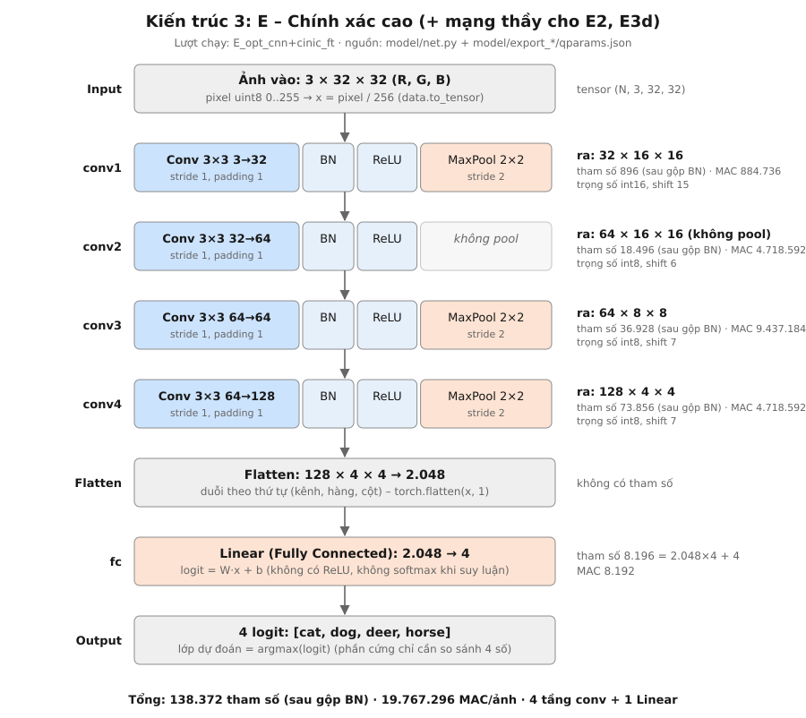
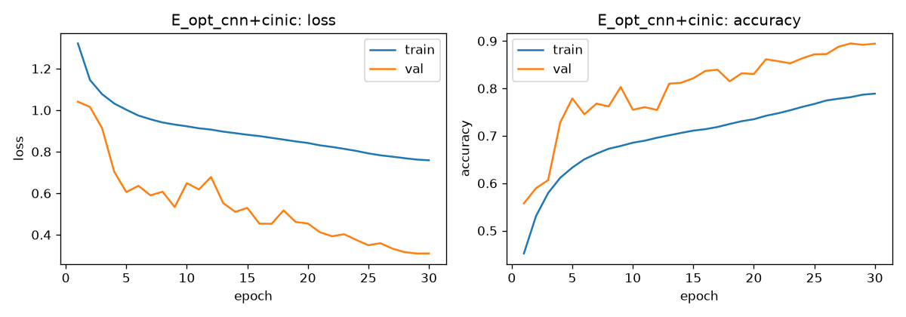
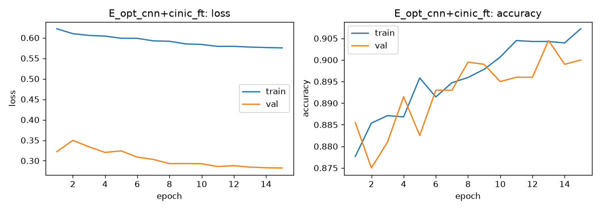
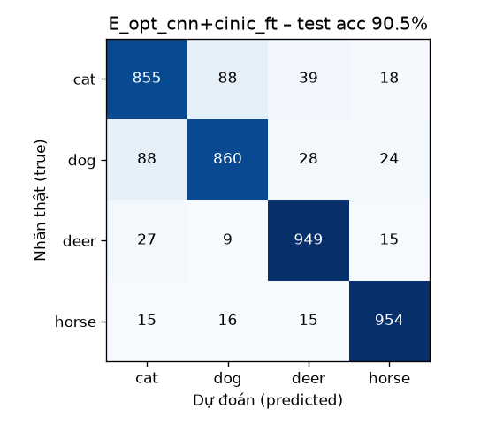
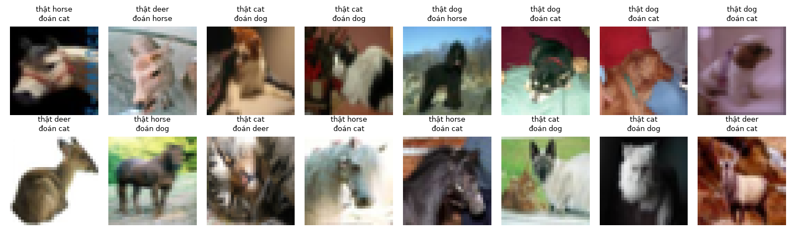

# Kiến trúc 3: E – VGG rút gọn, cặp conv kép ở 16×16 (`E_opt_cnn+cinic_ft`)

← [05_ARCHITECTURE_2_B3c.md](05_ARCHITECTURE_2_B3c.md) · [Mục lục](README.md) · [07_ARCHITECTURE_4_E2.md](07_ARCHITECTURE_4_E2.md) →

| Thông tin | Giá trị |
|---|---|
| Mã trong dự án | **E** – Chính xác cao (+ mạng thầy cho E2, E3d) |
| Tên lượt chạy cuối (checkpoint, thư mục export) | `E_opt_cnn+cinic_ft` |
| File định nghĩa | `model/net.py` – lớp `VGGLite` (dòng 75–94), cấu hình ở dòng 56 |
| Lệnh tạo ra mô hình | `model/kiem_chung.py` – `MODELS["E"]` (dòng 70–77) |
| Số tầng conv / Linear | 4 / 1 |
| Tham số (sau gộp BN) | 138.372 |
| MAC / ảnh | 19.767.296 |
| Trọng số thật trên FPGA | 136,8 KB (BRAM ước lượng ~79%) |
| **Test số nguyên (= FPGA)** | **90,65%** |
| Test float | 90,45% |
| Thời gian huấn luyện (laptop) | 70,0 phút |

Mọi số trong file này được tính từ chính code trên nhánh `main` hoặc đọc từ file kết quả đã commit (`model/results.md`,
`model/export_E_opt_cnn+cinic_ft/qparams.json`). Các kết quả là số chạy thật trên laptop
`LAPTOP-2RM30BH4` của nhóm (`model/kiem_chung_log.json`).

---

## 1. Ý tưởng thiết kế

**Ý tưởng.** Theo VGG: thay vì một conv 5×5, xếp **hai conv 3×3 liền nhau** (không pool ở giữa). Hai conv 3×3 nhìn được
vùng 5×5 nhưng ít tham số hơn (2×9 = 18 so với 25 hệ số mỗi cặp kênh) và có thêm một ReLU (thêm phi tuyến). E đặt cặp
conv kép `64→64` ở độ phân giải **16×16**, mở đầu rộng hơn B (32 kênh thay vì 16), kết thúc ở 128 kênh.

**Mục tiêu.** Mô hình **chính xác cao** và đồng thời là **mạng thầy** (teacher) để dạy E2, E3d bằng distillation
(`model/kiem_chung.py` dòng 44: `TEACHER = "E_opt_cnn+cinic_ft"`).

**Cái giá.** Conv3 (64→64 ở 16×16) tốn 9.437.184 MAC – **48% toàn mạng** (mục 3.3). Đặt conv kép ở độ phân giải cao là
"đắt" nhất về tốc độ.

**Đặc điểm nổi bật.**
- 4 conv: 3→32 (pool) · 32→64 (không pool) · 64→64 (pool) · 64→128 (pool) → Linear 2.048→4.
- 2 lượt huấn luyện: `+cinic` 30 epoch → `_ft` 15 epoch. Không học từ thầy (chính nó là thầy).

---

## 2. Phân tích cấu trúc mạng



### 2.1. Luồng dữ liệu từ Input đến Output

```text
Input 3×32×32 (pixel/256)
→ conv1: Conv 3×3, 3→32, stride 1, padding 1   → 32×32×32
→ BatchNorm2d(32)   → ReLU
→ MaxPool 2×2, stride 2   → 32×16×16
→ conv2: Conv 3×3, 32→64, stride 1, padding 1   → 64×16×16
→ BatchNorm2d(64)   → ReLU
   (không MaxPool – giữ nguyên kích thước)
→ conv3: Conv 3×3, 64→64, stride 1, padding 1   → 64×16×16
→ BatchNorm2d(64)   → ReLU
→ MaxPool 2×2, stride 2   → 64×8×8
→ conv4: Conv 3×3, 64→128, stride 1, padding 1   → 128×8×8
→ BatchNorm2d(128)   → ReLU
→ MaxPool 2×2, stride 2   → 128×4×4
→ Flatten   → 2048
→ Linear 2048→4   → 4 logit (cat, dog, deer, horse)
→ argmax   → lớp dự đoán (0..3)
```

Cấu hình `(64, False)` ở vị trí thứ 2 làm conv2 giữ nguyên 16×16, nên conv3 (cũng 64 kênh) chạy trên 16×16 rồi mới pool.

### 2.2. Bảng từng module (đúng thứ tự trong `nn.Sequential`)

Kích thước đo bằng cách cho một tensor `(1, 3, 32, 32)` chạy qua từng module của `net.build("E_opt_cnn+cinic_ft")`. Activation function của
mọi tầng conv là **ReLU** (module riêng ngay sau BN); tầng Linear cuối **không** có activation.

| # | Module PyTorch | Chức năng | Vào (C×H×W) | Ra (C×H×W) | Số filter | Kernel | Stride | Padding | Neuron | Tham số học được |
|---|---|---|---|---|---|---|---|---|---|---|
| 0 | `Conv2d(3, 32, 3, padding=1, bias=False)` | tích chập conv1 | 3 × 32 × 32 | 32 × 32 × 32 | 32 | 3×3 | 1 | 1 | – | 864 = 3·3·3·32 |
| 1 | `BatchNorm2d(32)` | chuẩn hoá từng kênh | 32 × 32 × 32 | 32 × 32 × 32 | – | – | – | – | – | 64 = 2·32 (γ, β); + 32+32 thống kê μ, σ² không học |
| 2 | `ReLU()` | kích hoạt max(0, x) | 32 × 32 × 32 | 32 × 32 × 32 | – | – | – | – | – | 0 |
| 3 | `MaxPool2d(2)` | lấy max mỗi ô 2×2 | 32 × 32 × 32 | 32 × 16 × 16 | – | 2×2 | 2 | 0 | – | 0 |
| 4 | `Conv2d(32, 64, 3, padding=1, bias=False)` | tích chập conv2 | 32 × 16 × 16 | 64 × 16 × 16 | 64 | 3×3 | 1 | 1 | – | 18.432 = 3·3·32·64 |
| 5 | `BatchNorm2d(64)` | chuẩn hoá từng kênh | 64 × 16 × 16 | 64 × 16 × 16 | – | – | – | – | – | 128 = 2·64 (γ, β); + 64+64 thống kê μ, σ² không học |
| 6 | `ReLU()` | kích hoạt max(0, x) | 64 × 16 × 16 | 64 × 16 × 16 | – | – | – | – | – | 0 |
| 7 | `Conv2d(64, 64, 3, padding=1, bias=False)` | tích chập conv3 | 64 × 16 × 16 | 64 × 16 × 16 | 64 | 3×3 | 1 | 1 | – | 36.864 = 3·3·64·64 |
| 8 | `BatchNorm2d(64)` | chuẩn hoá từng kênh | 64 × 16 × 16 | 64 × 16 × 16 | – | – | – | – | – | 128 = 2·64 (γ, β); + 64+64 thống kê μ, σ² không học |
| 9 | `ReLU()` | kích hoạt max(0, x) | 64 × 16 × 16 | 64 × 16 × 16 | – | – | – | – | – | 0 |
| 10 | `MaxPool2d(2)` | lấy max mỗi ô 2×2 | 64 × 16 × 16 | 64 × 8 × 8 | – | 2×2 | 2 | 0 | – | 0 |
| 11 | `Conv2d(64, 128, 3, padding=1, bias=False)` | tích chập conv4 | 64 × 8 × 8 | 128 × 8 × 8 | 128 | 3×3 | 1 | 1 | – | 73.728 = 3·3·64·128 |
| 12 | `BatchNorm2d(128)` | chuẩn hoá từng kênh | 128 × 8 × 8 | 128 × 8 × 8 | – | – | – | – | – | 256 = 2·128 (γ, β); + 128+128 thống kê μ, σ² không học |
| 13 | `ReLU()` | kích hoạt max(0, x) | 128 × 8 × 8 | 128 × 8 × 8 | – | – | – | – | – | 0 |
| 14 | `MaxPool2d(2)` | lấy max mỗi ô 2×2 | 128 × 8 × 8 | 128 × 4 × 4 | – | 2×2 | 2 | 0 | – | 0 |
| 15 | `torch.flatten(x, 1)` | duỗi phẳng | 128 × 4 × 4 | 2048 | – | – | – | – | – | 0 |
| 16 | `Linear(2048, 4)` | phân loại → 4 logit | 2048 | 4 | – | – | – | – | 4 | 8.196 = 2.048·4 + 4 |

Ghi chú các cột: "Số filter" = số kênh ra = số bộ lọc 3×3×C_in; "Neuron" chỉ có ý nghĩa với Linear (4 neuron = 4 lớp).
Mọi conv: stride 1, padding 1, `bias=False`; mọi MaxPool: kernel 2, stride 2, padding 0 (mặc định PyTorch).

---

## 3. Giải thích toàn bộ phép tính

### 3.1. Kích thước feature map sau mỗi tầng

Công thức kích thước đầu ra của **Convolution** (dùng cho cả chiều cao H và chiều rộng W):

```text
H_out = floor((H_in + 2·P − K) / S) + 1
```

- `H_in`: kích thước vào · `K = 3`: kích thước kernel · `P = 1`: padding (số viền 0 thêm mỗi phía) · `S = 1`: stride (bước trượt). Mọi conv trong dự án đều `kernel_size=3, padding=1` (stride mặc định 1).

Công thức của **MaxPool2d(2)** (PyTorch mặc định `stride = kernel_size = 2`, `padding = 0`):

```text
H_out = floor((H_in + 2·0 − 2) / 2) + 1 = H_in / 2   (khi H_in chẵn)
```

| Tầng | Conv: thay số | Kết quả conv | Pool: thay số | Kết quả sau tầng |
|---|---|---|---|---|
| conv1 | floor((32 + 2·1 − 3)/1) + 1 = 32 | 32×32×32 | floor((32 − 2)/2) + 1 = 16 | **32×16×16** |
| conv2 | floor((16 + 2·1 − 3)/1) + 1 = 16 | 64×16×16 | không pool | **64×16×16** |
| conv3 | floor((16 + 2·1 − 3)/1) + 1 = 16 | 64×16×16 | floor((16 − 2)/2) + 1 = 8 | **64×8×8** |
| conv4 | floor((8 + 2·1 − 3)/1) + 1 = 8 | 128×8×8 | floor((8 − 2)/2) + 1 = 4 | **128×4×4** |

Nhận xét: với `K = 3, P = 1, S = 1` thì `H_out = H_in` – conv **không đổi** kích thước, chỉ đổi số kênh. Mọi việc thu nhỏ ảnh đều do MaxPool.

Sau tầng conv cuối là Flatten: `128 × 4 × 4 = 2.048` số → Linear `2.048 → 4`.

### 3.2. Số tham số

Công thức (trọng số conv có `bias=False` vì ngay sau là BatchNorm – `model/net.py` dòng 33–34 và 83):

```text
Conv (PyTorch)      = K_h·K_w·C_in·C_out                (không bias)
BatchNorm (PyTorch) = 2·C_out                           (γ và β; μ, σ² là thống kê, không học)
Conv sau gộp BN     = K_h·K_w·C_in·C_out + C_out          (mỗi kênh ra 1 bias, xem fold_bn)
Linear              = N_in·N_out + N_out
```

| Tầng | Trọng số conv | BN (γ, β) | **PyTorch học** | **Sau gộp BN (phần cứng)** | % tổng phần cứng |
|---|---|---|---|---|---|
| conv1 | 3·3·3·32 = 864 | 2·32 = 64 | 928 | 864 + 32 = 896 | 0,6% |
| conv2 | 3·3·32·64 = 18.432 | 2·64 = 128 | 18.560 | 18.432 + 64 = 18.496 | 13,4% |
| conv3 | 3·3·64·64 = 36.864 | 2·64 = 128 | 36.992 | 36.864 + 64 = 36.928 | 26,7% |
| conv4 | 3·3·64·128 = 73.728 | 2·128 = 256 | 73.984 | 73.728 + 128 = 73.856 | 53,4% |
| fc | 2.048·4 = 8.192 | – | 8.196 | 8.192 + 4 = 8.196 | 5,9% |
| **Tổng** | | | **138.660** | **138.372** | 100% |

- **138.660** = số PyTorch thực sự học (`sum(p.numel() for p in model.parameters())` – đã chạy để kiểm chứng).
- **138.372** = số mà dự án ghi trong mọi bảng (`net.count_params`, `model/net.py` dòng 112–148) – là số lưu trên phần cứng sau khi gộp BN.
- Chênh 288 = 32 + 64 + 64 + 128: mỗi kênh có 2 tham số BN (γ, β) nhưng sau khi gộp chỉ còn 1 bias.
- Ngoài ra BN còn 576 số thống kê (running mean, running var) – lưu trong checkpoint nhưng không học bằng gradient.

### 3.3. Số phép nhân–cộng (MAC) và thời gian ước lượng

MAC (multiply–accumulate, một phép nhân rồi cộng dồn) của một conv: mỗi điểm ra cần `C_in·K·K` phép nhân.

```text
MAC_conv = H_out·W_out·C_out · (C_in·K·K)          MAC_linear = N_in·N_out
```

| Tầng | Thay số | MAC | % tổng |
|---|---|---|---|
| conv1 | 32·32·32·(3·3·3) | 884.736 | 4,5% |
| conv2 | 16·16·64·(32·3·3) | 4.718.592 | 23,9% |
| conv3 | 16·16·64·(64·3·3) | 9.437.184 | 47,7% |
| conv4 | 8·8·128·(64·3·3) | 4.718.592 | 23,9% |
| fc | 2.048·4 | 8.192 | 0,04% |
| **Tổng** | | **19.767.296** ≈ 19,77 triệu | 100% |

BatchNorm (sau khi gộp), ReLU (so sánh với 0) và MaxPool (so sánh) không có phép nhân nên không tính vào MAC.

**Ước lượng thời gian một ảnh** (công thức của `kiem_chung.py` dòng 352–353: `MAC ÷ (số DSP × tần số)`, giả sử mỗi DSP làm 1 MAC/chu kỳ và bận 100% – mạch thật chậm hơn 20–40%):

| Cấu hình | Thay số | Thời gian |
|---|---|---|
| 16 DSP @ 20 MHz | 19.767.296 / (16·20·10⁶) | 61,8 ms |
| 16 DSP @ 100 MHz | 19.767.296 / (16·100·10⁶) | 12,4 ms |
| 64 DSP @ 100 MHz | 19.767.296 / (64·100·10⁶) | 3,1 ms |

### 3.4. Bộ nhớ trên FPGA

Bộ nhớ trọng số thật trên FPGA (công thức `hw_numbers`, `model/kiem_chung.py` dòng 202–218): trọng số int8 (conv1: int16) + bias int32 (4 byte).

| Tầng | Trọng số | Bias | Byte |
|---|---|---|---|
| conv1 | 864 × 2 byte | 32 × 4 byte | 1.856 |
| conv2 | 18.432 × 1 byte | 64 × 4 byte | 18.688 |
| conv3 | 36.864 × 1 byte | 64 × 4 byte | 37.120 |
| conv4 | 73.728 × 1 byte | 128 × 4 byte | 74.240 |
| fc | 8.192 × 1 byte | 4 × 4 byte | 8.208 |
| **Tổng** | | | **140.112 byte = 136,83 KB** |

Bộ đệm ảnh trung gian (uint8, `kiem_chung.py` giả sử chỉ giữ bản đồ vào + bản đồ ra của tầng đang tính, pool làm ngay khi ghi): conv1: 3·32² + 32·16² = 11.264 byte · conv2: 32·16² + 64·16² = 24.576 byte · conv3: 64·16² + 64·8² = 20.480 byte · conv4: 64·8² + 128·4² = 6.144 byte. Lớn nhất: **conv2 = 24,0 KB**.

BRAM ước lượng = (trọng số + bộ đệm lớn nhất) / BRAM của chip = (140.112 + 24.576) / (1.620·1.024/8 = 207.360 byte) ≈ **79,4%**. Con số này **chưa tính** phần BRAM bị lẻ khối 18 Kb và bộ đệm dòng của RTL – thực tế cao hơn.

### 3.5. Trường tiếp nhận (receptive field)

Trường tiếp nhận (receptive field, RF) = số pixel ảnh gốc (theo một chiều) ảnh hưởng tới một điểm của feature map. Đây là phép tính **lý thuyết** từ cấu hình trong code (dự án không tự tính):

```text
RF_mới = RF_cũ + (K − 1)·j        j_mới = j·S        (bắt đầu RF = 1, j = 1)
```

| Sau | K | S | RF | j (khoảng cách 2 điểm kề nhau, tính bằng pixel gốc) |
|---|---|---|---|---|
| conv1 | 3 | 1 | 3 | 1 |
| pool1 | 2 | 2 | 4 | 2 |
| conv2 | 3 | 1 | 8 | 2 |
| conv3 | 3 | 1 | 12 | 2 |
| pool3 | 2 | 2 | 14 | 4 |
| conv4 | 3 | 1 | 22 | 4 |
| pool4 | 2 | 2 | 26 | 8 |

→ Mỗi điểm của feature map cuối "nhìn" một vùng **26×26 pixel** của ảnh 32×32.

### 3.6. Lượng tử hoá (số nguyên cho phần cứng)

Thông số lượng tử hoá **đã commit** trong `model/export_E_opt_cnn+cinic_ft/qparams.json` (sinh bởi `quantize.py` trên laptop của nhóm):

| Tầng | Bit W | f_in | fw | f_acc = f_in+fw | f_out | shift = f_acc − f_out | a_max (phân vị 99,99%) | MaxPool |
|---|---|---|---|---|---|---|---|---|
| conv1 | int16 | 8 | 11 | 19 | 4 | 15 | 8,227 | có |
| conv2 | int8 | 4 | 7 | 11 | 5 | 6 | 4,096 | không |
| conv3 | int8 | 5 | 8 | 13 | 6 | 7 | 2,752 | có |
| conv4 | int8 | 6 | 7 | 13 | 6 | 7 | 2,610 | có |
| fc | int8 | 6 | 8 | 14 | – | – | – | – |

**Ví dụ thay số cho conv1** (công thức trong `quantize.py` dòng 99–130):

- Trọng số conv1 sau lượng tử nằm trong `[-20093, 15746]` với `fw = 11` → giá trị thực lớn nhất ≈ 20093 / 2^11 = 9,811. `frac_bits_for` chọn `fw = floor(log2(32767 / max|W|))`: đây là `fw` lớn nhất mà max|W|·2^fw vẫn ≤ 32767.
- Ảnh vào là pixel/256 → `f_in = 8`. Tổng tích luỹ có thang `f_acc = 8 + 11 = 19`.
- Activation lớn nhất (phân vị 99,99% trên 2.000 ảnh) `a_max = 8,227` → `f_out = floor(log2(255 / 8,227)) = floor(4,954) = 4`.
- `shift = 19 − 4 = 15` → phần cứng tính `y = (acc + 2^14) >> 15` rồi kẹp về 0..255.

**Bộ cộng dồn có đủ 32 bit không?** Trường hợp xấu nhất mỗi tầng = max theo kênh ra của `Σ|Wq|·255 + |bq|` (tính từ `qparams.npz` đã commit):

| Tầng | Giá trị xấu nhất | Số bit cần (kể cả bit dấu) |
|---|---|---|
| conv1 | 50.482.709 | 27 |
| conv2 | 466.909 | 20 |
| conv3 | 2.435.642 | 23 |
| conv4 | 1.556.874 | 22 |
| fc | 5.792.334 | 24 |

→ Lớn nhất 27 bit < 32 bit: int32 **đủ**, không tràn.

### 3.7. Loss, softmax và argmax – thay số thật

Ví dụ thật: **ảnh test số 0** (nhãn cat). Logit số nguyên do golden model tính, lưu trong `testvec/img00_fc.mem`; logit của tầng fc có thang `f_acc = 14` nên giá trị thực = số nguyên / 2^14:

| | cat | dog | deer | horse |
|---|---|---|---|---|
| Logit số nguyên | 72.847 | 14.120 | -46.169 | -40.862 |
| Logit thực (/2^14) | 4,446 | 0,862 | -2,818 | -2,494 |
| Softmax p = e^z / Σe^z | 0,9714 | 0,0270 | 0,0007 | 0,0009 |

- **Dự đoán** = argmax = cat (đúng). Phần cứng chỉ cần so sánh 4 số nguyên, không cần softmax.
- **Cross-entropy** (khi huấn luyện, nhãn cứng): `L = −ln p_cat = −ln 0,9714 = 0,0290`.
- **Có label smoothing 0,1** (công thức opt): nhãn đích thành (0,925; 0,025; 0,025; 0,025) → `L = −Σ q_i·ln p_i = 0,4737`.
- Mức loss thấp nhất có thể đạt với label smoothing = entropy của nhãn đích = `−(0,925·ln 0,925 + 3·0,025·ln 0,025) = 0,349` → giải thích vì sao train loss của các lượt `--recipe opt` không xuống dưới ~0,35 trong khi val loss (tính **không** có label smoothing, `train.py` dòng 39) xuống thấp hơn.

---

## 4. Phân tích source code tương ứng

**Cấu hình kiến trúc** – `model/net.py` dòng 56:

```python
    "E_opt_cnn": ((32, True), (64, False), (64, True), (128, True)),
```

**Lớp xây dựng mô hình** – `net.build("E_opt_cnn+cinic_ft")` (dòng 97–104) bỏ phần sau dấu `+` (`"E_opt_cnn+cinic_ft".split("+")[0]` =
`"E_opt_cnn"`), rồi tra `OPT_ARCHS` và gọi `VGGLite(cfg)`.
Phần `+...` chỉ là nhãn để mỗi lượt huấn luyện có checkpoint và thư mục export riêng.

```python
# model/net.py dòng 75–94
class VGGLite(nn.Module):
    def __init__(self, cfg, n_classes=4):
        super().__init__()
        layers, c_in, size = [], 3, 32
        for c_out, pool in cfg:                                    # mỗi phần tử = 1 tầng conv
            layers += [nn.Conv2d(c_in, c_out, kernel_size=3, padding=1, bias=False),   # dòng 83
                       nn.BatchNorm2d(c_out), nn.ReLU()]                               # dòng 84
            if pool:                                               # dòng 85
                layers.append(nn.MaxPool2d(2))                     # dòng 86
                size //= 2                                         # dòng 87: theo dõi kích thước ảnh
            c_in = c_out
        self.features = nn.Sequential(*layers)
        self.classifier = nn.Linear(c_in * size * size, n_classes)  # dòng 90
        self.cfg, self.use_bn = tuple(cfg), True

    def forward(self, x):
        return self.classifier(torch.flatten(self.features(x), 1))   # dòng 94
```

**Đoạn code nào tạo ra tầng nào:**

| Thành phần trong sơ đồ | Index trong `model.features` / thuộc tính | Dòng code tạo ra |
|---|---|---|
| conv1 → BN → ReLU → MaxPool | `features[0]`, `[1]`, `[2]`, `[3]` | `net.py` dòng 83–84, 86 (phần tử thứ 1 của cấu hình) |
| conv2 → BN → ReLU (không pool) | `features[4]`, `[5]`, `[6]` | `net.py` dòng 83–84 (phần tử thứ 2 của cấu hình) |
| conv3 → BN → ReLU → MaxPool | `features[7]`, `[8]`, `[9]`, `[10]` | `net.py` dòng 83–84, 86 (phần tử thứ 3 của cấu hình) |
| conv4 → BN → ReLU → MaxPool | `features[11]`, `[12]`, `[13]`, `[14]` | `net.py` dòng 83–84, 86 (phần tử thứ 4 của cấu hình) |
| Flatten | trong `forward` | `net.py` dòng 94 |
| Linear 2048→4 | `model.classifier` | `net.py` dòng 90 |

**Vì sao tác giả viết như vậy:**
- `bias=False` trong conv: BN ngay sau đã có β làm việc của bias; giữ bias sẽ thừa tham số (bị BN triệt tiêu khi trừ trung bình).
- Không chuẩn hoá đầu vào bằng mean/std mà chỉ chia 256 (`data.py` dòng 36–38): chia 256 = dịch phải 8 bit, phần cứng làm "miễn phí";
  BN đầu tiên tự học phần chuẩn hoá (docstring `data.py` dòng 6–9).
- Linear không có ReLU và mô hình không có softmax: phần cứng chỉ cần argmax của 4 logit (`docs/model_spec.md`).
- `count_params`/`count_macs` (dòng 112–148) không đếm trên PyTorch mà tính bằng công thức theo cấu hình, để ra **số phần cứng sau gộp BN**.

**Các bước sau huấn luyện cho mô hình này** (`kiem_chung.py` dòng 47–49, `stages_after_train`):
`evaluate.py --arch "E_opt_cnn+cinic_ft"` → `quantize.py --arch "E_opt_cnn+cinic_ft" --conv1-bits 16` →
`golden_int.py --arch "E_opt_cnn+cinic_ft"` → `export.py --arch "E_opt_cnn+cinic_ft"`.

---

## 5. Quy trình huấn luyện

| Lượt | Lệnh (do `kiem_chung.py` gọi) | Dữ liệu train | Epoch | Batch | Batch/epoch | Số lần cập nhật | Optimizer · LR | Loss | Tăng cường | Mạng thầy |
|---|---|---|---|---|---|---|---|---|---|---|
| `E_opt_cnn+cinic` | `python model/train.py --arch "E_opt_cnn+cinic" --recipe opt --extra-data --cifar-repeat 2 --epochs 30` | CIFAR 18.000 ×2 + CINIC 84.000 = 120.000 | 30 | 128 | 938 | 28.140 | SGD nesterov m=0,9, lr 0,05, wd 5e-4 (chỉ W), warmup 5 + cosine | CE + label smoothing 0,1 | crop + lật + sáng/tương phản ±20% + Cutout 12 | – |
| `E_opt_cnn+cinic_ft` | `python model/train.py --arch "E_opt_cnn+cinic_ft" --init "E_opt_cnn+cinic" --recipe opt --lr 0.005 --warmup 0 --epochs 15` | CIFAR 18.000 | 15 | 128 | 141 | 2.115 | SGD nesterov m=0,9, lr 0,005, wd 5e-4 (chỉ W), warmup 0 + cosine | CE + label smoothing 0,1 | crop + lật + sáng/tương phản ±20% + Cutout 12 | – |

Lịch learning rate (tính theo `train.py` dòng 105–108 cho công thức gốc, `opt_recipe` dòng 181–188 cho công thức opt; `sched.step()`
được gọi **sau** mỗi epoch nên epoch 1 dùng giá trị ở `ep = 0`):

| Lượt | Epoch | LR | Cách tính |
|---|---|---|---|
| `E_opt_cnn+cinic` | 1 | 0,01000 | 0,05·(0+1)/5 (warmup) |
| `E_opt_cnn+cinic` | 5 | 0,05000 | 0,05·(4+1)/5 (warmup) |
| `E_opt_cnn+cinic` | 6 | 0,05000 | 0,05·0,5·(1 + cos(π·(5−5)/25)) |
| `E_opt_cnn+cinic` | 18 | 0,02657 | 0,05·0,5·(1 + cos(π·(17−5)/25)) |
| `E_opt_cnn+cinic` | 30 | 0,00020 | 0,05·0,5·(1 + cos(π·(29−5)/25)) |
| `E_opt_cnn+cinic_ft` | 1 | 0,00500 | 0,005·0,5·(1 + cos(π·(0−0)/15)) |
| `E_opt_cnn+cinic_ft` | 8 | 0,00276 | 0,005·0,5·(1 + cos(π·(7−0)/15)) |
| `E_opt_cnn+cinic_ft` | 15 | 0,00005 | 0,005·0,5·(1 + cos(π·(14−0)/15)) |

Từng bước trong một lần cập nhật (chi tiết và công thức: `09_TRAINING_PROCESS.md`):

| Bước | Bản chất | Code |
|---|---|---|
| Khởi tạo mô hình | `net.build` tạo mạng với trọng số ngẫu nhiên (khởi tạo mặc định của PyTorch); lượt tinh chỉnh nạp trọng số lượt trước qua `--init` | `train.py` dòng 80–84 |
| Loss | `nn.CrossEntropyLoss(label_smoothing=0.1)` | `train.py` dòng 175 |
| Optimizer | SGD(nesterov, momentum 0,9); weight decay 5e-4 chỉ cho tham số ≥ 2 chiều (trọng số conv/linear) | `train.py` dòng 176–180 |
| Chia batch | `DataLoader(..., shuffle=True)` | `data.py` dòng 103–105 |
| Forward / loss / backward / step | `logits = model(x)` → `loss_fn` → `zero_grad` → `backward` → `step` | `train.py` dòng 123–133 |
| Validation mỗi epoch | `evaluate(model, val_loader)` – CE không label smoothing | `train.py` dòng 141–142, 35–46 |
| Lưu model | `torch.save` khi val acc tốt hơn mọi epoch trước | `train.py` dòng 148–151 |
| Test | nạp checkpoint tốt nhất, đo test **một lần** | `train.py` dòng 156–157 |

---

## 6. Đánh giá kết quả

| Lượt | Epoch | Val acc tốt nhất | Test acc (float) | Thời gian (laptop) |
|---|---|---|---|---|
| `E_opt_cnn+cinic` | 30 | 89,50% | 89,20% | 64,7 phút |
| `E_opt_cnn+cinic_ft` | 15 | 90,45% | 90,45% | 5,3 phút |

Lượng tử hoá (mục "Lượng tử hoá (int8) – E_opt_cnn+cinic_ft" của `model/results.md`):

| Chỉ số | Giá trị |
|---|---|
| Sai khác logit lớn nhất sau gộp BN | 4.3e-06 (chỉ là sai số làm tròn số thực) |
| Accuracy float sau gộp BN | 90,45% |
| **Accuracy số nguyên (golden = FPGA)** | **90,65%** |
| Chênh số nguyên − float | +0,20 điểm % |
| Trùng dự đoán float ↔ số nguyên | 99,0% |
| golden_int.py ↔ PyTorch trùng từng bit | Có |

Tôi đã chạy lại `golden_int` trên `qparams.npz` đã commit: ra **90,65%** – khớp bảng trên.

**Ma trận nhầm lẫn float** (`evaluate.py`, hàng = nhãn thật, cột = dự đoán; mỗi lớp 1.000 ảnh):

| | cat | dog | deer | horse |
|---|---|---|---|---|
| **cat** | **855** | 88 | 39 | 18 |
| **dog** | 88 | **860** | 28 | 24 |
| **deer** | 27 | 9 | **949** | 15 |
| **horse** | 15 | 16 | 15 | **954** |

**Precision / Recall / F1** – dự án **không** tự tính các chỉ số này; tôi tính thêm từ ma trận trên để minh hoạ (công thức ở `11_EVALUATION_AND_RESULTS.md`):

| Lớp | Precision | Recall (= accuracy từng lớp) | F1 | Accuracy số nguyên từng lớp (golden) |
|---|---|---|---|---|
| cat | 86,8% | 85,5% | 86,2% | 85,8% |
| dog | 88,4% | 86,0% | 87,2% | 86,5% |
| deer | 92,0% | 94,9% | 93,5% | 94,8% |
| horse | 94,4% | 95,4% | 94,9% | 95,5% |
| **Trung bình (macro)** | 90,4% | 90,5% | 90,4% | 90,7% |

Cặp nhầm nhiều nhất: **dog → cat** (88 ảnh), tiếp theo **cat → dog** (88 ảnh). Riêng cặp cat↔dog chiếm 176 / 382 ảnh sai (46%).

**Đọc đường học** (`train_E_opt_cnn+cinic.png`): train acc tăng chậm đều tới ~0,79 còn val acc lên ~0,89 – khoảng cách do dữ liệu
CINIC + tăng cường + label smoothing như B3c. Val dao động khi LR còn lớn (5 epoch warmup tới 0,05) rồi mượt dần khi cosine giảm LR về 0.









---

## 7. Ưu điểm, nhược điểm, khi nào dùng

**Ưu điểm**
- Chính xác nhất: 90,65% số nguyên; cat 85,8% (cao nhất trong 5).
- Là mạng thầy cho E2/E3d.
- Lượng tử hoá rất ổn định: số nguyên còn hơn float 0,20 điểm, trùng dự đoán 99,0%.

**Nhược điểm**
- Nhiều phép tính nhất: 19,8 triệu MAC (gấp 7 lần B, gấp 1,56 lần E2).
- BRAM ước lượng ~79% (bộ đệm 64×16×16 lớn nhất) – chật.
- Ở 16 DSP @ 20 MHz cần ~62 ms/ảnh – chưa kịp 30 khung/giây nếu không nâng clock.

**Nên dùng khi:** Khi độ chính xác là ưu tiên số 1 và chấp nhận dùng nhiều DSP/nâng clock; hoặc dùng làm mạng thầy.

So sánh với 4 kiến trúc còn lại: [`12_ARCHITECTURE_COMPARISON.md`](12_ARCHITECTURE_COMPARISON.md).

---

← [05_ARCHITECTURE_2_B3c.md](05_ARCHITECTURE_2_B3c.md) · [Mục lục](README.md) · [07_ARCHITECTURE_4_E2.md](07_ARCHITECTURE_4_E2.md) →
