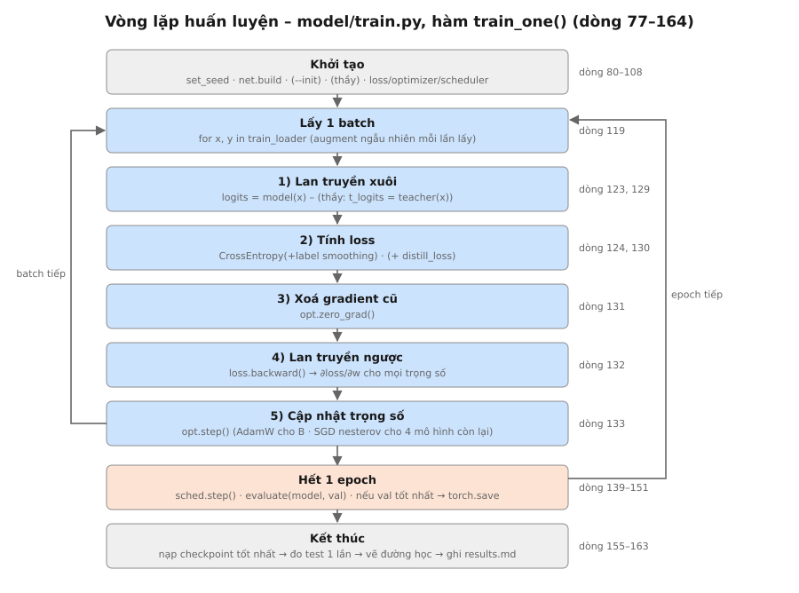
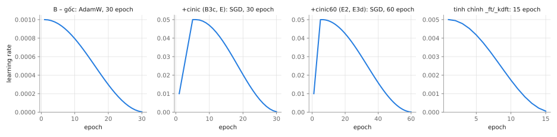

# 09 – Quy trình huấn luyện (chung cho cả 5 kiến trúc)

← [08_ARCHITECTURE_5_E3d.md](08_ARCHITECTURE_5_E3d.md) · [Mục lục](README.md) · [10_QUANTIZATION_AND_HARDWARE.md](10_QUANTIZATION_AND_HARDWARE.md) →

Cả 5 kiến trúc dùng **chung một hàm huấn luyện**: `train_one` trong `model/train.py` (dòng 77–164). Chúng chỉ khác nhau ở **tham số dòng
lệnh**, do `model/kiem_chung.py` khai báo (dòng 57–96). File này giải thích hàm đó từng bước. Phần cấu hình riêng của từng mô hình nằm ở
mục 5 của mỗi file kiến trúc.



---

## 1. Hai công thức huấn luyện

| | **Công thức gốc** (`--recipe base`) – dùng cho B | **Công thức opt** (`--recipe opt`) – dùng cho B3c, E, E2, E3d |
|---|---|---|
| Nơi định nghĩa | `train.py` dòng 101–108 | `opt_recipe`, dòng 167–189; hằng số `config.py` dòng 34–42 |
| Batch | 64 | 128 |
| Tăng cường | crop ±4 px + lật ngang | crop + lật + sáng/tương phản ±20% + Cutout 12×12 |
| Loss | `CrossEntropyLoss()` | `CrossEntropyLoss(label_smoothing=0.1)` |
| Optimizer | `AdamW(lr=1e-3, weight_decay=5e-4)` trên mọi tham số | `SGD(lr=0.05, momentum=0.9, nesterov=True)`; weight decay 5e-4 **chỉ** cho tham số ≥ 2 chiều |
| Lịch LR | `CosineAnnealingLR(T_max=epochs)` | `LambdaLR`: warmup tuyến tính 5 epoch rồi cosine về 0 |
| Epoch mặc định | 30 | 100 (5 mô hình đều ghi rõ `--epochs`) |

**Vì sao 4 mô hình sau dùng công thức khác?** Docstring `opt_recipe` (dòng 168–173) nêu lý do. SGD có momentum thường tốt hơn AdamW với
CNN trên CIFAR (chú thích `config.py` dòng 36). Label smoothing và tăng cường mạnh giảm học thuộc. Warmup tránh "sốc" khi learning rate
lớn gặp trọng số ngẫu nhiên. Tất cả **chỉ ảnh hưởng lúc huấn luyện**; mạng suy luận vẫn chỉ có Conv/BN/ReLU/Pool/Linear.

## 2. Huấn luyện 2 lượt và mạng thầy

| Mô hình | Lượt 1 (học rộng) | Lượt 2 (tinh chỉnh) | Thời gian laptop (lượt 1 + 2) |
|---|---|---|---|
| B | `B_16_32_64`: 30 epoch, chỉ CIFAR | – | 3,4 phút |
| B3c | `B3c_c4x4_128+cinic`: 30 epoch, CIFAR ×2 + CINIC | `+cinic_ft`: 15 epoch CIFAR, lr 0,005 | 26,8 + 2,1 = 28,9 phút |
| E | `E_opt_cnn+cinic`: 30 epoch | `+cinic_ft`: 15 epoch | 64,7 + 5,3 = 70,0 phút |
| E2 | `E2_lite+cinic60`: **60** epoch | `+cinic60_kdft`: 15 epoch **+ thầy E** | 89,6 + 5,7 = 95,3 phút |
| E3d | `E3d_deep5+cinic60`: **60** epoch | `+cinic60_kdft`: 15 epoch **+ thầy E** | 91,0 + 5,2 = 96,2 phút |

(Thời gian lấy từ bảng "So sánh kiến trúc" của `model/results.md`, chạy trên `LAPTOP-2RM30BH4`.)

- **Lượt 1** học trên 120.000 ảnh (CIFAR ×2 + 84.000 ảnh ImageNet của CINIC). Nhiều dữ liệu giúp học đặc trưng tổng quát hơn.
- **Lượt 2** bắt đầu từ trọng số lượt 1 (`--init`) và học tiếp 15 epoch **chỉ trên CIFAR**, lr nhỏ (0,005), không warmup. Mục đích là đưa
  mạng về đúng "miền" ảnh của tập test.
- **Mạng thầy:** lượt 2 của E2 và E3d cộng thêm loss distillation từ checkpoint `E_opt_cnn+cinic_ft` (`kiem_chung.py` dòng 44). Vì vậy
  `kiem_chung.py` luôn chạy E trước E2/E3d (dòng 576–580).

Hiệu quả của lượt 2 (test float, `model/results.md`):

| | Sau lượt 1 | Sau lượt 2 | Thay đổi |
|---|---|---|---|
| B3c | 86,65% | 87,67% | +1,02 |
| E | 89,20% | 90,45% | +1,25 |
| E2 | 89,92% | 90,00% | +0,08 |
| E3d | 89,65% | 90,20% | +0,55 |

Riêng E2, lượt 2 gần như không tăng (+0,08 điểm, tức khoảng 3 ảnh trên 4.000), nằm trong sai số đo.



*Hình: learning rate theo epoch của 4 kiểu lượt chạy (tính đúng công thức trong `train.py`).*

---

## 3. `train_one` từng bước

### Bước 0 – Cố định ngẫu nhiên (`set_seed`, dòng 28–32)

```python
torch.manual_seed(seed); np.random.seed(seed)
torch.use_deterministic_algorithms(True, warn_only=True)
```

Lệnh này cố định khởi tạo trọng số và chuỗi tăng cường ngẫu nhiên (NumPy). Thứ tự xáo trộn batch được cố định riêng bằng generator ở
`data.py` dòng 103, cũng theo `--seed` (mặc định 2027). Trước bản sửa ngày 26/11, generator luôn dùng 2027 bất kể `--seed`
(xem [15_CODE_REVIEW_NOTES.md](15_CODE_REVIEW_NOTES.md) mục B1).

### Bước 1 – Khởi tạo mô hình (dòng 81–84)

```python
model = net.build(arch)                                   # trọng số ngẫu nhiên
if init is not None:                                      # lượt tinh chỉnh
    model.load_state_dict(torch.load(config.CKPT_DIR / f"{init}.pt")["state_dict"])
```

- Code dự án **không** tự viết hàm khởi tạo, nên dùng khởi tạo mặc định của PyTorch:
  - `Conv2d` và `Linear`: phân bố đều kiểu Kaiming;
  - `BatchNorm2d`: γ = 1, β = 0, `running_mean` = 0, `running_var` = 1.
- Lượt `_ft`/`_kdft` thay toàn bộ bằng trọng số của lượt 1.

### Bước 2 – (tuỳ chọn) Mạng thầy (dòng 92–97)

```python
teacher_model = eval_mod.load_model(teacher)              # evaluate.load_model -> .eval()
for p in teacher_model.parameters():
    p.requires_grad_(False)                               # không cập nhật thầy
```

`load_model` (`evaluate.py` dòng 22–26) trả mô hình ở chế độ `eval()`: BN của thầy dùng thống kê cố định, dù trò đang ở chế độ `train()`.

### Bước 3 – Loss, optimizer, lịch LR (dòng 98–108 và `opt_recipe` 167–189)

- **Loss (cross-entropy):** `L = −Σ_i q_i·ln p_i`, trong đó `p = softmax(logit)` và `q` là nhãn:
  - công thức gốc: `q` là one-hot;
  - công thức opt: `q = 0,9·one_hot + 0,1/4`, tức (0,925; 0,025; 0,025; 0,025).
- **Nhóm tham số của SGD** (dòng 176–177):
  - `decay = [p for p in model.parameters() if p.ndim > 1]`: trọng số conv (4 chiều) và trọng số Linear (2 chiều);
  - `no_decay`: γ, β của BN và bias của Linear (1 chiều), không phạt weight decay vì chúng là hệ số co giãn/dịch, phạt sẽ làm hỏng chuẩn
    hoá.
- **Lịch LR opt** (dòng 183–186):

  ```python
  def lr_factor(ep):                      # ep = số epoch đã xong
      if ep < warm:
          return (ep + 1) / warm          # warmup: 0,2; 0,4; 0,6; 0,8; 1,0 (warm = 5)
      return 0.5 * (1 + np.cos(np.pi * (ep - warm) / max(1, epochs - warm)))   # cosine 1 -> 0
  ```

  LR thực = `lr0 · lr_factor(ep)`. Ví dụ lượt 60 epoch:
  - epoch 1: 0,05·0,2 = 0,01;
  - epoch 33 (ep = 32): `0,05·0,5·(1 + cos(π·27/55)) = 0,0257`;
  - epoch 60: 0,00004.

### Bước 4 – Vòng lặp epoch và batch (dòng 116–139)

```python
for ep in range(1, epochs + 1):
    model.train()                                      # BN dùng thống kê của batch
    for x, y in train_loader:                          # chia batch (DataLoader xáo trộn)
        logits = model(x)                              # (1) lan truyền xuôi
        loss = loss_fn(logits, y)                      # (2) tính loss
        if teacher is not None:
            with torch.no_grad():
                t_logits = teacher_model(x)            #     logit của thầy, không tính gradient
            loss = distill_loss(logits, t_logits, loss, kd_alpha, kd_temp)
        opt.zero_grad()                                # (3) xoá gradient cũ
        loss.backward()                                # (4) lan truyền ngược
        opt.step()                                     # (5) cập nhật trọng số
    sched.step()                                       # đổi LR sau mỗi epoch
```

(Code thật còn có nhánh CutMix và EMA ở dòng 120–122, 125–126, 134–135, nhưng cả hai đều tắt với 5 mô hình.)

| Bước | Bản chất | Công thức | Dòng |
|---|---|---|---|
| Chia batch | lấy 64/128 ảnh đã tăng cường | `ceil(N/batch)` batch mỗi epoch | 119 |
| (1) Forward | đưa batch qua mạng | `z = f(x; w)` | 123 |
| (2) Loss | đo sai lệch so với nhãn | CE (+ label smoothing) (+ KD) | 124, 130 |
| (3) `zero_grad` | đặt gradient về 0 | – | 131 |
| (4) `backward` | tính `∂L/∂w` bằng quy tắc dây chuyền | `∂L/∂z = p − q` ở đầu ra, rồi lan ngược | 132 |
| (5) `step` | cập nhật trọng số | AdamW hoặc SGD Nesterov (mục 5 của `03_CNN_FOUNDATIONS.md`) | 133 |
| Ghi nhận | cộng dồn loss và số dự đoán đúng của batch | `run_loss += loss·len(y)`; `correct += (argmax == y)` | 136–138 |
| Đổi LR | cập nhật LR cho epoch sau | theo lịch | 139 |

**Distillation** (dòng 49–57):

```python
soft = kl_div(log_softmax(logits / T), softmax(teacher_logits / T), reduction="batchmean") * T * T
return (1 - alpha) * hard_loss + alpha * soft         # alpha = 0.7, T = 4
```

Ví dụ thay số thật (ảnh test số 0, thầy E, trò E2):
- `soft = T²·KL = 16·0,01379 = 0,2206`;
- `hard = 0,4010` (CE có label smoothing);
- `L = 0,3·0,4010 + 0,7·0,2206 = 0,2748`.

Chi tiết: mục 24 của `03_CNN_FOUNDATIONS.md`.

### Bước 5 – Validation sau mỗi epoch (dòng 141–146 và hàm `evaluate` dòng 35–46)

```python
@torch.no_grad()
def evaluate(model, loader):
    model.eval()                                       # BN dùng running_mean / running_var
    loss_fn = nn.CrossEntropyLoss(reduction="sum")     # CE KHÔNG label smoothing, cộng tổng
    ...
    return total_loss / n, correct / n                 # loss trung bình mỗi ảnh, accuracy
```

- `@torch.no_grad()`: không ghi đồ thị tính toán, nên nhanh và tiết kiệm RAM.
- Val loss **không** có label smoothing và **không** có KD, nên không so sánh trực tiếp được với train loss. Đây là lý do trên đường học của
  các lượt opt, val loss luôn thấp hơn train loss.
- Train acc (dòng 144) đo **trong lúc** huấn luyện: trên ảnh đã tăng cường, BN ở chế độ train, trọng số thay đổi trong suốt epoch. Vì vậy train
  acc thường thấp hơn val acc trong dự án này. Đây **không** phải lỗi.

### Bước 6 – Lưu model tốt nhất (dòng 147–151)

```python
if val_acc > best_val:
    best_val = val_acc
    torch.save({"arch": arch, "state_dict": eval_model.state_dict()}, ckpt_path)   # model/checkpoints/<run>.pt
```

- Chỉ lưu khi val acc **lớn hơn hẳn** mọi epoch trước. Nếu bằng nhau thì giữ epoch sớm hơn.
- Dòng in mỗi epoch có dấu `*` khi checkpoint được lưu (dòng 151–153). Định dạng dòng in:
  `[<run>] epoch  e/E  train loss … acc …  |  val loss … acc … *  (giây)`.

### Bước 7 – Test và lưu kết quả (dòng 155–163)

1. Nạp lại checkpoint **tốt nhất theo val** (không phải epoch cuối), đo trên 4.000 ảnh test **một lần**. Đây là cột "Test acc" của bảng
   `results.md`.
2. `save_curves` (dòng 192–208): vẽ `figures/train_<run>.png` (loss và accuracy train/val theo epoch).
3. Lưu `checkpoints/<run>_history.json`.
4. `append_result` (dòng 211–229): ghi (hoặc thay) dòng của lượt này trong bảng "So sánh kiến trúc" của `results.md`, gồm tham số, MAC,
   KB, số epoch, val acc, test acc, số phút.

---

## 4. Khối lượng huấn luyện của 5 mô hình

| Mô hình | Lượt | Ảnh/epoch | Batch | Batch/epoch | Epoch | Số lần cập nhật |
|---|---|---|---|---|---|---|
| B | 1 | 18.000 | 64 | 282 | 30 | 8.460 |
| B3c, E | 1 | 120.000 | 128 | 938 | 30 | 28.140 |
| B3c, E | 2 | 18.000 | 128 | 141 | 15 | 2.115 |
| E2, E3d | 1 | 120.000 | 128 | 938 | 60 | 56.280 |
| E2, E3d | 2 | 18.000 | 128 | 141 | 15 | 2.115 |

Ở lượt 2 của E2/E3d, mỗi batch còn phải chạy forward của mạng thầy E (19,8 triệu MAC/ảnh).

## 5. Những điều dễ hiểu nhầm khi đọc kết quả huấn luyện

1. **"Train acc thấp hơn val acc, có lỗi không?"** Không. Ảnh train bị tăng cường (khó hơn), lượt 1 còn lẫn 70% ảnh ImageNet khác miền, và
   train acc đo trong chế độ `train()`.
2. **"Train loss không xuống dưới 0,35."** Khi có label smoothing 0,1 và 4 lớp, loss nhỏ nhất có thể là entropy của nhãn làm mềm:
   0,349.
3. **"Val acc tăng giảm thất thường."** Khi LR còn lớn (giai đoạn đầu và giữa của cosine), trọng số thay đổi mạnh mỗi epoch, và val chỉ
   có 2.000 ảnh (1 ảnh = 0,05 điểm %). Val ổn định khi LR nhỏ dần ở cuối.
4. **"Test float trong bảng khác số trong mục Lượng tử hoá?"** Không khác. "Accuracy float (sau gộp BN)" bằng đúng test acc của checkpoint,
   vì gộp BN chỉ sai 10⁻⁶ trên logit.
5. **"Chạy lại trên máy khác ra số hơi khác."** Bình thường. Ví dụ E2: cloud 90,30%, laptop 89,60% số nguyên
   (`docs/so_sanh_5_mo_hinh.md`). Mỗi mô hình mới chạy 1 lần (1 seed).

---

← [08_ARCHITECTURE_5_E3d.md](08_ARCHITECTURE_5_E3d.md) · [Mục lục](README.md) · [10_QUANTIZATION_AND_HARDWARE.md](10_QUANTIZATION_AND_HARDWARE.md) →
