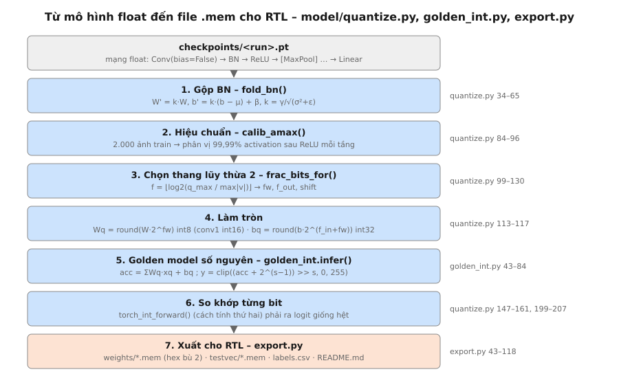

# 10 – Từ mô hình float đến số nguyên cho FPGA

← [09_TRAINING_PROCESS.md](09_TRAINING_PROCESS.md) · [Mục lục](README.md) · [11_EVALUATION_AND_RESULTS.md](11_EVALUATION_AND_RESULTS.md) →

Huấn luyện cho ra trọng số **số thực** (float32). Chip XC7S25 chỉ có 80 DSP48E1 (bộ nhân 25×18 bit số nguyên) và khoảng 202 KB BRAM
(`docs/hardware.md`). File này giải thích cách dự án biến mô hình float thành mô hình **chỉ dùng số nguyên**, có kết quả **trùng từng bit**
với mạch RTL sẽ viết sau. Nhờ vậy "Test số nguyên" trong các bảng chính là độ chính xác mà FPGA sẽ đạt.



Ba file thực hiện:
- `model/quantize.py`: gộp BN, hiệu chuẩn, chọn thang, làm tròn, kiểm tra.
- `model/golden_int.py`: mô hình chuẩn chỉ dùng số nguyên.
- `model/export.py`: xuất file `.mem` cho Verilog.

Lệnh (do `kiem_chung.py` gọi sau khi huấn luyện, dòng 47–49):

```bash
python model/quantize.py --arch "<run>" [--conv1-bits 16]
python model/golden_int.py --arch "<run>"
python model/export.py --arch "<run>"
```

---

## 1. Quy ước số (fixed-point)

Một số thực `v` được lưu bằng số nguyên `q` với `v ≈ q · 2^(−f)`, trong đó `f` là số bit phần lẻ (docstring `golden_int.py` dòng 6–11):

| Đại lượng | Kiểu số nguyên | Số bit phần lẻ f | Ghi chú |
|---|---|---|---|
| Ảnh vào | uint8 (0..255) | 8 | `x = pixel/256` ⇒ q = pixel, không cần tính gì |
| Trọng số conv2…, fc | int8 (−128..127) | `fw`, riêng mỗi tầng | |
| Trọng số conv1 | int8 (B) hoặc **int16** (B3c, E, E2, E3d) | `fw` | khoá `"wbits": 16` trong `qparams.json` |
| Bias | int32 | `f_acc = f_in + fw` | cùng thang với tổng tích luỹ |
| Tổng tích luỹ (accumulator) | int32 | `f_acc` | |
| Activation sau ReLU | uint8 (0..255) | `f_out`, riêng mỗi tầng | |
| Logit (đầu ra fc) | int32 | `f_acc` của fc | chỉ cần argmax nên không đổi thang |

**Mọi thang đều là lũy thừa của 2**, nên đổi thang chỉ là **dịch bit**, không cần bộ nhân hay bộ chia.

## 2. Bước 1 – Gộp BatchNorm vào conv (`fold_bn`, `quantize.py` dòng 34–65)

Khi suy luận, BN là phép tuyến tính theo từng kênh, nên gộp được vào conv đứng trước nó:

```text
BN:   y = γ·(z − μ)/√(σ² + ε) + β,      z = W*x + b
Đặt   k = γ/√(σ² + ε)                       (một số cho mỗi kênh ra)
⇒     y = (k·W)*x + (k·(b − μ) + β)
⇒     W' = k·W,     b' = k·(b − μ) + β       (b = 0 vì conv có bias=False)
```

Trong code:
- `w * k[:, None, None, None]` nhân k theo chiều kênh ra (dòng 52).
- Hàm duyệt `model.features`: Conv → (BN) → ReLU → (MaxPool nếu có). Nó ghi lại khoá `pool` cho từng tầng (dòng 57–60); đây là điểm phân
  biệt E (conv2 không pool), E2 (conv3 không pool), E3d (conv3, conv4 không pool), B3c (conv4 không pool).

**Kiểm tra** (`quantize.py` dòng 177–185): chạy mạng gốc và mạng đã gộp trên 4.000 ảnh test, rồi đo sai khác logit lớn nhất. Số thật
(`model/results.md`):

| Mô hình | B | B3c | E | E2 | E3d |
|---|---|---|---|---|---|
| Sai khác logit lớn nhất | 6,2·10⁻⁶ | 3,7·10⁻⁶ | 4,3·10⁻⁶ | 3,2·10⁻⁶ | 3,9·10⁻⁶ |

Các sai khác cỡ 10⁻⁶ chỉ là sai số làm tròn float32/float64. Phép gộp đúng.

**Tác dụng phụ quan trọng.** `k = γ/√(σ²+ε)` có thể rất lớn ở conv1, vì ảnh vào chỉ chia 256 chứ không chuẩn hoá theo độ lệch chuẩn.
Do đó trọng số conv1 sau gộp lớn bất thường. Ví dụ E2: `max|W'| ≈ 29.645/2¹¹ ≈ 14,5`, trong khi các tầng sau chỉ cỡ 0,3–1,0. Đây là lý do
cần int16 cho conv1 (mục 6).

## 3. Bước 2 – Hiệu chuẩn activation (`calib_amax`, dòng 84–96)

Trọng số đã biết trước, nhưng độ lớn của activation phụ thuộc ảnh. Dự án ước lượng nó như sau:
1. Chọn ngẫu nhiên **2.000 ảnh train**, cố định bằng `default_rng(SEED)` (dòng 188–189).
2. Cho chúng chạy qua mạng đã gộp BN.
3. Tại **mỗi tầng conv**, lấy activation sau ReLU (trước pool) và tính **phân vị 99,99%** (`PERCENTILE`, dòng 31). Gọi kết quả là `a_max`.

Dùng phân vị 99,99% thay cho giá trị lớn nhất để bỏ 0,01% giá trị bất thường, nhờ đó dành độ phân giải cho phần lớn giá trị. Các giá trị
lớn hơn `a_max` sẽ bị **bão hoà** ở 255. Hàm tính từng tầng rồi bỏ activation của tầng trước, để đỡ tốn RAM (chú thích dòng 85–86).

## 4. Bước 3 – Chọn số bit phần lẻ (`frac_bits_for`, dòng 99–101)

```text
f = floor( log2( q_max / max|v| ) )
```

Đây là `f` **lớn nhất** (chính xác nhất) mà `max|v|·2^f ≤ q_max`, tức không bị tràn.

| Loại | `q_max` | `max|v|` lấy từ |
|---|---|---|
| Trọng số int8 | 127 | `max|W'|` của tầng |
| Trọng số int16 (conv1) | 32.767 | `max|W'|` của conv1 |
| Activation uint8 | 255 | `a_max` (phân vị 99,99%) |

Ví dụ số thật (conv1 của E2, `model/export_E2_lite+cinic60_kdft/qparams.json`):
- **Trọng số (int16):** `fw = 11`. Trọng số lớn nhất sau lượng tử là −29.645 ⇒ |W'| ≈ 14,475 ⇒ `log2(32.767/14,475) = 11,14` ⇒ `fw = 11`.
- **Activation:** `a_max = 5,955` ⇒ `f_out = floor(log2(255/5,955)) = floor(5,420) = 5`. Mỗi bước activation = 1/32, và giá trị lớn nhất
  biểu diễn được là 255/32 = 7,97.
- **Thang tích luỹ:** `f_acc = f_in + fw = 8 + 11 = 19`. **Lượng dịch:** `shift = f_acc − f_out = 19 − 5 = 14`.

## 5. Bước 4 – Làm tròn (`quantize`, dòng 104–130)

```python
wq = clip(round(W' · 2^fw), −w_max − 1, w_max)           # int8 (−128..127) hoặc int16
bq = round(b' · 2^(f_in + fw))                           # int32; assert |bq| < 2^31
shift = f_in + fw − f_out ;  assert shift > 0
f_in (tầng sau) = f_out (tầng này)
```

Mọi `shift` của 5 mô hình đều nằm trong khoảng 5..15 (bảng ở mục 3.6 của từng file kiến trúc).

## 6. Vì sao conv1 dùng int16 (B3c, E, E2, E3d)

- **Vấn đề:** như mục 2, trọng số conv1 sau gộp BN rất lớn. Nếu vẫn dùng int8, `fw` sẽ nhỏ, bước làm tròn thô, và sai số lớn:

  | Mô hình | max\|W'\| conv1 (từ qparams) | `fw` nếu int8 | Bước làm tròn int8 | `fw` thực tế (int16) | Bước int16 |
  |---|---|---|---|---|---|
  | B (giữ int8) | 90/2⁴ = 5,6 | 4 | 1/16 | – | – |
  | B3c | 16.537/2¹¹ = 8,07 | 3 | 1/8 | 11 | 1/2.048 |
  | E | 20.093/2¹¹ = 9,81 | 3 | 1/8 | 11 | 1/2.048 |
  | E2 | 29.645/2¹¹ = 14,48 | 3 | 1/8 | 11 | 1/2.048 |
  | E3d | 31.559/2¹² = 7,70 | 4 | 1/16 | 12 | 1/4.096 |

- **Bằng chứng đo được** (máy cloud, ghi trong commit `e3fb269` và `0dabd8c` trên `main`):
  - với `E2_lite+cinic`, conv1 int8 làm mất khoảng 2 điểm %;
  - với `E_opt_cnn+cinic`, conv1 int16 cho 90,38%, còn toàn int8 cho 90,18%.
- **Chi phí phần cứng gần như bằng 0:**
  - conv1 chỉ có 432–864 trọng số, nên int16 tốn thêm < 1 KB;
  - DSP48E1 nhân 25×18 bit, nên int16 × uint8 vẫn vừa **một** DSP (docstring `quantize.py` dòng 105–107);
  - lượng dịch vẫn là một hằng số cho mỗi tầng.
- **Trong code:**
  - `--conv1-bits 16` (`quantize.py` dòng 167–168);
  - `wbits = conv1_bits if i == 0 else 8` (dòng 111);
  - `kiem_chung.py` chọn 16 cho 4 mô hình +cinic (`stages_after_train`, dòng 47–49).

## 7. Mô hình số nguyên (golden model, `golden_int.py`)

Đây là "đáp án chuẩn" cho phần cứng: RTL phải cho ra **kết quả giống hệt từng bit** (docstring dòng 3–4). Chỉ dùng NumPy với số nguyên:
nhân, cộng, dịch bit, so sánh.

**Một tầng conv** (dòng 13–17, 43–60):

```text
acc[o,h,w] = Σ_{c,ky,kx} Wq[o,c,ky,kx] · xq[c, h+ky−1, w+kx−1] + bq[o]     (padding: ngoài biên = 0)
y          = (acc + 2^(shift−1)) >> shift                                   (chia 2^shift, làm tròn)
y          = min(max(y, 0), 255)                                            (ReLU + bão hoà uint8)
out        = MaxPool 2×2 của y   (chỉ khi tầng có pool)
```

- `+ 2^(shift−1)` là cộng nửa bước trước khi dịch, để **làm tròn gần nhất** thay vì làm tròn xuống. Ví dụ *minh hoạ* với `shift = 4`:
  - `acc = 1.000`: (1.000 + 8) >> 4 = 1.008/16 = 63 (vì 62,5 làm tròn lên 63);
  - `acc = −300`: (−300 + 8) >> 4 = −19 (dịch số học giữ dấu), rồi ReLU ⇒ 0;
  - `acc = 9.000`: (9.008) >> 4 = 563, rồi bão hoà ⇒ 255.
- `>>` trên số âm của NumPy là dịch số học, tức làm tròn xuống. Phần cứng phải dùng đúng `>>>` (dịch số học) của Verilog.
- **Tầng fc:** `logit = flat @ Wq.T + bq` (int32), lớp dự đoán = argmax. Không dịch, không ReLU (dòng 80–83).

**Bộ cộng dồn có tràn int32 không?** Trường hợp xấu nhất `Σ|Wq|·255 + |bq|`, tính từ `qparams.npz` đã commit:

| Mô hình | Tầng cần nhiều bit nhất | Số bit (kể cả dấu) |
|---|---|---|
| B | fc | 24 |
| B3c | conv1 (int16) | 27 |
| E | conv1 (int16) | 27 |
| E2 | conv1 (int16) | 27 |
| E3d | conv1 (int16) | 28 |

Mọi tầng đều < 32 bit, nên int32 an toàn. Với các tầng int8, 19–25 bit là đủ, vì vậy RTL có thể dùng bộ cộng hẹp hơn.

## 8. Bước 5 – Kiểm tra khớp từng bit (`quantize.py` dòng 199–207)

- `torch_int_forward` (dòng 147–161) là **cách tính thứ hai**, viết độc lập với `golden_int.py`: nó dùng `F.conv2d` của PyTorch trên
  float64.
- Mọi số nguyên < 2⁵³ biểu diễn chính xác trong float64, nên hai cách **phải** ra logit giống hệt nhau.
- Kết quả của cả 5 mô hình: **"golden_int.py ↔ PyTorch trùng từng bit: Có"** (`model/results.md`).

| Mô hình | Float (sau gộp BN) | Số nguyên | Chênh | Trùng dự đoán float ↔ số nguyên |
|---|---|---|---|---|
| B | 80,23% | 80,00% | −0,22 | 98,0% |
| B3c | 87,67% | 87,60% | −0,08 | 98,0% |
| E | 90,45% | 90,65% | +0,20 | 99,0% |
| E2 | 90,00% | 89,60% | −0,40 | 98,2% |
| E3d | 90,20% | 90,25% | +0,05 | 98,9% |

Lượng tử hoá đổi kết quả của 1–2% số ảnh, nhưng accuracy chỉ lệch ≤ 0,4 điểm, có lúc còn tăng (E, E3d). Vì vậy dự án **không cần**
huấn luyện có lượng tử hoá (QAT); lượng tử hoá sau huấn luyện (PTQ) là đủ.

## 9. Bước 6 – Xuất cho RTL (`export.py`)

**Định dạng `.mem`:** mỗi dòng một số ở hệ 16, dạng **bù 2** (two's complement), đọc bằng `$readmemh` trong Verilog (`to_hex`, dòng 32–36):

| Giá trị | Bit | Cách tính | Hex |
|---|---|---|---|
| −3 | 8 | 256 − 3 = 253 | `fd` |
| 100 | 8 | | `64` |
| −20.093 (trọng số int16) | 16 | 65.536 − 20.093 = 45.443 | `b183` |
| −5 (bias int32) | 32 | 2³² − 5 | `fffffffb` |

**Thứ tự phần tử:**
- Trọng số conv: `W[o][c][ky][kx]`.
- fc: `W[o][k]` với `k = c·(H·W) + h·W + w`.
- Ảnh / feature map: `X[c][h][w]`.

**Nội dung một thư mục export** (ví dụ `model/export_E2_lite+cinic60_kdft/`):

| File | Nội dung |
|---|---|
| `weights/conv1_w.mem` … `fc_w.mem`, `*_b.mem` | trọng số và bias, tổng 138.372 dòng (= số tham số). Ví dụ 3 dòng đầu của `conv1_w.mem`: `04ec 087d 037f` (int16, 4 chữ số hex) |
| `testvec/img00_input.mem` … `img19_*.mem` | 20 ảnh test đầu tiên: ảnh vào (3×32×32) và đầu ra **từng** tầng conv (sau pool nếu có) và fc, tổng 20 × 6 = 120 file |
| `testvec/labels.csv` | nhãn thật và lớp golden dự đoán của 20 ảnh |
| `qparams.npz`, `qparams.json` | tham số số nguyên dạng máy đọc / người đọc (`f_in, fw, f_acc, f_out, shift, a_max, pool, wbits, w_range, b_range`) |
| `README.md` | bảng tầng, công thức, thứ tự phần tử – tài liệu cho người viết RTL |

Ví dụ thật: `testvec/img00_fc.mem` của E2 = `0001bd83 000032c0 ffff0113 ffff100f`, tức logit `114.051; 12.992; −65.261; −61.425`. Argmax = 0
(cat), đúng nhãn. Testbench RTL phải cho ra đúng 4 số này.

## 10. Ước lượng phần cứng

Các con số dưới đây là **ước lượng lý thuyết** của `kiem_chung.hw_numbers` (dòng 202–218), chưa có RTL thật:

| | B | B3c | E | E2 | E3d |
|---|---|---|---|---|---|
| Trọng số thật (W + bias) | 27,4 KB | 104,3 KB | 136,8 KB | 136,8 KB | 145,6 KB |
| Bộ đệm feature map lớn nhất (vào + ra) | 7,0 KB | 7,0 KB | 24,0 KB | 12,0 KB | 9,0 KB |
| BRAM ước lượng (trên 202,5 KB) | ~17% | ~55% | ~79% | ~73% | ~76% |
| MAC/ảnh | 2,81 triệu | 3,99 triệu | 19,77 triệu | 12,69 triệu | 11,58 triệu |
| 16 DSP @ 20 MHz | 8,8 ms | 12,5 ms | 61,8 ms | 39,7 ms | 36,2 ms |
| 16 DSP @ 100 MHz | 1,8 ms | 2,5 ms | 12,4 ms | 7,9 ms | 7,2 ms |
| 64 DSP @ 100 MHz | 0,4 ms | 0,6 ms | 3,1 ms | 2,0 ms | 1,8 ms |

**Giả định và giới hạn:**
- Mỗi DSP làm 1 MAC/chu kỳ và bận 100%; mạch thật chậm hơn khoảng 20–40% (`docs/so_sanh_5_mo_hinh.md`).
- BRAM chưa tính phần bị lẻ khối 18 Kb và các bộ đệm dòng (line buffer), nên thực tế cao hơn.
- `docs/model_spec.md` đặt ngân sách trọng số khoảng 100 KB: 3 mô hình E/E2/E3d **vượt** ngân sách này. Cần kiểm tra khi thiết kế RTL.
- Clock gốc của board là 20 MHz. Camera khoảng 30 khung/giây (33 ms/khung), nên ở 20 MHz với 16 DSP thì E, E2, E3d **chưa** kịp thời
  gian thực; muốn kịp phải nâng clock bằng MMCM hoặc dùng nhiều DSP hơn.
- Kết quả tổng hợp thật (LUT, FF, DSP, BRAM, tần số đạt được) **chưa xác định được**: thư mục `rtl/` hiện chưa có mã Verilog.

---

← [09_TRAINING_PROCESS.md](09_TRAINING_PROCESS.md) · [Mục lục](README.md) · [11_EVALUATION_AND_RESULTS.md](11_EVALUATION_AND_RESULTS.md) →
