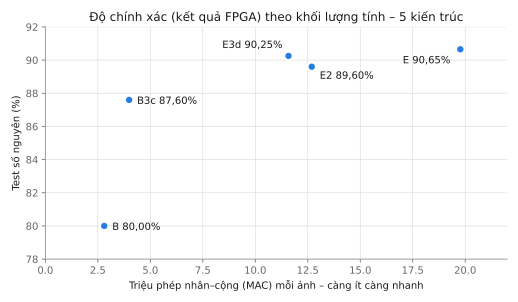
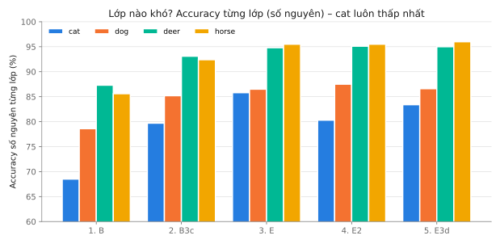
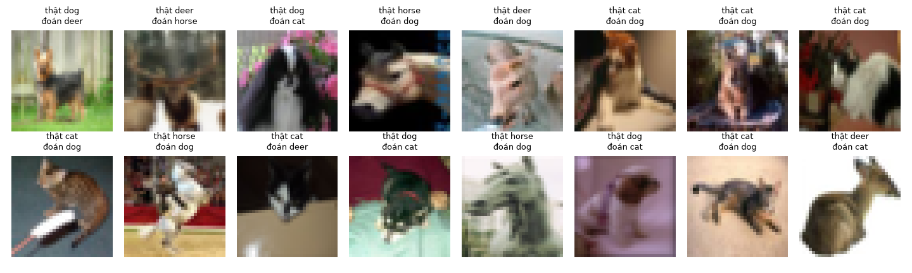
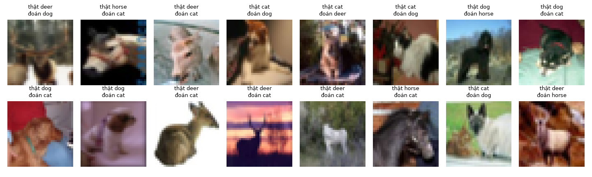
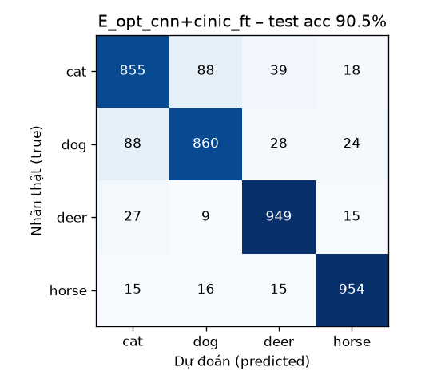
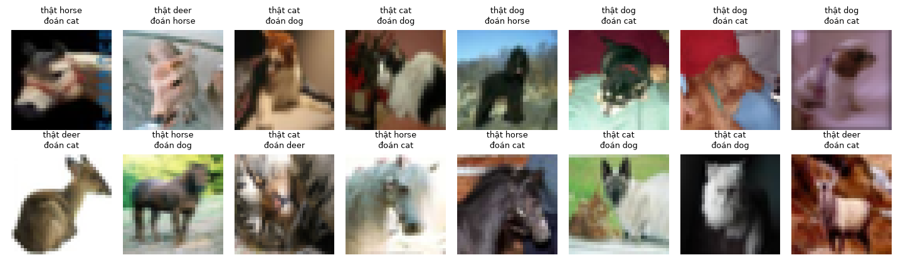
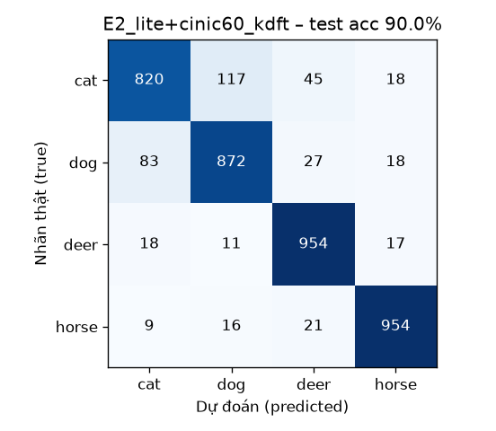
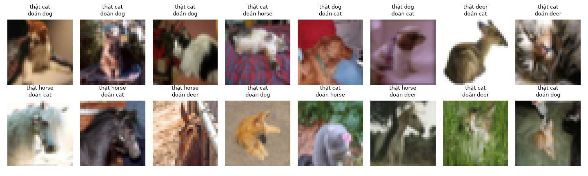
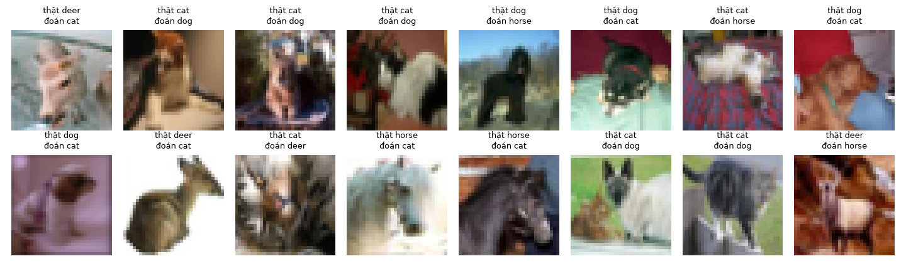
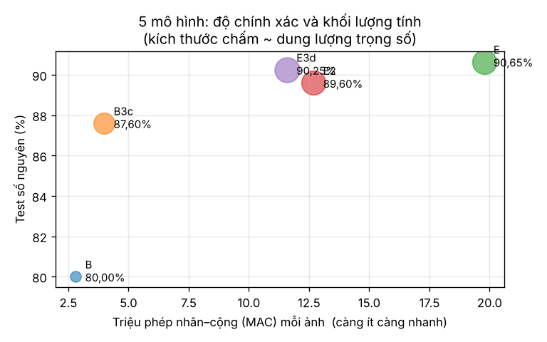

# 11 – Đánh giá và kết quả

← [10_QUANTIZATION_AND_HARDWARE.md](10_QUANTIZATION_AND_HARDWARE.md) · [Mục lục](README.md) · [12_ARCHITECTURE_COMPARISON.md](12_ARCHITECTURE_COMPARISON.md) →

Mọi kết quả trong file này là **số chạy thật trên laptop `LAPTOP-2RM30BH4` của nhóm** (25–26/11/2026, `model/kiem_chung_log.json`),
đọc từ `model/results.md` và `docs/so_sanh_5_mo_hinh.md` trên `main`. Accuracy số nguyên đã được chạy lại bằng `golden_int` trên
`qparams.npz` đã commit và **khớp** đúng từng số.

---

## 1. Kết quả chính của 5 kiến trúc

| | B | B3c | E | E2 | E3d |
|---|---|---|---|---|---|
| Lượt chạy | `B_16_32_64` | `B3c_c4x4_128+cinic_ft` | `E_opt_cnn+cinic_ft` | `E2_lite+cinic60_kdft` | `E3d_deep5+cinic60_kdft` |
| Val acc tốt nhất (float) | 81,55% | 87,30% | 90,45% | 90,20% | 90,70% |
| Test acc float | 80,23% | 87,67% | 90,45% | 90,00% | 90,20% |
| **Test acc số nguyên (= FPGA)** | **80,00%** | **87,60%** | **90,65%** | **89,60%** | **90,25%** |
| Macro-F1 float (tính thêm) | 80,21% | 87,65% | 90,41% | 89,94% | 90,17% |
| Tham số (sau gộp BN) | 27.684 | 105.636 | 138.372 | 138.372 | 147.524 |
| MAC/ảnh | 2.805.760 | 3.989.504 | 19.767.296 | 12.689.408 | 11.582.464 |
| Thời gian huấn luyện (laptop) | 3,4 phút | 28,9 phút | 70,0 phút | 95,3 phút | 96,2 phút |



*Hình: accuracy số nguyên theo số phép nhân–cộng. Bảng số liệu ở ngay trên.*

---

## 2. Các chỉ số dự án thực sự dùng

### 2.1. Accuracy (độ chính xác)

```text
Accuracy = số ảnh đoán đúng / tổng số ảnh
```

- **Ý nghĩa:** tỉ lệ ảnh được phân loại đúng.
- **Cách tính trong code:** `(logits.argmax(1) == y).sum() / n` (`train.py` dòng 44–46); `(pred == y_te).mean()` (`evaluate.py` dòng 49,
  `golden_int.py` dòng 90).
- **Ví dụ (số thật):** E đúng 3.626 / 4.000 ảnh test ở bản số nguyên = 90,65%. Kiểm tra từ ma trận nhầm lẫn số nguyên:
  858 + 865 + 948 + 955 = 3.626.
- **Có 4 loại accuracy trong dự án:**

  | Loại | Đo trên | Mô hình | Dòng code |
  |---|---|---|---|
  | Train acc | ảnh train đã tăng cường, BN chế độ train | float, trong lúc học | `train.py` dòng 137 |
  | Val acc | 2.000 ảnh val | float | `train.py` dòng 142 – **dùng để chọn checkpoint** |
  | Test acc (float) | 4.000 ảnh test | float (PyTorch) | `train.py` dòng 157; `evaluate.py` |
  | Test acc số nguyên | 4.000 ảnh test | golden model | `quantize.py` dòng 201; `golden_int.py` |

- **Cách đọc:** số để báo cáo là **test acc số nguyên**, vì đó là kết quả FPGA sẽ cho ra.

### 2.2. Loss (train loss, val loss)

- **Train loss** là trung bình loss **dùng để học** trên các batch của epoch: CE, có thể kèm label smoothing và KD (`train.py` dòng 136, 143).
- **Val loss** là CE thuần (không label smoothing, không KD), lấy trung bình trên 2.000 ảnh val (`evaluate`, dòng 39–46).
- Hai loss này khác định nghĩa, nên không so sánh trực tiếp được với nhau. Chi tiết: mục 5 của `09_TRAINING_PROCESS.md`.

### 2.3. Ma trận nhầm lẫn (confusion matrix)

- **Định nghĩa:** `CM[i][j]` = số ảnh có nhãn thật `i` mà mô hình đoán là `j`. Đường chéo là số đoán đúng.
- **Cách tính:** `sklearn.metrics.confusion_matrix(y_te, pred, labels=range(4))` (`evaluate.py` dòng 50), trên **mô hình float**.
- **Ví dụ (số thật, E2 float):**

  | thật \ đoán | cat | dog | deer | horse |
  |---|---|---|---|---|
  | **cat** | **820** | 117 | 45 | 18 |
  | **dog** | 83 | **872** | 27 | 18 |
  | **deer** | 18 | 11 | **954** | 17 |
  | **horse** | 9 | 16 | 21 | **954** |

- **Cách đọc:**
  - Hàng cat: trong 1.000 ảnh mèo, 820 ảnh đúng và 117 ảnh bị nhầm thành chó.
  - Cặp cat↔dog chiếm 117 + 83 = 200 trong 400 ảnh sai.
  - **Ở cả 5 mô hình, cặp nhầm nhiều nhất là cat → dog.**

### 2.4. Accuracy từng lớp

```text
acc_lớp_i = CM[i][i] / Σ_j CM[i][j]
```

Đây chính là **recall** của lớp đó (`evaluate.py` dòng 85; `kiem_chung.golden_check` dòng 230 cho bản số nguyên).

| Lớp | B | B3c | E | E2 | E3d |
|---|---|---|---|---|---|
| cat (float / **số nguyên**) | 71,1 / **68,5** | 79,8 / **79,7** | 85,5 / **85,8** | 82,0 / **80,3** | 83,9 / **83,4** |
| dog | 78,0 / **78,6** | 86,4 / **85,2** | 86,0 / **86,5** | 87,2 / **87,5** | 87,0 / **86,6** |
| deer | 86,8 / **87,3** | 92,8 / **93,1** | 94,9 / **94,8** | 95,4 / **95,1** | 94,1 / **95,0** |
| horse | 85,0 / **85,6** | 91,7 / **92,4** | 95,4 / **95,5** | 95,4 / **95,5** | 95,8 / **96,0** |



*Nhận xét:*
- **cat** luôn là lớp khó nhất, rồi đến **dog**. **deer** và **horse** dễ hơn rõ, vì nền ảnh (rừng, đồng cỏ) và dáng hình khác hẳn chó/mèo.
- Khi mô hình tốt lên, chênh lệch giữa các lớp thu hẹp: B có cat 68,5% so với horse 85,6% (chênh 17 điểm); E có 85,8% so với 95,5% (chênh
  10 điểm).

### 2.5. Các chỉ số phần cứng

| Chỉ số | Ý nghĩa | Nơi tính |
|---|---|---|
| Sai khác logit sau gộp BN | kiểm tra phép gộp BN đúng (~10⁻⁶) | `quantize.py` dòng 183 |
| Trùng dự đoán float ↔ số nguyên | % ảnh có cùng dự đoán ở hai bản | dòng 205 |
| golden ↔ PyTorch trùng từng bit | kiểm tra golden model đúng (phải "Có") | dòng 204 |
| Tham số, MAC, KB, BRAM %, ms/ảnh | ước lượng chi phí phần cứng | `net.py`, `kiem_chung.hw_numbers` |

---

## 3. Precision, Recall, F1 – dự án KHÔNG tính, tính thêm để tham khảo

Dự án không có precision, recall hay F1. Các số dưới đây do tôi tính từ ma trận nhầm lẫn **float** có trong `model/results.md`.

**Công thức** cho một lớp `i`:
- `TP` = `CM[i][i]` (đoán đúng là i);
- `FP` = tổng cột i − TP (đoán là i nhưng sai);
- `FN` = tổng hàng i − TP (thật là i nhưng đoán khác).

```text
Precision = TP / (TP + FP)      "trong các ảnh mô hình bảo là i, bao nhiêu % đúng là i"
Recall    = TP / (TP + FN)      "trong các ảnh thật sự là i, mô hình tìm ra bao nhiêu %"
F1        = 2·P·R / (P + R)     trung bình điều hoà của P và R
Macro-F1  = trung bình F1 của 4 lớp
```

**Ví dụ thay số (lớp cat của E2, float):**
- `TP = 820`.
- `FN = 1.000 − 820 = 180`.
- Tổng cột cat = 820 + 83 + 18 + 9 = 930, nên `FP = 930 − 820 = 110`.
- `P = 820/930 = 88,2%`, `R = 820/1.000 = 82,0%`, `F1 = 2·0,882·0,820/(0,882 + 0,820) = 85,0%`.

| Mô hình | Precision cat / dog / deer / horse | Recall cat / dog / deer / horse | F1 cat / dog / deer / horse | Macro-F1 |
|---|---|---|---|---|
| B | 74,6 / 74,5 / 83,4 / 88,6 | 71,1 / 78,0 / 86,8 / 85,0 | 72,8 / 76,2 / 85,1 / 86,8 | 80,21 |
| B3c | 85,3 / 82,5 / 88,9 / 94,2 | 79,8 / 86,4 / 92,8 / 91,7 | 82,4 / 84,4 / 90,8 / 93,0 | 87,65 |
| E | 86,8 / 88,4 / 92,0 / 94,4 | 85,5 / 86,0 / 94,9 / 95,4 | 86,1 / 87,2 / 93,5 / 94,9 | 90,41 |
| E2 | 88,2 / 85,8 / 91,1 / 94,7 | 82,0 / 87,2 / 95,4 / 95,4 | 85,0 / 86,5 / 93,2 / 95,1 | 89,94 |
| E3d | 87,2 / 86,1 / 92,5 / 94,8 | 83,9 / 87,0 / 94,1 / 95,8 | 85,5 / 86,6 / 93,3 / 95,3 | 90,17 |

Vì mỗi lớp có đúng 1.000 ảnh test (dữ liệu cân bằng), macro-F1 rất gần accuracy. Ở bài này, accuracy là chỉ số đủ tốt.

---

## 4. Độ tin cậy của các con số

- **Sai số chuẩn** của một accuracy p đo trên n ảnh là `√(p·(1−p)/n)`.
  - Test có n = 4.000: ở p ≈ 90% thì sai số chuẩn ≈ **0,47 điểm %**, khoảng tin cậy 95% ≈ **±0,93 điểm %**.
  - Ở p = 80% thì sai số chuẩn ≈ 0,63 điểm %.
- Val có n = 2.000: ở 90% thì sai số chuẩn ≈ 0,67 điểm %.
- **Hệ quả:** E (90,65%), E3d (90,25%) và E2 (89,60%) chênh nhau ≤ 1,05 điểm, tức nằm trong sai số đo của một lần chạy. Không thể khẳng
  định chắc mô hình nào trong ba mô hình này tốt hơn. Ngược lại, khoảng cách B (80%) → B3c (87,6%) → nhóm E (~90%) là **có ý nghĩa**.
- Mỗi mô hình mới được huấn luyện **1 lần** (1 seed). Trên máy cloud, 5 lần huấn luyện E2 (khác seed / số epoch / có-không KD) cho
  89,45–90,30% số nguyên (`model/results.md`, các lượt `E2_lite+cinic*`). Đây là ví dụ thực tế cho độ dao động giữa các lần chạy.
- Lượt chạy trên laptop lệch số cloud vài phần mười %: B3c +0,40, E +0,05, E2 −0,70 điểm (`docs/so_sanh_5_mo_hinh.md`).

---

## 5. Các file kết quả: sinh ở bước nào, dùng để làm gì

| File | Sinh ở bước | Bởi (dòng) | Định dạng | Dùng để |
|---|---|---|---|---|
| `model/checkpoints/<run>.pt` | huấn luyện | `train.py` 150 | PyTorch `{"arch", "state_dict"}` | evaluate, quantize, làm mạng thầy, tinh chỉnh (`--init`); **không commit** |
| `model/checkpoints/<run>_history.json` | huấn luyện | `train.py` 162 | JSON: train_loss, train_acc, val_loss, val_acc theo epoch | vẽ lại đường học; không commit |
| `model/checkpoints/kiem_chung_<mã>.txt` | kiểm chứng | `kiem_chung.run_step` 130–136 | văn bản | nhật ký đầy đủ của mọi lệnh con; không commit |
| `model/figures/train_<run>.png` | huấn luyện | `train.save_curves` | PNG 2 biểu đồ (loss, accuracy) | xem quá trình học, phát hiện overfitting |
| `model/figures/confusion_<run>.png` | đánh giá | `evaluate.py` 59–71 | PNG | ma trận nhầm lẫn float |
| `model/figures/errors_<run>.png` | đánh giá | `evaluate.py` 73–82 | PNG 16 ảnh | xem mô hình sai ở loại ảnh nào |
| `model/results.md` – bảng "So sánh kiến trúc" | huấn luyện | `train.append_result` | Markdown, 1 dòng/lượt | tham số, MAC, KB, epoch, val, test, phút |
| `model/results.md` – "Đánh giá chi tiết (float) – <run>" | đánh giá | `evaluate.py` 84–100 → `report.update_section` | Markdown | accuracy từng lớp, ma trận nhầm lẫn |
| `model/results.md` – "Lượng tử hoá (int8) – <run>" | lượng tử hoá | `quantize.py` 209–224 | Markdown | float vs số nguyên, khớp bit, bảng f_in/fw/f_out/shift |
| `model/results.md` – "5 mô hình chính (đang dùng)" + nhãn ✅/⚠️ | kiểm chứng | `kiem_chung.write_results_summary`, `label_sections` | Markdown | tóm tắt và đánh dấu nguồn số liệu |
| `model/export*/qparams.npz` | lượng tử hoá | `quantize.save_qparams` | NumPy npz: `w0, b0, …` + `meta` | golden, export, predict_image |
| `model/export*/qparams.json` | lượng tử hoá | như trên | JSON | người đọc / người viết RTL |
| `model/export*/weights/*.mem`, `testvec/*.mem`, `labels.csv`, `README.md` | xuất | `export.py` | hex bù 2 / CSV / Markdown | RTL (`$readmemh`) và testbench |
| `model/kiem_chung_log.json` | kiểm chứng | `kiem_chung.save_log` | JSON | trạng thái, máy, ngày; bước đã xong (để chạy tiếp) |
| `docs/so_sanh_5_mo_hinh.md` | kiểm chứng / `kiem_chung.py bang` | `kiem_chung.write_doc` | Markdown (tự sinh, không sửa tay) | bảng so sánh 5 mô hình |
| `model/figures/so_sanh_5_mo_hinh.png` | như trên | `kiem_chung.draw_figure` | PNG | hình accuracy theo MAC |

Dự án **không** sinh file CSV kết quả (ngoài `testvec/labels.csv`) và không lưu precision/recall/F1.

---

## 6. Hình kết quả của 5 mô hình (do dự án sinh)

| Mô hình | Ma trận nhầm lẫn | Ảnh đoán sai |
|---|---|---|
| B |  |  |
| B3c |  |  |
| E |  |  |
| E2 |  |  |
| E3d |  |  |



---

← [10_QUANTIZATION_AND_HARDWARE.md](10_QUANTIZATION_AND_HARDWARE.md) · [Mục lục](README.md) · [12_ARCHITECTURE_COMPARISON.md](12_ARCHITECTURE_COMPARISON.md) →
