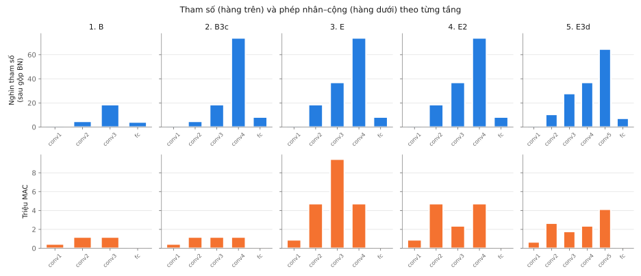
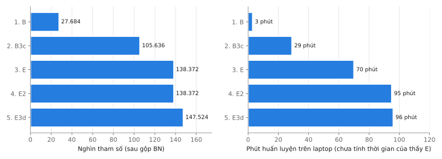
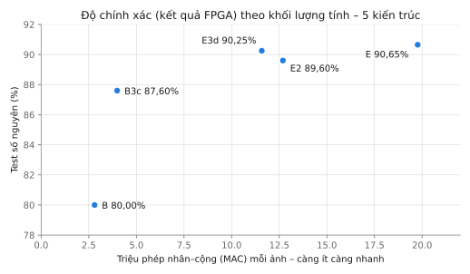

# 12 – So sánh 5 kiến trúc

← [11_EVALUATION_AND_RESULTS.md](11_EVALUATION_AND_RESULTS.md) · [Mục lục](README.md) · [13_RUN_PIPELINE_STEP_BY_STEP.md](13_RUN_PIPELINE_STEP_BY_STEP.md) →

Mọi số lấy từ code trên `main` và kết quả chạy trên laptop của nhóm (`model/results.md`, `docs/so_sanh_5_mo_hinh.md`). "Kiến trúc 1..5"
theo thứ tự cột của `docs/so_sanh_5_mo_hinh.md`.

---

## 1. Bảng so sánh tổng hợp

| Tiêu chí | Kiến trúc 1: **B** | Kiến trúc 2: **B3c** | Kiến trúc 3: **E** | Kiến trúc 4: **E2** | Kiến trúc 5: **E3d** |
|---|---|---|---|---|---|
| Lượt chạy | `B_16_32_64` | `B3c_c4x4_128+cinic_ft` | `E_opt_cnn+cinic_ft` | `E2_lite+cinic60_kdft` | `E3d_deep5+cinic60_kdft` |
| Vai trò (theo dự án) | Cơ bản (~80%) | Nhanh | Chính xác cao + mạng thầy | Cân bằng | Thử nghiệm mới (5 conv) |
| **Ý tưởng thiết kế** | 3 khối Conv-BN-ReLU-Pool giống nhau, số kênh nhân đôi | B + 1 conv 64→128 ở 4×4 (thêm sức chứa nơi MAC rẻ) | VGG: 2 conv 3×3 liền nhau ở 16×16 | như E nhưng cặp conv kép dời xuống 8×8 | sâu hơn, hẹp hơn: 3 conv liền nhau ở 8×8 |
| Lớp PyTorch | `SmallCNN` | `VGGLite` | `VGGLite` | `VGGLite` | `VGGLite` |
| Cấu hình (`net.py`) | `(16, 32, 64)` | `(16P, 32P, 64P, 128)` | `(32P, 64, 64P, 128P)` | `(32P, 64P, 64, 128P)` | `(24P, 48P, 64, 64, 112P)` |
| **Số tầng có trọng số** (conv + Linear) | 3 + 1 = 4 | 4 + 1 = 5 | 4 + 1 = 5 | 4 + 1 = 5 | 5 + 1 = 6 |
| Số module (Conv/BN/ReLU/Pool trong `features`) | 12 | 15 | 15 | 15 | 18 |
| **Số Conv layer** | 3 | 4 | 4 | 4 | 5 |
| **Kernel size** | 3×3 (pad 1, stride 1) | 3×3 | 3×3 | 3×3 | 3×3 |
| **Pooling** | MaxPool 2×2 sau cả 3 conv | MaxPool sau conv1–3; conv4 không | sau conv1, 3, 4; conv2 không | sau conv1, 2, 4; conv3 không | sau conv1, 2, 5; conv3–4 không |
| **Activation** | ReLU (Linear cuối không có) | ReLU | ReLU | ReLU | ReLU |
| Đầu vào Linear | 64×4×4 = 1.024 | 128×4×4 = 2.048 | 2.048 | 2.048 | 112×4×4 = 1.792 |
| **Số parameters** (sau gộp BN / PyTorch học) | 27.684 / 27.796 | 105.636 / 105.876 | 138.372 / 138.660 | 138.372 / 138.660 | 147.524 / 147.836 |
| Trọng số thật trên FPGA | 27,4 KB | 104,3 KB | 136,8 KB | 136,8 KB | 145,6 KB |
| MAC / ảnh | 2,81 triệu | 3,99 triệu | 19,77 triệu | 12,69 triệu | 11,58 triệu |
| Trường tiếp nhận cuối | 22 px | 38 px | 26 px | 30 px | 38 px |
| BRAM ước lượng | ~17% | ~55% | ~79% | ~73% | ~76% |
| ms/ảnh (16 DSP @ 100 MHz, lý thuyết) | 1,8 | 2,5 | 12,4 | 7,9 | 7,2 |
| Dữ liệu huấn luyện | CIFAR 18.000 | CIFAR ×2 + CINIC 84.000 | như B3c | như B3c | như B3c |
| **Optimizer** | AdamW (lr 1e-3, wd 5e-4) | SGD Nesterov (lr 0,05 → tinh chỉnh 0,005) | như B3c | như B3c | như B3c |
| **Loss function** | Cross-entropy | CE + label smoothing 0,1 | CE + label smoothing 0,1 | CE + LS 0,1 + **KD** từ E (α 0,7, T 4) ở lượt 2 | như E2 |
| Epoch (lượt 1 + 2) | 30 | 30 + 15 | 30 + 15 | 60 + 15 | 60 + 15 |
| **Accuracy test số nguyên** (float) | **80,00%** (80,23%) | **87,60%** (87,67%) | **90,65%** (90,45%) | **89,60%** (90,00%) | **90,25%** (90,20%) |
| Lớp yếu nhất (cat, số nguyên) | 68,5% | 79,7% | 85,8% | 80,3% | 83,4% |
| **Training time** (laptop) | 3,4 phút | 28,9 phút | 70,0 phút | 95,3 phút + E | 96,2 phút + E |
| Conv1 khi lượng tử | int8 | int16 | int16 | int16 | int16 |
| **Ưu điểm** | nhỏ nhất, nhanh nhất, RTL đơn giản, không cần dữ liệu ngoài | > 85% với MAC gần bằng B; BRAM còn dư | chính xác nhất; lượng tử hoá ổn định nhất (99,0% trùng dự đoán) | cùng tham số với E nhưng −36% MAC | ~90% với ít MAC nhất nhóm ~90%; RF lớn nhất |
| **Nhược điểm** | accuracy thấp (80%), sức chứa nhỏ | kém nhóm E 2–3 điểm; cần CINIC | nhiều MAC nhất (gấp 7 lần B); BRAM chật (~79%) | số nguyên tụt 0,40 điểm; cần mạng thầy; dao động giữa các lần chạy | nhiều tham số nhất; 5 tầng RTL; cần mạng thầy; mới chạy 1 lần |

Ký hiệu cấu hình: `64P` = conv ra 64 kênh **có** MaxPool sau; `64` = **không** pool.

*Hình: tham số (hàng trên) và MAC (hàng dưới) theo từng tầng của 5 kiến trúc. Số liệu chi tiết ở mục 3.2–3.3 của từng file kiến trúc.*

---

## 2. Trả lời 8 câu hỏi

### 2.1. Năm kiến trúc khác nhau về bản chất ở điểm nào?

Cả 5 dùng **cùng một khối cơ bản** (Conv 3×3 pad 1 → BN → ReLU → [MaxPool 2×2]) và cùng đầu ra (Flatten → Linear → 4 logit). Chúng chỉ
khác ở ba câu hỏi thiết kế:
1. **Rộng bao nhiêu** (số kênh mỗi tầng): B 16/32/64, các mô hình E bắt đầu 24 hoặc 32 kênh và kết thúc 112 hoặc 128 kênh.
2. **Sâu bao nhiêu** (số conv): 3 (B), 4 (B3c, E, E2), 5 (E3d).
3. **Đặt conv thêm ở độ phân giải nào** (vị trí MaxPool): B3c thêm ở 4×4, E ở 16×16, E2 ở 8×8, E3d hai conv ở 8×8.

Câu hỏi thứ ba quyết định **chi phí tính**. Ví dụ rõ nhất: E và E2 có **cùng bốn conv** (3→32, 32→64, 64→64, 64→128), nên cùng 138.372 tham
số. Nhưng conv 64→64 của E chạy ở 16×16 (9,44 triệu MAC), còn của E2 ở 8×8 (2,36 triệu MAC). Chỉ dời một MaxPool lên trước đã làm tổng MAC
giảm 36%.

Ngoài kiến trúc, chúng còn khác ở **cách huấn luyện**:
- B chỉ dùng CIFAR và công thức gốc.
- 4 mô hình còn lại dùng thêm 84.000 ảnh CINIC, công thức opt và tinh chỉnh.
- E2 và E3d học thêm từ mạng thầy E.

So sánh "kiến trúc" giữa B và 4 mô hình kia vì vậy **gộp chung** hiệu ứng của dữ liệu và công thức huấn luyện (xem 2.5).

### 2.2. Tại sao chúng có cấu trúc khác nhau?

Vì ba ràng buộc của chip XC7S25 kéo theo ba hướng khác nhau:
- **Tốc độ ~ MAC.** 80 DSP, clock gốc 20 MHz. MAC của một conv tỉ lệ với `H·W` của ảnh nó xử lý, nên muốn nhanh thì đặt phép tính ở độ phân
  giải thấp.
- **Bộ nhớ ~ tham số.** Khoảng 202 KB BRAM; `docs/model_spec.md` đặt ngân sách khoảng 100 KB cho trọng số. Tham số **không** phụ thuộc
  `H·W` mà phụ thuộc `C_in·C_out`, nên tầng sâu và hẹp tốn ít bộ nhớ hơn tầng rộng.
- **Độ chính xác.** Cần đủ sức chứa (tham số), đủ phi tuyến (số tầng) và trường tiếp nhận đủ lớn.

Mỗi kiến trúc là một điểm đánh đổi khác nhau:
- **B** tối thiểu mọi thứ.
- **B3c** thêm sức chứa ở 4×4: tốn bộ nhớ, gần như không tốn tốc độ.
- **E** dồn sức chứa ở 16×16: chính xác nhưng chậm.
- **E2** dời phần đó xuống 8×8: nhanh hơn, cùng bộ nhớ.
- **E3d** hẹp và sâu hơn: nhanh hơn nữa, bộ nhớ nhiều hơn một chút.

Chú thích trong `model/net.py` (dòng 60, 65, 67) nêu đúng các ý đồ này.

### 2.3. Kiến trúc nào phức tạp nhất?

Phụ thuộc vào thước đo:

| Thước đo | Phức tạp nhất | Số liệu |
|---|---|---|
| Số tầng / số module (độ phức tạp RTL) | **E3d** | 5 conv, 18 module |
| Khối lượng tính (MAC) | **E** | 19,77 triệu MAC |
| Bộ nhớ trọng số | **E3d** | 145,6 KB |
| Quy trình huấn luyện | **E2, E3d** | 2 lượt, 60 epoch, cần mạng thầy E chạy trước |

Nếu xét tổng thể "để làm ra và chạy được", **E3d phức tạp nhất**: nhiều tầng nhất, nhiều tham số nhất, cần thầy. **E nặng nhất** về tính
toán.

### 2.4. Kiến trúc nào có nhiều tham số nhất?

**E3d**: 147.524 tham số sau gộp BN (147.836 tham số PyTorch học). E và E2 có 138.372; B3c có 105.636; B có 27.684. Riêng conv5 của E3d
(64→112) đã chiếm 64.624 tham số (43,8%).

### 2.5. Kiến trúc nào có kết quả tốt nhất?

- **Theo accuracy số nguyên** (kết quả FPGA): **E = 90,65%**, tiếp theo E3d 90,25%, E2 89,60%, B3c 87,60%, B 80,00%. E cũng có lớp cat tốt
  nhất (85,8%) và macro-F1 float cao nhất (90,41%).
- **Nhưng** E, E3d và E2 chênh nhau ≤ 1,05 điểm, trong khi khoảng tin cậy 95% của một accuracy ~90% đo trên 4.000 ảnh là ±0,93 điểm, và
  mỗi mô hình mới chạy 1 lần. Kết luận đúng là: **ba mô hình E, E3d, E2 tương đương nhau ở mức ~90%**; khoảng cách giữa chúng chưa có ý
  nghĩa thống kê.
- **Theo hiệu quả** (accuracy trên chi phí): E3d đạt mức ~90% với ít MAC nhất (11,58 triệu, ít hơn E 41%). B3c là lựa chọn tốt nhất ở
  nhóm "≥ 85%".

### 2.6. Kiến trúc nào tổng quát hoá tốt hơn?

Dữ liệu thực nghiệm có thể dùng:

| Dấu hiệu | B | B3c | E | E2 | E3d |
|---|---|---|---|---|---|
| Test − Val (float, điểm %) | −1,32 | +0,37 | 0,00 | −0,20 | −0,50 |
| Số nguyên − float (điểm %) | −0,22 | −0,08 | +0,20 | −0,40 | +0,05 |
| Trùng dự đoán float ↔ số nguyên | 98,0% | 98,0% | 99,0% | 98,2% | 98,9% |

- Không mô hình nào có dấu hiệu overfitting rõ trên đường học (val không giảm khi train tăng).
- Độ chênh giữa val và test của cả 5 đều nhỏ hơn sai số đo (val ±0,67, test ±0,47 điểm ở mức 90%).
- **E** bền nhất khi chuyển sang số nguyên (99,0% trùng, số nguyên còn tăng). **E2** kém bền nhất (−0,40).
- **Tổng quát hoá ra ảnh camera ngày thi chưa được đo** (repo chưa có `model/real_images/`; đo bằng `python model/anh_that.py`), nên **chưa xác định được** mô hình nào tốt hơn
  trên ảnh thật. Có thể *dự đoán* các mô hình học thêm ảnh ImageNet (CINIC) sẽ bền hơn B với ảnh "khác CIFAR", nhưng đây chỉ là giả thuyết
  chưa kiểm chứng.

### 2.7. Đánh đổi giữa độ chính xác, tham số, tốc độ huấn luyện và tài nguyên

| Bước nâng cấp | Δ accuracy số nguyên | Δ MAC | Δ trọng số | Δ thời gian huấn luyện |
|---|---|---|---|---|
| B → B3c | **+7,60** | +1,18 triệu (+42%) | +76,9 KB | +25,5 phút (+ dữ liệu CINIC) |
| B3c → E3d | +2,65 | +7,59 triệu (×2,9) | +41,3 KB | +67,3 phút (+ cần E) |
| E3d → E2 | −0,65 | +1,11 triệu | −8,8 KB | −0,9 phút |
| E3d → E | +0,40 | +8,18 triệu (×1,7) | −8,8 KB | −26,2 phút (nhưng E2/E3d cần E trước) |

- Lợi ích **giảm dần**: bước đầu B→B3c cho +7,6 điểm với +42% MAC; bước sau cần gần ×3 MAC để thêm 2,65 điểm; lên tới E chỉ thêm 0,40 điểm
  (trong sai số) với gần ×1,7 MAC.
- Phần lớn bước nhảy B → B3c đến từ **dữ liệu + công thức huấn luyện** chứ không chỉ kiến trúc. Bằng chứng từ máy cloud: cùng kiến trúc B
  huấn luyện bằng công thức opt (B2, 100 epoch) đạt 83,88%; B3c **không** có CINIC đạt 85,30% (`model/results.md`, số AI).
- Thời gian huấn luyện tăng theo **số epoch × MAC × số ảnh**: E2/E3d mất ~95 phút vì 60 epoch trên 120.000 ảnh, chưa kể phải huấn luyện E
  (70 phút) làm thầy.

### 2.8. Khi nào dùng kiến trúc nào?

| Tình huống | Nên dùng | Lý do |
|---|---|---|
| Làm bản RTL đầu tiên để kiểm chứng toàn bộ luồng phần cứng | **B** | nhỏ, đều, 3 tầng giống nhau; dễ debug |
| Cần nhanh và ít tài nguyên nhưng phải > 85% | **B3c** | 87,6% với 4,0 triệu MAC, BRAM ~55% |
| Ưu tiên tuyệt đối độ chính xác, chấp nhận nhiều DSP hoặc nâng clock | **E** | 90,65%, lượng tử ổn định nhất |
| Muốn ~90% với ít phép tính, chấp nhận thêm 1 tầng RTL và BRAM ~76% | **E3d** | 90,25% với 11,6 triệu MAC |
| Muốn ~90% với cấu trúc 4 tầng như E nhưng nhanh hơn | **E2** | cùng bộ tham số với E, −36% MAC; lưu ý dao động giữa các lần chạy |
| Cần mạng thầy để huấn luyện mô hình nhỏ khác | **E** | `kiem_chung.py` dùng E làm thầy |

Muốn **chốt** mô hình cho cuộc thi còn thiếu hai số liệu chưa có trong repo: (1) độ chính xác trên **ảnh camera thật**, (2) **tài nguyên
và tần số thật** sau khi tổng hợp RTL bằng Vivado. Trong khi chưa có, B3c (an toàn về tài nguyên) và E3d (cân bằng ~90%) là hai ứng viên
hợp lý nhất theo số liệu hiện có.

---

← [11_EVALUATION_AND_RESULTS.md](11_EVALUATION_AND_RESULTS.md) · [Mục lục](README.md) · [13_RUN_PIPELINE_STEP_BY_STEP.md](13_RUN_PIPELINE_STEP_BY_STEP.md) →
