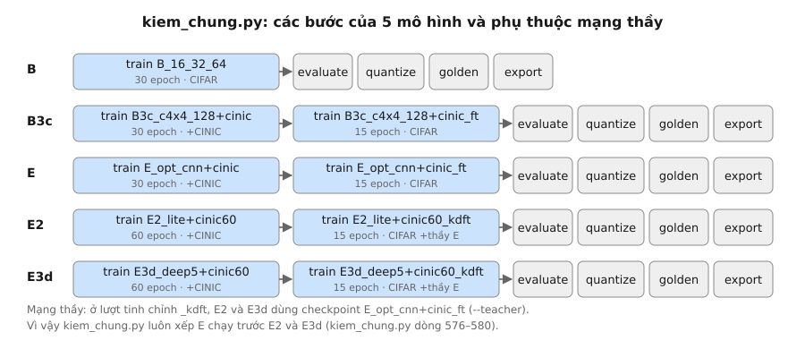

# 13 – Chạy dự án từ đầu: 11 bước

← [12_ARCHITECTURE_COMPARISON.md](12_ARCHITECTURE_COMPARISON.md) · [Mục lục](README.md) · [14_LEARNING_ROADMAP.md](14_LEARNING_ROADMAP.md) →

File này đi theo 11 bước của đề bài, nhưng **ghi đúng cách source code thực sự chạy**. Có 3 điểm khác với một quy trình mẫu:

1. **Bước 4 (tiền xử lý), 5 (xây mô hình) và 7 (validation) không có lệnh riêng.** Chúng chạy *bên trong* `train.py`: mỗi lần huấn
   luyện, `data.py` xử lý ảnh và `net.py` dựng mô hình; validation chạy cuối mỗi epoch. Trong file này, các bước đó có thêm một lệnh
   "xem thử" để bạn tự kiểm tra, nhưng lệnh đó không bắt buộc.
2. **Có hai bước dự án làm mà quy trình mẫu không có:** lượng tử hoá (`quantize.py`) và xuất file cho phần cứng (`export.py`). Lý do:
   mô hình phải chạy trên FPGA bằng số nguyên.
3. **Thực tế, một script làm hết các bước 6 → 11:** `model/kiem_chung.py`. Các lệnh lẻ trong từng bước dưới đây chính là các lệnh mà
   script này gọi (đọc từ `MODELS[...]["stages"]`, `model/kiem_chung.py` dòng 57–96).



Quy ước: mọi lệnh chạy từ **thư mục gốc repo** (theo `CLAUDE.md`). Tên lượt chạy có dấu `+` thì nên đặt trong ngoặc kép.

---

## Tóm tắt 11 bước

| Bước | Việc | File | Lệnh (ví dụ với E2) | Đầu ra chính |
|---|---|---|---|---|
| 1 | Môi trường Python | – | `source ~/eda-venv/bin/activate` | venv đang bật |
| 2 | Cài thư viện | `requirements.txt` | `pip install -r requirements.txt` | thư viện trong venv |
| 3 | Chuẩn bị dữ liệu | `prepare_cifar4.py`, `prepare_cinic4.py` | `python model/prepare_cifar4.py` | `data/cifar4.npz`, `data/cinic4_extra.npz` |
| 4 | Tiền xử lý | `data.py` | *(trong train.py)* | tensor trong RAM |
| 5 | Xây kiến trúc | `net.py` | *(trong train.py)* | đối tượng `nn.Module` |
| 6 | Huấn luyện | `train.py` | `python model/train.py --arch "E2_lite+cinic60" ...` | `model/checkpoints/<run>.pt` |
| 7 | Validation | `train.py` (`evaluate`) | *(trong train.py)* | chọn checkpoint tốt nhất |
| 8 | Testing | `train.py`, `evaluate.py`, `quantize.py`, `golden_int.py` | `python model/evaluate.py --arch ...` | test float + số nguyên |
| 9 | Đánh giá | `evaluate.py`, `quantize.py` | (cùng bước 8) | ma trận nhầm lẫn, results.md |
| 10 | Lưu kết quả | `export.py`, `report.py` | `python model/export.py --arch ...` | `model/export_<run>/` |
| 11 | So sánh 5 kiến trúc | `kiem_chung.py` | `python model/kiem_chung.py bang` | `docs/so_sanh_5_mo_hinh.md` |

---

## Bước 1 – Chuẩn bị môi trường Python

| Mục | Nội dung |
|---|---|
| Cần làm gì? | Mở Ubuntu (WSL2), vào thư mục repo, bật môi trường ảo (virtual environment) `~/eda-venv` |
| File | Không có. Vị trí môi trường ghi trong `docs/SETUP.md` (dòng 16) và `CLAUDE.md` |
| Lệnh | xem dưới |
| Đầu vào | Ubuntu WSL2 đã có Python 3 |
| Đầu ra | dấu nhắc lệnh có `(eda-venv)` ở đầu |
| Lưu ở đâu | `~/eda-venv/` (ngoài repo, không commit) |
| Bước tiếp theo | Bước 2 |

```bash
cd ~/projects/lsi-design-contest-2027
```

```bash
python3 -m venv ~/eda-venv
```
(lệnh trên chỉ chạy **lần đầu**)

```bash
source ~/eda-venv/bin/activate
```

**Vì sao cần venv?** Thư viện cài vào `~/eda-venv` chứ không vào Python của hệ thống, nên không xung đột với chương trình khác. Theo
`docs/SETUP.md`, venv này tự bật mỗi khi mở Ubuntu.

---

## Bước 2 – Cài đặt thư viện

| Mục | Nội dung |
|---|---|
| Cần làm gì? | Cài PyTorch bản CPU trước, rồi các thư viện còn lại |
| File | `requirements.txt` |
| Đầu vào | venv đang bật (bước 1) |
| Đầu ra | thư viện cài trong `~/eda-venv/lib/...` |
| Bước tiếp theo | Bước 3 |

```bash
pip install torch torchvision --index-url https://download.pytorch.org/whl/cpu
```

```bash
pip install -r requirements.txt
```

Kiểm tra:

```bash
python -c "import torch, torchvision, sklearn, matplotlib, PIL; print(torch.__version__)"
```

**Thư viện nào dùng ở đâu** (đọc từ các dòng `import` của `model/*.py`):

| Thư viện | Dùng trong | Để làm gì |
|---|---|---|
| `torch` | `net.py`, `data.py`, `train.py`, `evaluate.py`, `quantize.py` | mô hình, huấn luyện, `DataLoader` |
| `torchvision` | chỉ `prepare_cifar4.py` | tải CIFAR-10 (`CIFAR10(download=True)`) |
| `numpy` | gần như mọi file | mảng ảnh, golden model số nguyên |
| `matplotlib` | `train.py`, `evaluate.py`, `kiem_chung.py` | vẽ đường học, ma trận nhầm lẫn, hình so sánh |
| `scikit-learn` | `evaluate.py` | `confusion_matrix` |
| `pillow` | `prepare_cinic4.py`, `predict_image.py` | đọc ảnh PNG/JPG |
| `opencv-python-headless`, `jupyterlab`, `tqdm`, `cocotb` | **không** file nào trong `model/` import | có trong `requirements.txt` cho việc khác (`cocotb` cho testbench RTL) |

---

## Bước 3 – Chuẩn bị và kiểm tra dữ liệu

| Mục | Nội dung |
|---|---|
| Cần làm gì? | Tải CIFAR-10, lọc 4 lớp; (cho B3c, E, E2, E3d) chuẩn bị thêm ảnh CINIC-10 |
| File | `model/prepare_cifar4.py`, `model/prepare_cinic4.py` |
| Đầu vào | Internet (CIFAR-10 tự tải); file `CINIC-10.tar.gz` (687 MB) tải tay |
| Đầu ra | `data/cifar4.npz` (20.000 ảnh train + 4.000 ảnh test); `data/cinic4_extra.npz` (84.000 ảnh) |
| Lưu ở đâu | `data/` (trong `.gitignore`, không commit) |
| Bước tiếp theo | Bước 4 (hoặc chạy thẳng bước 6) |

```bash
python model/prepare_cifar4.py
```

Lệnh này in ra số ảnh mỗi lớp. Nếu đúng sẽ là **5000 ảnh train, 1000 ảnh test** cho mỗi lớp (CIFAR-10 có 5.000 + 1.000 ảnh mỗi lớp).

CINIC-10: tải `CINIC-10.tar.gz` tại <https://datashare.ed.ac.uk/handle/10283/3192>, rồi:

```bash
python model/prepare_cinic4.py --tar ~/Downloads/CINIC-10.tar.gz
```

Không chạy lệnh này cũng được: `kiem_chung.py` (hàm `ensure_cinic`, dòng 144–159) tự tìm file trong `~/Downloads`, `data/` hoặc
`/mnt/c/Users/*/Downloads` rồi gọi `prepare_cinic4.py`.

Kiểm tra dữ liệu bằng tay:

```bash
python -c "import numpy as np; d=np.load('data/cifar4.npz'); print({k: d[k].shape for k in d.files})"
```

Kết quả đúng: `x_train (20000, 32, 32, 3)`, `y_train (20000,)`, `x_test (4000, 32, 32, 3)`, `y_test (4000,)`, `classes (4,)`.
Chi tiết dữ liệu: [02_DATA_PREPROCESSING.md](02_DATA_PREPROCESSING.md).

---

## Bước 4 – Tiền xử lý dữ liệu (chạy bên trong train.py)

| Mục | Nội dung |
|---|---|
| Cần làm gì? | Không cần chạy gì: `train.py` gọi `data.get_loaders(...)` |
| File | `model/data.py` |
| Đầu vào | `data/cifar4.npz` (+ `data/cinic4_extra.npz` khi có `--extra-data`) |
| Đầu ra | 3 `DataLoader`: train (tăng cường, xáo trộn), val, test; mỗi batch là tensor `(B, 3, 32, 32)` giá trị `pixel/256` |
| Lưu ở đâu | Chỉ trong RAM, không ghi file |
| Bước tiếp theo | Bước 5 |

Những gì `get_loaders` (dòng 91–108) làm:
1. `split_train_val`: tách 10% ảnh train làm validation, xáo bằng seed 2027 → 18.000 train / 2.000 val.
2. Nếu có `--extra-data`: lặp ảnh CIFAR train `--cifar-repeat` lần và ghép thêm CINIC (18.000 × 2 + 84.000 = 120.000).
3. `Cifar4.__getitem__` → `to_tensor`: đổi `(32, 32, 3)` uint8 thành `(3, 32, 32)` float = pixel / 256.
4. Chỉ với ảnh train: lật ngang + cắt ngẫu nhiên có đệm 4; công thức opt thêm đổi sáng/tương phản ±20% và Cutout 12×12.

Xem thử một batch (lệnh không bắt buộc; `PYTHONPATH=model` để Python tìm thấy `config`, `data` như khi chạy `python model/...`):

```bash
PYTHONPATH=model python -c "import data; tr, va, te = data.get_loaders(); x, y = next(iter(tr)); print(len(tr.dataset), len(va.dataset), len(te.dataset), x.shape, float(x.min()), float(x.max()))"
```

Kết quả: `18000 2000 4000 torch.Size([64, 3, 32, 32])`, giá trị nhỏ nhất ≥ 0 và lớn nhất < 1 (vì chia 256).

---

## Bước 5 – Xây dựng từng kiến trúc (chạy bên trong train.py)

| Mục | Nội dung |
|---|---|
| Cần làm gì? | Không cần chạy gì: `train.py` gọi `net.build(arch)` (dòng 81) |
| File | `model/net.py` |
| Đầu vào | tên lượt chạy, ví dụ `E2_lite+cinic60_kdft` |
| Đầu ra | mô hình PyTorch (`SmallCNN` cho B, `VGGLite` cho 4 mô hình còn lại) |
| Lưu ở đâu | Chỉ trong RAM |
| Bước tiếp theo | Bước 6 |

`build` (dòng 97–104) cắt tên ở dấu `+` (`"E2_lite+cinic60_kdft"` → `"E2_lite"`), tra trong `ARCHS` (dòng 19–24) hoặc `OPT_ARCHS`
(dòng 55–72), rồi dựng mô hình. Phần đuôi sau dấu `+` chỉ là nhãn để phân biệt các lượt chạy, không đổi kiến trúc.

Xem thử tham số và MAC của 5 mô hình:

```bash
PYTHONPATH=model python -c "import net; [print(r, net.count_params(net.build(r)), net.count_macs(net.build(r))) for r in ['B_16_32_64','B3c_c4x4_128+cinic_ft','E_opt_cnn+cinic_ft','E2_lite+cinic60_kdft','E3d_deep5+cinic60_kdft']]"
```

Kết quả đúng (tham số sau gộp BN, MAC mỗi ảnh):

```
B_16_32_64 27684 2805760
B3c_c4x4_128+cinic_ft 105636 3989504
E_opt_cnn+cinic_ft 138372 19767296
E2_lite+cinic60_kdft 138372 12689408
E3d_deep5+cinic60_kdft 147524 11582464
```

Chi tiết từng kiến trúc: các file [04](04_ARCHITECTURE_1_B.md) → [08](08_ARCHITECTURE_5_E3d.md).

---

## Bước 6 – Huấn luyện

| Mục | Nội dung |
|---|---|
| Cần làm gì? | Chạy `train.py`; với 4 mô hình +cinic thì chạy **2 lượt**: lượt 1 trên CIFAR + CINIC, lượt 2 tinh chỉnh (fine-tune) chỉ trên CIFAR |
| File | `model/train.py` (dùng `data.py`, `net.py`, `config.py`) |
| Đầu vào | `data/*.npz`; lượt 2 cần checkpoint lượt 1 (`--init`); E2, E3d cần checkpoint của E (`--teacher`) |
| Đầu ra | checkpoint tốt nhất, lịch sử loss/accuracy, hình đường học, 1 dòng trong `results.md` |
| Lưu ở đâu | `model/checkpoints/<run>.pt`, `model/checkpoints/<run>_history.json`, `model/figures/train_<run>.png`, `model/results.md` |
| Bước tiếp theo | Bước 7 (chạy tự động trong lúc huấn luyện) |

Lệnh của từng mô hình, đúng như `kiem_chung.py` gọi (dòng 42–43 định nghĩa `FT` và `EXTRA`):

**B** (khoảng 3–4 phút trên laptop của nhóm):

```bash
python model/train.py --arch B_16_32_64
```

**B3c** (lượt 1 rồi lượt 2):

```bash
python model/train.py --arch "B3c_c4x4_128+cinic" --recipe opt --extra-data --cifar-repeat 2 --epochs 30
```

```bash
python model/train.py --arch "B3c_c4x4_128+cinic_ft" --init "B3c_c4x4_128+cinic" --recipe opt --lr 0.005 --warmup 0 --epochs 15
```

**E** (giống B3c, đổi tên kiến trúc; phải chạy **trước** E2 và E3d vì là mạng thầy):

```bash
python model/train.py --arch "E_opt_cnn+cinic" --recipe opt --extra-data --cifar-repeat 2 --epochs 30
```

```bash
python model/train.py --arch "E_opt_cnn+cinic_ft" --init "E_opt_cnn+cinic" --recipe opt --lr 0.005 --warmup 0 --epochs 15
```

**E2** (60 epoch, lượt 2 có thêm mạng thầy):

```bash
python model/train.py --arch "E2_lite+cinic60" --recipe opt --extra-data --cifar-repeat 2 --epochs 60
```

```bash
python model/train.py --arch "E2_lite+cinic60_kdft" --init "E2_lite+cinic60" --recipe opt --lr 0.005 --warmup 0 --epochs 15 --teacher "E_opt_cnn+cinic_ft"
```

**E3d**: giống E2, thay `E2_lite` bằng `E3d_deep5`.

```bash
python model/train.py --arch "E3d_deep5+cinic60" --recipe opt --extra-data --cifar-repeat 2 --epochs 60
```

```bash
python model/train.py --arch "E3d_deep5+cinic60_kdft" --init "E3d_deep5+cinic60" --recipe opt --lr 0.005 --warmup 0 --epochs 15 --teacher "E_opt_cnn+cinic_ft"
```

Mỗi epoch in một dòng dạng:

```
[E2_lite+cinic60_kdft] epoch  3/15  train loss ... acc ...  |  val loss ... acc ... *  (...s)
```

Dấu `*` nghĩa là val accuracy vừa đạt mức cao nhất mới, nên checkpoint được ghi đè. Thời gian huấn luyện thật trên laptop: B 3,4 phút;
B3c 26,8 + 2,1; E 64,7 + 5,3; E2 89,6 + 5,7; E3d 91,0 + 5,2 phút. Toàn bộ vòng lặp huấn luyện giải thích ở
[09_TRAINING_PROCESS.md](09_TRAINING_PROCESS.md).

---

## Bước 7 – Validation (chạy bên trong train.py)

| Mục | Nội dung |
|---|---|
| Cần làm gì? | Không cần chạy gì: cuối mỗi epoch `train_one` gọi `evaluate(model, val_loader)` (dòng 142) |
| File | `model/train.py`, hàm `evaluate` (dòng 35–46) |
| Đầu vào | 2.000 ảnh val (CIFAR, không tăng cường) |
| Đầu ra | val loss và val accuracy mỗi epoch; checkpoint chỉ ghi khi val accuracy tăng (dòng 148–151) |
| Lưu ở đâu | màn hình; `model/checkpoints/<run>_history.json`; cột "Val acc" trong `model/results.md` |
| Bước tiếp theo | Bước 8 |

Val chỉ dùng để **chọn epoch tốt nhất**, không dùng để cập nhật trọng số. Lưu ý: val loss là cross-entropy thường, còn train loss
của công thức opt có label smoothing (và KD), nên hai đường loss **không so trực tiếp được** (xem
[15_CODE_REVIEW_NOTES.md](15_CODE_REVIEW_NOTES.md)).

---

## Bước 8 – Testing

Dự án đo test **ba lần**, mỗi lần một mục đích:

| Lần | Ở đâu | Đo cái gì | Ghi vào |
|---|---|---|---|
| 1 | cuối `train_one` (dòng 156–157) | test float của checkpoint tốt nhất | cột "Test acc" của `results.md` |
| 2 | `evaluate.py` | test float lại + ma trận nhầm lẫn + accuracy từng lớp | mục "Đánh giá chi tiết (float) – <run>" |
| 3 | `quantize.py` / `golden_int.py` | test **số nguyên** (kết quả FPGA sẽ cho ra) | mục "Lượng tử hoá (int8) – <run>" |

| Mục | Nội dung |
|---|---|
| File | `model/evaluate.py`, `model/quantize.py`, `model/golden_int.py` |
| Đầu vào | `model/checkpoints/<run>.pt`; 4.000 ảnh test CIFAR-4; 2.000 ảnh train để hiệu chuẩn (quantize) |
| Đầu ra | accuracy float và số nguyên; tham số số nguyên |
| Lưu ở đâu | `model/results.md`, `model/figures/`, `model/export_<run>/qparams.npz` + `qparams.json` (B: `model/export/`) |
| Bước tiếp theo | Bước 9 |

Ví dụ với E2 (B dùng `--conv1-bits 8`, tức bỏ tuỳ chọn này):

```bash
python model/evaluate.py --arch "E2_lite+cinic60_kdft"
```

```bash
python model/quantize.py --arch "E2_lite+cinic60_kdft" --conv1-bits 16
```

```bash
python model/golden_int.py --arch "E2_lite+cinic60_kdft"
```

Dòng **bắt buộc** phải thấy trong phần in ra của `quantize.py` (dòng 206–207):

```
golden_int.py và PyTorch trùng từng bit: True; trùng dự đoán với float: ...%
```

Thứ tự bắt buộc: `quantize.py` phải chạy trước `golden_int.py` và `export.py`, vì hai script này đọc `qparams.npz` do `quantize.py` tạo.

---

## Bước 9 – Đánh giá

| Mục | Nội dung |
|---|---|
| Cần làm gì? | Đọc kết quả của bước 8: accuracy từng lớp, ma trận nhầm lẫn, ảnh bị đoán sai, mức sụt khi lượng tử hoá |
| File tạo ra | `model/figures/confusion_<run>.png`, `model/figures/errors_<run>.png` (do `evaluate.py`); bảng trong `results.md` |
| Đầu vào | đầu ra của bước 8 |
| Đầu ra | nhận xét: lớp yếu (cat), cặp hay nhầm (cat ↔ dog), chênh số nguyên − float |
| Bước tiếp theo | Bước 10 |

Cách đọc từng chỉ số và kết quả của 5 mô hình: [11_EVALUATION_AND_RESULTS.md](11_EVALUATION_AND_RESULTS.md). Dự án **không** tính
Precision/Recall/F1; file 11 tính thêm từ ma trận nhầm lẫn để tham khảo.

---

## Bước 10 – Lưu kết quả

| Mục | Nội dung |
|---|---|
| Cần làm gì? | Xuất tham số số nguyên ra file `.mem` cho RTL và tạo vector kiểm thử |
| File | `model/export.py`; `model/report.py` (hàm `update_section` để ghi `results.md`) |
| Lệnh | `python model/export.py --arch "E2_lite+cinic60_kdft"` |
| Đầu vào | `model/export_<run>/qparams.npz` + `qparams.json` |
| Đầu ra | `weights/<tầng>_w.mem`, `weights/<tầng>_b.mem`, `testvec/img00_input.mem` … `img19_fc.mem`, `testvec/labels.csv`, `README.md` |
| Lưu ở đâu | `model/export_<run>/` (B: `model/export/`) |
| Bước tiếp theo | Bước 11 |

Tổng hợp **mọi file** dự án tạo ra:

| File / thư mục | Tạo bởi | Commit lên GitHub? | Dùng để làm gì |
|---|---|---|---|
| `data/cifar4.npz`, `data/cinic4_extra.npz` | bước 3 | không (`.gitignore`) | dữ liệu |
| `model/checkpoints/<run>.pt` | `train.py` | không | trọng số float tốt nhất; đầu vào của evaluate/quantize; thầy cho KD |
| `model/checkpoints/<run>_history.json` | `train.py` | không | loss/accuracy từng epoch |
| `model/checkpoints/kiem_chung_<mã>.txt` | `kiem_chung.py` | không | nhật ký chạy đầy đủ |
| `model/figures/train_<run>.png` | `train.py` | có | đường học |
| `model/figures/confusion_<run>.png`, `errors_<run>.png` | `evaluate.py` | có | ma trận nhầm lẫn, 16 ảnh đoán sai |
| `model/results.md` | `train.py`, `evaluate.py`, `quantize.py` | có | bảng kết quả của mọi lượt chạy |
| `model/export*/qparams.npz`, `qparams.json` | `quantize.py` | có | tham số số nguyên (đầu vào của golden và export) |
| `model/export*/weights/*.mem` | `export.py` | có | nạp vào BRAM của RTL (`$readmemh`) |
| `model/export*/testvec/*.mem`, `labels.csv` | `export.py` | có | testbench RTL so từng giá trị |
| `model/export*/README.md` | `export.py` | có | đặc tả định dạng cho người viết RTL |
| `model/kiem_chung_log.json` | `kiem_chung.py` | có | trạng thái + bước đã xong của 5 mô hình |
| `docs/so_sanh_5_mo_hinh.md`, `model/figures/so_sanh_5_mo_hinh.png` | `kiem_chung.py` | có | bảng + hình so sánh |

Dự án **không** tạo file CSV kết quả nào ngoài `testvec/labels.csv`, và không lưu mô hình dạng ONNX.

---

## Bước 11 – So sánh 5 kiến trúc

| Mục | Nội dung |
|---|---|
| Cần làm gì? | Gom số liệu 5 mô hình thành một bảng và một hình |
| File | `model/kiem_chung.py` (`build_table` dòng 247, `write_doc` dòng 344–457, `draw_figure` dòng 485–510) |
| Đầu vào | `model/results.md`, `qparams.npz` của 5 mô hình, `model/kiem_chung_log.json` |
| Đầu ra | `docs/so_sanh_5_mo_hinh.md` (tự sinh, không sửa tay), `model/figures/so_sanh_5_mo_hinh.png` |
| Bước tiếp theo | Hết luồng Python. Tiếp theo là viết RTL trong `rtl/` và testbench trong `tb/` (hiện mới có README) |

```bash
python model/kiem_chung.py bang --khong-push
```
(chỉ vẽ lại bảng từ kết quả có sẵn)

```bash
python model/kiem_chung.py nhanh --khong-push
```
(chạy lại golden model trên `qparams.npz` có sẵn của cả 5 mô hình, vài phút)

> ⚠️ Mặc định `kiem_chung.py` **tự `git commit` và `git push`** (hàm `commit_push`, dòng 167–186). Khi chỉ muốn thử, luôn thêm
> `--khong-push`. Lệnh vẫn commit trên máy; nếu không muốn commit, chạy trong một bản sao của repo.

Phân tích bảng so sánh: [12_ARCHITECTURE_COMPARISON.md](12_ARCHITECTURE_COMPARISON.md).

---

## Cách chạy thật: một lệnh cho cả bước 6 → 11

```bash
python model/kiem_chung.py B --khong-push
```

```bash
python model/kiem_chung.py tatca
```

`kiem_chung.py` làm theo thứ tự:
1. Kiểm tra có `data/cifar4.npz` (dòng 552–553).
2. Nếu cần E2/E3d mà chưa có checkpoint của thầy E thì **tự thêm E** vào danh sách, rồi sắp theo thứ tự `B, B3c, E, E2, E3d` (dòng 576–580).
3. Nếu có mô hình cần CINIC thì gọi `ensure_cinic`.
4. Với mỗi mô hình, `verify_model` (dòng 514–541) chạy lần lượt các lệnh trong `stages`: train (1 hoặc 2 lượt) → evaluate → quantize → golden_int → export. Mỗi lệnh xong được ghi vào `kiem_chung_log.json`; nếu bị dừng, chạy lại đúng lệnh cũ sẽ **chạy tiếp** từ bước dở (thêm `--lam-lai` để làm lại từ đầu).
5. Vẽ lại bảng + hình so sánh, commit, push.

Tuỳ chọn `--thu` chạy mọi bước với 1 epoch để kiểm tra script (không commit). Hướng dẫn cho người dùng cuối: `docs/KIEM_CHUNG.md`.

## Bước thêm (tuỳ chọn) – Dự đoán ảnh thật

```bash
python model/predict_image.py model/real_images --arch "E2_lite+cinic60_kdft"
```

`predict_image.py` cắt giữa ảnh thành hình vuông, thu về 32×32 (dòng 27–32), rồi in dự đoán của cả mô hình float và golden model số
nguyên. Nếu ảnh nằm trong thư mục con `cat/`, `dog/`, `deer/`, `horse/` thì script tính luôn accuracy. Hiện repo **chưa có**
`model/real_images/`, nên accuracy trên ảnh thật **chưa xác định được**.

---

← [12_ARCHITECTURE_COMPARISON.md](12_ARCHITECTURE_COMPARISON.md) · [Mục lục](README.md) · [14_LEARNING_ROADMAP.md](14_LEARNING_ROADMAP.md) →
