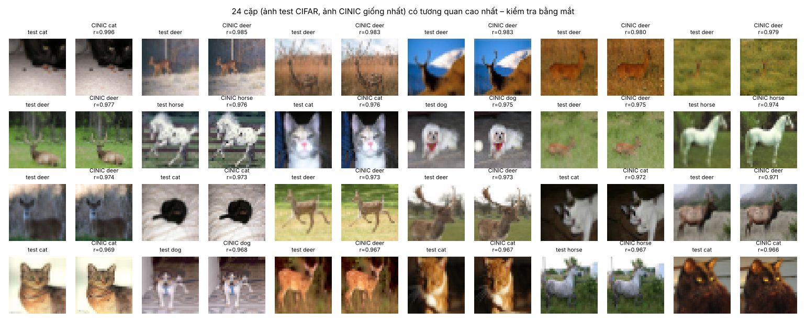

# 15 – Ghi chú đọc code: điểm bất thường, lỗi tiềm ẩn, giới hạn

← [14_LEARNING_ROADMAP.md](14_LEARNING_ROADMAP.md) · [Mục lục](README.md) · [CNN_ARCHITECTURES_COMPLETE_GUIDE.md](CNN_ARCHITECTURES_COMPLETE_GUIDE.md) →

Đề bài yêu cầu chỉ ra chỗ code có điểm bất thường, lỗi tiềm ẩn hoặc cách làm chưa tối ưu. Mỗi mục gồm: chỗ nào trong code, hiện
tượng, ảnh hưởng đến kết quả của 5 mô hình, và cách sửa.

**Cập nhật 26/11/2026:** theo yêu cầu của nhóm, các mục đánh dấu ✅ **đã được sửa trực tiếp trong code** trên `main`, và có thêm 3 công cụ:
`model/anh_that.py` (A2), `model/nhieu_seed.py` (A1), `documentation/tools/check_cinic_leak.py` (B5). Kiểm tra hồi quy: với seed mặc định
2027, code cũ và code mới huấn luyện ra **trọng số giống hệt từng bit** (thử cả công thức base lẫn opt + CINIC), nên kết quả 5 mô hình
**không đổi**.

Mức độ:
- 🔴 **ảnh hưởng kết luận**: cần lưu ý khi viết báo cáo hoặc chọn mô hình.
- 🟠 **lỗi tiềm ẩn**: hiện chưa gây sai nhưng dễ gây sai nếu đổi cách dùng.
- 🟡 **chưa nhất quán hoặc chưa tối ưu**: không đổi kết quả.

**Kết luận chung:** không tìm thấy lỗi nào làm **sai** con số accuracy của 5 mô hình. Mọi số liệu cốt lõi đã được chạy lại bằng
`documentation/tools/verify_numbers.py --golden` và khớp hoàn toàn. Các mục 🔴 là **giới hạn của thí nghiệm**, không phải lỗi code.

---

## A. Giới hạn ảnh hưởng tới kết luận 🔴

### A1. Mỗi mô hình chỉ chạy 1 lần (1 seed)
- **Ở đâu:** `kiem_chung.py` chạy mỗi mô hình đúng một lần; `findings()` (dòng 480–481) tự ghi cảnh báo này vào bảng.
- **Hiện tượng:** E2 từng cho 89,45–90,30% qua 5 lần huấn luyện trên máy cloud (`docs/KIEM_CHUNG.md` dòng 158). Lần chạy trên laptop
  cho 89,60%.
- **Ảnh hưởng:** E (90,65%), E3d (90,25%), E2 (89,60%) chênh nhau ≤ 1,05 điểm. Khoảng này nằm trong dao động giữa các lần chạy và trong
  sai số đo (±0,93 điểm, khoảng tin cậy 95% trên 4.000 ảnh). **Chưa đủ căn cứ để xếp hạng ba mô hình này.**
- **Gợi ý:** chạy 3–5 seed cho mỗi mô hình và báo cáo trung bình ± độ lệch chuẩn.
- **Đã có công cụ:** `python model/nhieu_seed.py <mã>` chạy thêm seed 2 và 3 cho một mô hình, theo đúng công thức của lượt chính, rồi ghi
  mục "Nhiều seed – <mã>" vào `model/results.md`. Lỗi B1 đã sửa nên các seed giờ khác nhau thật sự. Việc chạy phải làm trên laptop của
  nhóm (cần checkpoint mạng thầy E; số liệu phải là số của nhóm). Xem `docs/KIEM_CHUNG.md` Bước 5.

### A2. Chưa đo trên ảnh camera thật
- **Ở đâu:** `predict_image.py` có sẵn nhưng repo chưa có thư mục `model/real_images/`.
- **Ảnh hưởng:** accuracy trên ảnh ngày thi **chưa xác định được**. Mọi con số hiện có đều đo trên CIFAR-4 test.
- **Đã có công cụ:** `python model/anh_that.py` đo cả 5 mô hình trên `model/real_images/<lớp>/` và ghi mục "Ảnh thật" vào `results.md`.
  Còn thiếu ảnh do nhóm tự chụp (`docs/KIEM_CHUNG.md` Bước 4).

### A3. Chưa có RTL nên tài nguyên và tốc độ mới là ước lượng
- **Ở đâu:** `rtl/`, `tb/` mới có README. Số BRAM và ms/ảnh tính bằng công thức trong `kiem_chung.py` (`hw_numbers` dòng 202–218,
  `ms` dòng 352–353).
- **Hiện tượng:** ước lượng BRAM bỏ qua việc chia BRAM theo khối 18 Kb (phần lẻ bị lãng phí) và các bộ đệm dòng (line buffer). Bảng tự
  sinh cũng tự ghi chú rằng thực tế sẽ cao hơn. ms/ảnh giả sử DSP bận 100%.
- **Ảnh hưởng:** E (~79%), E3d (~76%), E2 (~73%) đã gần mức "chật" (~80%). Khi tổng hợp thật có thể **không vừa** chip nếu thiết kế
  lưu toàn bộ trọng số trên chip.

### A4. Ba mô hình ~90% vượt ngân sách trọng số trong model_spec
- **Ở đâu:** `docs/model_spec.md` dòng 23 đặt ngân sách "trọng số int8 ≤ ~100 KB". Dòng 40 của chính file đó cũng đã ghi nhận việc vượt.
- **Số liệu:** B3c 104,3 KB; E và E2 136,8 KB; E3d 145,6 KB.

### A5. Ở clock gốc 20 MHz, nhóm ~90% chưa đạt 30 khung hình/giây
- 16 DSP @ 20 MHz: E 61,8 ms, E2 39,7 ms, E3d 36,2 ms mỗi ảnh, đều > 33 ms (30 khung/giây). Muốn đạt phải tăng DSP hoặc dùng MMCM nâng
  clock (bảng tự sinh có dòng 100 MHz).

### A6. Dùng thêm dữ liệu ngoài (CINIC-10) cho 4 mô hình
- B3c, E, E2, E3d học thêm 84.000 ảnh ImageNet. Đề cho phép tự chọn dataset, nhưng **báo cáo phải nêu rõ** điều này
  (`docs/KIEM_CHUNG.md` cũng nhắc). Khi so sánh B với 4 mô hình còn lại, nhớ rằng khác biệt gồm cả dữ liệu, không chỉ kiến trúc.

---

## B. Lỗi tiềm ẩn 🟠

### B1. `--seed` không đổi thứ tự xáo dữ liệu – ✅ đã sửa
- **Ở đâu (trước khi sửa):** `model/data.py` dòng 103: `g = torch.Generator().manual_seed(config.SEED)`.
- **Hiện tượng:** `train.py --seed 5` gọi `set_seed(5)` (dòng 28–32), nên đổi được trọng số khởi tạo và phép tăng cường (dùng
  `np.random`). Nhưng **thứ tự batch** vẫn theo seed 2027.
- **Ảnh hưởng:** chạy nhiều seed sẽ **ít đa dạng hơn** mong đợi, nên độ lệch giữa các seed bị đánh giá thấp.
- **Đã sửa:** `get_loaders(..., seed=config.SEED)` (dòng 91) dùng `seed` cho generator (dòng 103). `train_one` truyền `--seed` xuống cả
  công thức base (dòng 101) lẫn `opt_recipe` (dòng 100, 167, 174). Tập val vẫn **cố ý** tách theo `config.SEED`, để mọi seed được chấm
  trên cùng 2.000 ảnh val. Kiểm tra: seed 2027 cho trọng số giống hệt code cũ; `--seed 5` giờ cho kết quả khác code cũ, đúng như mong
  muốn.

### B2. Tăng cường dữ liệu dùng `np.random` toàn cục – ✅ đã phòng sẵn
- **Ở đâu:** `Cifar4.__getitem__` (dòng 59–67), `strong_augment` (dòng 71–88).
- **Hiện tượng:** hiện tại `DataLoader` chạy với `num_workers=0` (mặc định), nên không sao. Nếu sau này đặt `num_workers>0` để tăng tốc,
  mọi worker sẽ có **cùng trạng thái** `np.random` và sinh ra cùng một chuỗi crop/flip/Cutout. Đây là lỗi kinh điển khi dùng PyTorch.
- **Đã sửa:** thêm `worker_init_fn=seed_worker` (dòng 105). Hàm `seed_worker` (dòng 111–115) cho mỗi worker một seed `np.random` riêng.
  Với `num_workers=0`, hàm không bao giờ được gọi nên kết quả không đổi.

### B3. `lr or config.OPT_LR` – ✅ đã sửa
- **Ở đâu:** `model/train.py` dòng 180.
- **Hiện tượng:** `--lr 0` (hoặc 0.0) bị coi là "không truyền" nên quay về 0,05. `warmup` ở dòng 181 đã viết đúng kiểu
  (`... if warmup is None else warmup`), còn `lr` thì chưa.
- **Đã sửa:** `lr=config.OPT_LR if lr is None else lr`. Các giá trị dự án thực sự dùng (0,05 và 0,005) cho kết quả y như trước.

### B4. `kiem_chung.py` mặc định tự commit và push
- **Ở đâu:** `commit_push` (dòng 167–186). Khi push lỗi, hàm chạy `git pull --no-edit` rồi push lại (dòng 182–183).
- **Ảnh hưởng:** chạy thử mà quên `--khong-push` sẽ đẩy kết quả lên GitHub. `pull --no-edit` có thể tạo merge commit tự động.
- **Gợi ý:** giữ thói quen thêm `--khong-push`; chạy thử (`--thu`) trong một bản sao repo, đúng như `docs/KIEM_CHUNG.md` khuyên.

### B5. Chống trùng CINIC chỉ bắt ảnh trùng từng pixel – ✅ đã đo: có ảnh gần trùng, nhưng không làm phồng kết quả
- **Ở đâu:** `model/prepare_cinic4.py` dòng 53–57 (so `hash(tobytes())` với 4.000 ảnh test).
- **Hiện tượng:** ảnh gần trùng (cùng gốc nhưng khác vài pixel do nén, cắt lệch, thu nhỏ) không bị loại.
- **Đã đo** bằng `documentation/tools/check_cinic_leak.py`. Với mỗi ảnh test (và bản lật), script tìm ảnh CINIC giống nhất theo hệ số
  tương quan r. Xem bằng mắt (hình dưới): ở r ≥ 0,90 gần như mọi cặp **đúng là cùng một bức ảnh**; ở 0,86–0,90 khoảng một nửa; dưới
  0,86 chỉ còn lác đác.

  | | r ≥ 0,95 | r ≥ 0,90 | r ≥ 0,85 | r ≥ 0,80 |
  |---|---|---|---|---|
  | Số ảnh test có ảnh CINIC tương ứng | 73 | 218 | 356 | 569 |
  | Mốc: số ảnh test có ảnh **CIFAR train** tương ứng | 27 | 70 | – | – |

  Ước lượng: khoảng **5–8% ảnh test** (khoảng 220–320 ảnh) có bản gần trùng trong CINIC. Lý do có thể là CIFAR-10 và ImageNet đều thu
  ảnh từ Internet, nên một số bức ảnh nằm trong cả hai. Chính CIFAR train cũng có ảnh gần trùng tập test (hàng "Mốc"), đây là tính chất
  đã biết của CIFAR-10.
- **Có làm phồng accuracy không?** Accuracy số nguyên (%) theo nhóm ảnh test:

  | | Tất cả (4.000) | r ≥ 0,90 (218, gần như chắc trùng) | r < 0,90 (3.782) | r < 0,80 (3.431, sạch) |
  |---|---|---|---|---|
  | **B** (không học CINIC – đối chứng) | 80,00 | 87,16 | 79,59 | 79,19 |
  | B3c | 87,60 | 89,91 | 87,47 | 87,12 |
  | E | 90,65 | 94,04 | 90,45 | 90,18 |
  | E2 | 89,60 | 93,12 | 89,40 | 89,19 |
  | E3d | 90,25 | 93,12 | 90,08 | 89,80 |

  - **B chưa từng thấy ảnh CINIC** nhưng cũng đoán nhóm "trùng" đúng hơn hẳn (87,16% so với 79,19%). Vậy nhóm này vốn là ảnh **dễ**
    (con vật rõ, ở giữa khung), chứ không phải mô hình "học thuộc" chúng.
  - Bỏ nhóm r ≥ 0,90 ra thì mọi mô hình giảm 0,13–0,41 điểm. **B giảm nhiều nhất**, và thứ tự các mô hình **không đổi**. Bỏ cả nhóm
    r ≥ 0,80 thì giảm 0,41–0,81 điểm, B vẫn giảm nhiều nhất.
  - **Kết luận:** không thấy dấu hiệu CINIC làm phồng kết quả. Báo cáo nên ghi đã kiểm tra trùng lặp và có thể kèm cột "test sạch
    (r < 0,80)" ở trên.
- **Nếu muốn loại hẳn:** thêm bước lọc theo tương quan vào `prepare_cinic4.py` rồi huấn luyện lại 4 mô hình +cinic (nhiều giờ). Chưa làm,
  vì sẽ đổi dữ liệu so với 5 mô hình đã kiểm chứng, và số đo ở trên cho thấy lợi ích nhỏ.

*Hình: 24 cặp có tương quan cao nhất (r 0,966–0,996). Cả 24 đều là cùng một bức ảnh, khác nhau chút ít về màu hoặc cách cắt.*

---

## C. Chưa nhất quán / chưa tối ưu 🟡

| # | Ở đâu | Hiện tượng | Ảnh hưởng |
|---|---|---|---|
| C1 ✅ | `quantize.py` dòng 222–223 | Tiêu đề cột "Khoảng W (int8)" giữ nguyên dù conv1 là int16. **Đã đổi thành "Khoảng W (số nguyên)"** (có hiệu lực từ lần chạy `quantize.py` sau). Tên mục "Lượng tử hoá (int8) – …" **cố ý giữ**: `report.update_section` dùng tên mục làm khoá, đổi tên sẽ sinh mục trùng | Người đọc `results.md` dễ hiểu nhầm khoảng [−32768, 32767] của conv1 là int8 |
| C2 | `train.py` dòng 39 so với 104/175 | val loss = CE thường; train loss của công thức opt có label smoothing (sàn ≈ 0,349) và KD | Hai đường loss của mô hình opt **không so trực tiếp** được; train loss luôn "cao" hơn |
| C3 | `train.py` dòng 137 | train accuracy đo trên ảnh **đã tăng cường** (Cutout, đổi sáng) trong chế độ `train()` | train acc thấp hơn val acc ở các mô hình opt là bình thường, không phải lỗi |
| C4 | `train.py` dòng 106 so với 176–179 | Công thức base (B) áp weight decay cho **mọi** tham số, kể cả γ, β của BN; công thức opt thì không | Hai công thức khác nhau ở cả điểm này, ngoài optimizer |
| C5 | `train.py` dòng 219 | Cột "KB int8" trong `results.md` = `tham số / 1024`, bỏ qua bias int32 và conv1 int16 | E2: results.md ghi 135,1 KB, còn trọng số thật là 136,8 KB (`hw_numbers`) |
| C6 | `train.py` dòng 148 | `val_acc > best_val`: khi bằng nhau giữ epoch **sớm hơn** | Không sai; cần biết khi đọc dấu `*` |
| C7 | `quantize.py` dòng 174, 187–188 | 2.000 ảnh hiệu chuẩn lấy từ toàn bộ 20.000 ảnh train, **gồm cả** 2.000 ảnh val | Vô hại: hiệu chuẩn không dùng nhãn, và val không dùng để báo cáo kết quả cuối |
| C8 | `train.py` dòng 60–74, 85–91 | Có sẵn CutMix và EMA (`--cutmix`, `--ema`), nhưng 5 mô hình không dùng | Mã chết (dead code) với 5 mô hình; chỉ phục vụ thí nghiệm |
| C9 | `net.py` | Không có `nn.Dropout` | Cố ý: chỉ dùng Conv/BN/ReLU/Pool/Linear theo `CLAUDE.md`; chống overfitting bằng BN, weight decay, tăng cường, label smoothing |
| C10 ✅ | `config.py` dòng 32, `net.py` dòng 50 | Chú thích còn ghi "nhánh exp/opt-acc-90" dù code đã ở `main`. **Đã sửa** chú thích | Chỉ là chú thích cũ |
| C11 ✅ | `docs/KIEM_CHUNG.md` Bước 1 | "Kết quả mong đợi" của `kiem_chung.py nhanh` còn ghi số AI (B3c 87,20%…) trước khi kiểm chứng trên laptop. **Đã cập nhật** | Bảng trên cùng của file đã có số mới (87,60%…) |
| C12 | `prepare_cifar4.py` dòng 17–20 | Tự khai báo lại `DATA_DIR`, `CLASSES` thay vì import `config` | Sửa `config.CLASSES` sẽ không tự đổi theo |
| C13 | `train.py` dòng 156–157 và `evaluate.py` | Test float được tính 2 lần (cuối `train_one` và trong `evaluate.py`) | Tốn thêm vài giây; hai số luôn giống nhau |
| C14 | `train.py` dòng 32 | `use_deterministic_algorithms(True, warn_only=True)` chỉ cảnh báo, không bắt buộc | Chạy lại trên máy khác hoặc phiên bản thư viện khác có thể lệch vài phần mười điểm (`docs/KIEM_CHUNG.md` chấp nhận ±1 điểm) |

---

## D. Những điểm trông lạ nhưng **đúng** (cố ý)

| Điểm | Vì sao đúng |
|---|---|
| Chia pixel cho **256** chứ không phải 255 (`data.py` dòng 38) | 256 = 2⁸, nên phần cứng chỉ cần coi pixel uint8 là số fixed-point với f = 8 bit phân số; không cần phép chia |
| Conv không có bias khi có BN (`net.py` dòng 34 `bias=not use_bn`, dòng 83 `bias=False`) | BN ngay sau conv đã có β; bias của conv sẽ bị BN triệt tiêu. Sau khi gộp BN, mỗi kênh có lại một bias |
| `count_params` (27.684) khác số tham số PyTorch học (27.796) | `count_params` đếm tham số **sau gộp BN** (thứ thật sự nằm trên FPGA); chênh đúng bằng tổng số kênh BN (16+32+64 = 112 với B) |
| Linear cuối không có ReLU, không có softmax | Phần cứng chỉ cần argmax của logit; softmax chỉ có trong hàm loss lúc huấn luyện |
| Mạng thầy luôn ở chế độ `eval()` khi KD | `evaluate.load_model` trả `model.eval()` (dòng 26) và `train.py` đóng băng gradient (dòng 94–96), nên BN của thầy dùng thống kê đã học |
| Conv1 int16 cho 4 mô hình +cinic | Commit `e3fb269` ghi int8 làm mất ~2 điểm (E2_lite+cinic); int16 × uint8 vẫn vừa một DSP48E1 (25×18) |

---

← [14_LEARNING_ROADMAP.md](14_LEARNING_ROADMAP.md) · [Mục lục](README.md) · [CNN_ARCHITECTURES_COMPLETE_GUIDE.md](CNN_ARCHITECTURES_COMPLETE_GUIDE.md) →
