# Hướng dẫn đầy đủ: 5 kiến trúc CNN của dự án LSI Design Contest 2027

> **File chính.** Đọc riêng file này cũng đủ hiểu toàn bộ dự án: dữ liệu, 5 kiến trúc, huấn luyện, đánh giá, lượng tử hoá cho FPGA, so
> sánh và cách chạy. Mỗi phần có link tới file chi tiết (01–15) để đào sâu hơn. Bản đồ tài liệu và thứ tự đọc: [README.md](README.md).

**Nguồn:** mọi phân tích dựa trên source code nhánh `main` của repo (thư mục `model/`) và kết quả nhóm đã chạy trên laptop
(`model/results.md`, `docs/so_sanh_5_mo_hinh.md`, 25–26/11/2026). Số nào không có căn cứ trong repo được ghi là **"chưa xác định được"**.
Các số cốt lõi (tham số, MAC, kích thước tensor, accuracy số nguyên) đã được chạy lại bằng `documentation/tools/verify_numbers.py --golden`
và khớp hoàn toàn.

**Quy ước:**
- Số viết theo kiểu Việt Nam: `27.684` là hai mươi bảy nghìn; `90,65%` là chín mươi phẩy sáu lăm phần trăm.
- Thuật ngữ tiếng Anh để trong ngoặc, ví dụ: tích chập (convolution).
- `model/train.py:148` nghĩa là dòng 148 của file đó.
- Ghi chú **[Lý thuyết]** là kiến thức chung; **[Dự án]** là cách code này thực sự làm.

---

## Mục lục

1. [Dự án làm gì](#1-dự-án-làm-gì)
2. [Cấu trúc source code và bảng liên kết công đoạn → file](#2-cấu-trúc-source-code)
3. [Dữ liệu và tiền xử lý](#3-dữ-liệu-và-tiền-xử-lý)
4. [Kiến thức CNN tối thiểu, có thay số](#4-kiến-thức-cnn-tối-thiểu)
5. [Năm kiến trúc](#5-năm-kiến-trúc)
6. [Huấn luyện](#6-huấn-luyện)
7. [Đánh giá và kết quả](#7-đánh-giá-và-kết-quả)
8. [Từ float đến số nguyên cho FPGA](#8-từ-float-đến-số-nguyên-cho-fpga)
9. [So sánh 5 kiến trúc](#9-so-sánh-5-kiến-trúc)
10. [Chạy dự án từ đầu: 11 bước](#10-chạy-dự-án-từ-đầu-11-bước)
11. [Lộ trình học](#11-lộ-trình-học)
12. [Điểm bất thường trong code](#12-điểm-bất-thường-trong-code)
13. [Bảng thuật ngữ](#13-bảng-thuật-ngữ)

---

## 1. Dự án làm gì

**Bài toán:** phân loại ảnh màu 32×32 thành 4 lớp, theo thứ tự chỉ số **0 cat, 1 dog, 2 deer, 3 horse** (`model/config.py:17`). Mô hình
chạy trên chip FPGA **AMD Spartan-7 XC7S25** của board ZERO7; board này gắn lên Raspberry Pi 5, và Pi lo camera và hiển thị.

**Ràng buộc phần cứng** (`docs/hardware.md`) quyết định mọi lựa chọn thiết kế:

| Tài nguyên | XC7S25 có | Hệ quả cho mô hình |
|---|---|---|
| DSP48E1 (bộ nhân 25×18 bit) | 80 | số phép nhân–cộng (MAC) quyết định tốc độ |
| Block RAM | 1.620 Kb ≈ 202 KB | trọng số + bộ đệm ảnh phải vừa; `docs/model_spec.md` đặt ngân sách trọng số ~100 KB |
| LUT | 14.600 | logic điều khiển |
| Clock board | 20 MHz (chân B13) | muốn nhanh hơn phải dùng MMCM |

Vì vậy `CLAUDE.md` chỉ cho dùng **Conv 3×3, ReLU, MaxPool 2×2, Linear** (thêm BatchNorm lúc huấn luyện, sau đó gộp vào conv); mạch lấy
**argmax** của 4 logit; mọi phép tính trên FPGA là **số nguyên** (int8 trọng số, uint8 activation, int32 tích luỹ).

**Luồng tổng thể:**

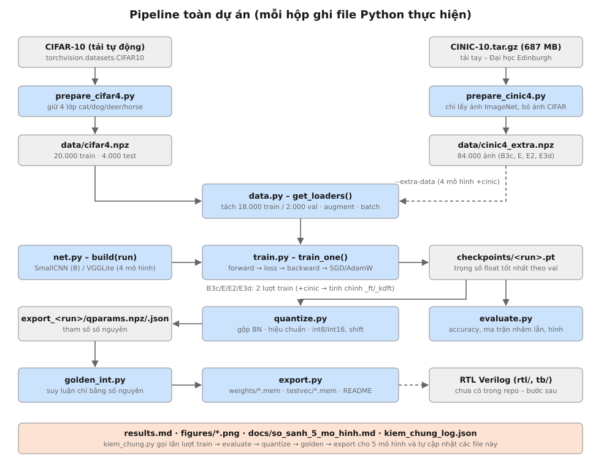

```
CIFAR-10 ─► prepare_cifar4.py ─► data/cifar4.npz ─┐
CINIC-10 ─► prepare_cinic4.py ─► data/cinic4_extra.npz ─┤
                                                         ▼
               data.py (tách val, tăng cường) ─► train.py (net.py dựng mô hình) ─► checkpoints/<run>.pt
                                                         ▼
                 evaluate.py (float) ─► quantize.py (gộp BN, int8/int16) ─► golden_int.py (số nguyên)
                                                         ▼
                 export.py (.mem cho RTL) ─► kiem_chung.py (bảng so sánh 5 mô hình, commit + push)
```

**Năm kiến trúc** (theo `docs/so_sanh_5_mo_hinh.md`):

| # | Mã | Lượt chạy cuối | Vai trò | Test số nguyên (= kết quả FPGA) |
|---|---|---|---|---|
| 1 | **B** | `B_16_32_64` | Cơ bản (~80%) | 80,00% |
| 2 | **B3c** | `B3c_c4x4_128+cinic_ft` | Nhanh | 87,60% |
| 3 | **E** | `E_opt_cnn+cinic_ft` | Chính xác cao + mạng thầy | 90,65% |
| 4 | **E2** | `E2_lite+cinic60_kdft` | Cân bằng | 89,60% |
| 5 | **E3d** | `E3d_deep5+cinic60_kdft` | Thử nghiệm mới (5 conv) | 90,25% |

Chi tiết: [01_PROJECT_STRUCTURE.md](01_PROJECT_STRUCTURE.md).

---

## 2. Cấu trúc source code

```
lsi-design-contest-2027/
├── model/                     ← toàn bộ Python
│   ├── config.py              hằng số, đường dẫn, siêu tham số
│   ├── prepare_cifar4.py      tải CIFAR-10, lọc 4 lớp → data/cifar4.npz
│   ├── prepare_cinic4.py      lọc ảnh ImageNet 4 lớp từ CINIC-10 → data/cinic4_extra.npz
│   ├── data.py                tách train/val, tăng cường, DataLoader
│   ├── net.py                 định nghĩa kiến trúc (SmallCNN, VGGLite), đếm tham số & MAC
│   ├── train.py               huấn luyện (2 công thức, fine-tune, distillation)
│   ├── evaluate.py            đánh giá float, ma trận nhầm lẫn
│   ├── quantize.py            gộp BN, lượng tử hoá, kiểm tra khớp từng bit
│   ├── golden_int.py          mô hình chuẩn chỉ dùng số nguyên (chuẩn cho RTL)
│   ├── export.py              xuất .mem + vector kiểm thử cho Verilog
│   ├── report.py              ghi/thay một mục trong results.md
│   ├── predict_image.py       dự đoán ảnh thật
│   ├── kiem_chung.py          chạy trọn quy trình cho 5 mô hình, vẽ bảng so sánh, commit + push
│   ├── results.md             bảng kết quả mọi lượt chạy (tự ghi)
│   ├── figures/               hình (đường học, ma trận nhầm lẫn…)
│   ├── export/                tham số số nguyên của B (và các kiến trúc gốc A–D)
│   └── export_<run>/          tham số số nguyên của mỗi kiến trúc mới
├── docs/                      đặc tả, phần cứng, bảng so sánh tự sinh
├── rtl/, tb/, pi/             (mới có README – chưa có RTL)
└── data/                      dữ liệu (không commit)
```

**Bảng liên kết công đoạn → file Python:**

| Công đoạn | File | Hàm / đoạn code chính | Đầu ra |
|---|---|---|---|
| Tải + lọc dữ liệu | `prepare_cifar4.py`, `prepare_cinic4.py` | `extract` (23–32); lọc tên `n…` (44–46); chống trùng (53–57) | `data/*.npz` |
| Tách train/val | `data.py` | `split_train_val` (27–33) | 18.000 / 2.000 ảnh |
| Tiền xử lý + tăng cường | `data.py` | `to_tensor` (36–38), `Cifar4.__getitem__` (57–68), `strong_augment` (71–88) | tensor `(3,32,32)` |
| Chia batch | `data.py` | `get_loaders` (91–108) | 3 `DataLoader` |
| Dựng mô hình | `net.py` | `SmallCNN` (27–47), `VGGLite` (75–94), `build` (97–104) | `nn.Module` |
| Đếm tham số / MAC | `net.py` | `count_params` (112–122), `count_macs` (125–134) | số nguyên |
| Loss, optimizer, LR | `train.py` | nhánh base (101–108), `opt_recipe` (167–189) | |
| Forward / backward / cập nhật | `train.py` | vòng lặp (116–139) | |
| Validation + lưu model | `train.py` | `evaluate` (35–46), dòng 141–153 | `checkpoints/<run>.pt` |
| Test + ghi kết quả | `train.py` | dòng 155–163, `append_result` (211–229) | `results.md`, `train_<run>.png` |
| Đánh giá chi tiết | `evaluate.py` | `main` (36–101) | `confusion_*.png`, `errors_*.png` |
| Lượng tử hoá | `quantize.py` | `fold_bn` (34–65), `calib_amax` (84–96), `quantize` (104–130) | `qparams.npz/json` |
| Suy luận số nguyên | `golden_int.py` | `conv3x3_int` (50–60), `requant_relu` (43–47), `infer` (68–84) | logit int32 |
| Xuất cho RTL | `export.py` | `main` (43–118) | `weights/*.mem`, `testvec/*` |
| Điều phối + so sánh | `kiem_chung.py` | `MODELS` (57–96), `verify_model` (514–541), `write_doc` (344–457) | `docs/so_sanh_5_mo_hinh.md` |

**Quy ước tên lượt chạy:** `<kiến trúc>+<nhãn>`. `net.build` cắt ở dấu `+` (`net.py:100`), nên `E2_lite+cinic60_kdft` vẫn là kiến trúc
`E2_lite`. Nhãn cho biết cách huấn luyện: `cinic` = có dữ liệu CINIC; `60` = 60 epoch; `ft` = tinh chỉnh (fine-tune); `kd` = học từ mạng
thầy (knowledge distillation).

Chi tiết: [01_PROJECT_STRUCTURE.md](01_PROJECT_STRUCTURE.md).

---

## 3. Dữ liệu và tiền xử lý

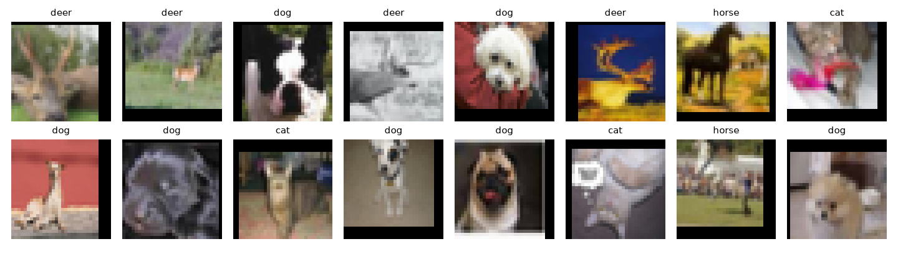

| Bước | Code | Thay số |
|---|---|---|
| **CIFAR-10 → CIFAR-4.** Giữ 4 lớp, đánh lại nhãn theo thứ tự `CLASSES` | `prepare_cifar4.py:23–32` | 50.000 → **20.000** ảnh train; 10.000 → **4.000** ảnh test (5.000 + 1.000 mỗi lớp) |
| **CINIC-10 → 84.000 ảnh ImageNet.** Chỉ lấy ảnh tên bắt đầu bằng `n` (ảnh ImageNet), bỏ ảnh gốc CIFAR; bỏ ảnh trùng pixel với tập test | `prepare_cinic4.py:44–57` | 4 lớp × 21.000 = **84.000** ảnh |
| **Tách val.** Xáo bằng seed 2027, lấy 10% làm val | `data.py:27–33` | train 18.000 (4508/4506/4488/4498), val 2.000 (492/494/512/502) |
| **Ghép CINIC** (chỉ vào train, chỉ khi `--extra-data`) | `data.py:99–102` | 18.000 × 2 + 84.000 = **120.000** ảnh |
| **uint8 → tensor.** `(32,32,3)` → `(3,32,32)`, chia **256** | `data.py:36–38` | pixel 200 → 0,78125 |
| **Tăng cường cơ bản** (mọi mô hình): đệm 4 pixel 0, cắt ngẫu nhiên 32×32, lật ngang 50% | `data.py:59–64` | 9 × 9 = 81 vị trí cắt × 2 hướng |
| **Tăng cường mạnh** (công thức opt): sáng/tương phản ±20%, Cutout 12×12 | `data.py:71–88` | |
| **Chia batch** | `data.py:103–107` | base 64 ảnh → 282 batch/epoch; opt 128 → 141 (CIFAR) hoặc 938 (có CINIC) |

**Vì sao chia 256 chứ không chia 255?** [Dự án] 256 = 2⁸, nên phần cứng coi pixel uint8 là số fixed-point có 8 bit phân số (f = 8) mà
không cần phép chia nào.

**Val và test không bao giờ bị tăng cường**, và không bao giờ có ảnh CINIC. Mọi accuracy báo cáo đều đo trên **4.000 ảnh test CIFAR-4**.

Chi tiết: [02_DATA_PREPROCESSING.md](02_DATA_PREPROCESSING.md).

---

## 4. Kiến thức CNN tối thiểu

Phần này chỉ gồm những gì cần để hiểu 5 kiến trúc. Đủ 30 khái niệm, mỗi khái niệm gồm bản chất, lý do, cách hoạt động, ví dụ và vị trí
trong code: [03_CNN_FOUNDATIONS.md](03_CNN_FOUNDATIONS.md).

### 4.1. Tích chập 3×3 (convolution)

[Lý thuyết] Bộ lọc 3×3 trượt trên ảnh; tại mỗi vị trí nhân từng phần tử với vùng ảnh bên dưới rồi cộng lại:

```text
z[o, h, w] = Σ_c Σ_ky Σ_kx  W[o, c, ky, kx] · x[c, h+ky−1, w+kx−1]  +  b[o]
```

`o` = kênh ra, `c` = kênh vào, `ky, kx ∈ {0, 1, 2}`. Điểm nằm ngoài ảnh lấy bằng 0 (đệm – padding).

**Kích thước đầu ra:** `H_out = (H + 2P − K)/S + 1`. Với K = 3, P = 1, S = 1: `(32 + 2 − 3)/1 + 1 = 32`, tức **giữ nguyên** kích thước.

**Số tham số** (sau khi gộp BN, mỗi kênh ra có 1 bias): `C_in · C_out · 9 + C_out`.
Ví dụ conv1 của B: `3 · 16 · 9 + 16 = 432 + 16 = 448`.

**Số MAC** (phép nhân–cộng, multiply–accumulate): `C_in · C_out · 9 · H_out · W_out`.
Ví dụ conv1 của B: `432 · 32 · 32 = 442.368`.

> **Ý quan trọng nhất cho thiết kế:** tham số **không** phụ thuộc H·W, nhưng MAC **tỉ lệ với** H·W. Cùng một conv 64→64 (36.864 trọng số)
> tốn 9,44 triệu MAC ở 16×16 nhưng chỉ 2,36 triệu MAC ở 8×8. Đây là chìa khoá để hiểu E và E2.

[Dự án] `nn.Conv2d(c_in, c_out, kernel_size=3, padding=1, bias=False)` (`net.py:83`). Không có bias vì BN đứng ngay sau đã có β.

### 4.2. BatchNorm, ReLU, MaxPool, Linear

| Khối | Công thức | Tham số | Ví dụ |
|---|---|---|---|
| BatchNorm (BN) | `y = γ·(z − μ)/√(σ² + ε) + β` | γ, β mỗi kênh (μ, σ² là thống kê, không học) | B: 2·(16+32+64) = 224 số học được |
| ReLU | `y = max(0, z)` | 0 | −1,99 → 0; 3,48 → 3,48 |
| MaxPool 2×2 | lấy max của mỗi ô 2×2, bước 2 | 0 | 32×32 → 16×16 |
| Flatten | trải `(C, H, W)` thành vector | 0 | B: 64×4×4 → 1.024 |
| Linear | `logit = W·x + b` | `N_in · 4 + 4` | B: 1.024·4 + 4 = 4.100 |

**Vì sao B có 27.796 tham số PyTorch nhưng chỉ 27.684 trên FPGA?** Lúc huấn luyện, mỗi kênh BN có γ và β (2 số). Khi gộp BN vào conv
(mục 8), mỗi kênh chỉ còn 1 bias. Do đó bớt đúng 16 + 32 + 64 = 112 số. `net.count_params` (`net.py:112–122`) đếm theo kiểu phần cứng.

### 4.3. Logit, softmax, loss – thay số thật

Ảnh test số 0 (nhãn cat), mô hình E2. Logit số nguyên do golden model tính là `[114.051; 12.992; −65.261; −61.425]`. Thang của fc là
`f_acc = 15`, nên logit thực = số nguyên / 2¹⁵:

| | cat | dog | deer | horse |
|---|---|---|---|---|
| Logit thực | 3,481 | 0,396 | −1,992 | −1,875 |
| Softmax `p = e^z / Σe^z` | 0,9481 | 0,0434 | 0,0040 | 0,0045 |

- **Dự đoán** = argmax = **cat** (đúng). Phần cứng chỉ cần argmax, **không** tính softmax.
- **Cross-entropy:** `L = −ln p_cat = −ln 0,9481 = 0,0533`.
- **Label smoothing 0,1** (công thức opt): nhãn đích (0,925; 0,025; 0,025; 0,025) → `L = −Σ q_i ln p_i = 0,4010`.
- **Distillation** (E2, E3d; α = 0,7, T = 4): `soft = T²·KL = 16 · 0,01379 = 0,2206`; `L = 0,3 · 0,4010 + 0,7 · 0,2206 = 0,2748`.

### 4.4. Trường tiếp nhận (receptive field)

[Lý thuyết] Vùng ảnh gốc ảnh hưởng tới một điểm của feature map. Công thức: `RF ← RF + (K − 1)·j`, rồi `j ← j·S`, bắt đầu RF = 1, j = 1.

Ví dụ B (conv, pool, conv, pool, conv, pool):
- conv: RF = 1 + 2·1 = 3;
- pool: RF = 3 + 1·1 = 4, j = 2;
- conv: RF = 4 + 2·2 = 8;
- pool: RF = 8 + 1·2 = 10, j = 4;
- conv: RF = 10 + 2·4 = 18;
- pool: RF = 18 + 1·4 = **22 px**, j = 8.

Kết quả cho 5 mô hình: B 22, E 26, E2 30, B3c 38, E3d 38 px. [Dự án] Code không tự tính RF; đây là phép tính lý thuyết từ cấu hình.

---

## 5. Năm kiến trúc

Cả 5 kiến trúc dùng cùng một **khối cơ bản**: `Conv 3×3 (pad 1) → BN → ReLU → [MaxPool 2×2]`, và cùng **đầu ra**:
`Flatten → Linear → 4 logit`. Chúng chỉ khác ở **số khối**, **số kênh** và **vị trí MaxPool**.

Trong `net.py`:
- **B** dùng `SmallCNN(channels)` (dòng 27–47): mọi tầng đều có pool.
- **4 mô hình còn lại** dùng `VGGLite(cfg)` (dòng 75–94), với `cfg` là danh sách `(số kênh ra, có pool)`:

```python
# model/net.py:75–94 (rút gọn)
class VGGLite(nn.Module):
    def __init__(self, cfg, n_classes=4):
        layers, c_in, size = [], 3, 32
        for c_out, pool in cfg:
            layers += [nn.Conv2d(c_in, c_out, kernel_size=3, padding=1, bias=False),   # Conv layer
                       nn.BatchNorm2d(c_out), nn.ReLU()]                                # BN + kích hoạt
            if pool:
                layers.append(nn.MaxPool2d(2))                                          # Pooling layer
                size //= 2
            c_in = c_out
        self.features = nn.Sequential(*layers)
        self.classifier = nn.Linear(c_in * size * size, n_classes)                      # Fully connected
    def forward(self, x):
        return self.classifier(torch.flatten(self.features(x), 1))
```

Mỗi phần tử của `cfg` sinh ra một tầng conv trong bảng bên dưới. Phần tử có `True` sinh thêm một MaxPool. `classifier` là tầng `fc`.

Các bảng tham số/MAC dưới đây do script đọc `net.py` sinh ra, và tổng khớp với `count_params` / `count_macs`.

### 5.1. Kiến trúc 1 – B (`B_16_32_64`): cơ bản

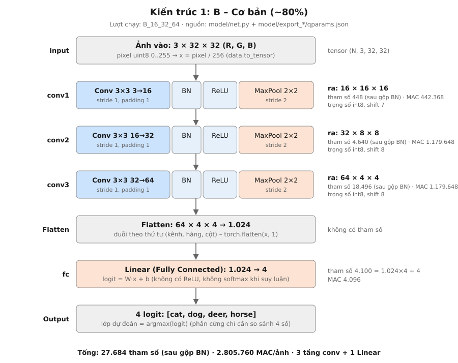

- **Ý tưởng.** CNN kinh điển nhỏ nhất: 3 khối giống hệt nhau, mỗi khối nhân đôi số kênh (16 → 32 → 64) và giảm nửa kích thước
  (32 → 16 → 8 → 4). Đây là cách cân bằng phổ biến: kích thước giảm 4 lần, số kênh tăng 2 lần, nên MAC mỗi tầng gần như đều nhau.
- **Code.** `ARCHS["B_16_32_64"] = (16, 32, 64)` (`net.py:21`) → `SmallCNN`.

| Tầng | Vào (C×H×W) | Pool | Ra (C×H×W) | Trọng số | Bias | Tham số | MAC |
|---|---|---|---|---|---|---|---|
| conv1 | 3×32×32 | có | 16×16×16 | 432 | 16 | 448 | 442.368 |
| conv2 | 16×16×16 | có | 32×8×8 | 4.608 | 32 | 4.640 | 1.179.648 |
| conv3 | 32×8×8 | có | 64×4×4 | 18.432 | 64 | 18.496 | 1.179.648 |
| fc | 1.024 | – | 4 | 4.096 | 4 | 4.100 | 4.096 |
| **Tổng** | | | | | | **27.684** | **2.805.760** |

- **Huấn luyện:** công thức base (AdamW, CE, 30 epoch, chỉ CIFAR), 3,4 phút.
- **Kết quả:** số nguyên **80,00%** (float 80,23%). Lớp cat chỉ đạt 68,5%.
- **Nhận xét:** nhỏ, nhanh, dễ làm RTL. Nhưng sức chứa (27,7 nghìn tham số) và trường tiếp nhận (22 px) đều nhỏ.

Chi tiết: [04_ARCHITECTURE_1_B.md](04_ARCHITECTURE_1_B.md).

### 5.2. Kiến trúc 2 – B3c (`B3c_c4x4_128+cinic_ft`): nhanh

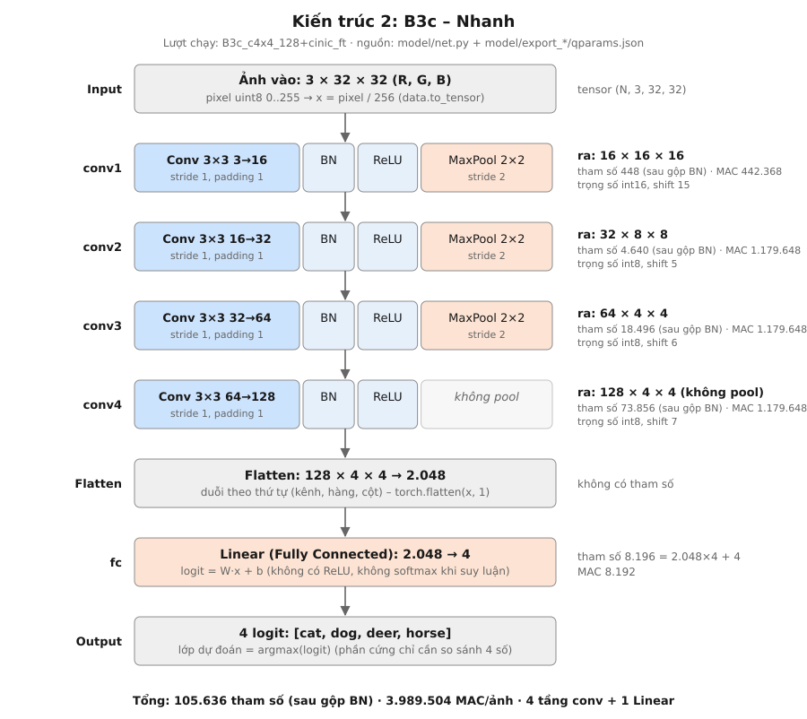

- **Ý tưởng.** Giữ nguyên thân B, thêm **một conv 64→128 ở độ phân giải 4×4**, không pool (`net.py:60, 64`). Ở 4×4 mỗi trọng số chỉ được
  dùng 16 lần, nên thêm 73.728 trọng số chỉ tốn thêm 1,18 triệu MAC. Đổi lại: tốn bộ nhớ (BRAM), gần như không tốn tốc độ.
- **Code.** `OPT_ARCHS["B3c_c4x4_128"] = ((16,T),(32,T),(64,T),(128,F))` → `VGGLite`.

| Tầng | Vào (C×H×W) | Pool | Ra (C×H×W) | Trọng số | Bias | Tham số | MAC |
|---|---|---|---|---|---|---|---|
| conv1 | 3×32×32 | có | 16×16×16 | 432 | 16 | 448 | 442.368 |
| conv2 | 16×16×16 | có | 32×8×8 | 4.608 | 32 | 4.640 | 1.179.648 |
| conv3 | 32×8×8 | có | 64×4×4 | 18.432 | 64 | 18.496 | 1.179.648 |
| conv4 | 64×4×4 | không | 128×4×4 | 73.728 | 128 | 73.856 | 1.179.648 |
| fc | 2.048 | – | 4 | 8.192 | 4 | 8.196 | 8.192 |
| **Tổng** | | | | | | **105.636** | **3.989.504** |

- **Huấn luyện:** công thức opt, lượt 1 30 epoch (CIFAR ×2 + CINIC), lượt 2 tinh chỉnh 15 epoch; 28,9 phút. Lượng tử conv1 int16.
- **Kết quả:** số nguyên **87,60%** (float 87,67%). Tăng 7,6 điểm so với B, trong khi MAC chỉ tăng 42%.

Chi tiết: [05_ARCHITECTURE_2_B3c.md](05_ARCHITECTURE_2_B3c.md).

### 5.3. Kiến trúc 3 – E (`E_opt_cnn+cinic_ft`): chính xác cao, mạng thầy

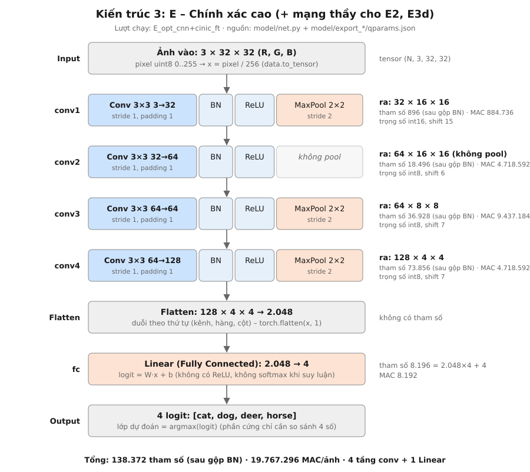

- **Ý tưởng.** Kiểu VGG: hai conv 3×3 liền nhau ở **16×16** (conv2 không pool) trước khi pool. Hai conv 3×3 liền nhau nhìn được vùng 5×5
  mà ít tham số hơn một conv 5×5, và có thêm một lần ReLU. Rộng hơn B (32 kênh ngay từ conv1).
- **Code.** `OPT_ARCHS["E_opt_cnn"] = ((32,T),(64,F),(64,T),(128,T))` (`net.py:56`).

| Tầng | Vào (C×H×W) | Pool | Ra (C×H×W) | Trọng số | Bias | Tham số | MAC |
|---|---|---|---|---|---|---|---|
| conv1 | 3×32×32 | có | 32×16×16 | 864 | 32 | 896 | 884.736 |
| conv2 | 32×16×16 | không | 64×16×16 | 18.432 | 64 | 18.496 | 4.718.592 |
| conv3 | 64×16×16 | có | 64×8×8 | 36.864 | 64 | 36.928 | 9.437.184 |
| conv4 | 64×8×8 | có | 128×4×4 | 73.728 | 128 | 73.856 | 4.718.592 |
| fc | 2.048 | – | 4 | 8.192 | 4 | 8.196 | 8.192 |
| **Tổng** | | | | | | **138.372** | **19.767.296** |

- **Huấn luyện:** như B3c; 70,0 phút. Checkpoint của E là **mạng thầy** cho E2 và E3d.
- **Kết quả:** số nguyên **90,65%** (float 90,45%), cao nhất trong 5 mô hình. Cat đạt 85,8%. 99,0% dự đoán trùng giữa float và số nguyên.
- **Giá phải trả:** 19,8 triệu MAC (gấp 7 lần B), riêng conv3 chiếm 9,44 triệu. BRAM ước lượng ~79%.

Chi tiết: [06_ARCHITECTURE_3_E.md](06_ARCHITECTURE_3_E.md).

### 5.4. Kiến trúc 4 – E2 (`E2_lite+cinic60_kdft`): cân bằng

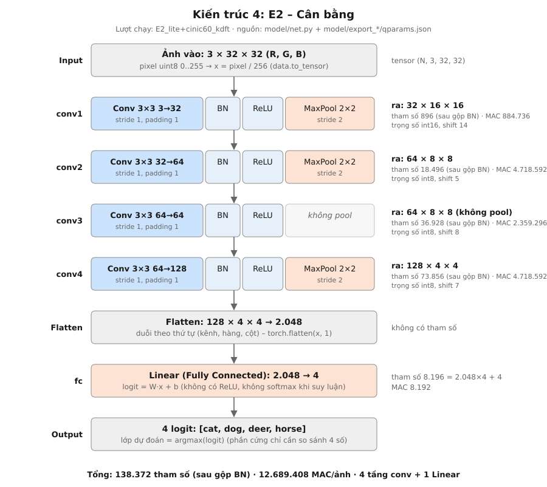

- **Ý tưởng.** **Đúng 4 conv của E**, nhưng dời MaxPool: pool sau conv2, còn cặp conv kép đặt ở **8×8** (`net.py:65–66`). Tham số giữ
  nguyên 138.372, MAC giảm 36%.
- **Code.** `OPT_ARCHS["E2_lite"] = ((32,T),(64,T),(64,F),(128,T))`.

| Tầng | Vào (C×H×W) | Pool | Ra (C×H×W) | Trọng số | Bias | Tham số | MAC |
|---|---|---|---|---|---|---|---|
| conv1 | 3×32×32 | có | 32×16×16 | 864 | 32 | 896 | 884.736 |
| conv2 | 32×16×16 | có | 64×8×8 | 18.432 | 64 | 18.496 | 4.718.592 |
| conv3 | 64×8×8 | không | 64×8×8 | 36.864 | 64 | 36.928 | 2.359.296 |
| conv4 | 64×8×8 | có | 128×4×4 | 73.728 | 128 | 73.856 | 4.718.592 |
| fc | 2.048 | – | 4 | 8.192 | 4 | 8.196 | 8.192 |
| **Tổng** | | | | | | **138.372** | **12.689.408** |

So với E, chỉ conv3 khác nhau: 9.437.184 → 2.359.296 MAC, tức giảm 7.077.888.

- **Huấn luyện:** lượt 1 **60 epoch**, lượt 2 tinh chỉnh 15 epoch **có học từ thầy E**; 95,3 phút (chưa tính thời gian huấn luyện E).
- **Kết quả:** số nguyên **89,60%** (float 90,00%). Mức sụt khi lượng tử (−0,40) lớn nhất nhóm. Trên máy cloud, 5 lần huấn luyện cho
  89,45–90,30%.

Chi tiết: [07_ARCHITECTURE_4_E2.md](07_ARCHITECTURE_4_E2.md).

### 5.5. Kiến trúc 5 – E3d (`E3d_deep5+cinic60_kdft`): sâu hơn, hẹp hơn

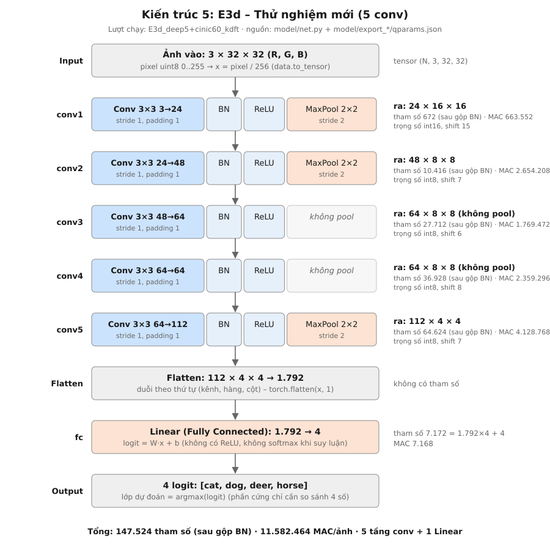

- **Ý tưởng.** Hẹp ở đầu (24, 48 kênh) để giảm MAC ở độ phân giải cao. Thêm chiều sâu ở 8×8: **3 conv liền nhau**, 48→64→64→112
  (`net.py:67, 69`). Mục tiêu ghi trong chú thích: giữ tốc độ ~E2_lite, trọng số ≤ ~150 KB.
- **Code.** `OPT_ARCHS["E3d_deep5"] = ((24,T),(48,T),(64,F),(64,F),(112,T))`.

| Tầng | Vào (C×H×W) | Pool | Ra (C×H×W) | Trọng số | Bias | Tham số | MAC |
|---|---|---|---|---|---|---|---|
| conv1 | 3×32×32 | có | 24×16×16 | 648 | 24 | 672 | 663.552 |
| conv2 | 24×16×16 | có | 48×8×8 | 10.368 | 48 | 10.416 | 2.654.208 |
| conv3 | 48×8×8 | không | 64×8×8 | 27.648 | 64 | 27.712 | 1.769.472 |
| conv4 | 64×8×8 | không | 64×8×8 | 36.864 | 64 | 36.928 | 2.359.296 |
| conv5 | 64×8×8 | có | 112×4×4 | 64.512 | 112 | 64.624 | 4.128.768 |
| fc | 1.792 | – | 4 | 7.168 | 4 | 7.172 | 7.168 |
| **Tổng** | | | | | | **147.524** | **11.582.464** |

- **Huấn luyện:** như E2; 96,2 phút.
- **Kết quả:** số nguyên **90,25%** (float 90,20%; val 90,70%, cao nhất). Đạt mức ~90% với ít MAC nhất trong nhóm ~90%.
- **Giá phải trả:** nhiều tham số nhất (145,6 KB); 5 tầng RTL; mới chạy 1 lần.

Chi tiết: [08_ARCHITECTURE_5_E3d.md](08_ARCHITECTURE_5_E3d.md).

---

## 6. Huấn luyện

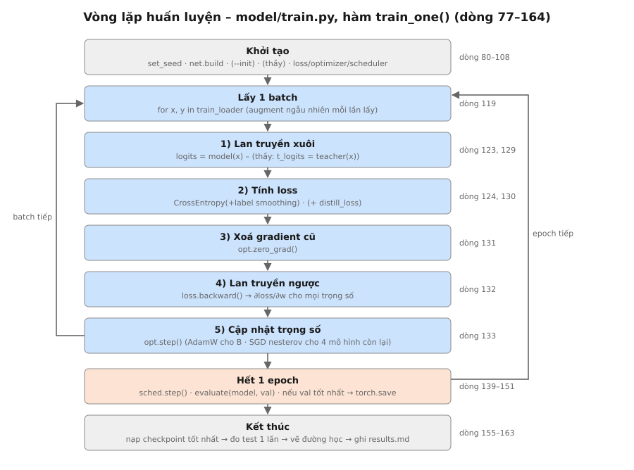

### 6.1. Hai công thức

| | **base** – B | **opt** – B3c, E, E2, E3d |
|---|---|---|
| Code | `train.py:101–108` | `opt_recipe`, `train.py:167–189` |
| Batch | 64 | 128 |
| Loss | `CrossEntropyLoss()` | `CrossEntropyLoss(label_smoothing=0.1)` |
| Optimizer | AdamW, lr 1e-3, weight decay 5e-4 (mọi tham số) | SGD Nesterov, momentum 0,9, lr 0,05; weight decay 5e-4 chỉ cho trọng số conv/linear |
| Lịch LR | cosine, T_max = số epoch | warmup tuyến tính 5 epoch rồi cosine về 0 |
| Tăng cường | crop + lật | crop + lật + sáng/tương phản + Cutout |

### 6.2. Huấn luyện 2 lượt + mạng thầy

| | Lượt 1 (CIFAR ×2 + CINIC, 120.000 ảnh) | Lượt 2: tinh chỉnh (chỉ CIFAR, lr 0,005, không warmup, `--init`) | Test float sau lượt 1 → 2 |
|---|---|---|---|
| B3c | 30 epoch | 15 epoch | 86,65 → 87,67 |
| E | 30 epoch | 15 epoch | 89,20 → 90,45 |
| E2 | 60 epoch | 15 epoch + thầy E (α 0,7, T 4) | 89,92 → 90,00 |
| E3d | 60 epoch | 15 epoch + thầy E | 89,65 → 90,20 |

**Vì sao 2 lượt?** Lượt 1 học đặc trưng chung từ nhiều ảnh (thêm ảnh ImageNet của CINIC). Lượt 2 kéo mô hình về đúng "miền" ảnh CIFAR
mà tập test dùng.

**Vì sao học từ thầy?** Phân phối xác suất "mềm" của thầy (ví dụ "ảnh mèo này hơi giống chó") cho thêm thông tin mà nhãn 0/1 không có
(`distill_loss`, `train.py:49–57`).

### 6.3. Một bước huấn luyện, từng dòng code

| Bước | Bản chất / công thức | Code |
|---|---|---|
| Cố định ngẫu nhiên | `torch.manual_seed(2027)`, `np.random.seed(2027)` | `set_seed`, 28–32 |
| Khởi tạo mô hình | `net.build(arch)`; tinh chỉnh thì nạp checkpoint | 81–84 |
| Loss / optimizer / lịch LR | xem 6.1 | 98–108, 167–189 |
| Chia batch | `DataLoader(shuffle=True)` | `data.py:103–107` |
| Forward (lan truyền xuôi) | `logits = model(x)` | 123 |
| Tính loss | `loss_fn(logits, y)` (+ KD) | 124–130 |
| Backpropagation (lan truyền ngược) | `loss.backward()` tính ∂L/∂W bằng quy tắc dây chuyền (chain rule) | 132 |
| Cập nhật trọng số | `opt.step()`: SGD Nesterov `v ← μv + g`, `W ← W − η(g + μv)` | 133 |
| Lặp epoch | `sched.step()` đổi LR | 139 |
| Validation | `evaluate(model, val_loader)`: CE, accuracy trên 2.000 ảnh val | 141–146 |
| Lưu model | chỉ khi val accuracy tăng: `torch.save(...)` → `checkpoints/<run>.pt` | 148–151 |
| Test | nạp checkpoint tốt nhất, đo trên 4.000 ảnh test | 155–157 |

Ví dụ LR của công thức opt (lr 0,05, 30 epoch): epoch 1 = 0,05 × 1/5 = 0,01; epoch 5 = 0,05; sau đó giảm theo cosine
`0,05 · ½(1 + cos(π·(ep − 5)/25))` về gần 0.

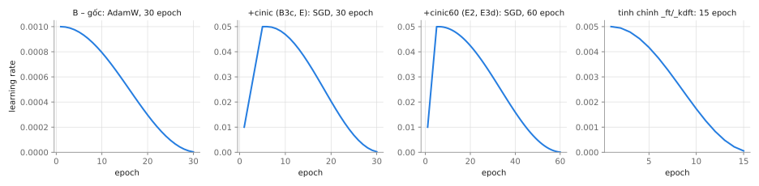

Chi tiết: [09_TRAINING_PROCESS.md](09_TRAINING_PROCESS.md).

---

## 7. Đánh giá và kết quả

### 7.1. Các chỉ số dự án thực sự dùng

| Chỉ số | Công thức | Tính ở đâu |
|---|---|---|
| Accuracy | số đoán đúng / tổng số ảnh | `train.py:44, 137`, `evaluate.py:49`, `golden_int.py:87–90` |
| Train / val loss | CE trung bình (train: có label smoothing, KD) | `train.py:39, 136` |
| Ma trận nhầm lẫn (confusion matrix) | `cm[i][j]` = số ảnh lớp i bị đoán là j | `evaluate.py:50` (`sklearn`) |
| Accuracy từng lớp | `cm[i][i] / Σ_j cm[i][j]` | `evaluate.py:85`, `kiem_chung.py:230` |
| Chênh số nguyên − float, trùng dự đoán | | `quantize.py:199–207` |
| Tham số, MAC, KB, BRAM, ms/ảnh | | `net.py`, `kiem_chung.py:202–218, 352–353` |

Dự án **không** tính Precision, Recall, F1. File 11 tính thêm từ ma trận nhầm lẫn để tham khảo. Ví dụ lớp cat của E2 (float): TP 820,
FP 110, FN 180 → P = 820/930 = 88,2%; R = 820/1000 = 82,0%; F1 = 2PR/(P+R) = 85,0%.

### 7.2. Kết quả 5 mô hình

| | B | B3c | E | E2 | E3d |
|---|---|---|---|---|---|
| **Test số nguyên** | **80,00** | **87,60** | **90,65** | **89,60** | **90,25** |
| Test float | 80,23 | 87,67 | 90,45 | 90,00 | 90,20 |
| Val float | 81,55 | 87,30 | 90,45 | 90,20 | 90,70 |
| Số nguyên − float | −0,22 | −0,08 | +0,20 | −0,40 | +0,05 |
| Trùng dự đoán float ↔ số nguyên | 98,0% | 98,0% | 99,0% | 98,2% | 98,9% |
| cat / dog / deer / horse (số nguyên) | 68,5 / 78,6 / 87,3 / 85,6 | 79,7 / 85,2 / 93,1 / 92,4 | 85,8 / 86,5 / 94,8 / 95,5 | 80,3 / 87,5 / 95,1 / 95,5 | 83,4 / 86,6 / 95,0 / 96,0 |
| Macro-F1 (float, tính thêm) | 80,21 | 87,65 | 90,41 | 89,94 | 90,17 |

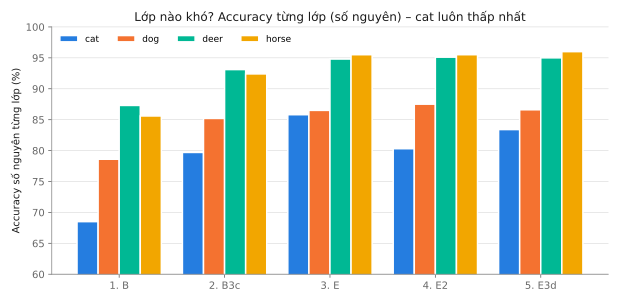

**Nhận xét:**
- **cat** là lớp khó nhất ở cả 5 mô hình; cặp hay nhầm nhất là **cat ↔ dog**. **deer**, **horse** dễ hơn.
- **Độ tin cậy:** ở mức 90%, sai số chuẩn trên 4.000 ảnh là √(0,9·0,1/4000) ≈ 0,47 điểm; khoảng tin cậy 95% ≈ ±0,93. Do đó E, E3d, E2
  (chênh ≤ 1,05) **chưa phân hạng được**.

Chi tiết + hình ma trận nhầm lẫn của từng mô hình: [11_EVALUATION_AND_RESULTS.md](11_EVALUATION_AND_RESULTS.md).

---

## 8. Từ float đến số nguyên cho FPGA

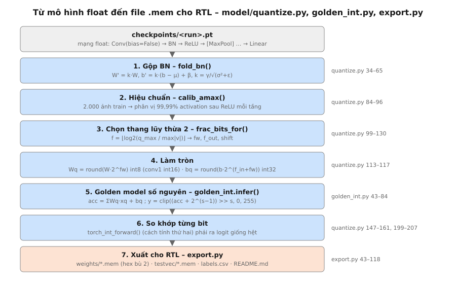

**Quy ước:** số thực `v ≈ q · 2^(−f)`; mọi thang là lũy thừa của 2, nên đổi thang chỉ cần **dịch bit**.

| Bước | Công thức | Code |
|---|---|---|
| 1. Gộp BN vào conv | `k = γ/√(σ²+ε)`; `W' = k·W`; `b' = k·(b − μ) + β` | `fold_bn`, `quantize.py:34–65` |
| 2. Hiệu chuẩn activation | phân vị 99,99% của activation sau ReLU, trên 2.000 ảnh train | `calib_amax`, 84–96 |
| 3. Chọn số bit phân số | `f = floor(log₂(q_max / max|v|))` | `frac_bits_for`, 99–101 |
| 4. Làm tròn | `wq = round(W'·2^fw)`; `bq = round(b'·2^(f_in+fw))` (int32); `shift = f_in + fw − f_out` | `quantize`, 104–130 |
| 5. Suy luận số nguyên | `acc = Σ wq·x + bq` (int32); `y = clip((acc + 2^(shift−1)) >> shift, 0, 255)`; MaxPool; fc → logit int32 | `golden_int.py:43–84` |
| 6. Kiểm tra | golden NumPy ↔ PyTorch số nguyên **trùng từng bit** trên 4.000 ảnh | `quantize.py:199–207` |
| 7. Xuất | `.mem` hex bù 2 (int8: 2 chữ số, int16: 4, int32: 8) + 20 vector kiểm thử | `export.py` |

**Ví dụ minh hoạ gộp BN** (số tự chọn): γ = 1,2; σ² = 0,25 (ε bỏ qua); μ = 0,5; β = 0,1 → k = 1,2/0,5 = 2,4; W' = 2,4·W;
b' = 2,4·(0 − 0,5) + 0,1 = −1,1.

**Ví dụ số thật** (conv1 của E2, `qparams.json`):
- trọng số int16, `fw = 11`;
- `a_max = 5,955` → `f_out = floor(log₂(255/5,955)) = 5`;
- `f_acc = 8 + 11 = 19`, nên `shift = 19 − 5 = 14`.

Phép dịch có làm tròn: acc = 1000, shift = 4 → (1000 + 8) >> 4 = 63.

**Vì sao conv1 dùng int16 ở B3c, E, E2, E3d?**
- Ảnh vào chỉ chia 256, không chuẩn hoá, nên k của BN ở conv1 rất lớn và trọng số conv1 sau gộp lớn (E2: max ≈ 14,5).
- Nếu dùng int8, f chỉ còn 3, bước làm tròn là 1/8, quá thô.
- Commit `e3fb269` ghi int8 làm mất ~2 điểm %. Với int16, `fw = 11` (bước 1/2.048).
- int16 × uint8 vẫn vừa **một** DSP48E1 (25×18). Conv1 chỉ có ≤ 864 trọng số, nên tốn thêm < 1 KB.

**Ước lượng phần cứng** (`kiem_chung.py:202–218`):

| | B | B3c | E | E2 | E3d |
|---|---|---|---|---|---|
| Trọng số thật (W + bias int32) | 27,4 KB | 104,3 KB | 136,8 KB | 136,8 KB | 145,6 KB |
| Bộ đệm ảnh lớn nhất (vào + ra, uint8) | 7 KB | 7 KB | 24 KB | 12 KB | 9 KB |
| BRAM ước lượng | ~17% | ~55% | ~79% | ~73% | ~76% |
| ms/ảnh, 16 DSP @ 20 MHz | 8,8 | 12,5 | 61,8 | 39,7 | 36,2 |
| ms/ảnh, 16 DSP @ 100 MHz | 1,8 | 2,5 | 12,4 | 7,9 | 7,2 |

Công thức: `ms = MAC / (DSP × f) × 1000`. Ví dụ E2: 12.689.408 / (16 × 100·10⁶) × 1000 = 7,9 ms. Đây là ước lượng lý thuyết (DSP bận
100%). BRAM chưa tính phần lẻ khối 18 Kb và bộ đệm dòng. **Số liệu tổng hợp thật chưa xác định được**, vì repo chưa có RTL.

Chi tiết: [10_QUANTIZATION_AND_HARDWARE.md](10_QUANTIZATION_AND_HARDWARE.md).

---

## 9. So sánh 5 kiến trúc

| Tiêu chí | 1: B | 2: B3c | 3: E | 4: E2 | 5: E3d |
|---|---|---|---|---|---|
| Ý tưởng | 3 khối đều, kênh ×2 | B + conv 64→128 ở 4×4 | VGG: conv kép ở 16×16 | như E, conv kép dời xuống 8×8 | hẹp + sâu: 3 conv liền ở 8×8 |
| Tầng có trọng số (conv + fc) | 4 | 5 | 5 | 5 | 6 |
| Số conv | 3 | 4 | 4 | 4 | 5 |
| Kernel | 3×3 | 3×3 | 3×3 | 3×3 | 3×3 |
| Pooling | MaxPool 2×2 ×3 | ×3 (conv4 không) | ×3 (conv2 không) | ×3 (conv3 không) | ×3 (conv3, 4 không) |
| Activation | ReLU | ReLU | ReLU | ReLU | ReLU |
| Tham số (FPGA / PyTorch) | 27.684 / 27.796 | 105.636 / 105.876 | 138.372 / 138.660 | 138.372 / 138.660 | 147.524 / 147.836 |
| MAC / ảnh | 2,81 tr | 3,99 tr | 19,77 tr | 12,69 tr | 11,58 tr |
| Optimizer | AdamW | SGD Nesterov | SGD Nesterov | SGD Nesterov | SGD Nesterov |
| Loss | CE | CE + LS 0,1 | CE + LS 0,1 | CE + LS + KD | CE + LS + KD |
| Accuracy số nguyên | 80,00% | 87,60% | **90,65%** | 89,60% | 90,25% |
| Thời gian huấn luyện | 3,4 ph | 28,9 ph | 70,0 ph | 95,3 ph (+E) | 96,2 ph (+E) |
| Ưu điểm | nhỏ, nhanh, RTL đơn giản | >85% với MAC ≈ B | chính xác nhất, lượng tử ổn định nhất | = tham số E, −36% MAC | ~90% với ít MAC nhất |
| Nhược điểm | 80% | kém nhóm E 2–3 điểm | MAC ×7 B, BRAM ~79% | sụt −0,40 khi lượng tử, dao động | nhiều tham số nhất, 5 tầng |

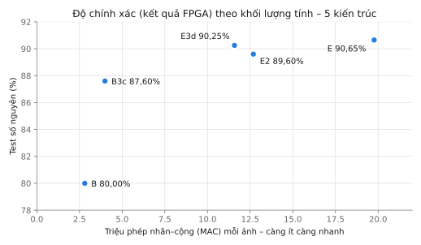

**Tóm tắt 8 câu trả lời** (đầy đủ ở [12_ARCHITECTURE_COMPARISON.md](12_ARCHITECTURE_COMPARISON.md)):

1. **Khác nhau về bản chất:** cùng khối cơ bản, chỉ khác độ rộng, độ sâu và **vị trí MaxPool**. Vị trí pool quyết định MAC. Ngoài ra B
   khác 4 mô hình kia cả về dữ liệu (không CINIC) lẫn công thức huấn luyện.
2. **Vì sao khác nhau:** mỗi kiến trúc là một điểm đánh đổi giữa tốc độ (∝ MAC), bộ nhớ (∝ tham số) và độ chính xác trên chip XC7S25.
3. **Phức tạp nhất:** E3d về cấu trúc (5 conv, 18 module) và quy trình (cần thầy). E nặng nhất về tính toán.
4. **Nhiều tham số nhất:** E3d, 147.524.
5. **Kết quả tốt nhất:** E (90,65%). Tuy vậy E, E3d, E2 nằm trong sai số đo và chỉ chạy 1 seed. Về hiệu quả: E3d (~90% với 11,6 triệu
   MAC); trong nhóm ≥ 85% thì B3c tốt nhất.
6. **Tổng quát hoá:** cả 5 có |test − val| nhỏ hơn sai số đo, không thấy overfitting rõ. E bền nhất khi lượng tử. Trên ảnh camera thật thì
   **chưa xác định được** (chưa có `real_images`).
7. **Đánh đổi:** lợi ích giảm dần. B → B3c: +7,6 điểm với +42% MAC. B3c → E3d: +2,65 điểm với ×2,9 MAC. E3d → E: +0,40 điểm với ×1,7 MAC.
8. **Khi nào dùng:**
   - B: bản RTL đầu tiên;
   - B3c: cần nhanh, ít tài nguyên;
   - E: ưu tiên độ chính xác và có dư DSP/clock;
   - E3d: muốn ~90% với ít phép tính;
   - E2: muốn 4 tầng như E nhưng nhanh hơn.

---

## 10. Chạy dự án từ đầu: 11 bước

| Bước | Việc | Lệnh / nơi xảy ra | Đầu ra |
|---|---|---|---|
| 1 | Môi trường | `source ~/eda-venv/bin/activate` | venv |
| 2 | Thư viện | `pip install torch torchvision --index-url https://download.pytorch.org/whl/cpu`, rồi `pip install -r requirements.txt` | |
| 3 | Dữ liệu | `python model/prepare_cifar4.py`; `python model/prepare_cinic4.py --tar <CINIC-10.tar.gz>` | `data/cifar4.npz`, `data/cinic4_extra.npz` |
| 4 | Tiền xử lý | trong `train.py` (`data.get_loaders`) | tensor trong RAM |
| 5 | Xây kiến trúc | trong `train.py` (`net.build`) | `nn.Module` |
| 6 | Huấn luyện | `python model/train.py --arch ...` (xem dưới) | `model/checkpoints/<run>.pt`, `train_<run>.png`, dòng trong `results.md` |
| 7 | Validation | trong `train.py`, cuối mỗi epoch | chọn checkpoint tốt nhất |
| 8 | Testing | cuối `train.py`; `evaluate.py`; `quantize.py`; `golden_int.py` | test float + số nguyên |
| 9 | Đánh giá | `evaluate.py`, `quantize.py` | `confusion_*.png`, mục trong `results.md` |
| 10 | Lưu kết quả | `python model/export.py --arch ...` | `model/export_<run>/` |
| 11 | So sánh | `python model/kiem_chung.py bang --khong-push` | `docs/so_sanh_5_mo_hinh.md` |

Ví dụ trọn bộ cho E2 (đúng các lệnh `kiem_chung.py` gọi; E phải được huấn luyện trước):

```bash
python model/train.py --arch "E2_lite+cinic60" --recipe opt --extra-data --cifar-repeat 2 --epochs 60
```

```bash
python model/train.py --arch "E2_lite+cinic60_kdft" --init "E2_lite+cinic60" --recipe opt --lr 0.005 --warmup 0 --epochs 15 --teacher "E_opt_cnn+cinic_ft"
```

```bash
python model/evaluate.py --arch "E2_lite+cinic60_kdft"
```

```bash
python model/quantize.py --arch "E2_lite+cinic60_kdft" --conv1-bits 16
```

```bash
python model/golden_int.py --arch "E2_lite+cinic60_kdft"
```

```bash
python model/export.py --arch "E2_lite+cinic60_kdft"
```

Thực tế chỉ cần một lệnh cho cả bước 6 → 11 (tự sắp thứ tự, chạy tiếp nếu bị dừng; **mặc định tự commit + push**):

```bash
python model/kiem_chung.py tatca
```

Chi tiết từng bước (cần làm gì, file, lệnh, đầu vào, đầu ra, lưu ở đâu, bước tiếp theo):
[13_RUN_PIPELINE_STEP_BY_STEP.md](13_RUN_PIPELINE_STEP_BY_STEP.md).

---

## 11. Lộ trình học

| Chặng | Nội dung | Đọc | Bài tập tiêu biểu (đáp án) |
|---|---|---|---|
| 0 | Python, NumPy, PyTorch tối thiểu | `config.py`, `data.py` | in `shape` của `cifar4.npz` |
| 1 | Dữ liệu | 02 | số batch/epoch khi có CINIC (938) |
| 2 | Một tầng CNN | 03, 04 | tham số + MAC conv1 của B (448; 442.368) |
| 3 | Tự dựng 5 kiến trúc | 04–08 | viết `MyCNN(cfg)` ra đúng 27.796 / 105.876 / 138.660 / 138.660 / 147.836 tham số |
| 4 | Huấn luyện | 09 | LR epoch 1 của công thức opt (0,01) |
| 5 | Đánh giá | 11 | P/R/F1 lớp cat của E2 (88,2 / 82,0 / 85,0) |
| 6 | Lượng tử hoá | 10 | `frac_bits_for(0,73, 127)` = 7; (1000 + 8) >> 4 = 63 |
| 7 | Tự thiết kế kiến trúc thứ 6 | 12, 15 | ràng buộc ≤ 100 KB, tự trả lời 8 câu hỏi |

Lời giải và lệnh kiểm tra: [14_LEARNING_ROADMAP.md](14_LEARNING_ROADMAP.md).

---

## 12. Điểm bất thường trong code

Không có lỗi nào làm sai accuracy của 5 mô hình. Những điểm cần biết:

- 🔴 **Giới hạn của thí nghiệm:**
  - mỗi mô hình chỉ chạy 1 seed;
  - chưa đo trên ảnh thật;
  - chưa có RTL, nên tài nguyên mới là ước lượng;
  - E, E2, E3d vượt ngân sách 100 KB;
  - ở 20 MHz, nhóm ~90% chưa đạt 30 khung/giây;
  - báo cáo phải nêu việc dùng CINIC.
- 🟠 **Lỗi tiềm ẩn:**
  - `--seed` không đổi thứ tự xáo dữ liệu (`data.py:103`);
  - tăng cường dùng `np.random` toàn cục, nên sẽ trùng giữa các worker nếu `num_workers > 0`;
  - `lr or OPT_LR` (`train.py:180`);
  - `kiem_chung.py` mặc định push;
  - chống trùng CINIC chỉ bắt ảnh trùng tuyệt đối.
- 🟡 **Chưa nhất quán:**
  - tiêu đề "Khoảng W (int8)" dù conv1 là int16 (`quantize.py:222`);
  - val loss và train loss không cùng định nghĩa;
  - cột "KB int8" của `results.md` bỏ qua bias int32;
  - chú thích cũ "nhánh exp/opt-acc-90".

Đầy đủ (vị trí, ảnh hưởng, cách sửa gợi ý): [15_CODE_REVIEW_NOTES.md](15_CODE_REVIEW_NOTES.md).

---

## 13. Bảng thuật ngữ

| Tiếng Việt | Tiếng Anh | Một câu giải thích |
|---|---|---|
| Tích chập | convolution | trượt bộ lọc nhỏ trên ảnh, nhân–cộng tại mỗi vị trí |
| Bộ lọc / nhân | filter / kernel | bộ trọng số 3×3×C_in của một kênh ra |
| Bản đồ đặc trưng | feature map | đầu ra của một tầng conv, kích thước C×H×W |
| Đệm | padding | thêm viền 0 quanh ảnh để giữ kích thước |
| Bước trượt | stride | số pixel bộ lọc dịch mỗi lần (dự án: 1) |
| Gộp cực đại | max pooling | lấy max mỗi ô 2×2, giảm nửa kích thước |
| Hàm kích hoạt | activation function | phi tuyến sau conv; dự án dùng ReLU |
| Chuẩn hoá theo batch | batch normalization (BN) | chuẩn hoá mỗi kênh rồi co giãn γ, dịch β |
| Tầng kết nối đầy đủ | fully connected / Linear | nhân ma trận ra 4 logit |
| Hàm mất mát | loss function | đo độ sai; dự án dùng cross-entropy |
| Làm mềm nhãn | label smoothing | nhãn đích 0,925 / 0,025 thay vì 1 / 0 |
| Chưng cất tri thức | knowledge distillation (KD) | mô hình trò bắt chước xác suất của mô hình thầy |
| Lan truyền xuôi / ngược | forward / backpropagation | tính đầu ra / tính gradient |
| Bộ tối ưu | optimizer | quy tắc cập nhật trọng số (SGD, AdamW) |
| Tốc độ học | learning rate (LR) | độ lớn bước cập nhật |
| Khởi động | warmup | tăng LR dần trong vài epoch đầu |
| Tinh chỉnh | fine-tuning | học tiếp từ trọng số đã có với LR nhỏ |
| Tăng cường dữ liệu | data augmentation | biến đổi ngẫu nhiên ảnh train |
| Học thuộc | overfitting | giỏi trên train, kém trên dữ liệu mới |
| Trường tiếp nhận | receptive field | vùng ảnh gốc ảnh hưởng tới một điểm đầu ra |
| Phép nhân–cộng | multiply–accumulate (MAC) | thước đo khối lượng tính |
| Lượng tử hoá | quantization | đổi số thực sang số nguyên ít bit |
| Số dấu phẩy tĩnh | fixed-point | số nguyên ngầm hiểu có f bit phân số |
| Gộp BN | BN folding | nhập BN vào trọng số và bias của conv |
| Hiệu chuẩn | calibration | đo dải activation để chọn thang |
| Mô hình chuẩn | golden model | mô hình số nguyên mà RTL phải khớp từng bit |
| Ma trận nhầm lẫn | confusion matrix | bảng đếm nhãn thật × nhãn dự đoán |

---

**Danh sách sơ đồ:**
- Kiến trúc: `assets/architecture_diagrams/arch1_B.svg` … `arch5_E3d.svg`.
- Quy trình: `assets/pipeline_diagrams/` (tổng thể, vòng lặp huấn luyện, lượng tử hoá, thứ tự chạy).
- Biểu đồ so sánh: `assets/other_visualizations/` (accuracy–MAC, tham số/MAC theo tầng, accuracy từng lớp, tham số + thời gian, lịch LR).
- Hình gốc của dự án: `assets/project_figures/`.
- Tất cả sinh lại được bằng `python documentation/tools/make_figures.py`.
