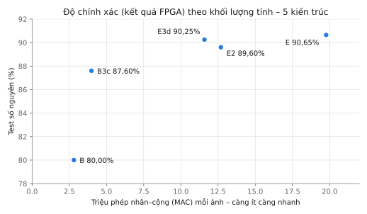

# Tài liệu học: 5 kiến trúc CNN của dự án LSI Design Contest 2027

Bộ tài liệu này phân tích **source code thật** trên nhánh `main` (thư mục `model/`) để giải thích từ đầu đến cuối: dữ liệu đi vào thế nào,
5 kiến trúc được thiết kế ra sao và vì sao, mỗi phép tính bên trong, quá trình huấn luyện, cách đánh giá, cách đưa mô hình xuống FPGA
bằng số nguyên, và vì sao 5 kiến trúc cho kết quả khác nhau.

- Viết cho sinh viên đang học CNN; thuật ngữ tiếng Anh để trong ngoặc.
- Không sửa file nào của dự án; mọi thứ nằm trong `documentation/`.
- Số liệu lấy từ code và kết quả nhóm đã chạy (`model/results.md`, `docs/so_sanh_5_mo_hinh.md`). Chỗ nào repo không có căn cứ thì ghi
  "chưa xác định được".

## Bắt đầu từ đâu?

| Bạn muốn… | Đọc |
|---|---|
| Hiểu toàn bộ trong **một file** | **[CNN_ARCHITECTURES_COMPLETE_GUIDE.md](CNN_ARCHITECTURES_COMPLETE_GUIDE.md)** |
| Học kỹ từng phần, từ cơ bản | đọc theo thứ tự 01 → 15 bên dưới |
| Chỉ cần chạy được dự án | [13_RUN_PIPELINE_STEP_BY_STEP.md](13_RUN_PIPELINE_STEP_BY_STEP.md) |
| Chọn mô hình cho cuộc thi | [12_ARCHITECTURE_COMPARISON.md](12_ARCHITECTURE_COMPARISON.md) |
| Có kế hoạch học + bài tập | [14_LEARNING_ROADMAP.md](14_LEARNING_ROADMAP.md) |

## Thứ tự đọc khuyến nghị

| # | File | Nội dung | Nên đọc khi |
|---|---|---|---|
| 0 | [CNN_ARCHITECTURES_COMPLETE_GUIDE.md](CNN_ARCHITECTURES_COMPLETE_GUIDE.md) | File chính: tổng hợp mọi phần, có bảng tham số/MAC từng tầng của 5 mô hình | đầu tiên, để có bức tranh tổng thể |
| 1 | [01_PROJECT_STRUCTURE.md](01_PROJECT_STRUCTURE.md) | Cây thư mục, vai trò từng file, bảng **công đoạn → file Python**, đồ thị import, quy ước tên lượt chạy | trước khi mở code |
| 2 | [02_DATA_PREPROCESSING.md](02_DATA_PREPROCESSING.md) | CIFAR-4, CINIC-10, tách val, chia 256, tăng cường, batch | |
| 3 | [03_CNN_FOUNDATIONS.md](03_CNN_FOUNDATIONS.md) | 30 khái niệm CNN; mỗi khái niệm có bản chất, lý do, công thức, ví dụ thay số, vị trí trong code | nếu chưa vững lý thuyết |
| 4 | [04_ARCHITECTURE_1_B.md](04_ARCHITECTURE_1_B.md) | Kiến trúc 1 – **B** (cơ bản, 80,00%) | đọc 04 thật kỹ; 05–08 cùng khung nên đọc nhanh hơn |
| 5 | [05_ARCHITECTURE_2_B3c.md](05_ARCHITECTURE_2_B3c.md) | Kiến trúc 2 – **B3c** (nhanh, 87,60%) | |
| 5b | [**05_ARCHITECTURE_2_B3c_v2.md**](05_ARCHITECTURE_2_B3c_v2.md) | **★ B3c (mô hình đi thi) từ A đến Z**: hình thành kiến trúc, huấn luyện, lượng tử hoá từng tầng, tính tay một ảnh thật qua cả mạng – mọi số có công thức → thay số → nguồn | đọc file này để hiểu sâu mô hình đi thi |
| 6 | [06_ARCHITECTURE_3_E.md](06_ARCHITECTURE_3_E.md) | Kiến trúc 3 – **E** (chính xác cao, mạng thầy, 90,65%) | |
| 7 | [07_ARCHITECTURE_4_E2.md](07_ARCHITECTURE_4_E2.md) | Kiến trúc 4 – **E2** (cân bằng, 89,60%) | |
| 8 | [08_ARCHITECTURE_5_E3d.md](08_ARCHITECTURE_5_E3d.md) | Kiến trúc 5 – **E3d** (5 conv, 90,25%) | |
| 9 | [09_TRAINING_PROCESS.md](09_TRAINING_PROCESS.md) | 2 công thức huấn luyện, huấn luyện 2 lượt, mạng thầy, `train_one` từng dòng | |
| 10 | [10_QUANTIZATION_AND_HARDWARE.md](10_QUANTIZATION_AND_HARDWARE.md) | Gộp BN, fixed-point, int8/int16, golden model, xuất `.mem`, ước lượng BRAM/tốc độ | phần riêng của dự án FPGA |
| 11 | [11_EVALUATION_AND_RESULTS.md](11_EVALUATION_AND_RESULTS.md) | Các chỉ số đánh giá, kết quả, Precision/Recall/F1 tính thêm, độ tin cậy, file kết quả | |
| 12 | [12_ARCHITECTURE_COMPARISON.md](12_ARCHITECTURE_COMPARISON.md) | Bảng so sánh 5 kiến trúc + trả lời 8 câu hỏi | |
| 13 | [13_RUN_PIPELINE_STEP_BY_STEP.md](13_RUN_PIPELINE_STEP_BY_STEP.md) | Chạy dự án từ đầu, 11 bước, lệnh thật | khi bắt tay chạy |
| 14 | [14_LEARNING_ROADMAP.md](14_LEARNING_ROADMAP.md) | Lộ trình 7 chặng, bài tập có đáp án, tự dựng lại 5 kiến trúc | song song với các file trên |
| 15 | [15_CODE_REVIEW_NOTES.md](15_CODE_REVIEW_NOTES.md) | Điểm bất thường, lỗi tiềm ẩn, giới hạn của thí nghiệm | trước khi viết báo cáo |

Mỗi file có thanh điều hướng `← trước · Mục lục · sau →` ở đầu và cuối.

## Năm kiến trúc trong một bảng

| # | Mã | Lượt chạy cuối | Cấu hình conv (`P` = có MaxPool sau) | Tham số | MAC/ảnh | Test số nguyên |
|---|---|---|---|---|---|---|
| 1 | B | `B_16_32_64` | 16P · 32P · 64P | 27.684 | 2,81 triệu | 80,00% |
| 2 | B3c | `B3c_c4x4_128+cinic_ft` | 16P · 32P · 64P · 128 | 105.636 | 3,99 triệu | 87,60% |
| 3 | E | `E_opt_cnn+cinic_ft` | 32P · 64 · 64P · 128P | 138.372 | 19,77 triệu | 90,65% |
| 4 | E2 | `E2_lite+cinic60_kdft` | 32P · 64P · 64 · 128P | 138.372 | 12,69 triệu | 89,60% |
| 5 | E3d | `E3d_deep5+cinic60_kdft` | 24P · 48P · 64 · 64 · 112P | 147.524 | 11,58 triệu | 90,25% |



## Sơ đồ và hình

| Thư mục | Nội dung |
|---|---|
| `assets/architecture_diagrams/` | Sơ đồ từng kiến trúc: `arch1_B.svg` … `arch5_E3d.svg` (tầng, kích thước tensor, tham số, MAC) |
| `assets/pipeline_diagrams/` | `pipeline_overview.svg` (toàn dự án), `training_loop.svg`, `quantization_flow.svg`, `run_order.svg` |
| `assets/other_visualizations/` | `acc_vs_mac.svg`, `params_mac_per_layer.svg`, `per_class_accuracy.svg`, `params_and_training_time.svg`, `lr_schedules.svg` |
| `assets/project_figures/` | Bản sao hình do chính dự án sinh (`model/figures/`): đường học, ma trận nhầm lẫn, ảnh đoán sai, ảnh mẫu, hình so sánh |

## Công cụ đi kèm

Chạy từ thư mục gốc repo, venv đang bật.

```bash
python documentation/tools/verify_numbers.py
```
Lệnh trên kiểm tra lại tham số, MAC và kích thước tensor của 5 mô hình bằng code dự án, chạy trong vài giây. Thêm `--golden` để chạy luôn
golden model số nguyên trên 4.000 ảnh test (khoảng 2–3 phút, cần `data/cifar4.npz`). Kết quả lần chạy gần nhất: **TẤT CẢ KHỚP**.

```bash
python documentation/tools/make_figures.py
```
Lệnh trên vẽ lại mọi sơ đồ SVG từ code, từ `qparams.json` và từ `docs/so_sanh_5_mo_hinh.md`, rồi chép hình của dự án vào
`assets/project_figures/`.

```bash
python documentation/tools/check_cinic_leak.py
```
Lệnh trên đo ảnh gần trùng giữa 84.000 ảnh CINIC và 4.000 ảnh test, rồi tính accuracy của 5 mô hình trên phần test "sạch" (khoảng 3 phút,
cần `data/*.npz`). Kết quả lần chạy 26/11: khoảng 5–8% ảnh test có bản gần trùng, nhưng không làm phồng kết quả (chi tiết ở
[15_CODE_REVIEW_NOTES.md](15_CODE_REVIEW_NOTES.md) mục B5).

Hai script mới trong `model/` (thêm 26/11, hướng dẫn ở `docs/KIEM_CHUNG.md` Bước 4–5): `python model/anh_that.py` (đo 5 mô hình trên ảnh
thật) và `python model/nhieu_seed.py <mã>` (chạy thêm seed).

## Quy ước trong tài liệu

- Số viết theo kiểu Việt Nam: `138.372` (dấu chấm ngăn nghìn), `90,65%` (dấu phẩy thập phân). Trong code và lệnh thì giữ nguyên kiểu
  Python (`0.005`).
- `model/train.py` dòng 148 hoặc `train.py:148`: vị trí trong source tại thời điểm viết tài liệu (nhánh `main`, 26/11/2026). Nếu code đổi,
  số dòng có thể lệch.
- **[Lý thuyết]**: kiến thức chung về CNN. **[Dự án]**: cách code này thực sự làm.
- "Test số nguyên" = accuracy của `golden_int.py`, tức đúng kết quả mạch FPGA sẽ cho ra. "Test float" = accuracy của mô hình PyTorch.
- Mọi accuracy đo trên 4.000 ảnh test CIFAR-4. Mỗi mô hình mới chạy 1 lần, nên chênh nhau dưới ~1 điểm chưa đủ để kết luận.
